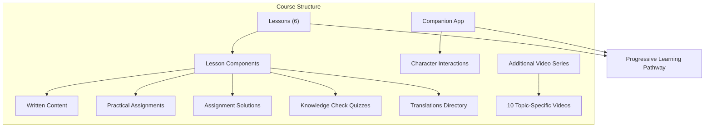
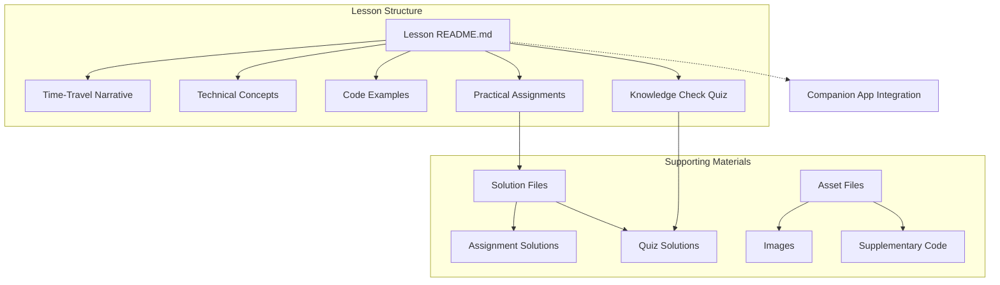
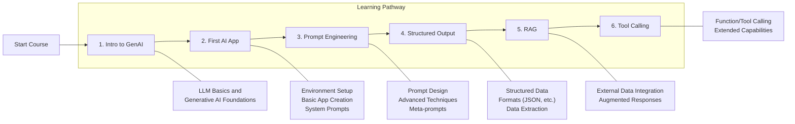
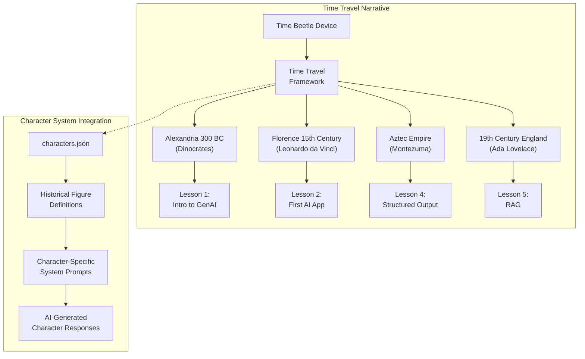
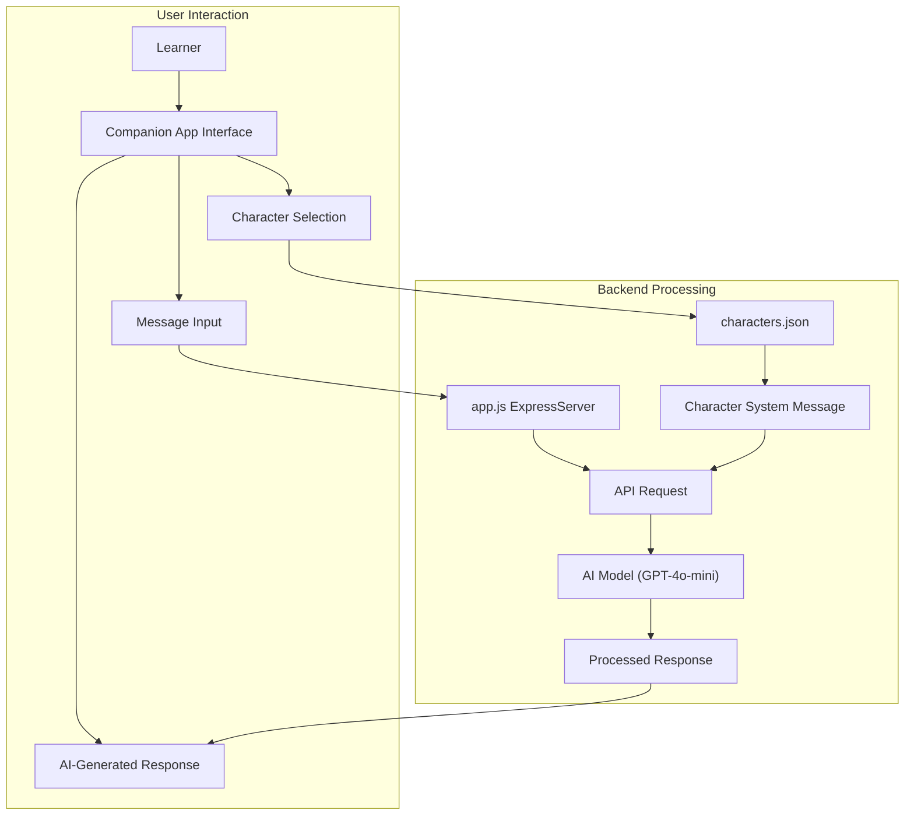
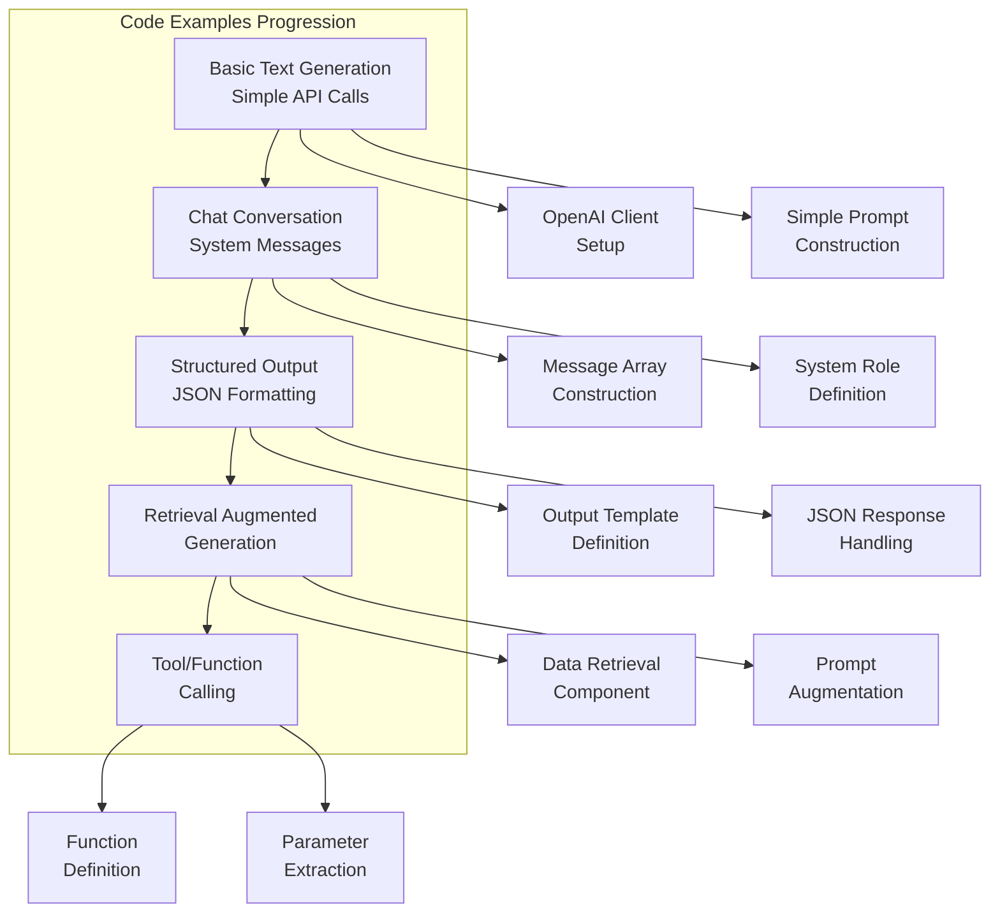
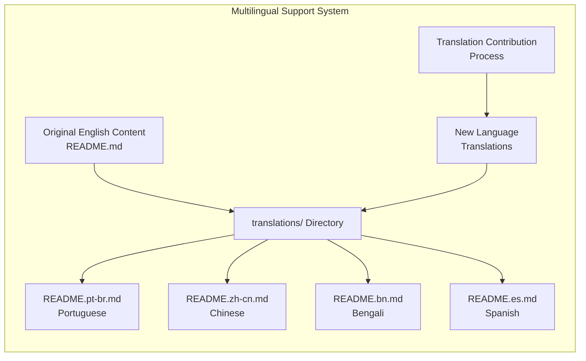
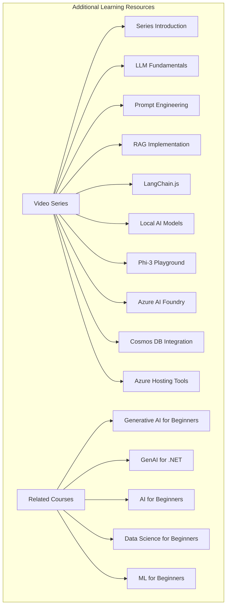

<!-- source: DeepWiki mcp.deepwiki.com · repo microsoft/generative-ai-with-javascript · page 2 Course Structure · fetched 2026-10-26 -->

# Course Structure

Relevant source files

The following files were used as context for generating this wiki page:

- [README.md](README.md)
- [app/README.md](app/README.md)
- [lessons/01-intro-to-genai/README.md](lessons/01-intro-to-genai/README.md)
- [lessons/02-first-ai-app/README.md](lessons/02-first-ai-app/README.md)
- [lessons/04-structured-output/README.md](lessons/04-structured-output/README.md)
- [lessons/05-rag/README.md](lessons/05-rag/README.md)

This page provides a comprehensive overview of how the Generative AI with JavaScript course is organized, the progression of lessons, and the learning objectives. It details the structure of course materials, learning paths, and how different components contribute to the overall learning experience. For information about the companion application that demonstrates these concepts, see [Companion App](#3).

## Overview of Course Organization

The Generative AI with JavaScript course is structured as a series of progressive lessons, each building on concepts from previous lessons. The curriculum follows a time-traveling narrative that combines technical learning with an engaging storyline, allowing learners to interact with historical figures while building practical AI skills.

Sources: [README.md:82-93](), [README.md:74-81]()

## Lesson Content Structure

Each lesson in the course follows a consistent structure, combining narrative elements with technical content, practical exercises, and knowledge verification. This structure ensures that learners can build skills methodically while remaining engaged through the storyline.

### Standard Lesson Components

Each lesson is organized with the following components:

| Component | Purpose | Location |
|-----------|---------|----------|
| Written Lesson | Primary instructional content with narrative | `/lessons/[lesson-number]/README.md` |
| Assignments | Practical exercises to apply concepts | Within lesson README.md |
| Solutions | Complete solutions to assignments | `/lessons/[lesson-number]/solution/` |
| Knowledge Checks | Quiz questions to verify understanding | End of lesson README.md |
| Quiz Solutions | Answers to knowledge check questions | `/lessons/[lesson-number]/solution/solution-quiz.md` |
| Character Integration | Interactive demonstrations through the companion app | Referenced in lesson content |
| Translations | Multilingual versions of content | `/lessons/[lesson-number]/translations/` |

Sources: [lessons/01-intro-to-genai/README.md:1-27](), [lessons/02-first-ai-app/README.md:1-27](), [README.md:74-81]()

## Curriculum Progression

The course curriculum follows a logical progression, starting with foundational concepts and gradually advancing to more complex applications of Generative AI with JavaScript.

### Lesson Sequence and Learning Objectives

Sources: [README.md:84-93]()

Here's a detailed breakdown of each lesson's focus and learning objectives:

| Lesson | Title | Core Learning Objectives | Key Technical Components |
|--------|-------|--------------------------|--------------------------|
| 1 | Introduction to Generative AI and LLMs | Understand GenAI fundamentals, applications and limitations | Generative AI concepts, LLM basics, JavaScript integration |
| 2 | First AI App | Set up development environment, create basic app, understand system prompts | Environment setup, API integration, system messages |
| 3 | Prompt Engineering | Learn techniques to craft effective prompts, understand meta-prompts | Advanced prompting, techniques to control AI outputs |
| 4 | Structured Output | Generate formatted output, extract data from prompts | JSON/XML formatting, data extraction, structured responses |
| 5 | RAG (Retrieval Augmented Generation) | Integrate external data sources, improve relevance and accuracy | Data retrieval, context augmentation, source integration |
| 6 | Tool Calling/Function Calling | Extend LLM capabilities with custom functions | Function integration, tool calling patterns, capability extension |

Sources: [lessons/01-intro-to-genai/README.md:1-7](), [lessons/02-first-ai-app/README.md:1-7](), [lessons/04-structured-output/README.md:1-7](), [lessons/05-rag/README.md:1-7](), [README.md:84-93]()

## Narrative Framework

A unique aspect of this course is its immersive narrative framework, which uses a time-traveling storyline to engage learners. This framework integrates technical learning with interactions with historical figures, providing context and engagement.

Sources: [lessons/01-intro-to-genai/README.md:29-159](), [lessons/02-first-ai-app/README.md:23-117](), [lessons/04-structured-output/README.md:25-122](), [lessons/05-rag/README.md:23-79](), [app/README.md:1-29]()

The narrative follows a mechanic from 1860s London who travels through time using a device called the "Time Beetle." This journey connects with each lesson's technical content, providing a cohesive learning experience. The companion app allows learners to interact with these historical characters, reinforcing concepts through practical application.

## Companion App Integration

The course includes a companion application that allows learners to interact with historical characters using the Generative AI technologies taught in the lessons. This integration provides a practical demonstration of the concepts and enhances the learning experience.

Sources: [app/README.md:1-29](), [lessons/01-intro-to-genai/README.md:160-235]()

The companion app utilizes a character system defined in `characters.json`, where each historical figure has a specific system message that shapes their responses. The app demonstrates practical implementation of the AI concepts taught in the lessons, providing an engaging way for learners to experiment with the technology.

## Code Examples and Assignments

Throughout the course, code examples and practical assignments reinforce learning objectives. These components progress in complexity, building upon previously learned concepts.

### Code Example Progression

Sources: [lessons/02-first-ai-app/README.md:180-360](), [lessons/04-structured-output/README.md:170-300](), [lessons/05-rag/README.md:205-285]()

### Assignment Structure

Each lesson includes practical assignments that challenge learners to apply the concepts they've learned. Assignments are designed to build upon previously learned skills while introducing new concepts.

| Lesson | Assignment Focus | Skills Applied | Integration with Narrative |
|--------|------------------|----------------|----------------------------|
| 1 | Using LLMs for research | Basic prompt construction | Helping Dinocrates build a lighthouse |
| 2 | Building an engineering assistant | System messages, response generation | Assisting Leonardo with aerial screw calculations |
| 4 | Creating encoded structured output | Output formatting, data transformation | Repairing Leonardo's aerial screw |
| 5 | Implementing RAG with Wikipedia | External data integration, context augmentation | Helping Ada Lovelace improve the Time Beetle |

Sources: [lessons/01-intro-to-genai/README.md:322-337](), [lessons/02-first-ai-app/README.md:446-486](), [lessons/04-structured-output/README.md:513-536](), [lessons/05-rag/README.md:305-329]()

## Multilingual Support

The course is designed with global accessibility in mind, featuring a translation system that provides content in multiple languages.

Sources: [README.md:33-35]()

Each lesson includes a `translations/` directory where multilingual versions of the content are stored. The current supported languages include Portuguese, Chinese, Bengali, and Spanish, with an open invitation for community contributions to expand language support.

## Additional Learning Resources

Beyond the core lessons, the course provides additional resources to support learners, including a complementary video series and links to related courses.

Sources: [README.md:97-140]()

These additional resources provide deeper dives into specific topics and alternative learning paths for different programming languages and platforms, ensuring learners can continue their AI education beyond the core curriculum.

## Summary

The Generative AI with JavaScript course is structured as a progressive learning journey that combines technical instruction with an engaging narrative framework. Through six comprehensive lessons, learners develop skills in creating and integrating Generative AI into JavaScript applications, with practical demonstrations through the companion app. The course structure supports various learning styles with written content, code examples, practical assignments, and interactive elements, all designed to build competence in Generative AI implementation.

---

