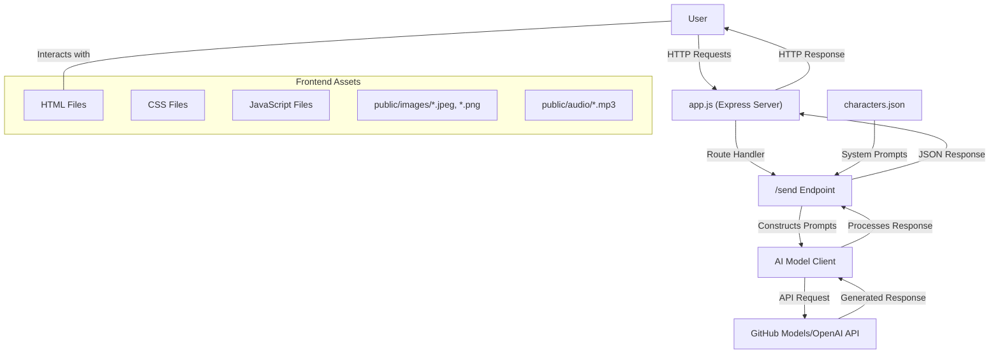
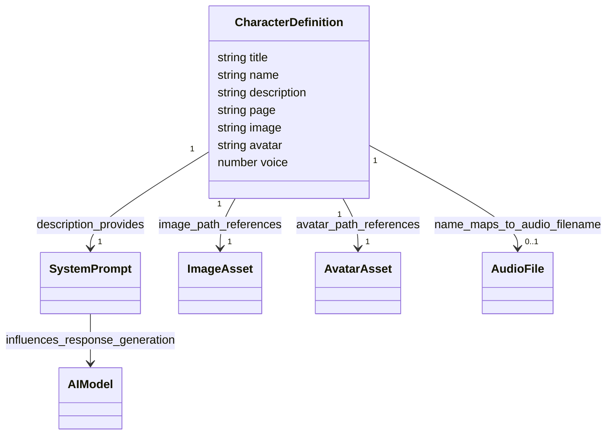
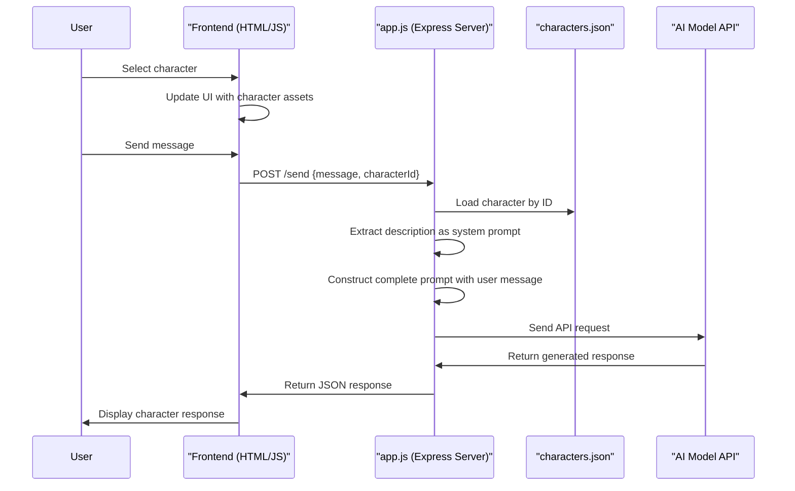
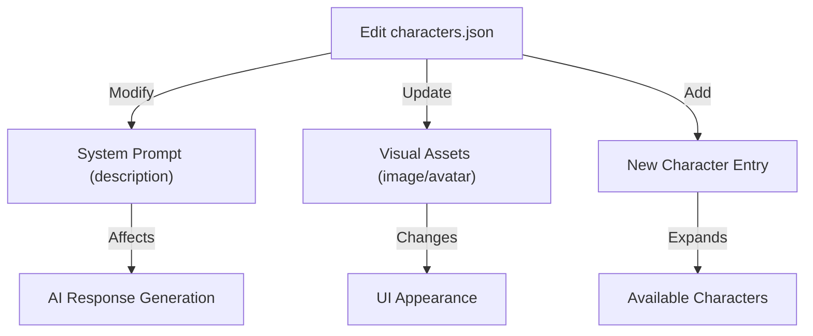
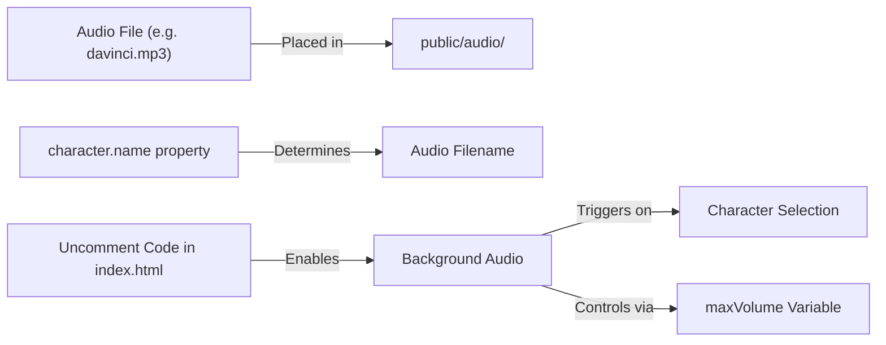

<!-- source: DeepWiki mcp.deepwiki.com · repo microsoft/generative-ai-with-javascript · page 3 Companion App · fetched 2026-10-26 -->

# Companion App

<details>
<summary>Relevant source files</summary>

The following files were used as context for generating this wiki page:

- [README.md](README.md)
- [app/README.md](app/README.md)
- [app/public/characters.json](app/public/characters.json)
- [app/public/images/amelia-avatar.jpeg](app/public/images/amelia-avatar.jpeg)
- [app/public/images/amelia-front.jpeg](app/public/images/amelia-front.jpeg)

</details>


The Companion App is a web-based application that demonstrates practical implementation of generative AI with JavaScript. It enables users to converse with AI-powered historical characters through a chat interface, serving as a hands-on demonstration of concepts taught in the Generative AI with JavaScript course. For details on setting up the development environment, see [Setup and Configuration](#7).

## Architecture Overview

The app uses a client-server architecture centered around an Express server that handles communication between users and AI models:



Sources: [app/README.md:1-65](), [README.md:46-50]()

## Character System

The foundation of the Companion App is its character system, defined in `characters.json`. This file contains an array of character definition objects that configure how each historical persona behaves:



Each character entry contains the following properties:

| Property | Type | Purpose | Example |
|----------|------|---------|---------|
| `title` | String | Display name | `"Leonardo Da Vinci"` |
| `name` | String | Internal identifier | `"davinci"` |
| `description` | String | System prompt | `"You are Leonardo da Vinci, a brilliant inventor..."` |
| `page` | String | HTML page reference | `"davinci.html"` |
| `image` | String | Full image path | `"davinci.png"` |
| `avatar` | String | Avatar image path | `"davinci-avatar.jpeg"` |
| `voice` | Number | Voice ID | `182` |

The `description` field serves as the system prompt that instructs the AI model how to respond as that character, forming the foundation of each character's personality and knowledge limitations.

Sources: [app/public/characters.json:1-56](), [app/README.md:22-24]()

## Request-Response Flow

When a user interacts with the Companion App, the following processing flow occurs:



This flow demonstrates how the app integrates user input with character configurations to generate contextually appropriate responses through AI models.

Sources: [app/README.md:14-20](), [README.md:46-50]()

## Included Characters

The application ships with six predefined historical characters:

| Character | Internal Name | System Prompt Focus |
|-----------|--------------|---------------------|
| Dinocrates | `dinocrates` | Architecture and engineering projects |
| Leonardo Da Vinci | `davinci` | Inventions and artistic works |
| Ludovico Sforza | `sforza` | Patronage of arts and sciences; expresses frustration at Da Vinci's unfinished mural |
| Montezuma | `montezuma` | Aztec leadership and culture |
| Ada Lovelace | `ada` | Mathematics and early computing concepts |
| Amelia Earhart | `ada` | Aviation pioneering and mechanics |

**Note:** The configuration uses the same internal name `ada` for both Ada Lovelace and Amelia Earhart, which could potentially cause selection issues.

Sources: [app/public/characters.json:1-56]()

## Character Customization

The app's flexibility comes from its easily customizable character system:



To modify a character's behavior:
1. Edit the `description` field in their entry in `characters.json`
2. The modified system prompt will change how the AI model responds
3. No server restart is required for changes to take effect

This design allows for quick iterations on character personalities and knowledge boundaries.

Sources: [app/README.md:22-24](), [app/public/characters.json:1-56]()

## Optional Audio Feature

The app includes a commented-out feature for background audio:



To enable background audio:
1. Download royalty-free music files
2. Name each file according to the character's `name` property (e.g., `davinci.mp3`)
3. Place files in the `/public/audio` folder
4. Uncomment the audio code marked by "TODO" in `index.html`

The app documentation suggests potential music choices for different characters from free resources like Pixabay.

Sources: [app/README.md:31-64]()

## Running the Application

The Companion App can be run through two methods:

### GitHub Codespaces
- Creates a preconfigured development environment in the browser
- Provides access to GitHub Models without additional API setup
- Command sequence:
  ```
  cd app
  npm install
  npm start
  ```
- Then click "Open in Browser" button

### Local Installation
1. Clone the repository
2. Navigate to `/app` directory
3. Run `npm install` to install dependencies
4. Run `npm start` to start the Express server
5. Open the provided URL (typically `http://localhost:3000`) in a browser

Sources: [app/README.md:3-8](), [README.md:59-71]()

## Responsible AI Implementation

The app implements responsible AI practices through:

1. Clear disclaimers that characters are fictional representations
2. Explicit statements that generated responses don't represent actual historical views
3. System prompts that limit character knowledge to their historical time period
4. Transparent labeling of content as being for entertainment purposes
5. Adherence to Microsoft's Responsible AI principles

These measures ensure ethical use of generative AI technology while maintaining an engaging user experience.

Sources: [README.md:143-147](), [app/README.md:27-30](), [app/public/characters.json:5-6, 14-15, 23-24, 32-33, 41-42, 50-51]()

This technical documentation provides an overview of the Companion App's architecture, functionality, and customization options. For information about prompt engineering techniques demonstrated in the app, see [Prompt Engineering Techniques](#5.1) and for details about the app's internal architecture, see [App Architecture](#3.1).

---

