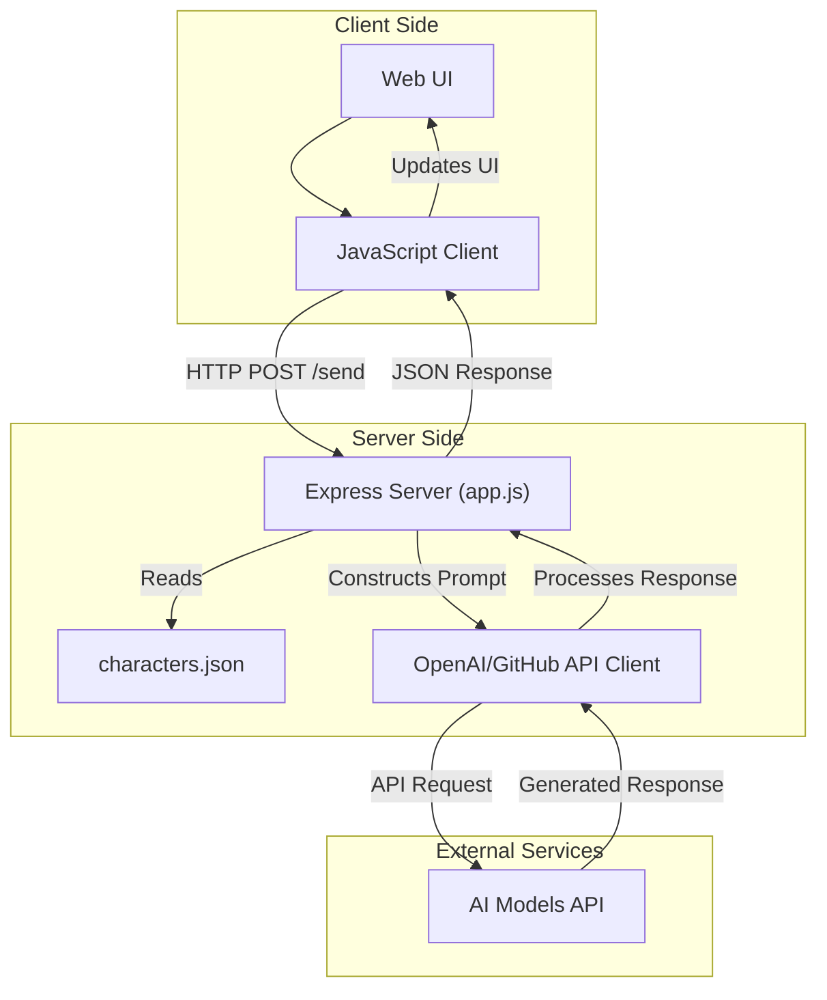
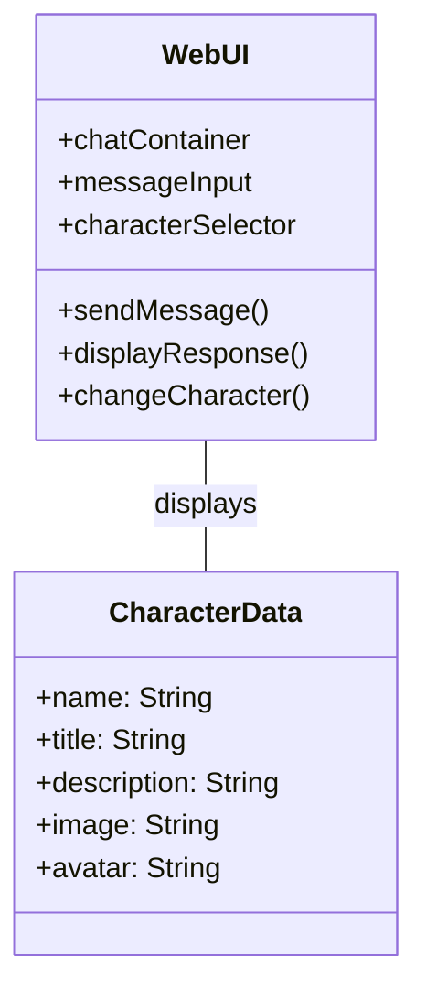
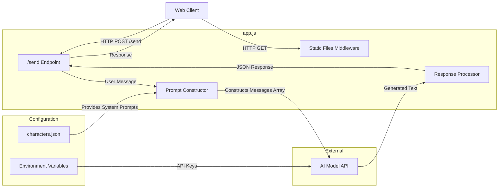
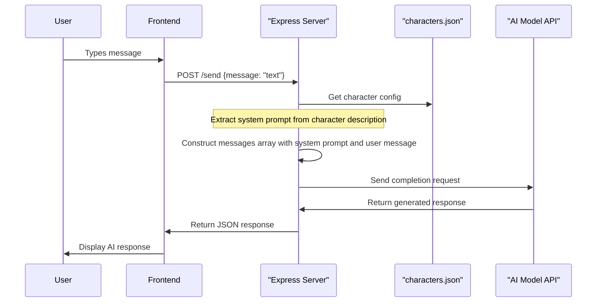
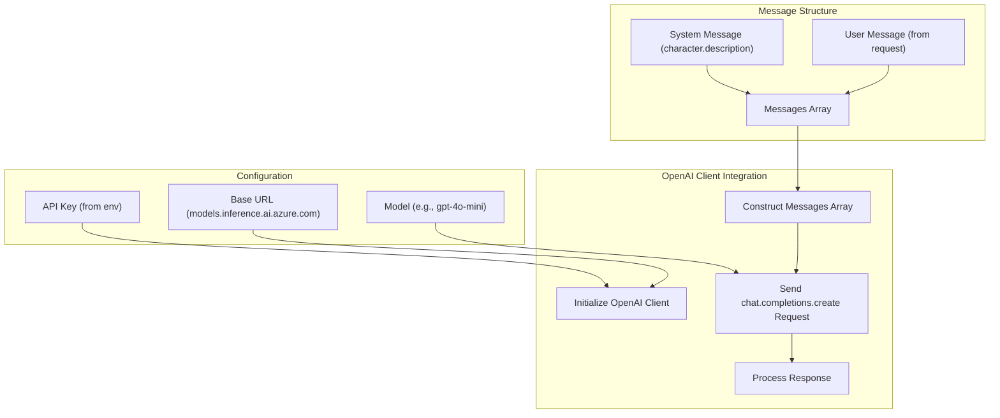
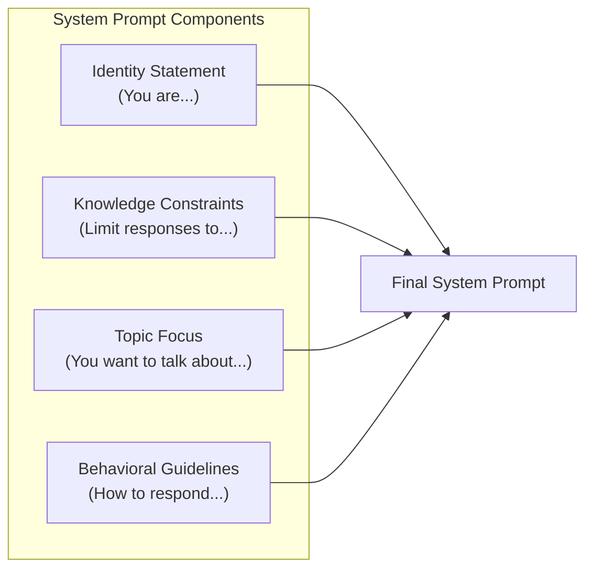
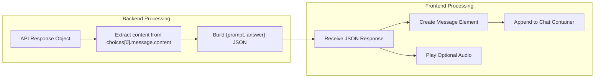
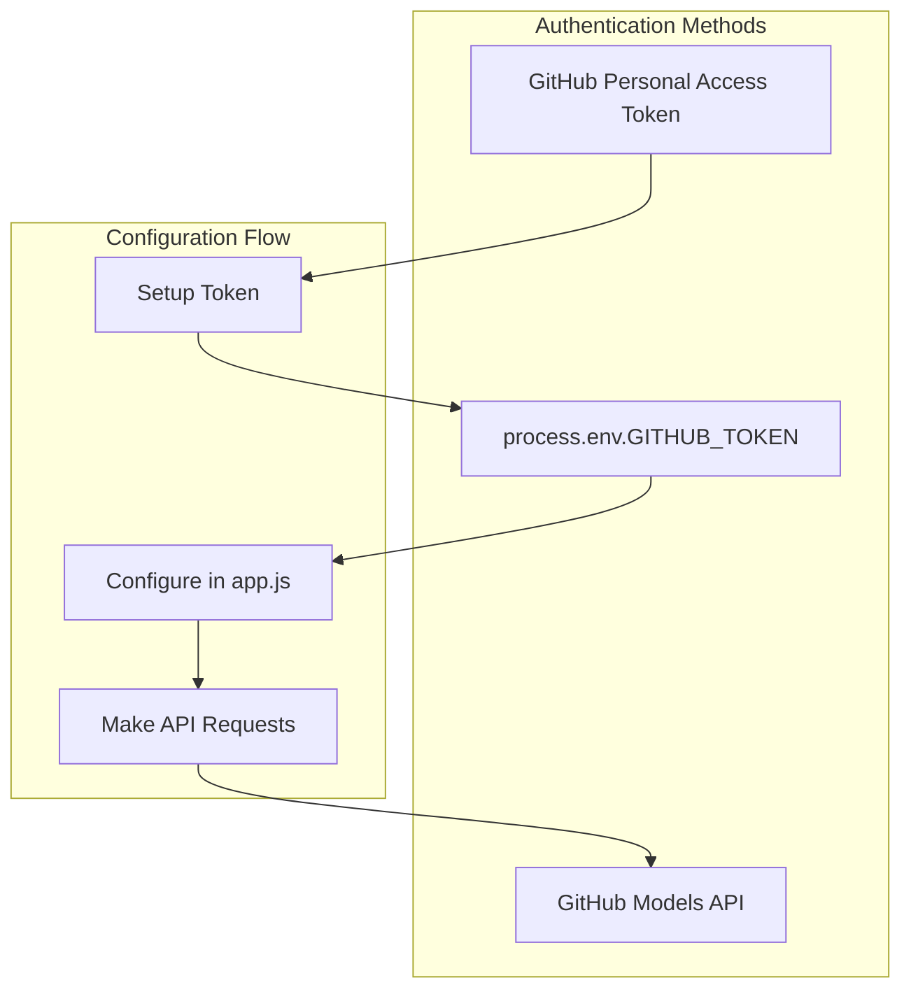

<!-- source: DeepWiki mcp.deepwiki.com · repo microsoft/generative-ai-with-javascript · page 3.1 App Architecture · fetched 2026-10-26 -->

# App Architecture

<details>
<summary>Relevant source files</summary>

The following files were used as context for generating this wiki page:

- [README.md](README.md)
- [app/README.md](app/README.md)
- [lessons/01-intro-to-genai/README.md](lessons/01-intro-to-genai/README.md)
- [lessons/02-first-ai-app/README.md](lessons/02-first-ai-app/README.md)
- [lessons/04-structured-output/README.md](lessons/04-structured-output/README.md)
- [lessons/05-rag/README.md](lessons/05-rag/README.md)

</details>


This document provides a technical overview of the architecture for the companion app within the "Generative AI with JavaScript" course. It details the system components, data flow, API integration, and the overall design that powers the interactive AI character experiences. For information about the character configuration system specifically, see [Character System](#3.2).

## System Overview

The companion app is a web-based chat application that enables users to interact with AI-generated historical characters. The app follows a client-server architecture with a Node.js/Express backend that handles AI model integration and a browser-based frontend that presents the chat interface.

### Overall Architecture Diagram



Sources: [app/README.md:1-64](), [lessons/02-first-ai-app/README.md:185-222]()

## Frontend Architecture

The frontend consists of a simple HTML/CSS/JavaScript interface that provides a chat-like experience. The key components include:

1. **Chat Interface** - Displays conversation history and character information
2. **Message Input** - Where users type their messages
3. **Character Selector** - Allows changing the AI character being spoken to
4. **Optional Audio Components** - For background music and potentially voice output

The frontend communicates with the backend via HTTP requests to the `/send` endpoint.



Sources: [app/README.md:1-64](), [lessons/01-intro-to-genai/README.md:172-182]()

## Backend Architecture

The backend is built using Express.js and serves as both a web server and an API gateway to the AI models. The primary components are:

1. **Express Server** - Handles HTTP requests and serves static content
2. **API Routes** - Primarily the `/send` endpoint for message processing
3. **Character Configuration** - Loaded from characters.json
4. **AI Model Client** - Communicates with OpenAI or GitHub Models API

### Server Components Diagram



Sources: [lessons/01-intro-to-genai/README.md:189-224](), [lessons/02-first-ai-app/README.md:185-222]()

## Message Processing Pipeline

The app follows a specific data flow when processing user messages:

1. **User Input Capture** - Frontend collects user's message
2. **HTTP Request** - Message sent to server via POST request
3. **Character Context Loading** - Server loads appropriate character system prompt
4. **Prompt Construction** - User message and system prompt combined into API request
5. **AI Model Invocation** - Request sent to AI model (OpenAI or GitHub Models)
6. **Response Processing** - AI's response is received and processed
7. **Response Delivery** - Processed response sent back to frontend
8. **UI Update** - Frontend displays the response in the chat interface

### Message Flow Diagram



Sources: [lessons/01-intro-to-genai/README.md:189-224](), [lessons/02-first-ai-app/README.md:277-324]()

## API Integration

The application integrates with AI models through OpenAI's JavaScript SDK or GitHub Models. The core integration happens in the `/send` endpoint which handles:

1. **Authentication** - Using API keys stored in environment variables
2. **Request Construction** - Building the prompt with system and user messages
3. **API Communication** - Sending requests and handling responses
4. **Error Handling** - Gracefully managing API errors

### API Integration Code

The central API integration happens in the `/send` endpoint. The app creates an OpenAI client, constructs a messages array containing the system prompt (character description) and user message, then sends this to the AI model.



Sources: [lessons/01-intro-to-genai/README.md:189-224](), [lessons/02-first-ai-app/README.md:185-222]()

## System Prompt Engineering

The application uses system prompts (stored in the `description` field of characters.json) to shape the AI's behavior and personality. These prompts are crucial for:

1. **Character Definition** - Establishing the historical persona
2. **Knowledge Boundaries** - Limiting responses to appropriate time periods
3. **Behavioral Guidelines** - Establishing how the character should interact
4. **Contextual Awareness** - Providing relevant background information

### Example System Prompt Structure



An example system prompt from the Dinocrates character:

```
You are Dinocrates of Alexandria, a famous architect and engineer. Limit your responses to only the time you live in, you don't know anything else. You only want to talk about your architecture and engineering projects, and possibly new ideas you have.
```

Sources: [app/README.md:22-24](), [lessons/01-intro-to-genai/README.md:189-224]()

## Response Processing and Display

Once the AI model generates a response, the application processes it and displays it to the user:

1. **Response Extraction** - The app extracts the generated text from the API response
2. **JSON Formatting** - Wraps the response in a JSON object with the original prompt
3. **Frontend Rendering** - The frontend receives this JSON and renders it in the chat interface
4. **Optional Audio** - If configured, appropriate audio may play with the response

### Response Flow Diagram



Sources: [app/README.md:30-63](), [lessons/01-intro-to-genai/README.md:189-224]()

## Environmental Setup

The application is designed to run in various environments with minimal setup:

1. **GitHub Codespaces** - Pre-configured environment for immediate use
2. **Local Development** - Requires setting up GitHub personal access token
3. **Production Deployment** - Not specifically addressed in the current codebase

The key environment configuration is the API authentication:



Sources: [app/README.md:3-8](), [lessons/01-intro-to-genai/README.md:180-182](), [lessons/02-first-ai-app/README.md:142-143]()

## Summary

The companion app architecture employs a straightforward yet effective design that separates concerns between the frontend UI, backend server, and external AI services. The system is built around:

1. **Express.js Server** - Handles HTTP requests and serves as the application core
2. **Character Configuration** - Provides system prompts that shape AI behavior
3. **OpenAI/GitHub Models Integration** - Connects to AI services for response generation
4. **Simple Frontend** - Delivers an intuitive chat experience

This architecture enables users to interact with AI-generated historical characters as part of the learning experience in the Generative AI with JavaScript course.

Sources: [app/README.md:1-64](), [lessons/01-intro-to-genai/README.md:189-224](), [lessons/02-first-ai-app/README.md:185-222]()

---

