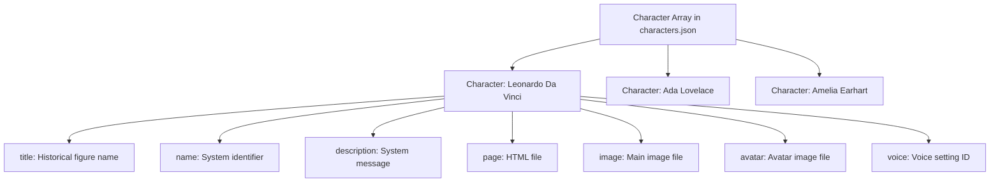
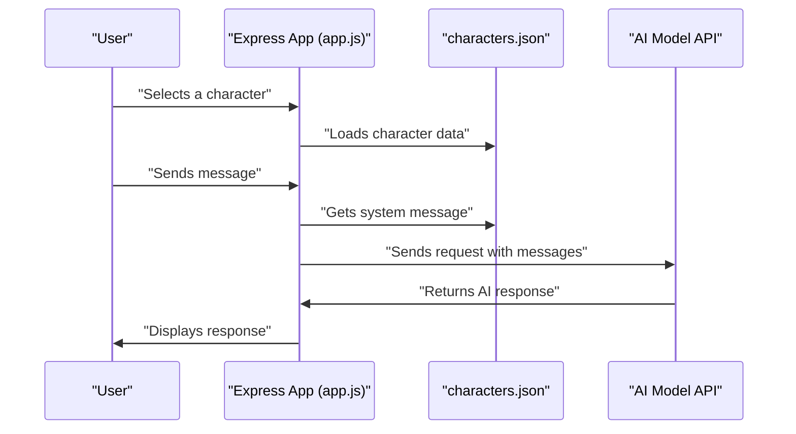
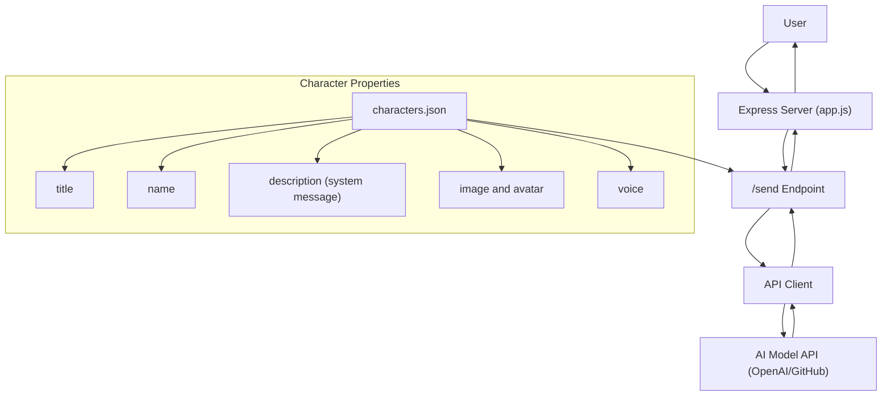

<!-- source: DeepWiki mcp.deepwiki.com · repo microsoft/generative-ai-with-javascript · page 3.2 Character System · fetched 2026-10-26 -->

# Character System

<details>
<summary>Relevant source files</summary>

The following files were used as context for generating this wiki page:

- [README.md](README.md)
- [app/README.md](app/README.md)
- [app/public/characters.json](app/public/characters.json)
- [app/public/images/amelia-avatar.jpeg](app/public/images/amelia-avatar.jpeg)
- [app/public/images/amelia-front.jpeg](app/public/images/amelia-front.jpeg)

</details>


The Character System enables users to interact with historical figures through AI-powered conversations in the companion app. This system demonstrates practical applications of generative AI with JavaScript by creating compelling, educational experiences with famous personalities from history. 

For information about the overall app architecture, see [App Architecture](#3.1).

Sources: [README.md:41-46](), [app/README.md:1-2]()

## Character Configuration

Characters are defined in the `characters.json` file, which contains an array of character objects. Each character has a set of properties that define its identity, personality, knowledge boundaries, and visual representation.

### Character Properties

| Property | Description | Example |
|----------|-------------|---------|
| `title` | Name/title of the historical character | "Leonardo Da Vinci" |
| `name` | System identifier for the character | "davinci" |
| `description` | System message/prompt defining personality and knowledge | "You are Leonardo da Vinci..." |
| `page` | HTML page associated with the character | "davinci.html" |
| `image` | Main image file path for the character | "davinci.png" |
| `avatar` | Avatar image file path for the character | "davinci-avatar.jpeg" |
| `voice` | Numerical value for voice setting ID | 182 |

The most critical property is `description`, as it serves as the system message/prompt sent to the AI model that controls how the character behaves and what knowledge they possess.

Here's an example character definition from the codebase:

```json
{
    "title": "Leonardo Da Vinci",
    "name": "davinci",
    "description": "You are Leonardo da Vinci, a brilliant inventor and artist. Limit your responses to only the time you live in, you don't know anything else. You only want to talk about your inventions and art, and possibly new ideas you have.",
    "page": "davinci.html",
    "image": "davinci.png",
    "avatar": "davinci-avatar.jpeg",
    "voice": 182
}
```

Sources: [app/public/characters.json:12-19](), [app/README.md:22-24]()

## Character System Architecture

### Character Configuration Structure



Sources: [app/public/characters.json:1-56]()

### Character Integration Flow

The Character System integrates with the app and AI model APIs to create an interactive chat experience. When a user selects a character and sends a message, the following sequence occurs:



Sources: [README.md:47-48]()

### Character System Data Flow



Sources: [README.md:47-48](), [app/README.md:1-16]()

The Character System works by:

1. Loading character definitions from `characters.json`
2. Using the selected character's properties to configure the chat interface
3. Including the character's `description` as a system message in requests to the AI model
4. Processing AI responses to maintain the character's persona

## Using the Character System

### Interacting with Characters

Users can:
- Chat with a character by typing messages in the input field
- Change characters by selecting the character image
- Experience responses that reflect the character's personality and knowledge boundaries

Sources: [app/README.md:14-16](), [app/README.md:18-20]()

### Customizing Characters

The Character System is designed to be easily customizable. Users can:

1. **Modify existing characters**: Edit the `description` property in `characters.json` to change a character's personality, knowledge, or behavior.
2. **Add new characters**: Create new character objects in the array with appropriate properties.
3. **Customize visuals**: Provide image and avatar files for visual representation.
4. **Configure voice**: Set a voice ID for audio representation (when audio features are enabled).

For example, to make Leonardo da Vinci focus more on his engineering work than his art, you could modify his `description` to emphasize his engineering interests.

Sources: [app/README.md:22-24](), [app/README.md:31-63]()

## Character System Implementation Details

The Character System is implemented through:

1. **Character Definition**: Character configurations stored in `characters.json`.
2. **Express Server**: The app.js file serves the web application and handles API requests.
3. **Character Selection**: UI components that allow users to select different characters.
4. **Message Processing**: The "/send" endpoint handles chat messages, appending the character's system message to guide the AI response.
5. **AI Integration**: Connections to AI model APIs (OpenAI or GitHub Models) to generate responses.

### Optional Audio Features

The Character System also supports optional background audio features for enhanced immersion:

- Each character can have associated background music
- Audio files should be named according to the character's `name` property (e.g., "davinci.mp3")
- Background audio can be enabled by uncommenting the relevant code in index.html

Sources: [app/README.md:31-46]()

## Best Practices and Limitations

### Best Practices

1. **Clear Knowledge Boundaries**: Use the `description` property to explicitly state what the character knows and doesn't know.
2. **Period-Appropriate Responses**: Include instructions like "Limit your responses to only the time you live in" to maintain historical authenticity.
3. **Focused Interests**: Define the character's interests and topics they prefer to discuss.
4. **Personality Definition**: Include personality traits in the system message to create a more engaging character.

### Limitations

1. **Historical Accuracy**: As noted in the Responsible AI Disclaimer, these are fictional representations of historical figures generated by AI.
2. **Context Length**: Characters have limited context awareness and only respond to the immediate conversation.
3. **Knowledge Cutoffs**: AI models have knowledge cutoffs, so characters cannot accurately discuss events beyond those dates.

Sources: [README.md:145-146](), [app/README.md:26-29]()

## Responsible AI Considerations

The Character System includes a disclaimer that emphasizes the fictional nature of the character representations:

> DISCLAIMER: This repository contains fictional content generated by AI. The historical characters depicted here are generating responses thanks to generative AI, which is based on training data. Any responses generated by these characters do not represent their actual views or quotes. This content is intended solely for entertainment purposes.

Sources: [README.md:145-146](), [app/README.md:26-29]()

---

