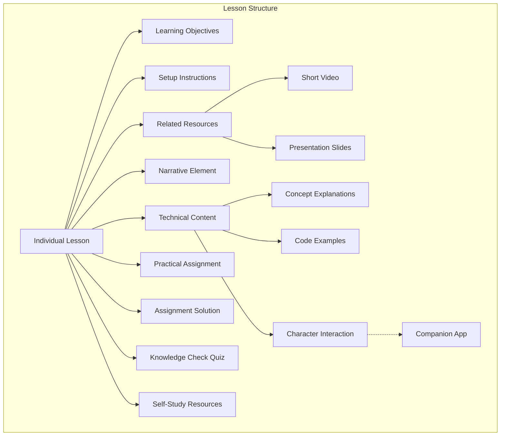
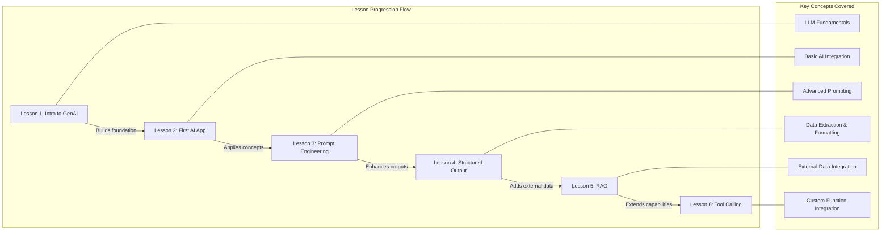
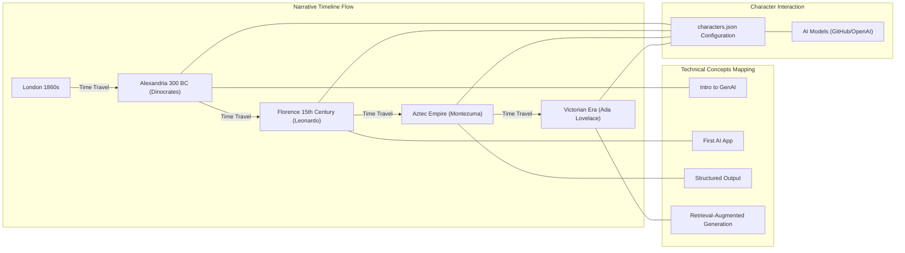
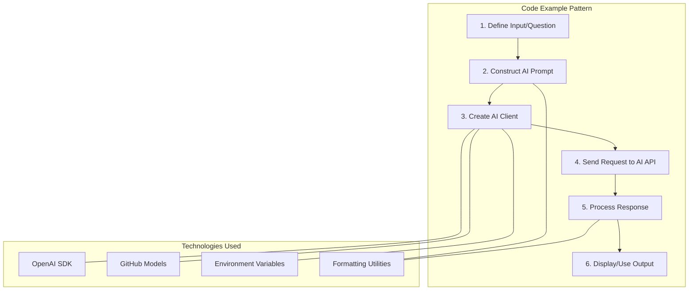
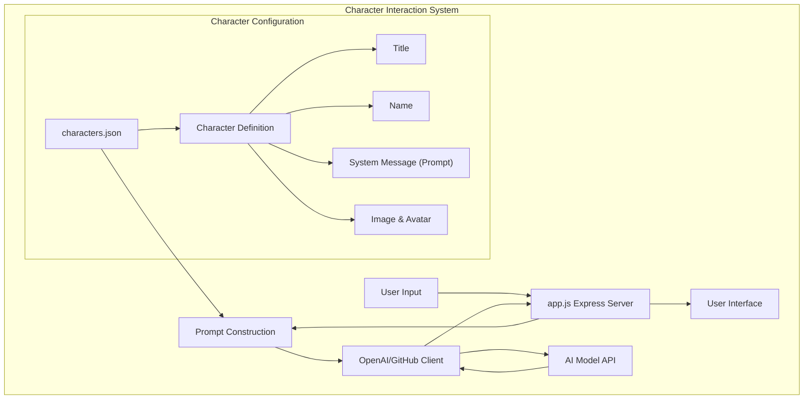

<!-- source: DeepWiki mcp.deepwiki.com · repo microsoft/generative-ai-with-javascript · page 4 Lessons · fetched 2026-10-26 -->

# Lessons

Relevant source files

The following files were used as context for generating this wiki page:

- [README.md](README.md)
- [app/README.md](app/README.md)
- [lessons/01-intro-to-genai/README.md](lessons/01-intro-to-genai/README.md)
- [lessons/02-first-ai-app/README.md](lessons/02-first-ai-app/README.md)
- [lessons/04-structured-output/README.md](lessons/04-structured-output/README.md)
- [lessons/05-rag/README.md](lessons/05-rag/README.md)

The Lessons section forms the core educational content of the "Generative AI with JavaScript" repository. This structured curriculum provides JavaScript developers with a progressive learning path for integrating Generative AI capabilities into their applications. The lessons guide learners from foundational concepts to advanced techniques through a combination of narrative storytelling, technical instruction, and practical assignments.

This page documents the overall structure, content, and implementation of the lessons system. For information about the companion app that demonstrates these concepts, see [Companion App](#3).

## Lesson Structure and Organization

Each lesson in the curriculum follows a consistent structure designed to facilitate learning through multiple modalities. Lessons build progressively on each other, introducing new concepts while reinforcing previous learning.

### Lesson Components

Sources: [README.md:75-80](), [lessons/01-intro-to-genai/README.md:1-14](), [lessons/02-first-ai-app/README.md:1-14](), [lessons/04-structured-output/README.md:1-14](), [lessons/05-rag/README.md:1-14]()

As shown in the diagram, each lesson contains multiple components that work together to create a comprehensive learning experience:

| Component | Description |
|-----------|-------------|
| Learning Objectives | Clear statements of what learners will achieve by completing the lesson |
| Setup Instructions | Guidance for preparing the development environment |
| Related Resources | Links to videos and presentation slides that supplement the written content |
| Narrative Element | A continuing storyline that contextualizes the technical concepts |
| Technical Content | Explanations, code examples, and demonstrations of key concepts |
| Practical Assignment | Hands-on task to apply the lesson concepts |
| Assignment Solution | Reference implementation for the assignment |
| Knowledge Check Quiz | Questions to test understanding of key concepts |
| Self-Study Resources | Additional learning materials for further exploration |

Sources: [README.md:75-80]()

### Learning Progression

The lessons follow a carefully designed progression that introduces increasingly complex concepts while building on previous knowledge.

Sources: [README.md:82-94]()

## Individual Lessons Overview

The curriculum consists of six lessons, each focusing on specific aspects of Generative AI development with JavaScript:

### Lesson 1: Introduction to Generative AI and LLMs

This foundational lesson introduces the basic concepts of Generative AI and Large Language Models (LLMs). It covers:

- Basic concepts of Generative AI and LLMs
- Applications and limitations in JavaScript development
- Enhancing user experiences with AI
- Introduction to the narrative framework (time-traveling adventure)

Sources: [lessons/01-intro-to-genai/README.md:1-9]()

### Lesson 2: First AI App

This lesson guides learners through building their first AI application, covering:

- Setting up the development environment
- Writing a basic app with JavaScript and AI integration
- Understanding system prompts and their importance
- Creating chat applications with conversation context

Sources: [lessons/02-first-ai-app/README.md:1-12](), [lessons/02-first-ai-app/README.md:144-166]()

### Lesson 3: Prompt Engineering

This lesson focuses on techniques to improve AI outputs through effective prompting:

- Prompt engineering fundamentals
- Advanced techniques for controlling AI responses
- Meta-prompts for precision and accuracy
- Implementation of prompting strategies in JavaScript applications

Sources: [README.md:90]()

### Lesson 4: Structured Output

This lesson teaches how to work with structured data outputs from AI models:

- Extracting specific information from AI responses
- Formatting output in various structured formats (JSON, tables, etc.)
- Data extraction patterns and techniques
- Implementing structured output in practical applications

Sources: [lessons/04-structured-output/README.md:1-9](), [lessons/04-structured-output/README.md:148-223]()

### Lesson 5: Retrieval-Augmented Generation (RAG)

This lesson introduces the concept of RAG for enhancing AI with external data:

- Fundamentals of Retrieval-Augmented Generation
- Integrating external data sources with AI models
- Implementing retrieval components in JavaScript
- Augmenting prompts with retrieved information

Sources: [lessons/05-rag/README.md:1-9](), [lessons/05-rag/README.md:104-141]()

### Lesson 6: Tool Calling/Function Calling

This advanced lesson covers extending AI capabilities through custom functions:

- Implementing tool/function calling with LLMs
- Creating custom tools for AI models to use
- Integrating external capabilities into AI workflows
- Building advanced AI applications with extended functionality

Sources: [README.md:93]()

## Narrative Framework

The lessons utilize a unique narrative framework that follows a time-traveling adventure, where learners interact with historical figures through different time periods. This storytelling approach serves to contextualize technical concepts and make the learning experience more engaging.

Sources: [lessons/01-intro-to-genai/README.md:29-158](), [lessons/02-first-ai-app/README.md:25-118](), [lessons/04-structured-output/README.md:25-123](), [lessons/05-rag/README.md:23-76]()

The narrative serves multiple purposes:
1. Contextualizes technical concepts within historical periods
2. Provides engaging scenarios for applying AI concepts
3. Demonstrates the companion app's character interaction capabilities
4. Creates memorable learning experiences through storytelling

Each historical period and character is associated with specific AI concepts that are explored in the corresponding lesson.

## Technical Implementation

### Code Examples and Assignments

Each lesson contains practical code examples that demonstrate key concepts, followed by assignments that allow learners to apply what they've learned. The code examples typically follow this pattern:

Sources: [lessons/02-first-ai-app/README.md:184-223](), [lessons/01-intro-to-genai/README.md:189-235](), [lessons/05-rag/README.md:206-286]()

Key implementation patterns include:

1. **API Integration**: Using the OpenAI SDK to communicate with AI models
2. **Prompt Construction**: Building effective prompts with appropriate context
3. **Response Handling**: Processing and extracting useful information from AI responses
4. **Error Handling**: Implementing proper error handling for API calls
5. **Configuration Management**: Using environment variables for API keys and other settings

Sources: [lessons/02-first-ai-app/README.md:184-223](), [lessons/01-intro-to-genai/README.md:189-235]()

### Character Interaction System

The companion app allows learners to interact with AI-powered historical characters, demonstrating the concepts taught in the lessons. The app uses a system of character definitions and AI integration to create interactive conversations.

Sources: [app/README.md:1-29](), [lessons/01-intro-to-genai/README.md:189-235]()

The character interaction system demonstrates several key concepts:

1. **Character Configuration**: Each historical character is defined in the `characters.json` file with a name, description (system message), and visual assets
2. **System Messages**: Special prompts that define a character's personality and knowledge
3. **API Integration**: Connection to AI models through GitHub Models or OpenAI
4. **Conversation Context**: Maintaining context between user messages for coherent interactions

This system serves as both a practical demonstration of the concepts and an engaging way for learners to interact with the course material.

Sources: [app/README.md:19-25](), [lessons/01-intro-to-genai/README.md:160-182]()

## Development Resources

Each lesson includes self-study resources and links to additional materials that help learners deepen their understanding of the concepts covered. These resources typically include:

- Documentation links
- GitHub repositories with sample code
- Video tutorials
- Additional reading materials
- Related workshops and courses

The lessons are designed to be modular and self-contained, but they also provide pathways to more advanced topics and practical applications.

Sources: [lessons/02-first-ai-app/README.md:505-512](), [lessons/05-rag/README.md:346-351]()

## Summary

The Lessons system provides a comprehensive, structured approach to learning Generative AI with JavaScript, combining narrative storytelling, technical instruction, and practical assignments. Through six progressive lessons, learners gain the knowledge and skills needed to integrate AI capabilities into their JavaScript applications, from basic concepts to advanced techniques like RAG and function calling.

The combination of written content, video resources, character interactions, and practical assignments creates a multi-modal learning experience that accommodates different learning styles and reinforces key concepts through repetition and application.

Sources: [README.md:82-94](), [README.md:75-80]()

---

