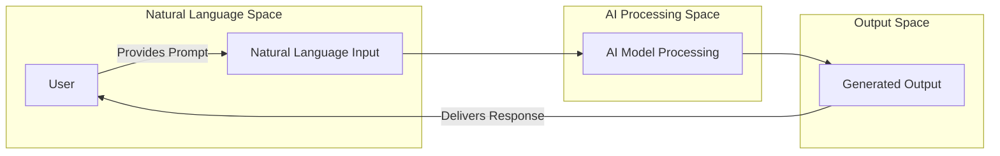
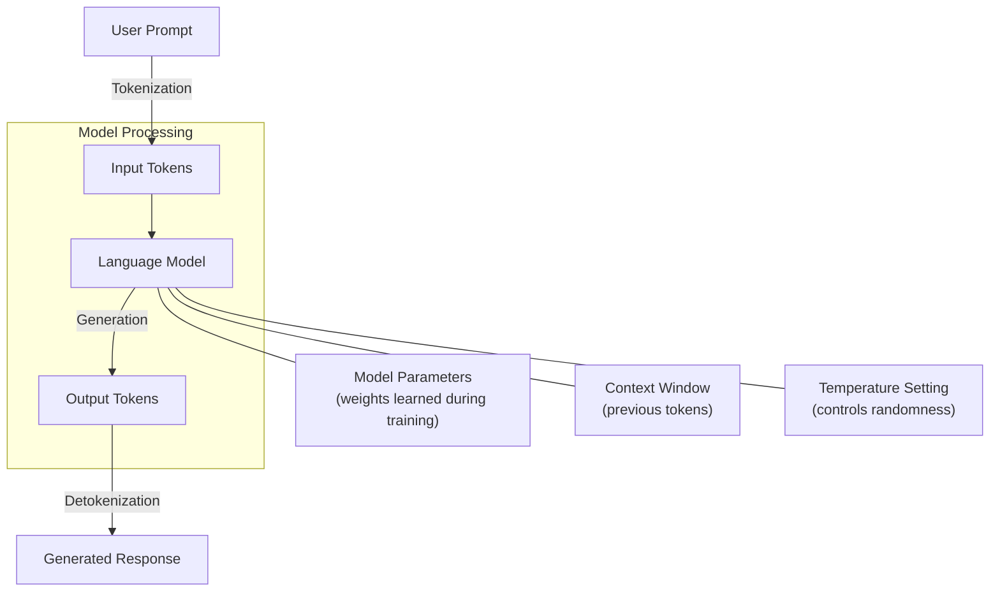
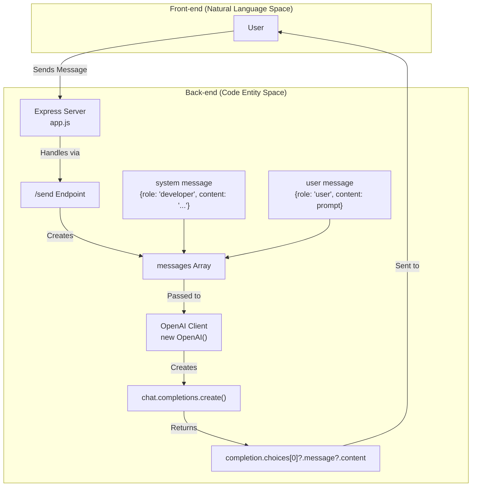
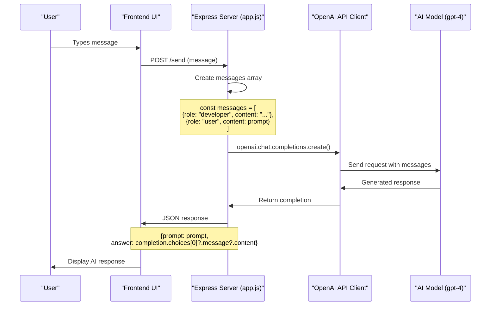
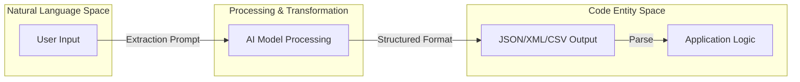
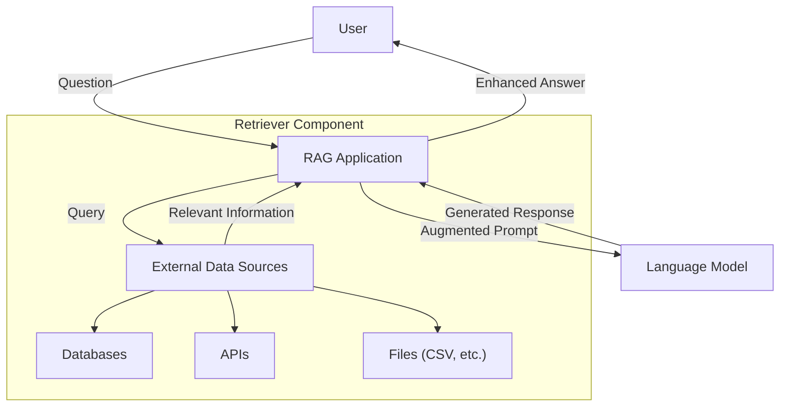

<!-- source: DeepWiki mcp.deepwiki.com · repo microsoft/generative-ai-with-javascript · page 4.1 Introduction to Generative AI · fetched 2026-10-26 -->

# Introduction to Generative AI

<details>
<summary>Relevant source files</summary>

The following files were used as context for generating this wiki page:

- [lessons/01-intro-to-genai/README.md](lessons/01-intro-to-genai/README.md)
- [lessons/01-intro-to-genai/translations/README.bn.md](lessons/01-intro-to-genai/translations/README.bn.md)
- [lessons/02-first-ai-app/README.md](lessons/02-first-ai-app/README.md)
- [lessons/02-first-ai-app/translations/README.bn.md](lessons/02-first-ai-app/translations/README.bn.md)
- [lessons/04-structured-output/README.md](lessons/04-structured-output/README.md)
- [lessons/04-structured-output/translations/README.bn.md](lessons/04-structured-output/translations/README.bn.md)
- [lessons/05-rag/README.md](lessons/05-rag/README.md)

</details>


This document provides an introduction to Generative AI concepts with a specific focus on JavaScript development. It covers fundamental AI concepts, how JavaScript developers can leverage AI models, and the basic architecture of AI-powered applications.

For information about building your first AI application, see [First AI App](#4.2). For details on prompt engineering techniques, see [Prompt Engineering Techniques](#5.1).

## What is Generative AI?

Generative AI refers to artificial intelligence systems that can generate new content, including text, images, code, and more, based on patterns learned from existing data. In the context of JavaScript development, generative AI primarily involves using Large Language Models (LLMs) to enhance applications with natural language processing capabilities.

These systems work by taking a prompt (input) from the user and generating a response based on patterns learned during training. The most common type of generative AI systems used in JavaScript applications are Large Language Models (LLMs).

Basic Generative AI Flow:



Sources: [lessons/01-intro-to-genai/README.md:21-27](), [lessons/02-first-ai-app/README.md:184-222]()

## Core Concepts of Large Language Models (LLMs)

Large Language Models are AI systems trained on vast amounts of text data that can generate human-like text based on a given input. These models learn patterns, relationships, and structures in language during training and can then generate new content that follows these patterns.

### How LLMs Work

LLMs process input text (prompts) and predict the most likely next words or phrases based on their training. They work with tokens (words or parts of words) and maintain a context window that determines how much previous text they consider when generating a response.

LLM Processing Flow:



Sources: [lessons/02-first-ai-app/README.md:360-401](), [lessons/02-first-ai-app/README.md:402-442]()

### Common Challenges with LLMs

LLMs face several challenges that developers should be aware of:

1. **Out-of-date information**: LLMs are trained on data up to a certain cutoff date and may not have knowledge of recent events.
2. **Inaccurate responses**: They may sometimes generate plausible-sounding but incorrect information.
3. **Context limitations**: They can only consider a limited amount of previous text (the context window).
4. **Understanding nuance**: They may struggle with understanding subtle context, sarcasm, or cultural references.

Sources: [lessons/05-rag/README.md:104-114]()

## Generative AI for JavaScript Developers

JavaScript's ecosystem offers several advantages for implementing generative AI solutions:

| Component | Description | Examples |
|-----------|-------------|----------|
| Core Language | JavaScript features that facilitate AI integration | Async/await, Promises, fetch API |
| Libraries | JavaScript libraries for AI model interaction | OpenAI SDK, TensorFlow.js, Hugging Face Transformers |
| Frameworks | Frameworks that facilitate building AI-powered apps | Node.js, Express, Next.js |
| Tools | Developer tools that support AI development | VS Code, ChatGPT plugins, GitHub Copilot |

Sources: [lessons/01-intro-to-genai/README.md:295-308]()

JavaScript AI Application Architecture:



Sources: [lessons/01-intro-to-genai/README.md:186-236](), [lessons/02-first-ai-app/README.md:210-222]()

## Building AI Applications with JavaScript

Building an AI application with JavaScript typically involves setting up a client to communicate with an AI model, formulating prompts, sending them to the model, and handling the responses.

### Basic Structure of an AI App

A simple AI application in JavaScript generally follows this pattern:

1. **Setup**: Initialize the AI client with necessary credentials
2. **Input**: Collect user input or generate a prompt
3. **Processing**: Send the prompt to the AI model
4. **Output**: Receive and process the model's response
5. **Presentation**: Display the results to the user

Here's a simplified example of a basic AI application structure:

```javascript
// 1. Initialize the AI client
const openai = new OpenAI({
  baseURL: "https://models.inference.ai.azure.com",
  apiKey: process.env.GITHUB_TOKEN,
});

// 2. Create a prompt
const prompt = "Translate 'Hello, how are you?' to Italian";

// 3. Send request to the model
const completion = await openai.chat.completions.create({
  model: 'gpt-4',
  messages: [{ role: 'user', content: prompt }],
});

// 4. Process and display the response
console.log(completion.choices[0]?.message?.content);
```

Sources: [lessons/02-first-ai-app/README.md:184-222]()

### Creating Effective Prompts

Prompts are the instructions or queries sent to the AI model. The quality of the prompt significantly affects the quality of the response. A good prompt should be:

- Clear and specific
- Properly structured
- Contextually relevant
- Appropriately detailed

### Understanding System Messages

System messages help set the behavior and personality of the AI model. They provide context and instructions that guide how the model responds to user inputs.

```javascript
const messages = [
  {
    "role": "developer",
    "content": "You are a travel assistant that helps users plan trips to Italy."
  },
  {
    "role": "user",
    "content": "I want to visit Rome next month. What should I see?"
  }
];
```

The system message (with "role": "developer") sets up the AI to respond as a travel assistant focused on Italy, which guides all its subsequent responses.

> Note: In some models, this role might be called "system" instead of "developer". "Developer" is the newer term, but the concept remains the same.

Sources: [lessons/02-first-ai-app/README.md:332-356]()

## Key Concepts for Working with LLMs

### Temperature and Creativity Control

Temperature is a parameter that controls the randomness of the AI's responses:

- **Low temperature (close to 0)**: More deterministic, focused responses
- **High temperature (close to 1)**: More random, creative, and diverse responses
- **Very high temperature (above 1)**: Potentially incoherent responses

```javascript
const completion = await openai.chat.completions.create({
  model: 'gpt-4',
  messages: messages,
  temperature: 0.7  // Balanced between deterministic and creative
});
```

### Context Windows and Tokens

A context window represents the number of tokens (words or parts of words) that the AI model can consider when generating a response:

- **Tokens**: Units of text processing (roughly 4 characters per token in English)
- **Context window**: The maximum combined length of input and output tokens
- **Maximum output tokens**: The limit on how long the generated response can be

Different models have different limits. For example, GPT-4o (as of August 2024) has:
- Maximum context window size: 128k tokens
- Maximum output tokens: ~16k tokens

```javascript
const completion = await openai.chat.completions.create({
  model: 'gpt-4',
  messages: messages,
  max_tokens: 100  // Limits the response length
});
```

Sources: [lessons/02-first-ai-app/README.md:358-442]()

Conversation Flow in Chat-based AI Applications:



Sources: [lessons/01-intro-to-genai/README.md:186-236](), [lessons/02-first-ai-app/README.md:270-327]()

## Advanced Techniques

### Structured Output

Structured output involves generating responses in specific formats like JSON, XML, or CSV to make them easier to parse and use programmatically. This is useful when building applications that need to extract specific data from AI responses.

Structured Output Processing Flow:



Sources: [lessons/04-structured-output/README.md:154-228](), [lessons/04-structured-output/README.md:310-394]()

Example of requesting structured JSON output:

```javascript
// Prompt requesting JSON format
const prompt = `Extract the following information from the user's input:
location, when, budget, currency. Respond with the extracted data in JSON format.

User input: I want to go to Greece in June, my budget is 800 euro.`;

// Result would be a JSON structure:
// {
//   "location": "Greece",
//   "when": "June",
//   "budget": 800,
//   "currency": "euro"
// }
```

Sources: [lessons/04-structured-output/README.md:402-440]()

### Retrieval-Augmented Generation (RAG)

Retrieval-Augmented Generation (RAG) is a technique that enhances AI responses by incorporating information from external data sources. It combines the strengths of retrieval-based methods and generative models to produce more accurate and relevant responses.

Retrieval-Augmented Generation Flow:



Sources: [lessons/05-rag/README.md:124-142]()

Example of a simple RAG implementation:

```javascript
// 1. User question
const question = `what's the fastest Prius model?`;

// 2. Retriever component: search data for relevant information
const rows = fs.readFileSync("./hybrid.csv", "utf8").split("\n");
const columns = rows[0].split(",");
const matches = rows.slice(1).filter((row) => 
  question.toLowerCase().includes(row.toLowerCase()));

// 3. Format retrieved data (as a markdown table)
const table = 
  `| ${columns.join(" | ")} |\n` +
  `|${columns.map(() => "---").join(" | ")}|\n` +
  matches.map((row) => `| ${row.replaceAll(",", " | ")} |\n`).join("");

// 4. Create augmented prompt with the retrieved information
const augmentedPrompt = `
## Instructions
Answer questions using only the sources below.
If there's not enough data in provided sources, say that you don't know.
Be brief and straight to the point.

## Sources
${table}

## Question
${question}
`;

// 5. Send to language model
const completion = await openai.chat.completions.create({
  model: "gpt-4o-mini",
  messages: [{ role: "user", content: augmentedPrompt }],
});

// 6. Return enhanced response
console.log(completion.choices[0]?.message?.content);
```

Sources: [lessons/05-rag/README.md:204-285]()

## Practical Applications of Generative AI in JavaScript

Generative AI can enhance JavaScript applications in numerous ways:

| Application Type | Description | Example Use Case |
|------------------|-------------|------------------|
| Chatbots | Interactive conversational interfaces | Customer support, information retrieval |
| Content Generation | Automatic content creation | Blog posts, product descriptions, social media content |
| Assistants & Agents | Advanced tools that perform tasks | Scheduling assistants, research agents |
| Code Completion | Generating code snippets | Developer productivity tools |
| Translation | Converting text between languages | Multilingual applications |

Sources: [lessons/01-intro-to-genai/README.md:257-276]()

## Summary

Generative AI, particularly Large Language Models, offers powerful capabilities for JavaScript developers to enhance their applications with natural language processing, content generation, and intelligent assistance features. By understanding the core concepts of LLMs, effective prompt engineering, and advanced techniques like structured output and RAG, developers can create more intelligent and user-friendly applications.

The JavaScript ecosystem provides robust tools and libraries for integrating AI capabilities, making it accessible for developers to add generative AI features to their applications regardless of their prior experience with AI technologies.

As you continue learning about generative AI with JavaScript, you'll discover more advanced techniques and applications in subsequent lessons.

---

