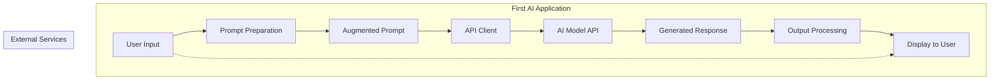
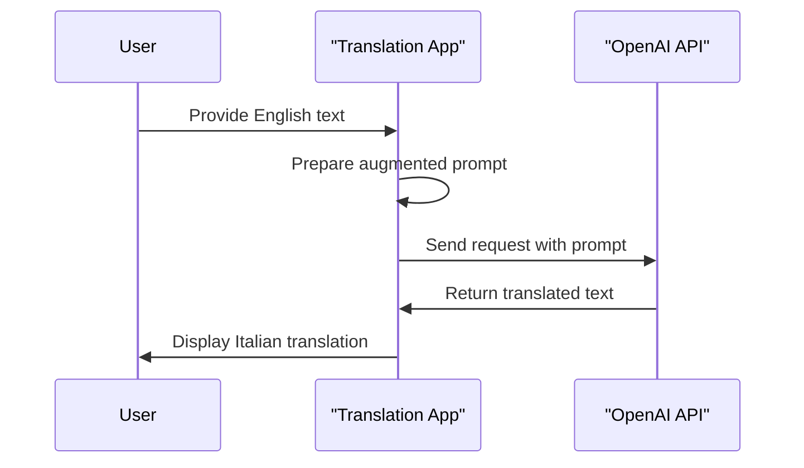
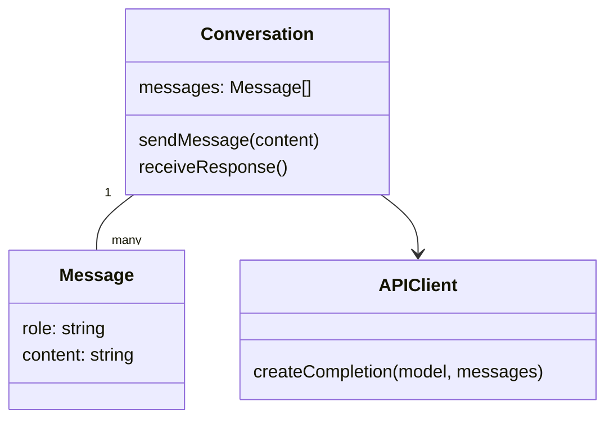
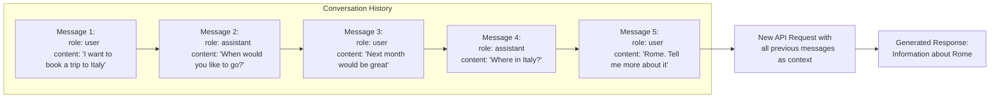
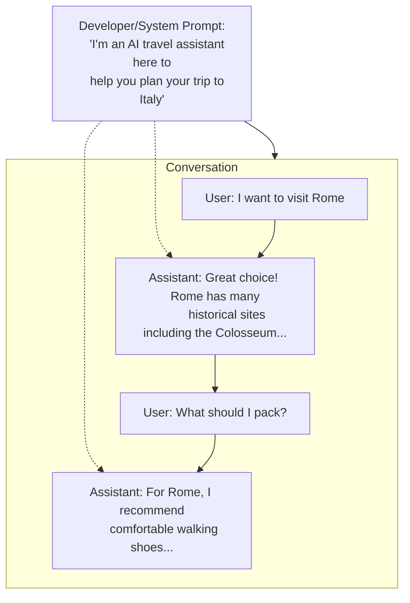
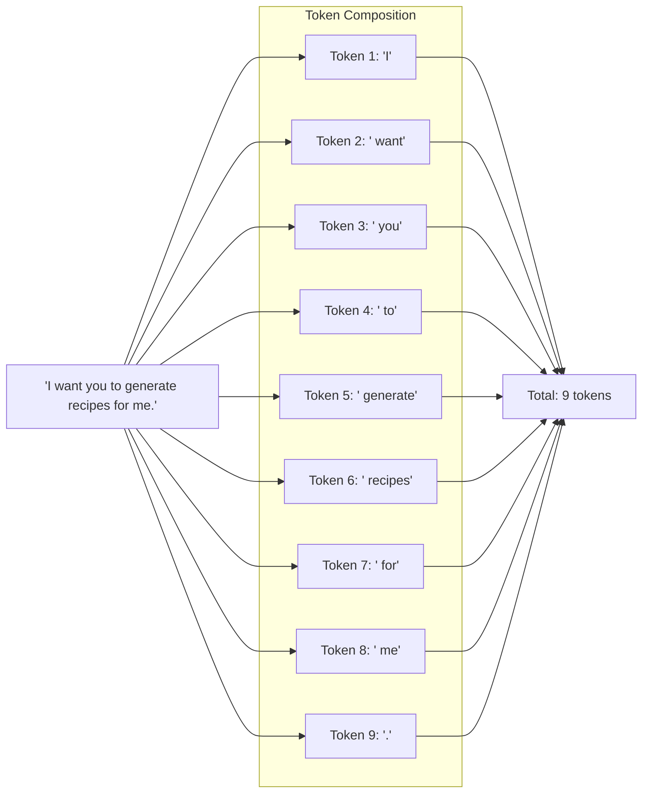
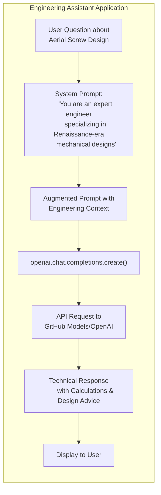
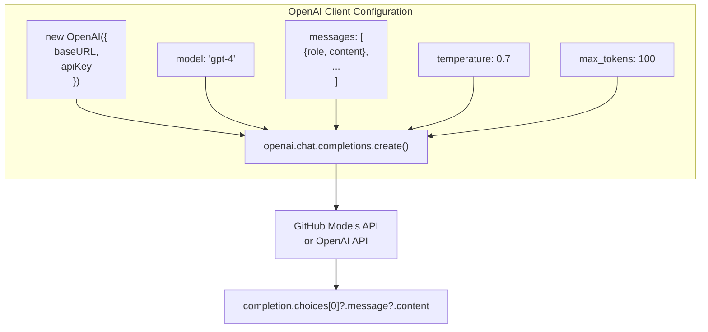

<!-- source: DeepWiki mcp.deepwiki.com · repo microsoft/generative-ai-with-javascript · page 4.2 First AI App · fetched 2026-10-26 -->

# First AI App

<details>
<summary>Relevant source files</summary>

The following files were used as context for generating this wiki page:

- [lessons/01-intro-to-genai/README.md](lessons/01-intro-to-genai/README.md)
- [lessons/02-first-ai-app/README.md](lessons/02-first-ai-app/README.md)
- [lessons/04-structured-output/README.md](lessons/04-structured-output/README.md)
- [lessons/05-rag/README.md](lessons/05-rag/README.md)

</details>


This page documents how to build your first application with JavaScript that interacts with generative AI models. It covers the essential components for creating a simple AI-powered app, from setting up the development environment to implementing basic chat functionality and understanding system prompts.

For information about generative AI concepts and fundamentals, see [Introduction to Generative AI](#4.1). For details about more advanced prompt engineering techniques, see [Prompt Engineering](#4.3).

## Development Environment Setup

Before building an AI app, you need to set up your development environment with the following essential tools:

| Tool | Purpose |
|------|---------|
| Text editor | For writing code (e.g., Visual Studio Code) |
| Terminal | For running commands |
| Browser | For testing web-based apps |
| Node.js | JavaScript runtime environment |
| API key | Access to AI model services (GitHub Models, OpenAI, etc.) |

The codebase supports running in GitHub Codespaces for the quickest setup experience. Once in a Codespace, you can install the necessary dependencies with `npm install`.

Sources: [lessons/02-first-ai-app/README.md:144-158]()

## Basic AI App Architecture



The diagram above illustrates the basic flow of an AI-powered application:
1. The application takes user input (a question or prompt)
2. Prepares a prompt with context or instructions
3. Sends the prompt to an AI model API
4. Receives and processes the response
5. Displays the result to the user

Sources: [lessons/02-first-ai-app/README.md:166-232]()

## Writing a Basic AI App

Let's examine a simple application that demonstrates how to interact with an AI model API. This example shows a text translation app that converts English to Italian:



The core implementation involves these steps:

1. Define the input text (question)
2. Create an augmented prompt with clear instructions
3. Initialize the API client
4. Send the request to the model
5. Process and display the response

The code structure follows this pattern as shown in [lessons/02-first-ai-app/README.md:184-222](), where a simple prompt is constructed with instructions to translate English text to Italian.

### Prompt Construction

The augmented prompt combines user input with instructions:

```
## Instructions
Translate the following text to Italian:
## Question
[User's text here]
```

This structured format helps guide the AI to perform the specific task requested.

Sources: [lessons/02-first-ai-app/README.md:184-222]()

## Chat Applications

Building on the basic AI app architecture, chat applications maintain conversation context through a series of messages:



In a chat application, messages are structured with roles like "user", "assistant", or "developer" (previously called "system") to represent different participants in the conversation. The model uses this context to generate more coherent responses.

### Message Structure



The diagram shows how conversation history provides context for each new interaction, allowing the AI to reference previous messages when generating responses.

Sources: [lessons/02-first-ai-app/README.md:242-326]()

## System Prompts

System prompts (now called "developer" prompts in some models) define the role and behavior of the AI assistant. They set up a "personality" and provide context for how the AI should respond to user queries.



A system prompt is incorporated at the beginning of the conversation, acting as a background directive that shapes all responses without being visible to the user.

### Example System Prompt

```javascript
const message = {
  "role": "developer",  // Previously "system" in some models
  "content": "I'm an AI travel assistant, here to help you plan your trip to Italy."
};
```

Including this message at the start of your messages array will guide the AI to respond in the character of a travel assistant.

Sources: [lessons/02-first-ai-app/README.md:332-357]()

## Advanced Settings

### Temperature Control

The temperature parameter controls the randomness and creativity of AI responses:

| Temperature | Effect |
|-------------|--------|
| 0 (Low) | Deterministic, predictable responses |
| 0.5 (Medium) | Balanced creativity and coherence |
| 1.0 (High) | More creative, varied responses |
| >1.0 | Increasingly random (not recommended) |

You can set the temperature in your API request:

```javascript
const completion = await openai.chat.completions.create({
    model: 'gpt-4',
    messages: messages,
    temperature: 0.7  // Balanced creativity
});
```

Sources: [lessons/02-first-ai-app/README.md:358-390]()

### Context Window and Tokens

AI models have limits on how much text they can process, measured in tokens:



The context window (maximum token limit) varies by model. For instance, GPT-4o has:
- Maximum output tokens: ~16k tokens
- Maximum context window: 128k tokens

You can control the maximum output tokens with the `max_tokens` parameter:

```javascript
const completion = await openai.chat.completions.create({
    model: 'gpt-4',
    messages: messages,
    max_tokens: 100  // Limits response length
});
```

Sources: [lessons/02-first-ai-app/README.md:391-441]()

## Sample Application: Engineering Assistant

Building upon these concepts, you can create an AI-powered engineering assistant to help with calculations and designs.



This application leverages system prompts to create an AI assistant specialized in engineering, particularly for historical designs like Leonardo da Vinci's aerial screw.

Sources: [lessons/02-first-ai-app/README.md:442-486]()

## API Integration Details



The diagram illustrates how the OpenAI client is configured and used to make requests to AI model APIs. The primary integration points are:

1. Client initialization with base URL and API key
2. Request creation with model specification, messages, and parameters
3. Response handling from the completion object

Sources: [lessons/02-first-ai-app/README.md:200-232](), [lessons/02-first-ai-app/README.md:295-323]()

## Key Concepts Summary

| Concept | Description | Code Reference |
|---------|-------------|----------------|
| Basic Prompt | Simple input text to the AI model | `const question = 'Hello, how are you?';` |
| Augmented Prompt | Input enhanced with instructions | `const augmentedPrompt = '## Instructions\nTranslate...'` |
| System Prompt | Defines AI assistant personality | `{ "role": "developer", "content": "I'm an AI travel assistant..." }` |
| Messages Array | Sequence of conversation messages | `const messages = [ { "role": "user", "content": "..." }, ... ]` |
| Temperature | Controls response randomness | `temperature: 0.7` |
| Context Window | Token limit for processing | `max_tokens: 100` |

Understanding these core concepts will enable you to build effective AI applications that can generate text, translate languages, maintain conversations, and assist with specialized tasks.

Sources: [lessons/02-first-ai-app/README.md:184-486]()

---

