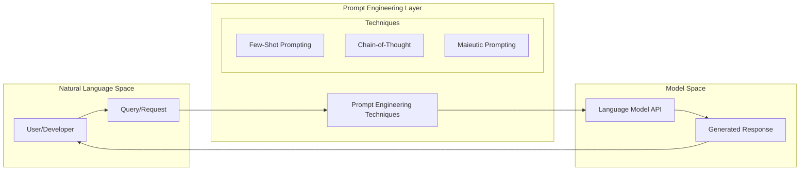
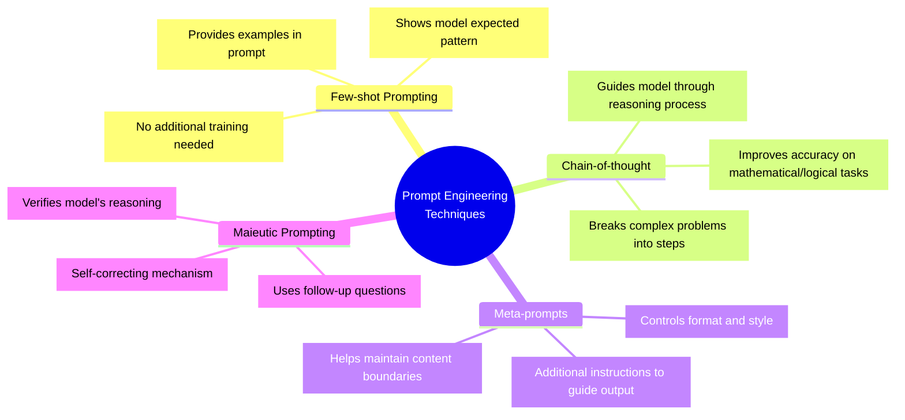
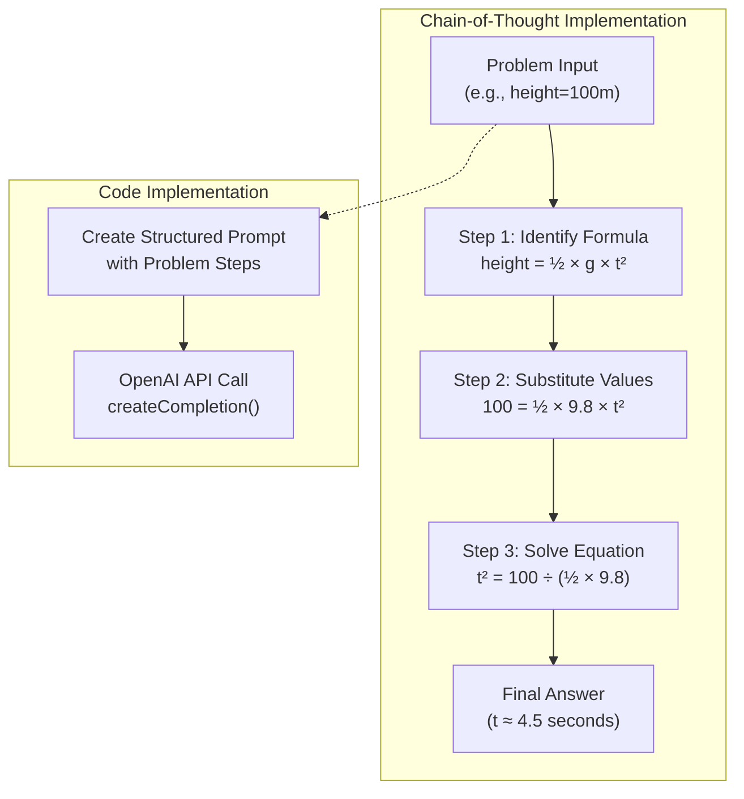
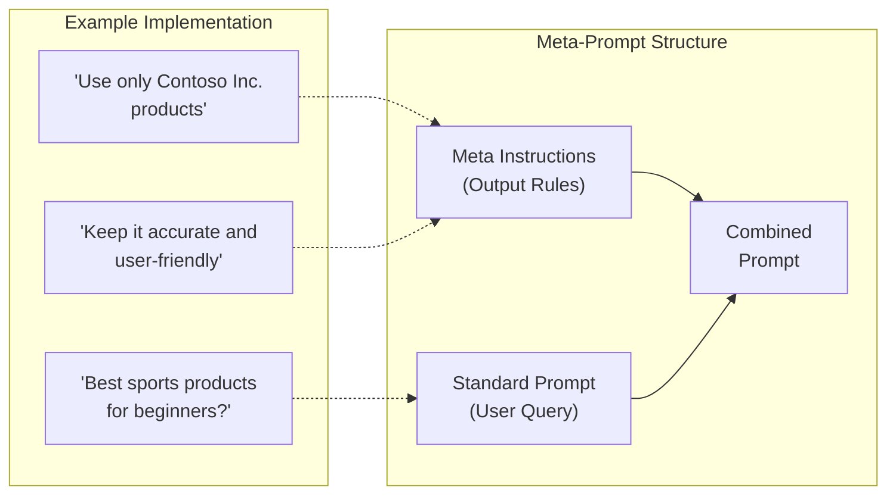
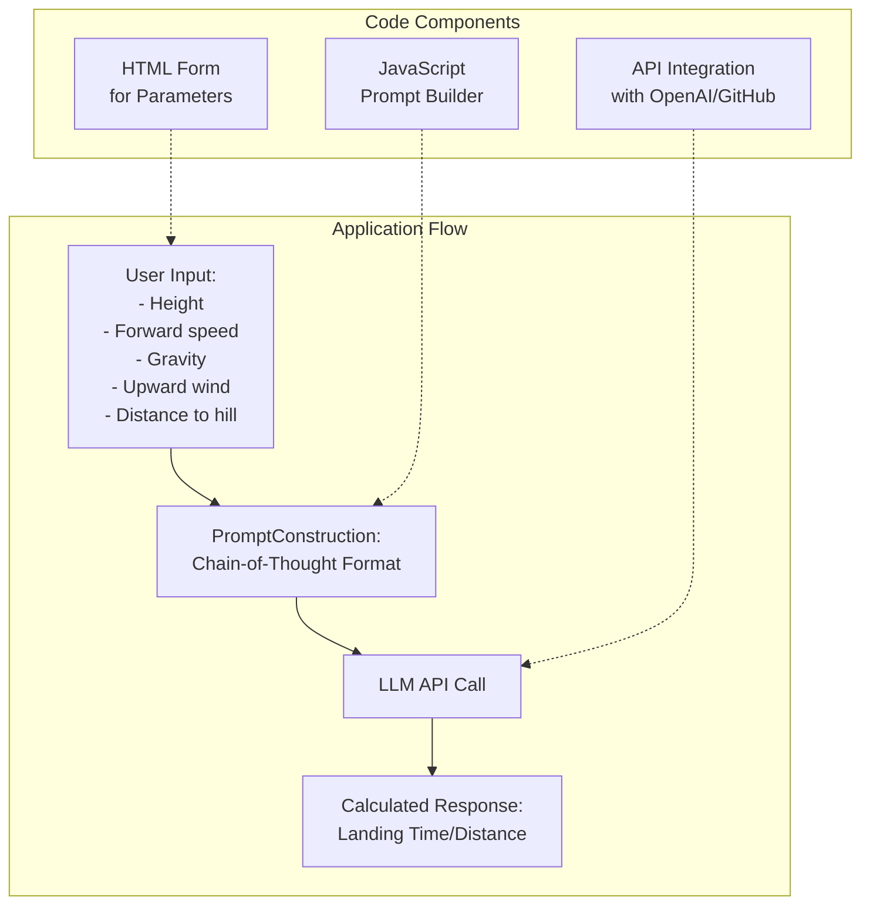
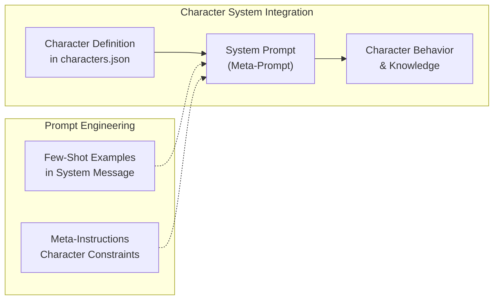

<!-- source: DeepWiki mcp.deepwiki.com · repo microsoft/generative-ai-with-javascript · page 4.3 Prompt Engineering · fetched 2026-10-26 -->

# Prompt Engineering

<details>
<summary>Relevant source files</summary>

The following files were used as context for generating this wiki page:

- [lessons/03-prompt-engineering/README.md](lessons/03-prompt-engineering/README.md)
- [lessons/03-prompt-engineering/translations/README.bn.md](lessons/03-prompt-engineering/translations/README.bn.md)
- [lessons/05-rag/translations/README.bn.md](lessons/05-rag/translations/README.bn.md)

</details>


This wiki page documents the prompt engineering techniques covered in Lesson 3 of the Generative AI with JavaScript course. It explains what prompt engineering is, why it's important for developers, the key techniques, and how to implement them effectively in JavaScript applications. For information about structuring AI outputs in specific formats, see [Structured Output](#4.4).

## What is Prompt Engineering?

Prompt engineering is the practice of crafting effective prompts to get desired outputs from large language models (LLMs). Despite its technical-sounding name, it's not about building infrastructure but about communicating effectively with AI models. This skill leverages the emergent properties of LLMs, allowing developers to achieve better, more predictable results.



Sources: [lessons/03-prompt-engineering/README.md:136-142, 155-171]

## Why Prompt Engineering Matters for Developers

For application developers, prompt engineering offers several key benefits:

1. **Improved Accuracy**: Get more accurate and relevant results from language models
2. **Output Control**: Ensure responses are appropriate for users and align with brand voice
3. **Format Consistency**: Structure outputs in ways that are easier to parse and present

Understanding prompt engineering techniques allows developers to create more reliable and effective AI integrations, reducing the need for complex post-processing logic.

Sources: [lessons/03-prompt-engineering/README.md:162-173]

## Key Prompt Engineering Techniques

The course covers four primary prompt engineering techniques:



Sources: [lessons/03-prompt-engineering/README.md:176-187]

### Few-shot Prompting

Few-shot prompting involves providing example input-output pairs within your prompt to guide the AI's responses. This technique essentially "shows" the model what kind of output you expect by giving it patterns to follow.

#### How it works:

1. Include 2-3 examples of inputs and desired outputs
2. Format consistently across examples
3. Provide your actual query in the same format

#### Example:

```
"Tell me about the Roman Colosseum." → "It's a massive amphitheater."

"What was life like in ancient Rome?" → "It was bustling and tough."

"Describe the aerial screw invention." → 
```

This approach is effective when you need consistent formatting or want to establish a specific response pattern without additional model training.

Sources: [lessons/03-prompt-engineering/README.md:192-202]

### Chain-of-Thought Prompting

Chain-of-thought prompting guides the AI through a step-by-step reasoning process, which is especially effective for complex problems requiring logical or mathematical calculations.



#### Implementation:

When implemented in code, this technique involves constructing a prompt that:
1. Clearly defines the problem
2. Outlines the steps required to solve it
3. Shows partial work or reasoning
4. Invites the model to continue the logical progression

This technique is extremely valuable for applications involving:
- Mathematical calculations
- Step-by-step instructions
- Logic puzzles
- Algorithm explanation

Sources: [lessons/03-prompt-engineering/README.md:206-226]

### Meta-Prompts

Meta-prompts are additional instructions that shape the AI's output more precisely. They act as guardrails to ensure responses meet specific requirements.



#### Common Meta-Prompt Elements:

1. **Content restrictions**: Limiting responses to specific topics or sources
2. **Format guidance**: Specifying output structure (bullets, paragraphs, etc.)
3. **Tone instructions**: Setting professional, casual, or other tone requirements
4. **Length parameters**: Indicating whether responses should be brief or detailed

Meta-prompts are particularly useful in customer-facing applications where consistency and brand voice matter, or when you need to ensure the model doesn't generate inappropriate or off-topic content.

Sources: [lessons/03-prompt-engineering/README.md:251-280]

### Maieutic Prompting

Maieutic prompting uses guiding questions to verify the model's reasoning and guide it toward accurate answers. This technique involves breaking down complex problems and asking the model to explain its thinking at each step.

#### Implementation Steps:

1. Present the initial problem
2. Ask the model for its answer
3. Follow up with questions about its reasoning
4. Use the responses to correct any errors in logic

#### Example:

```
Initial prompt: "How long would it take to fall 100 meters with gravity of 9.8 m/s²?"
Response: "4.5 seconds"
Follow-up: "Why 4.5 seconds? Show your work."
```

This technique is valuable for:
- Debugging AI responses
- Improving accuracy in technical applications
- Educational tools where step-by-step explanations are valuable

Sources: [lessons/03-prompt-engineering/README.md:227-247]

## Practical Implementation

The course includes a practical implementation of prompt engineering techniques in the context of calculating landing parameters for an "aerial screw" (an early helicopter-like machine designed by Leonardo da Vinci).

### Aerial Screw Calculator Implementation

The assignment demonstrates how to create a JavaScript application that uses the chain-of-thought technique to guide an AI model through physics calculations.



The implementation shows how to:
1. Gather necessary parameters from the user
2. Format them into a chain-of-thought prompt
3. Submit to the language model
4. Present the calculated results

By using the chain-of-thought approach, the application guides the model to show its reasoning, increasing accuracy and allowing for verification of the calculation steps.

Sources: [lessons/03-prompt-engineering/README.md:284-323]

## Meta-Prompt Example with Code

The following shows how meta-prompts are implemented in the course examples:

```
## Meta Prompt: Use only Contoso Inc. products (basketballs, soccer balls, tennis rackets). Keep it accurate and user-friendly.
## Prompt: Best sports products for beginners?
## Response: Basketballs, soccer balls, and tennis rackets—perfect for coordination and agility.
```

Without the meta-prompt guidance, the model might suggest products not available from Contoso Inc., demonstrating the value of this approach for keeping responses aligned with business requirements.

Sources: [lessons/03-prompt-engineering/README.md:260-273]

## Integration with Character System

The prompt engineering techniques integrate with the companion app's character system through carefully crafted system prompts. When interacting with characters like Ludovico Sforza in the tutorial's narrative, these techniques shape the character's responses.



The character system relies heavily on meta-prompts to establish the character's personality, knowledge boundaries, and speaking style. This is implemented through the system message property in the character definitions.

Sources: [lessons/03-prompt-engineering/README.md:111-134]

## Best Practices

Based on the course materials, here are key best practices for prompt engineering:

| Technique | Best For | Example Use Case |
|-----------|----------|------------------|
| Few-shot | Consistent formatting | Product descriptions |
| Chain-of-thought | Complex reasoning | Mathematics calculator |
| Meta-prompts | Content boundaries | Brand-aligned responses |
| Maieutic | Verification | Educational applications |

Additional best practices:
- Be specific and clear in your instructions
- Use examples when response format matters
- Include an "escape hatch" for when the model lacks information
- Test prompts with multiple inputs to ensure consistency

Sources: [lessons/03-prompt-engineering/README.md:162-173, 176-187]

## Conclusion

Prompt engineering is a crucial skill for developers working with generative AI. By understanding and implementing these four key techniques—few-shot prompting, chain-of-thought prompting, meta-prompts, and maieutic prompting—developers can significantly improve the quality, reliability, and usability of AI-generated content in their applications.

The techniques covered in this lesson provide a foundation for more advanced implementations in later lessons, particularly when working with structured outputs and retrieval-augmented generation (RAG).

Sources: [lessons/03-prompt-engineering/README.md:136-187]

---

