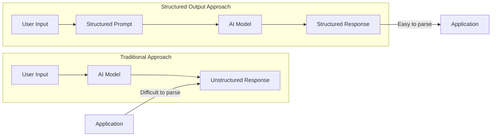
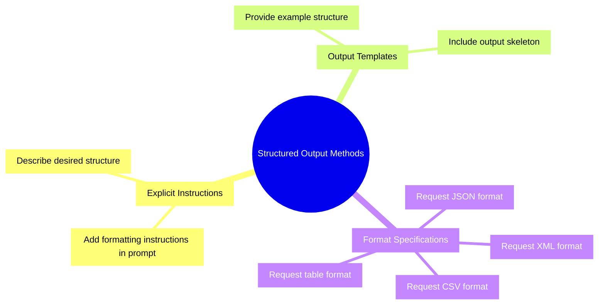
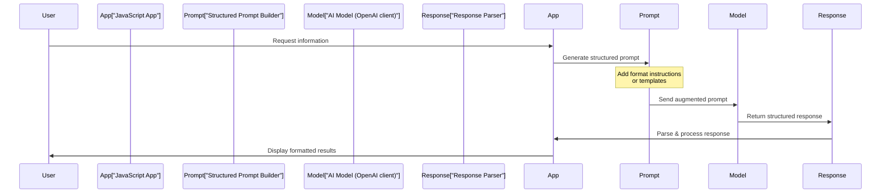
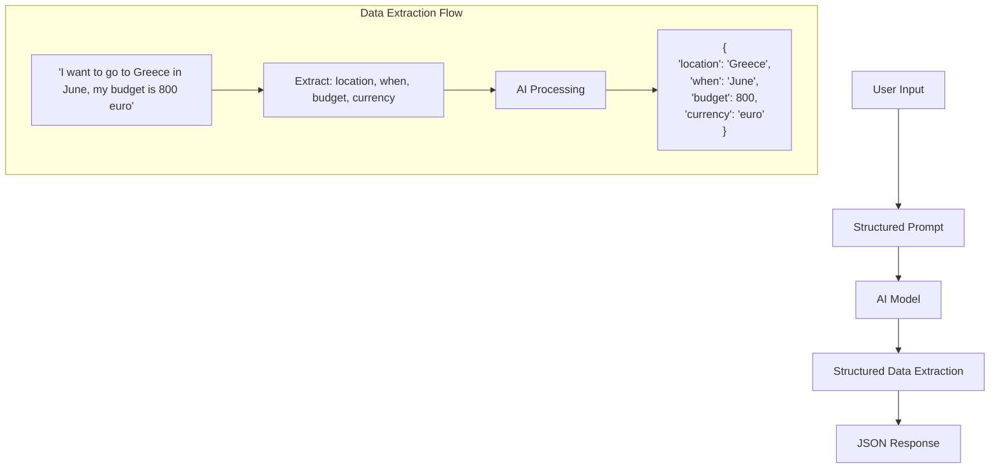
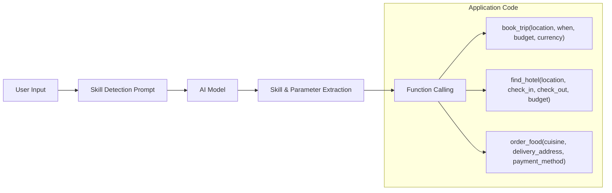

<!-- source: DeepWiki mcp.deepwiki.com · repo microsoft/generative-ai-with-javascript · page 4.4 Structured Output · fetched 2026-10-26 -->

# Structured Output

<details>
<summary>Relevant source files</summary>

The following files were used as context for generating this wiki page:

- [lessons/01-intro-to-genai/README.md](lessons/01-intro-to-genai/README.md)
- [lessons/02-first-ai-app/README.md](lessons/02-first-ai-app/README.md)
- [lessons/04-structured-output/README.md](lessons/04-structured-output/README.md)
- [lessons/04-structured-output/assets/game.png](lessons/04-structured-output/assets/game.png)
- [lessons/04-structured-output/assets/meeting.png](lessons/04-structured-output/assets/meeting.png)
- [lessons/05-rag/README.md](lessons/05-rag/README.md)

</details>


## Purpose and Scope

This documentation covers structured output techniques for generative AI applications built with JavaScript. Structured output refers to controlling and formatting the responses from AI models into specific, predictable formats like JSON, tables, or other structured text formats that are easily consumable by applications or humans. This enables more reliable data extraction, improves consistency, and facilitates integration with other services or systems.

This page focuses on implementation patterns and techniques for achieving structured output with large language models. For related topics on prompt engineering basics, see [Prompt Engineering](#4.3), and for using structured output in retrieval scenarios, see [Retrieval-Augmented Generation](#4.5).

## Understanding Structured Output

Structured output transforms the natural language capabilities of AI models into organized, parseable data formats. Without structure, AI responses can be difficult to process programmatically or integrate into applications.



**Diagram: Unstructured vs. Structured Output Approaches**

Sources: [lessons/04-structured-output/README.md:145-157]()

### Benefits of Structured Output

Structured output provides several key advantages:

| Benefit | Description |
|---------|-------------|
| Predictable parsing | Applications can reliably extract specific fields or values |
| Improved consistency | Responses follow a consistent format, improving UX |
| Better integration | Easier to integrate with databases, APIs, and other services |
| Error reduction | Reduces parsing errors and edge cases in downstream processing |
| Enhanced presentation | Data can be displayed in a more organized, readable format |

Sources: [lessons/04-structured-output/README.md:156-166]()

## Methods for Structuring AI Output

There are three primary approaches to achieving structured output:



**Diagram: Methods for Structuring Output**

Sources: [lessons/04-structured-output/README.md:171-307]()

### Explicit Instructions in Prompts

The simplest approach involves adding specific formatting instructions directly in your prompt:

```
Generate ideas for inventions that can be built using 15th-century technology. 
For each invention, provide the required resources and estimate the effort 
needed to construct it. Present the information in a table with the following 
columns: Title, Description, Resources Needed, and Effort.
```

This technique is straightforward but may result in less consistent formatting compared to other methods.

Sources: [lessons/04-structured-output/README.md:222-237]()

### Output Templates

Providing an output template gives the model a clear structure to follow:

```
Generate ideas for inventions that can be built using 15th-century technology. 
For each invention, specify the required resources and estimate the effort 
needed to construct it. Present the information using the following format:

Title: [Invention Name]
Description: [Brief Explanation]
Resources Needed: [List of Required Materials]
Effort: [Estimated Difficulty or Labor Required]
```

This method usually produces more consistent results as it provides a clear pattern for the model to follow.

Sources: [lessons/04-structured-output/README.md:247-296]()

### Format Specifications

For programmatic consumption, you can request specific data formats like JSON:

```
Generate ideas for inventions I can build given 15th century technology, 
please let me know for each what resources I need and how much effort there 
would be to build each invention, for each idea present in json format, 
include properties for title, description, resources, needed, effort

Example of the JSON output:
[
  {
    "title": "",
    "description": ".",
    "resources_needed": "",
    "effort": ""
  }
]
```

This approach is particularly useful when integrating AI responses with other services or APIs.

Sources: [lessons/04-structured-output/README.md:314-395]()

## Implementation Patterns

The following diagram illustrates the implementation flow for structured output in a JavaScript application:



**Diagram: Structured Output Implementation Flow**

Sources: [lessons/04-structured-output/README.md:396-447](), [lessons/02-first-ai-app/README.md:178-200]()

### Code Implementation

A basic implementation for generating structured output follows this pattern:

1. Define the user's question or input
2. Create an augmented prompt with format instructions
3. Send the request to the AI model
4. Process the structured response

The key components in the codebase involve:

1. Creating the OpenAI client
2. Crafting the structured prompt
3. Making the API request
4. Processing the response

Sources: [lessons/02-first-ai-app/README.md:183-221](), [lessons/04-structured-output/README.md:396-440]()

## Extracting Structured Data from User Input

Beyond generating structured output, you can also extract structured data from user input:



**Diagram: Structured Data Extraction Flow**

Sources: [lessons/04-structured-output/README.md:401-439]()

### Parameter Extraction Pattern

To extract parameters from user input:

1. Define the parameters you want to extract
2. Create a prompt that asks the AI to extract these parameters
3. Request a specific output format (typically JSON)
4. Process the structured response

Example prompt pattern:
```
Extract the following information from a user's prompt: location, when, budget, currency, respond with the extracted data in JSON format.

User prompt: {user_input}
```

Sources: [lessons/04-structured-output/README.md:403-447]()

## Advanced Applications: Skill Detection and Function Calling

One powerful application of structured output is automatically determining which function or "skill" a user request maps to, along with extracting relevant parameters:



**Diagram: Skill Detection and Function Calling**

Sources: [lessons/04-structured-output/README.md:456-508]()

### Skill Detection Implementation

To implement skill detection:

1. Define a set of skills and their required parameters
2. Create a prompt that describes these skills and asks the AI to determine which skill to use
3. Extract the skill and parameters from the response
4. Call the corresponding function with the extracted parameters

Example prompt pattern:
```
Here are some skills you have:

skill: book_trip
parameters: location, when, budget, currency

skill: find_hotel
parameters: location, check_in, check_out, budget

skill: order_food
parameters: cuisine, delivery_address, payment_method

Figure out which skill to use based on a user's prompt and extract the necessary parameters, respond with the extracted data in JSON format with columns skill, parameters, extracted_data

{user_input}
```

This pattern resembles function/tool calling capabilities in advanced AI APIs, but implemented through prompt engineering.

Sources: [lessons/04-structured-output/README.md:459-509]()

## Common Use Cases

Structured output techniques are particularly valuable in the following scenarios:

| Use Case | Description | Format |
|----------|-------------|--------|
| Data extraction | Extract structured data from unstructured text | JSON |
| Form filling | Extract parameters to populate forms | JSON/Key-value |
| API integration | Generate data for API calls | JSON/XML |
| Tabular data | Present information in an organized table | Markdown/HTML tables |
| Command parsing | Interpret user commands and extract parameters | JSON + Function name |
| Content generation | Create consistently formatted content | Predefined templates |

Sources: [lessons/04-structured-output/README.md:396-509](), [lessons/01-intro-to-genai/README.md:260-274]()

## Best Practices

When implementing structured output:

1. **Be explicit about format requirements** - Clearly specify the exact format you need
2. **Provide examples** - Include example outputs to guide the model
3. **Use escape hatches** - Include instructions for handling unknown or missing information
4. **Validate responses** - Always validate and sanitize structured output before using it
5. **Handle parsing errors** - Have fallback mechanisms for when parsing fails
6. **Keep prompts concise** - Focus on essential format instructions to avoid confusion
7. **Test different formats** - Some formats (like JSON) may work more consistently than others

Sources: [lessons/04-structured-output/README.md:171-396](), [lessons/05-rag/README.md:252-299]()

This approach to structured output provides a robust foundation for creating reliable, integrable AI applications that can process and respond with predictable, machine-readable data formats.

---

