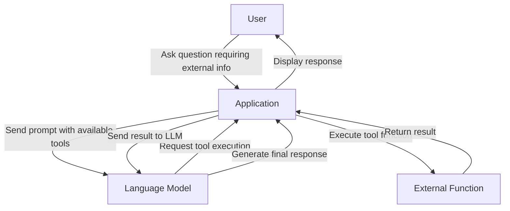
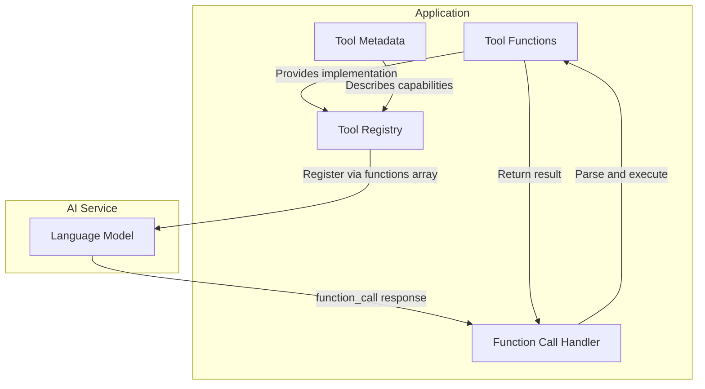
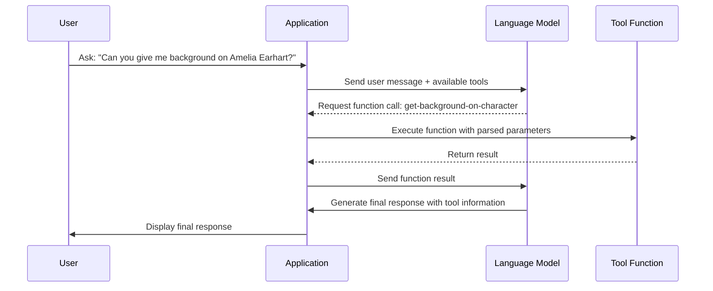

<!-- source: DeepWiki mcp.deepwiki.com · repo microsoft/generative-ai-with-javascript · page 4.6 Tool Calling · fetched 2026-10-26 -->

# Tool Calling

<details>
<summary>Relevant source files</summary>

The following files were used as context for generating this wiki page:

- [lessons/01-intro-to-genai/solution/solution-quiz.md](lessons/01-intro-to-genai/solution/solution-quiz.md)
- [lessons/02-first-ai-app/solution/solution-quiz.md](lessons/02-first-ai-app/solution/solution-quiz.md)
- [lessons/03-prompt-engineering/solution/solution-quiz.md](lessons/03-prompt-engineering/solution/solution-quiz.md)
- [lessons/03-prompt-engineering/solution/solution.md](lessons/03-prompt-engineering/solution/solution.md)
- [lessons/04-structured-output/solution/solution-quiz.md](lessons/04-structured-output/solution/solution-quiz.md)
- [lessons/05-rag/solution/solution-quiz.md](lessons/05-rag/solution/solution-quiz.md)
- [lessons/06-tool-calling/code/app.js](lessons/06-tool-calling/code/app.js)
- [lessons/06-tool-calling/code/package-lock.json](lessons/06-tool-calling/code/package-lock.json)
- [lessons/06-tool-calling/code/package.json](lessons/06-tool-calling/code/package.json)
- [lessons/06-tool-calling/solution/solution-quiz.md](lessons/06-tool-calling/solution/solution-quiz.md)

</details>


Tool Calling enables language models to extend their capabilities by invoking external functions (tools) that can perform specialized tasks. This page documents the implementation of tool calling with generative AI models using JavaScript. For more information about other advanced techniques like Retrieval-Augmented Generation, see [Retrieval-Augmented Generation](#4.5).

## 1. What is Tool Calling?

Tool calling is a mechanism that allows AI models to:
- Request the execution of external functions
- Pass structured parameters to those functions
- Receive and process the results of those functions

This capability enhances the AI model's abilities beyond its built-in knowledge by providing access to external systems, data sources, or specialized computation.



**Diagram: Tool Calling Data Flow**

Sources: [lessons/06-tool-calling/code/app.js:81-108]()

## 2. Tool Calling Architecture

The tool calling system consists of several key components that work together to extend the AI model's capabilities.



**Diagram: Tool Calling System Architecture**

Sources: [lessons/06-tool-calling/code/app.js:1-56](), [lessons/06-tool-calling/code/app.js:81-108]()

## 3. Tool Metadata Structure

Tool metadata is crucial for the AI model to understand how to use a function. It follows a specific JSON schema:

| Field | Type | Description |
|-------|------|-------------|
| name | string | Unique identifier for the tool |
| description | string | Human-readable description of what the tool does |
| parameters | object | JSON Schema describing the expected parameters |
| parameters.type | string | Usually "object" for structured parameters |
| parameters.properties | object | Schema for each parameter |
| parameters.required | array | List of required parameter names |
| output | object | Description of the function's return value |

Example tool metadata from the codebase:

```javascript
const findLandingSpotJson = {
  name: "find-landing-spot",
  description: "Finds a suitable landing spot",
  parameters: {
    type: "object",
    properties: {
      lat: {
        type: "number",
        description: "The latitude of the location",
      },
      long: {
        type: "number",
        description: "The longitude of the location",
      },
    },
    required: ["lat", "long"],
  },
  output: { type: "object", properties: { lat: "number", long: "number" } }
};
```

Sources: [lessons/06-tool-calling/code/app.js:17-51]()

## 4. Implementation Steps

### 4.1 Define Tool Functions

First, define JavaScript functions that implement the tool functionality:

```mermaid
classDiagram
    class "findLandingSpot()" {
        +function(lat, long)
        +Returns landing coordinates
    }
    class "getBackgroundOnCharacter()" {
        +function(character)
        +Returns character background
    }
```

**Diagram: Tool Function Implementation**

Sources: [lessons/06-tool-calling/code/app.js:3-15]()

### 4.2 Define Tool Metadata

Create JSON schemas that describe each tool's functionality and parameters:

```mermaid
classDiagram
    class "findLandingSpotJson" {
        +name: "find-landing-spot"
        +description: "Finds a suitable landing spot"
        +parameters: object
        +output: object
    }
    class "getBackgroundOnCharacterJson" {
        +name: "get-background-on-character"
        +description: "Get background information on a character"
        +parameters: object
        +output: object
    }
```

**Diagram: Tool Metadata Structure**

Sources: [lessons/06-tool-calling/code/app.js:17-51]()

### 4.3 Register Tools in a Registry

Map tool names to their implementation functions:

```javascript
const tools = {
  [findLandingSpotJson.name]: findLandingSpot,
  [getBackgroundOnCharacterJson.name]: getBackgroundOnCharacter
};
```

Sources: [lessons/06-tool-calling/code/app.js:53-56]()

### 4.4 Initialize AI Client

Set up the OpenAI client:

```javascript
const openai = new OpenAI({
    baseURL: "https://models.inference.ai.azure.com",
    apiKey: process.env.GITHUB_TOKEN,
});
```

Sources: [lessons/06-tool-calling/code/app.js:59-62]()

### 4.5 Create Messages

Prepare system and user messages:

```javascript
const messages = [
{
    role: "system",
    content: `You are a helpful assistant. You can call functions to perform tasks. Make sure to parse the function call and arguments correctly.`
}, {
    role: "user",
    content: "Can you give me some background on the character named Amelia Earhart?"
}];
```

Sources: [lessons/06-tool-calling/code/app.js:71-79]()

### 4.6 Make API Request with Tools

When making the API request, include the tools in the `functions` parameter:

```javascript
const result = await openai.chat.completions.create({
    model: 'gpt-4o',
    messages: messages,
    functions: [getBackgroundOnCharacterJson, findLandingSpotJson]
});
```

Sources: [lessons/06-tool-calling/code/app.js:84-88]()

### 4.7 Handle Tool Execution

Process the AI's response to execute requested functions:

```javascript
for (const choice of result.choices) {
    let functionCall = choice.message?.function_call;
    let functionName = functionCall?.name;
    let args = JSON.parse(functionCall?.arguments);
    
    if (functionName && functionName in tools) {
        console.log(`Calling [${functionName}]`);
        const toolFunction = tools[functionName];
        const toolResponse = toolFunction(...Object.values(args));
        console.log("Result from [tool] calling: ", toolResponse);
    }
}
```

Sources: [lessons/06-tool-calling/code/app.js:90-104]()

## 5. Complete Data Flow

The following diagram illustrates the complete data flow in a tool calling interaction:



**Diagram: Complete Tool Calling Interaction**

Sources: [lessons/06-tool-calling/code/app.js:81-108]()

## 6. Purpose and Benefits of Tool Calling

According to the lesson quiz, the primary purposes of tool calling are:

1. To enable the AI model to perform tasks beyond its built-in capabilities by leveraging external functions
2. To provide metadata about tools so the AI model can suggest their usage appropriately
3. To create a structured interface between AI models and external systems

Tool calling provides several benefits:
- Extends AI capabilities beyond its training data
- Provides real-time data access
- Allows for complex computations
- Enables integration with existing systems
- Creates a more interactive and capable assistant

Sources: [lessons/06-tool-calling/solution/solution-quiz.md:1-38]()

## 7. Best Practices

When implementing tool calling:

1. **Clear Tool Descriptions**: Provide detailed descriptions of each tool to help the AI understand when to use it
2. **Structured Parameters**: Define parameter schemas carefully to ensure proper data handling
3. **Error Handling**: Include error handling in both tool functions and the tool execution handler
4. **Appropriate Tool Design**: Create focused tools that perform specific tasks rather than overly general ones
5. **Security Considerations**: Validate inputs and consider permission models for sensitive operations

Sources: [lessons/06-tool-calling/code/app.js:17-51](), [lessons/06-tool-calling/code/app.js:90-104]()

## 8. Dependencies

The implementation relies on the OpenAI Node.js SDK, as indicated in the package dependencies:

```javascript
"dependencies": {
  "openai": "^4.91.1"
}
```

Sources: [lessons/06-tool-calling/code/package.json:12-14]()

---

