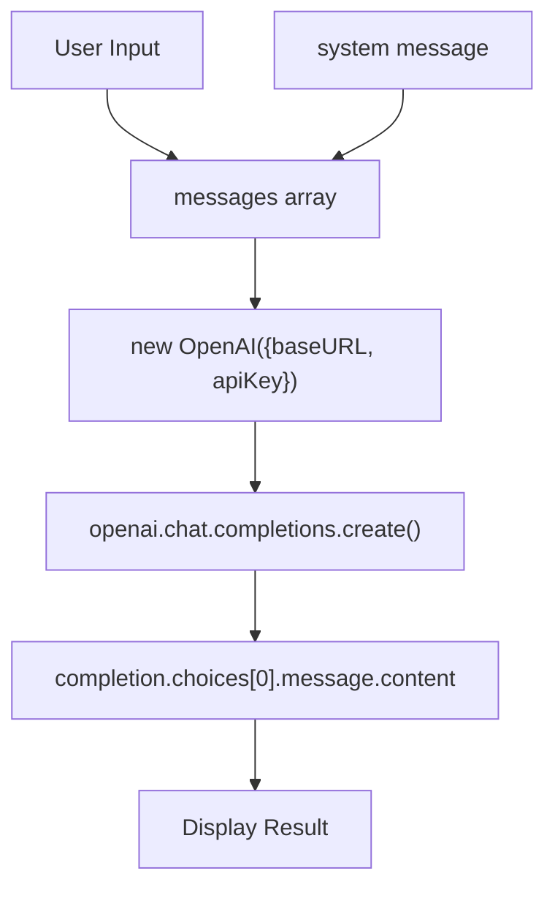
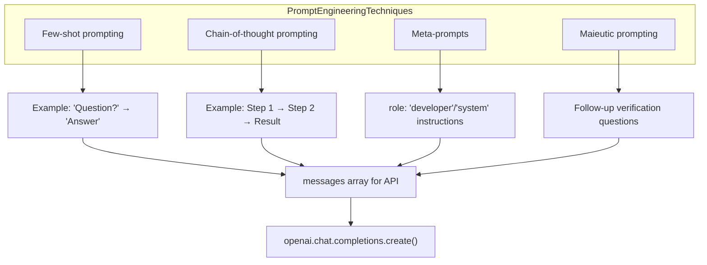
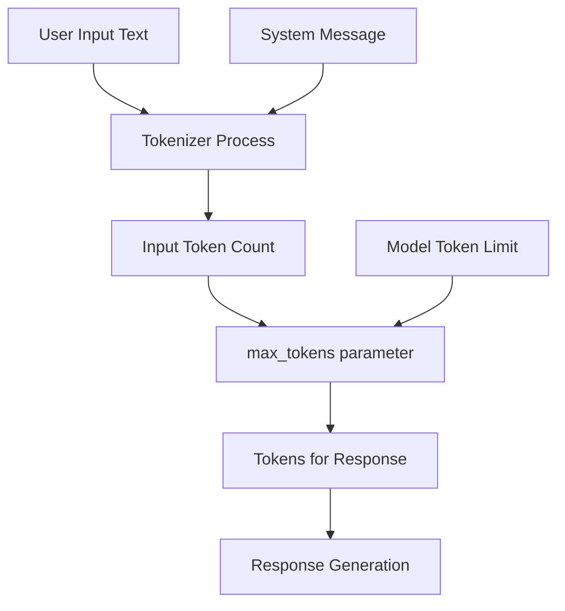
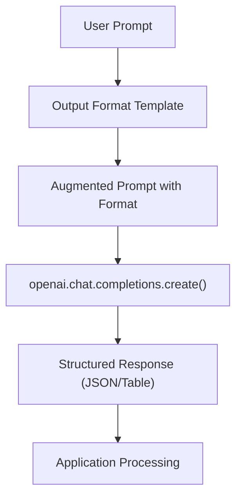
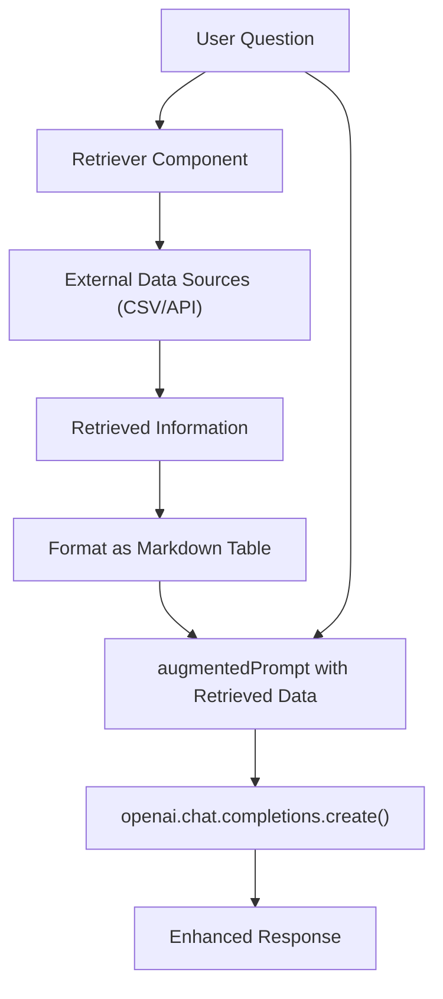
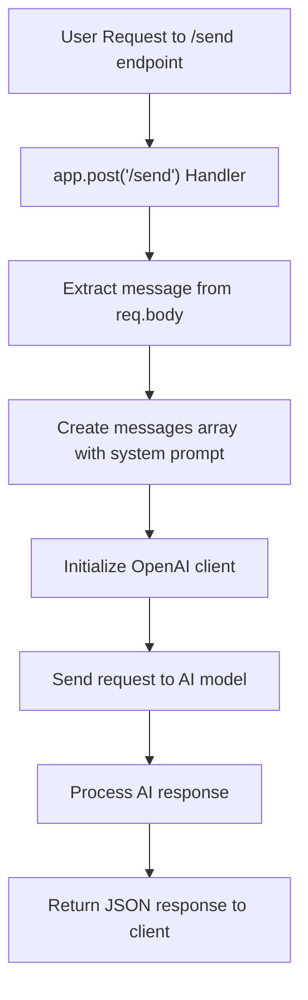

<!-- source: DeepWiki mcp.deepwiki.com · repo microsoft/generative-ai-with-javascript · page 5 Technical Concepts · fetched 2026-10-26 -->

# Technical Concepts

<details>
<summary>Relevant source files</summary>

The following files were used as context for generating this wiki page:

- [lessons/01-intro-to-genai/README.md](lessons/01-intro-to-genai/README.md)
- [lessons/02-first-ai-app/README.md](lessons/02-first-ai-app/README.md)
- [lessons/03-prompt-engineering/README.md](lessons/03-prompt-engineering/README.md)
- [lessons/04-structured-output/README.md](lessons/04-structured-output/README.md)
- [lessons/05-rag/README.md](lessons/05-rag/README.md)

</details>


This page provides a comprehensive overview of the core technical concepts used throughout the Generative AI with JavaScript repository. It explains the foundational technologies, design patterns, and implementation details needed to understand how the codebase works. For information about specific lessons, refer to the [Lessons](#4) page, and for details on the companion app, see the [Companion App](#3) page.

## Large Language Models (LLMs) and API Integration

Large Language Models (LLMs) form the foundation of the generative AI capabilities in this repository. The codebase primarily integrates with these models through API calls, using standardized request/response patterns.

### Basic API Integration Pattern

The following diagram illustrates the basic pattern used throughout the codebase for interacting with LLM APIs:



A typical implementation follows this pattern:

1. Create a messages array containing the user input and optional system message
2. Initialize an API client with appropriate credentials
3. Send a request to the model
4. Process and display the response

Sources: [lessons/02-first-ai-app/README.md:184-224](), [lessons/01-intro-to-genai/README.md:189-224]()

### API Configuration Options

The API calls can be configured with several parameters:

| Parameter | Description | Example |
|-----------|-------------|---------|
| `model` | Specifies which model to use | `'gpt-4'`, `'gpt-4o-mini'` |
| `messages` | Array of message objects with roles | `[{role: 'user', content: 'Hello'}]` |
| `temperature` | Controls randomness (0-1) | `0.7` (default), `0` (deterministic) |
| `max_tokens` | Maximum tokens in the response | `100` |
| `stream` | Whether to stream the response | `true`, `false` |

Sources: [lessons/02-first-ai-app/README.md:378-386](), [lessons/05-rag/README.md:274-278]()

## Prompt Engineering Techniques

Prompt engineering is the practice of crafting effective prompts to get desired outputs from language models. The repository covers four main techniques:



### Few-shot Prompting

This technique involves providing examples of the desired input-output pattern to guide the model's responses. This helps establish a pattern for the model to follow:

```javascript
const messages = [
  {
    "role": "user",
    "content": "Tell me about the Roman Colosseum."
  },
  {
    "role": "assistant",
    "content": "It's a massive amphitheater."
  },
  {
    "role": "user",
    "content": "What was life like in ancient Rome?"
  }
];
```

Sources: [lessons/03-prompt-engineering/README.md:192-199]()

### Chain-of-thought Prompting

This technique involves guiding the model through a step-by-step reasoning process to solve complex problems:

```javascript
const augmentedPrompt = `
- 100 meters above ground  
- Gravity: 9.8 m/s²  
- How many seconds to land?  
`;
```

Sources: [lessons/03-prompt-engineering/README.md:204-216](), [lessons/03-prompt-engineering/README.md:289-295]()

### Meta-prompts

Meta-prompts add explicit instructions to shape the model's response format, tone, or content boundaries:

```javascript
const message = {
  "role": "developer", // This used to be called "system"
  "content": "I'm an AI travel assistant, here to help you plan your trip to Italy."
};
```

Sources: [lessons/02-first-ai-app/README.md:342-349](), [lessons/03-prompt-engineering/README.md:253-268]()

### Maieutic Prompting

This technique uses guiding questions to verify the model's reasoning and improve accuracy:

```javascript
// After receiving an answer, ask follow-up questions
const followUpQuestion = "Why 4.5 seconds?";
```

Sources: [lessons/03-prompt-engineering/README.md:227-250]()

## Context Window and Tokens

Understanding token usage and context window management is crucial for effective LLM integration:



### Token Concepts

- **Token**: A word or part of a word; the basic unit processed by LLMs
- **Context Window**: The total number of tokens (input + output) a model can process
- **max_tokens**: Parameter that limits the response length

For example, models like `gpt-4o-2024-08-06` have specifications:
- Maximum output tokens: ~16k tokens
- Maximum context window size: 128k tokens

Sources: [lessons/02-first-ai-app/README.md:392-442]()

## Structured Output

The repository demonstrates how to generate structured output in various formats (JSON, tables, etc.) by providing explicit instructions and templates in the prompt:



### Structuring Methods

Several methods for structuring output are demonstrated:

1. **Explicit Instructions**: Request a specific format in the prompt
   ```
   "Present the information in a table with columns: Title, Description, Resources, Effort."
   ```

2. **Output Templates**: Provide a template for the model to follow
   ```
   "Present the information using the following format:
   Title: [Invention Name]
   Description: [Brief Explanation]
   Resources Needed: [List of Required Materials]
   Effort: [Estimated Difficulty or Labor Required]"
   ```

3. **JSON/XML Templates**: Request responses in a specific structured format
   ```
   "Respond with the extracted data in JSON format.
   Example of the JSON output:
   [
     {
       "title": "",
       "description": ".",
       "resources_needed": "",
       "effort": ""
     }
   ]"
   ```

Sources: [lessons/04-structured-output/README.md:221-441]()

### Data Extraction

The repository also shows how to extract structured data from user inputs:

```javascript
const promptTemplate = `
Extract the following information from a user's prompt: location, when, budget, currency, respond with the extracted data in JSON format, user prompt: ${user_input}.
`;
```

Sources: [lessons/04-structured-output/README.md:401-446]()

## Retrieval-Augmented Generation (RAG)

RAG combines retrieval-based methods with generative models to enhance responses with external data:



### RAG Components

1. **Retriever Component**: Searches for relevant information from external data sources
   ```javascript
   // Load CSV data as an array of objects
   const rows = fs.readFileSync("./hybrid.csv", "utf8").split("\n");
   const columns = rows[0].split(",");
   
   // Search the data using keywords from the question
   const words = question
     .toLowerCase()
     .replaceAll(/[.?!()'":,]/g, "")
     .split(" ")
     .filter((word) => word.length > 2);
   const matches = rows.slice(1).filter((row) => 
     words.some((word) => row.toLowerCase().includes(word))
   );
   ```

2. **Context Augmentation**: Combines retrieved information with the user query
   ```javascript
   const augmentedPrompt = `
   ## Instructions
   Answer questions using only the sources below.
   If there's not enough data in provided sources, say that you don't know.
   Be brief and straight to the point.
   
   ## Sources
   ${table}
   
   ## Question
   ${question}
   `;
   ```

3. **Generator Component**: Uses the augmented prompt to generate enhanced responses
   ```javascript
   const chunks = await openai.chat.completions.create({
     model: "gpt-4o-mini",
     messages: [{ role: "user", content: augmentedPrompt }],
     stream: true,
   });
   ```

Sources: [lessons/05-rag/README.md:206-284]()

### External Data Sources

The repository demonstrates various methods for integrating external data:

- **File-based data**: Reading from CSV or text files
- **API integration**: Fetching data from external APIs like Wikipedia
  ```javascript
  const response = await fetch('https://en.wikipedia.org/w/api.php?format=json&action=query&prop=extracts&redirects=true&explaintext&titles=Tim%20Berners-Lee');
  const data = await response.json();
  const text = Object.values(data.query.pages)[0]?.extract;
  ```

Sources: [lessons/05-rag/README.md:153-165](), [lessons/05-rag/README.md:317-323]()

## Companion App Implementation

The repository includes a companion app that demonstrates these concepts in a working application:



The app uses Express.js to handle requests, interfaces with AI models, and returns generated responses to users. Character definitions in the app determine the AI's behavior through system messages.

Sources: [lessons/01-intro-to-genai/README.md:189-224]()

## Summary of Key Technical Concepts

| Concept | Description | Implementation |
|---------|-------------|----------------|
| LLM API Integration | Standardized patterns for interacting with LLMs | OpenAI API with appropriate parameters |
| Prompt Engineering | Techniques to craft effective prompts | Few-shot, Chain-of-thought, Meta-prompts, Maieutic prompting |
| Context Management | Managing token usage and context windows | Tokenization, max_tokens parameter |
| Structured Output | Generating responses in specific formats | Output templates, JSON/XML structures |
| RAG | Enhancing responses with external data | Retriever component + Generator component |

Sources: [lessons/02-first-ai-app/README.md](), [lessons/03-prompt-engineering/README.md](), [lessons/04-structured-output/README.md](), [lessons/05-rag/README.md]()

These technical concepts form the foundation of the Generative AI with JavaScript repository, providing developers with the tools and patterns needed to build effective AI-powered applications.

---

