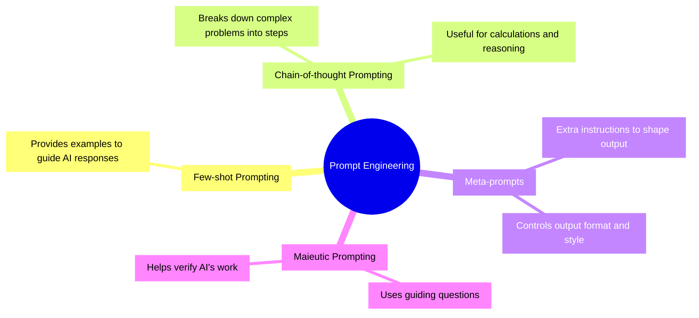
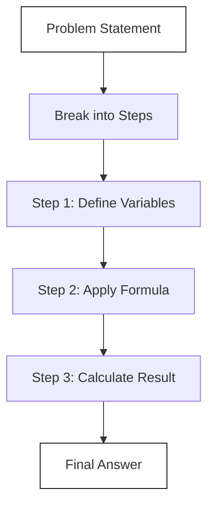
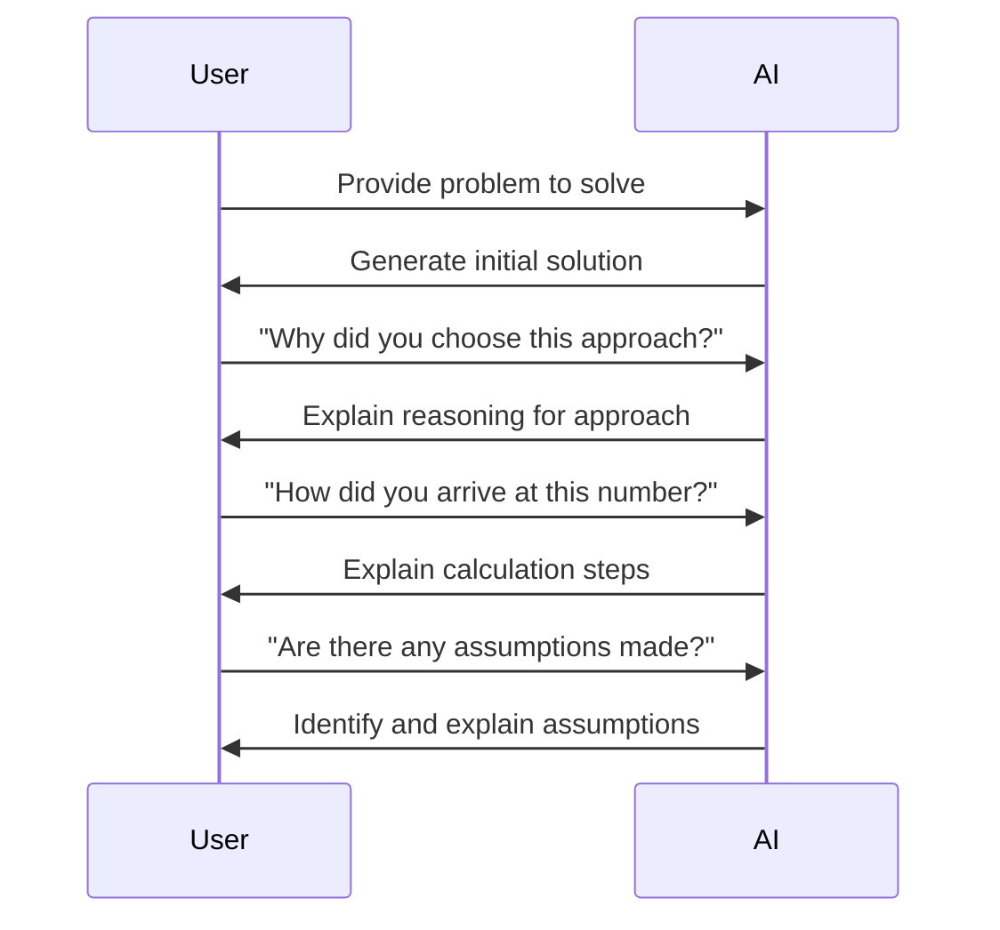
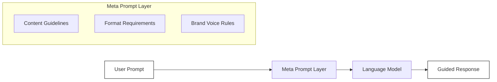
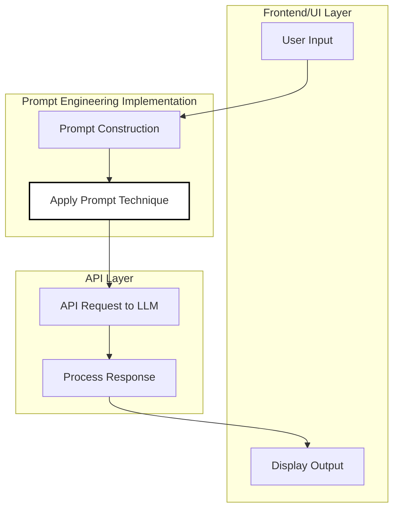

<!-- source: DeepWiki mcp.deepwiki.com · repo microsoft/generative-ai-with-javascript · page 5.1 Prompt Engineering Techniques · fetched 2026-10-26 -->

# Prompt Engineering Techniques

<details>
<summary>Relevant source files</summary>

The following files were used as context for generating this wiki page:

- [lessons/01-intro-to-genai/translations/README.pt-br.md](lessons/01-intro-to-genai/translations/README.pt-br.md)
- [lessons/01-intro-to-genai/translations/README.zh-cn.md](lessons/01-intro-to-genai/translations/README.zh-cn.md)
- [lessons/02-first-ai-app/translations/README.pt-br.md](lessons/02-first-ai-app/translations/README.pt-br.md)
- [lessons/02-first-ai-app/translations/README.zh-cn.md](lessons/02-first-ai-app/translations/README.zh-cn.md)
- [lessons/03-prompt-engineering/README.md](lessons/03-prompt-engineering/README.md)
- [lessons/03-prompt-engineering/translations/README.pt-br.md](lessons/03-prompt-engineering/translations/README.pt-br.md)
- [lessons/03-prompt-engineering/translations/README.zh-cn.md](lessons/03-prompt-engineering/translations/README.zh-cn.md)
- [lessons/04-structured-output/translations/README.pt-br.md](lessons/04-structured-output/translations/README.pt-br.md)
- [lessons/04-structured-output/translations/README.zh-cn.md](lessons/04-structured-output/translations/README.zh-cn.md)
- [lessons/05-rag/translations/README.pt-br.md](lessons/05-rag/translations/README.pt-br.md)
- [lessons/05-rag/translations/README.zh-cn.md](lessons/05-rag/translations/README.zh-cn.md)

</details>


This page documents the various prompt engineering techniques implemented throughout the Generative AI with JavaScript repository. Prompt engineering is the practice of crafting effective prompts to get the desired output from large language models (LLMs). Understanding these techniques is essential for developers looking to build robust AI applications that produce consistent, accurate, and useful responses.

For information about other advanced techniques like Retrieval-Augmented Generation (RAG), see [RAG Architecture](#5.2).

## Overview of Prompt Engineering

Prompt engineering is about designing inputs (prompts) that guide AI models to produce desired outputs. Despite the technical-sounding name, it's not about building infrastructure, but rather about crafting the right instructions to get optimal results from language models.



Sources: [lessons/03-prompt-engineering/README.md:134-200]()

## Why Prompt Engineering Matters

Effective prompt engineering allows developers to:

1. **Get more accurate results** from language models, improving user experience
2. **Control the output** to ensure relevance and appropriateness for users
3. **Format the output** in ways that are easier to understand and consume

These capabilities are particularly important when dealing with sensitive topics or when you need to maintain a consistent brand voice.

Sources: [lessons/03-prompt-engineering/README.md:162-174]()

## Four Key Prompt Engineering Techniques

### 1. Few-shot Prompting

Few-shot prompting involves providing examples within your prompt to guide the AI's responses. By showing the model a few examples of the type of response you want, you help it understand the pattern and format expected.

#### Example:
```
"Tell me about the Roman Colosseum." → "It's a massive amphitheater."
"What was life like in ancient Rome?" → "It was bustling and tough."
```

When you then ask a new question, the model has a pattern to follow, even when you're in unusual contexts (like flying in an aerial screw, as in the repository's narrative).

Sources: [lessons/03-prompt-engineering/README.md:192-202]()

### 2. Chain-of-thought Prompting

Chain-of-thought prompting guides the AI through a step-by-step reasoning process to solve complex problems methodically. This technique is particularly useful for mathematical calculations, logical reasoning, and other scenarios requiring a series of deductions.



#### Example from the Repository:
Using chain-of-thought for calculating landing time:
- 100 meters above ground
- Gravity: 9.8 m/s²
- How many seconds to land?

The LLM then shows its work:
- Height = 100m, initial vertical speed = 0 m/s, gravity = 9.8 m/s²
- Using formula: height = ½ * g * t²
- Solving: 100 = ½ * 9.8 * t² → t ≈ 4.5s

This approach helps the AI "think through" the problem, resulting in more accurate answers for complex calculations.

Sources: [lessons/03-prompt-engineering/README.md:204-226]()

### 3. Maieutic Prompting

Maieutic prompting uses guided questioning to verify the accuracy of AI outputs. This technique involves asking the AI to explain its reasoning for each step of its response, ensuring consistent logic throughout.



#### Example:
1. AI provides an answer about landing time (4.5 seconds)
2. User asks: "Why 4.5 seconds?"
3. AI explains the formula and calculation steps in detail

This technique helps catch errors in reasoning and makes the AI's thought process transparent, allowing developers to verify the quality of responses.

Sources: [lessons/03-prompt-engineering/README.md:227-249]()

### 4. Meta-prompts

Meta-prompts add additional instructions to shape the AI's output more precisely. They act as guardrails for AI responses, ensuring outputs follow specific guidelines regarding content, format, or tone.



#### Example:
```
Meta Prompt: Use only Contoso Inc. products (basketballs, soccer balls, tennis rackets). Keep it accurate and user-friendly.
User Prompt: Best sports products for beginners?
```

With the meta-prompt, the AI restricts its response to Contoso products. Without it, the AI might mention non-Contoso products, diluting brand messaging.

Meta-prompts are particularly valuable in customer-facing applications where consistency and adherence to specific guidelines are important.

Sources: [lessons/03-prompt-engineering/README.md:251-282]()

## Implementation in JavaScript Applications

In the Generative AI with JavaScript repository, these prompt engineering techniques are implemented in various JavaScript applications. Here's how they connect to the code:



### Example Application: Aerial Screw Calculator

The repository includes an example of implementing chain-of-thought prompting in a JavaScript application that calculates whether an aerial screw (Leonardo da Vinci's flying machine) can safely land.

```javascript
// Key parameters gathered from user input
const height = 100; // meters
const forwardSpeed = 10; // meters per second
const gravity = 9.8; // meters per second squared
const upwardWind = 0.7; // meters per second
const distanceToHill = 100; // meters

// Constructing prompt with chain-of-thought instruction
const augmentedPrompt = `
## Instructions
Calculate if the aerial screw can safely land on the hill.
Show your work step by step.

## Parameters
- Current height above ground: ${height} meters
- Forward speed: ${forwardSpeed} meters per second
- Gravity: ${gravity} meters per second squared
- Upward wind: ${upwardWind} meters per second
- Distance to hill: ${distanceToHill} meters
`;
```

This example demonstrates how chain-of-thought prompting is implemented by:
1. Gathering input parameters
2. Constructing a prompt that explicitly asks for step-by-step reasoning
3. Processing the response to extract the calculated result

Sources: [lessons/03-prompt-engineering/README.md:284-307]()

## Choosing the Right Technique

The following table summarizes when to use each prompt engineering technique:

| Technique | Best Used For | Implementation Complexity | Example Use Case |
|-----------|---------------|---------------------------|------------------|
| Few-shot Prompting | Tasks where examples help clarify intent | Low | Teaching the model to format responses in a specific way |
| Chain-of-thought | Complex calculations, logic problems | Medium | Math calculations, step-by-step reasoning |
| Meta-prompts | Ensuring adherence to guidelines | Low-Medium | Brand-consistent responses, content moderation |
| Maieutic Prompting | Verifying accuracy, critical applications | Medium-High | Financial calculations, medical information |

## Practical Tips for Implementation

When implementing these techniques in your JavaScript applications:

1. **Start simple**: Begin with basic prompts and gradually add complexity
2. **Test extensively**: Different models respond differently to the same prompting techniques
3. **Store templates**: Keep successful prompt templates for reuse
4. **Consider context limits**: Be mindful of token limitations in your chosen model
5. **Combine techniques**: Often, a combination of techniques yields the best results

## Summary

Prompt engineering techniques provide powerful ways to control and enhance AI outputs in your JavaScript applications. By understanding and implementing few-shot prompting, chain-of-thought prompting, meta-prompts, and maieutic prompting, developers can create more accurate, reliable, and useful AI experiences.

These techniques form the foundation for more advanced implementations, such as Retrieval-Augmented Generation (RAG) and Tool Calling, which are covered in subsequent sections of this repository.

Sources: [lessons/03-prompt-engineering/README.md:176-187]()

---

