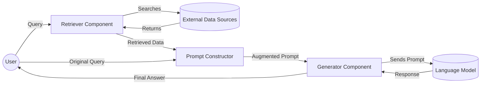
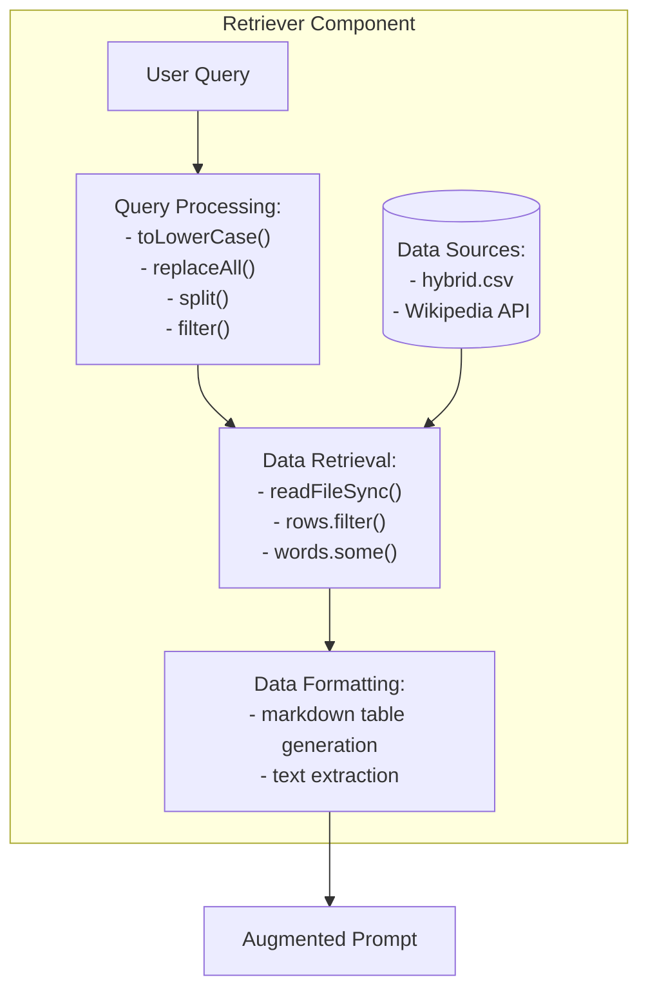
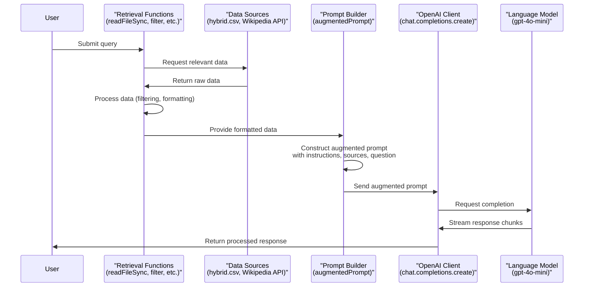
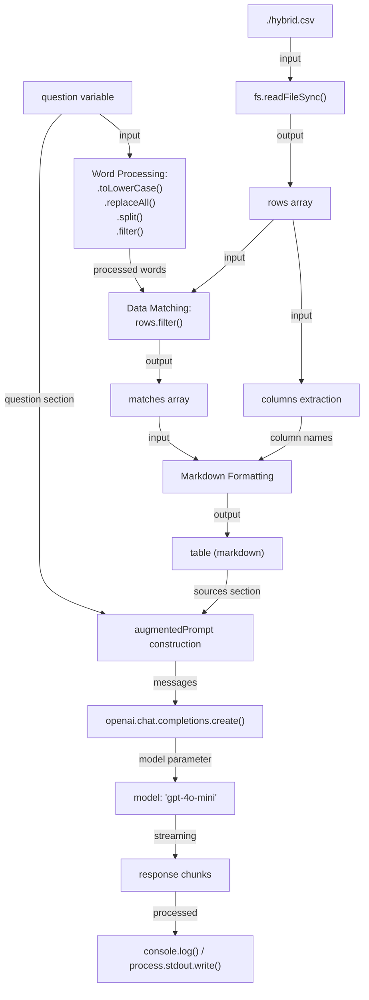

<!-- source: DeepWiki mcp.deepwiki.com · repo microsoft/generative-ai-with-javascript · page 5.2 RAG Architecture · fetched 2026-10-26 -->

# RAG Architecture

<details>
<summary>Relevant source files</summary>

The following files were used as context for generating this wiki page:

- [lessons/01-intro-to-genai/README.md](lessons/01-intro-to-genai/README.md)
- [lessons/02-first-ai-app/README.md](lessons/02-first-ai-app/README.md)
- [lessons/03-prompt-engineering/translations/README.bn.md](lessons/03-prompt-engineering/translations/README.bn.md)
- [lessons/04-structured-output/README.md](lessons/04-structured-output/README.md)
- [lessons/05-rag/README.md](lessons/05-rag/README.md)
- [lessons/05-rag/translations/README.bn.md](lessons/05-rag/translations/README.bn.md)

</details>


This document explains the architecture and implementation of Retrieval-Augmented Generation (RAG) systems, which enhance language model responses by integrating external data sources. RAG addresses key limitations of traditional language models by retrieving and incorporating relevant information from controlled sources.

For information about using function calling with RAG results, see [Tool Calling Implementation](#5.3).

## Core RAG Concept

Traditional Large Language Models (LLMs) have several limitations that RAG helps address:

| Challenge | Description |
|-----------|-------------|
| Out-of-date information | Training data may be outdated |
| Inaccurate information | Training sources may contain errors or misinformation |
| Non-authoritative sources | Models may not distinguish between reliable and unreliable sources |

RAG addresses these issues by combining a retrieval system with a generative model, enabling more accurate and contextually relevant responses backed by external data.

RAG Architecture



Sources: [lessons/05-rag/README.md:123-144]()

## RAG Components

### 1. Retriever Component

The retriever is responsible for finding relevant information from external data sources based on the user's query. It processes the query, searches through data sources, and returns the most relevant information.



Sources: [lessons/05-rag/README.md:126-132](), [lessons/05-rag/example/rag-cars.js:29-62]()

In the codebase example, the retriever implementation loads data from a CSV file and performs a keyword-based search:

```javascript
// Load CSV data
const rows = fs.readFileSync("./hybrid.csv", "utf8").split("\n");
const columns = rows[0].split(",");

// Process query and search for matches
const words = question
  .toLowerCase()
  .replaceAll(/[.?!()'":,]/g, "")
  .split(" ")
  .filter((word) => word.length > 2);
const matches = rows.slice(1).filter((row) => 
  words.some((word) => row.toLowerCase().includes(word))
);

// Format as markdown table
const table = `| ${columns.join(" | ")} |\n` +
  `|${columns.map(() => "---").join(" | ")}|\n` +
  matches.map((row) => `| ${row.replaceAll(",", " | ")} |\n`).join("");
```

Sources: [lessons/05-rag/example/rag-cars.js:29-62]()

### 2. Prompt Construction

The prompt constructor combines the original user query with the retrieved information and instructions for the language model. This "augmented prompt" guides the model to generate responses based on the provided information.

```javascript
const augmentedPrompt = `
## Instructions
Answer questions about hybrid cars using only the sources below.
If there's not enough data in provided sources, say that you don't know.
Be brief and straight to the point.

## Sources
${table}

## Question
${question}
`;
```

Sources: [lessons/05-rag/README.md:172-195](), [lessons/05-rag/example/rag-cars.js:64-79]()

Note the "escape hatch" instruction: `If there's not enough data in provided sources, say that you don't know.` This prevents the model from generating incorrect information when there isn't sufficient data.

### 3. Generator Component

The generator takes the augmented prompt and sends it to a language model to generate a response. In the codebase, this is implemented using the OpenAI client:

```javascript
const openai = new OpenAI({
  baseURL: "https://models.inference.ai.azure.com",
  apiKey: process.env.GITHUB_TOKEN,
});

const chunks = await openai.chat.completions.create({
  model: "gpt-4o-mini",
  messages: [{ role: "user", content: augmentedPrompt }],
  stream: true,
});

console.log(`Answer for "${question}":`);

for await (const chunk of chunks) {
  process.stdout.write(chunk.choices[0].delta.content ?? "");
}
```

Sources: [lessons/05-rag/example/rag-cars.js:81-98]()

## RAG Process Flow

This diagram shows the complete RAG process flow from user query to final response:

RAG Process Flow



Sources: [lessons/05-rag/README.md:133-144](), [lessons/05-rag/example/rag-cars.js:22-98]()

## External Data Sources Integration

RAG can integrate various external data sources:

| Data Source Type | Description | Implementation Example |
|------------------|-------------|------------------------|
| APIs | Access real-time data programmatically | Wikipedia API for information retrieval |
| Databases | Store and query structured data | Not directly shown in code examples |
| CSV Files | Local structured data storage | `hybrid.csv` in the example code |
| Text Files | Various document formats | Potential extension point |

Sources: [lessons/05-rag/README.md:149-165]()

### Wikipedia API Example

The repository includes an example of using the Wikipedia API as an external data source:

```javascript
const response = await fetch('https://en.wikipedia.org/w/api.php?format=json&action=query&prop=extracts&redirects=true&explaintext&titles=Tim%20Berners-Lee');
const data = await response.json();
const text = Object.values(data.query.pages)[0]?.extract;
```

Sources: [lessons/05-rag/README.md:442-447]()

## Prompt Augmentation Techniques

Effective prompt construction is crucial for RAG. The codebase demonstrates several techniques:

1. **Clear Instructions** - Telling the model how to use the retrieved information:
   ```
   Answer questions using only the sources below.
   ```

2. **Source Citation** - Clearly identifying retrieved information:
   ```
   ## Sources
   [Retrieved information]
   ```

3. **Escape Hatch** - Handling insufficient information:
   ```
   If there's not enough data in provided sources, say that you don't know.
   ```

Sources: [lessons/05-rag/README.md:172-195]()

## RAG Implementation Details

The following diagram shows the detailed implementation of RAG in the `rag-cars.js` example:

RAG Implementation in rag-cars.js



Sources: [lessons/05-rag/example/rag-cars.js:22-98]()

## Data Search Techniques

Depending on your data and requirements, different search techniques can be used in the retriever component:

| Search Technique | Description | Best Use Case |
|-----------------|-------------|---------------|
| Keyword Search | Find exact word matches | Simple queries, structured data |
| Full-Text Search | Searches entire content | Document collections, articles |
| Semantic Search | Searches based on meaning | Complex queries, natural language |
| Vector Search | Uses embeddings to find similar content | Finding conceptually related information |

Sources: [lessons/05-rag/README.md:234-239]()

## Benefits of RAG

| Benefit | Description |
|---------|-------------|
| Improved Accuracy | Uses current, verified information from controlled sources |
| Reduced Hallucination | Prevents model from generating incorrect information |
| Greater Control | Specifies what information the model should use |
| Up-to-date Information | Accesses real-time data not available during model training |
| Source Attribution | Can cite specific sources for generated information |

Sources: [lessons/05-rag/README.md:126-132](), [lessons/05-rag/README.md:195-227]()

## Best Practices

When implementing RAG systems:

1. **Data Quality** - Ensure the retrieved information is accurate and relevant
2. **Privacy and Security** - Obtain proper permissions for accessing and storing data
3. **Performance Optimization** - Balance retrieval depth with response time
4. **Clear Instructions** - Guide the model on how to use the retrieved information
5. **Escape Hatches** - Instruct the model to acknowledge when it lacks sufficient information

Sources: [lessons/05-rag/README.md:227-239]()

## Conclusion

RAG architecture combines retrieval systems with generative models to create more accurate, relevant, and controlled AI responses. By supplementing the language model's knowledge with external data, RAG addresses many limitations of traditional LLMs and provides a powerful framework for building information-rich AI applications.

The implementation in this codebase demonstrates a functional RAG system that can be extended and customized for various use cases and data sources.

---

