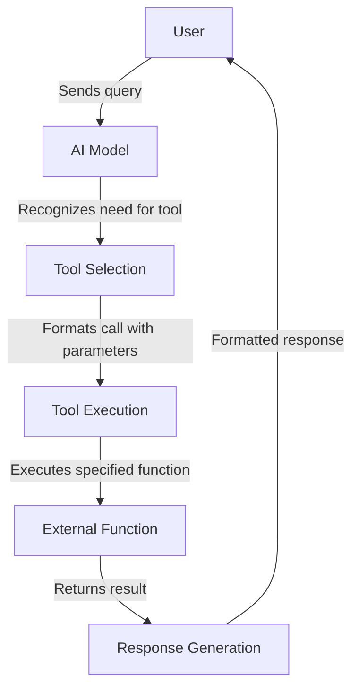
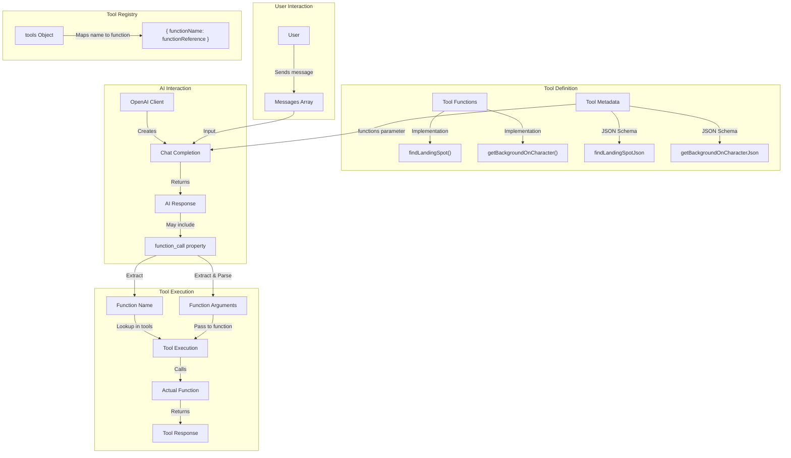
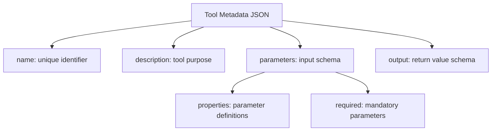
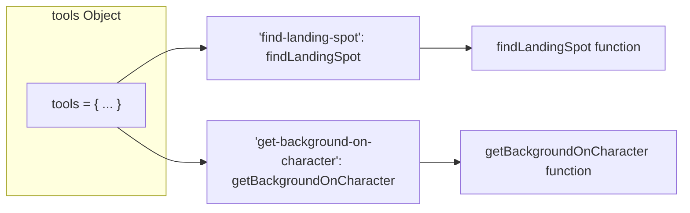
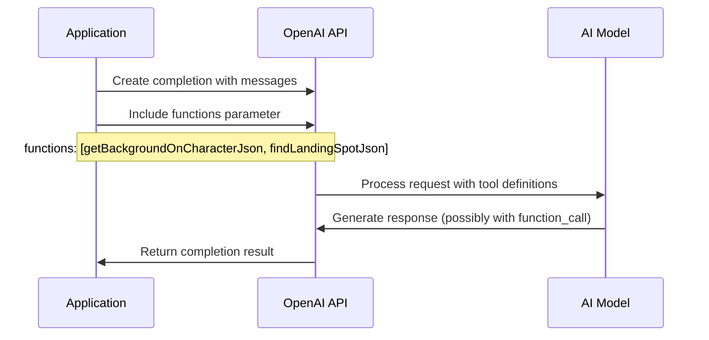
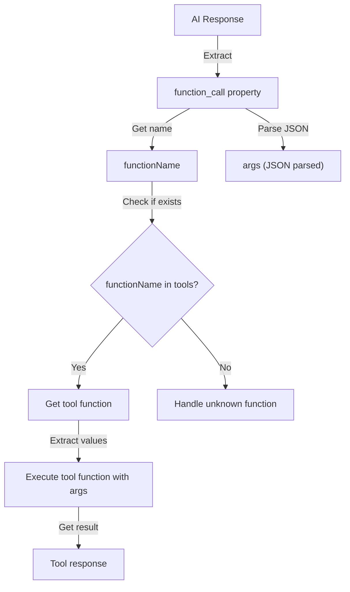
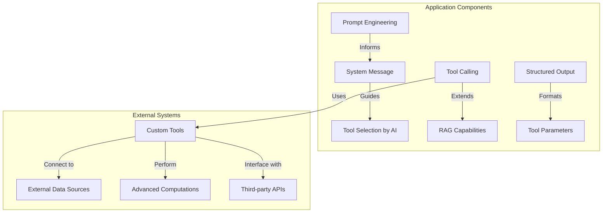

<!-- source: DeepWiki mcp.deepwiki.com · repo microsoft/generative-ai-with-javascript · page 5.3 Tool Calling Implementation · fetched 2026-10-26 -->

# Tool Calling Implementation

<details>
<summary>Relevant source files</summary>

The following files were used as context for generating this wiki page:

- [lessons/01-intro-to-genai/solution/solution-quiz.md](lessons/01-intro-to-genai/solution/solution-quiz.md)
- [lessons/02-first-ai-app/solution/solution-quiz.md](lessons/02-first-ai-app/solution/solution-quiz.md)
- [lessons/03-prompt-engineering/solution/solution-quiz.md](lessons/03-prompt-engineering/solution/solution-quiz.md)
- [lessons/03-prompt-engineering/solution/solution.md](lessons/03-prompt-engineering/solution/solution.md)
- [lessons/04-structured-output/solution/solution-quiz.md](lessons/04-structured-output/solution/solution-quiz.md)
- [lessons/05-rag/solution/solution-quiz.md](lessons/05-rag/solution/solution-quiz.md)
- [lessons/06-tool-calling/code/app.js](lessons/06-tool-calling/code/app.js)
- [lessons/06-tool-calling/code/package-lock.json](lessons/06-tool-calling/code/package-lock.json)
- [lessons/06-tool-calling/code/package.json](lessons/06-tool-calling/code/package.json)
- [lessons/06-tool-calling/solution/solution-quiz.md](lessons/06-tool-calling/solution/solution-quiz.md)

</details>


## Purpose and Scope

This document provides a detailed technical explanation of how tool calling (also known as function calling) is implemented in the Generative AI with JavaScript course. Tool calling enables AI models to invoke external functions to perform tasks beyond their built-in capabilities, such as retrieving specific information or performing calculations. This implementation allows the AI to suggest when and how to use tools based on user queries.

For information about the overall RAG architecture, see [RAG Architecture](#5.2).

## Concept Overview

Tool calling creates a bridge between AI language models and external JavaScript functions, allowing the model to trigger actions in the outside world. When implemented correctly, the AI can:

1. Recognize when a user request requires an external tool
2. Select the appropriate tool for the task
3. Format the arguments correctly for the function call
4. Return the results to the user in a natural way



Sources: [lessons/06-tool-calling/solution/solution-quiz.md:1-38]()

## Tool Calling Architecture

The tool calling implementation follows this architecture:



Sources: [lessons/06-tool-calling/code/app.js:1-108]()

## Tool Definition

Tools are defined by two components:

1. **The actual function implementation** - JavaScript functions that perform specific tasks
2. **Tool metadata** - JSON schema that describes the function, its parameters, and return type

### Function Implementation

Functions should be clear, well-defined, and handle the specific task they're designed for:

```mermaid
classDiagram
    class "Tool Function" {
        +Input parameters
        +Processing logic
        +Return value
    }
    
    class "findLandingSpot()" {
        +lat: number
        +long: number
        +Process coordinates
        +Return landing coordinates
    }
    
    class "getBackgroundOnCharacter()" {
        +character: string
        +Retrieve character info
        +Return background text
    }
    
    "Tool Function" <|-- "findLandingSpot()"
    "Tool Function" <|-- "getBackgroundOnCharacter()"
```

Sources: [lessons/06-tool-calling/code/app.js:3-15]()

### Tool Metadata Schema

Each tool requires a JSON schema defining:

| Property | Description | Example |
|----------|-------------|---------|
| name | Unique identifier for the tool | "find-landing-spot" |
| description | Explains what the tool does | "Finds a suitable landing spot" |
| parameters | JSON Schema defining inputs | Object with property definitions |
| required | Array of required parameters | ["lat", "long"] |
| output | Schema describing the return value | { type: "object", properties: {...} } |

Here's an example of the tool metadata schema structure:



Sources: [lessons/06-tool-calling/code/app.js:17-51]()

## Tool Registration

Tools are registered with the AI model in two steps:

1. Creating a mapping between tool names and their function implementations
2. Passing tool metadata to the AI model during the API call

### Function Mapping

A tools object maps function names to their implementations:



Sources: [lessons/06-tool-calling/code/app.js:53-56]()

### Registering with the AI Model

Tool metadata is passed to the AI model via the `functions` parameter in the API call:



Sources: [lessons/06-tool-calling/code/app.js:84-88]()

## Tool Execution Flow

When the AI suggests a tool, the application needs to:

1. Extract the function call information from the AI response
2. Parse the arguments
3. Look up the function in the tools registry
4. Execute the function with the provided arguments
5. Handle the response



Sources: [lessons/06-tool-calling/code/app.js:90-104]()

## Example Implementation

The repository includes a complete implementation of tool calling in the application code. Here's how it works:

1. **Define tool functions**: 
   - `findLandingSpot`: Finds landing coordinates based on latitude and longitude
   - `getBackgroundOnCharacter`: Retrieves background information about a character

2. **Define tool metadata**: 
   - JSON schemas that describe each function's parameters and outputs

3. **Create tool mapping**:
   - Map function names to their implementations in a tools object

4. **Set up the OpenAI client**:
   - Initialize the client with appropriate configurations

5. **Create messages array**:
   - System message setting context
   - User message with a query

6. **Make API request**:
   - Include functions parameter with tool metadata

7. **Process the response**:
   - Extract function call information
   - Parse arguments
   - Execute the appropriate function
   - Handle the result

Sources: [lessons/06-tool-calling/code/app.js:1-108]()

## Benefits of Tool Calling

Tool calling provides several advantages:

| Benefit | Description |
|---------|-------------|
| Extended Capabilities | Enables AI to perform tasks it couldn't do with just language processing |
| Precision | Tools perform specific tasks with exact inputs and outputs |
| Factuality | Retrieves real-time or accurate information from external sources |
| Code Execution | Allows safe execution of code without exposing the language model to execution risks |
| Integration | Connects AI capabilities with existing application functions |

Sources: [lessons/06-tool-calling/solution/solution-quiz.md:29-38]()

## Technical Considerations

When implementing tool calling, consider the following:

1. **Security**: Ensure tools only perform safe operations since they're being triggered by AI
2. **Error Handling**: Properly validate inputs and handle errors during tool execution
3. **Parameter Validation**: Verify that required parameters are present and of the correct type
4. **Performance**: Consider the performance implications of functions that might take time to execute
5. **Tool Selection**: The AI might not always choose the most appropriate tool, so provide clear descriptions

Sources: [lessons/06-tool-calling/code/app.js:90-104]()

## Integration with Other Components

Tool calling integrates with other components of the application:



Sources: [lessons/06-tool-calling/solution/solution-quiz.md:1-38]()

---

