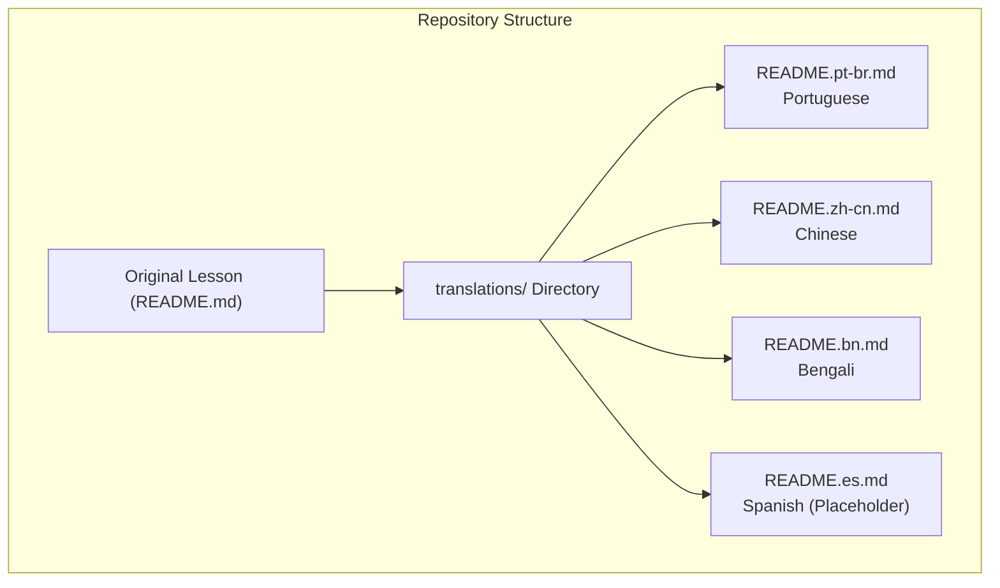
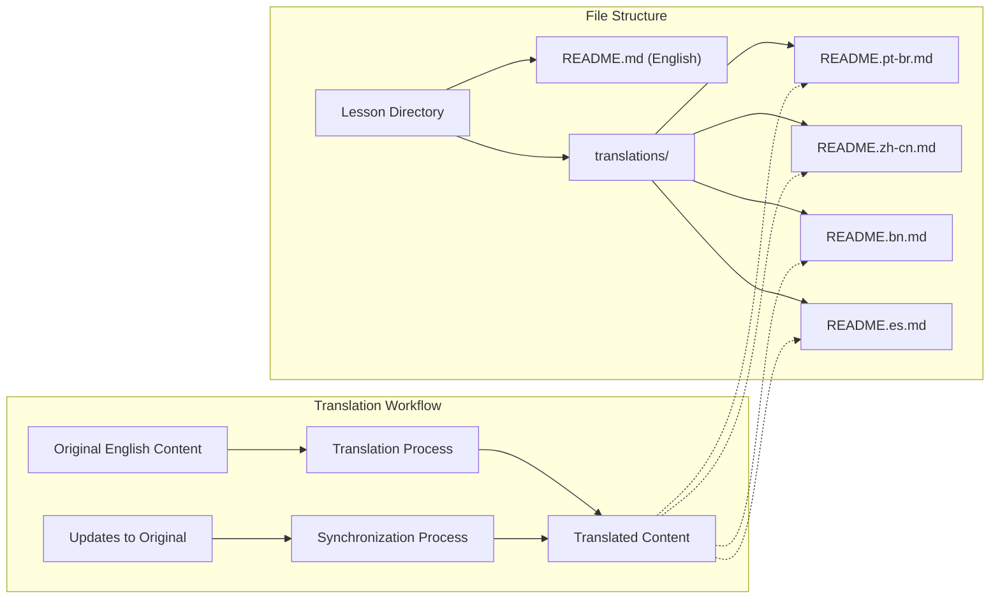
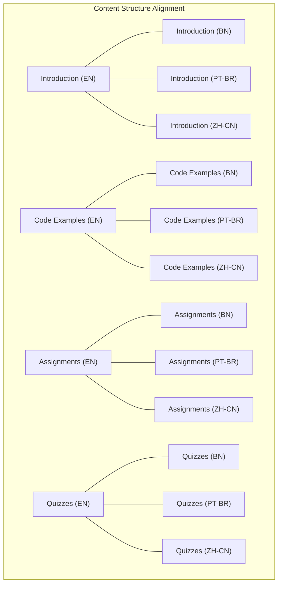
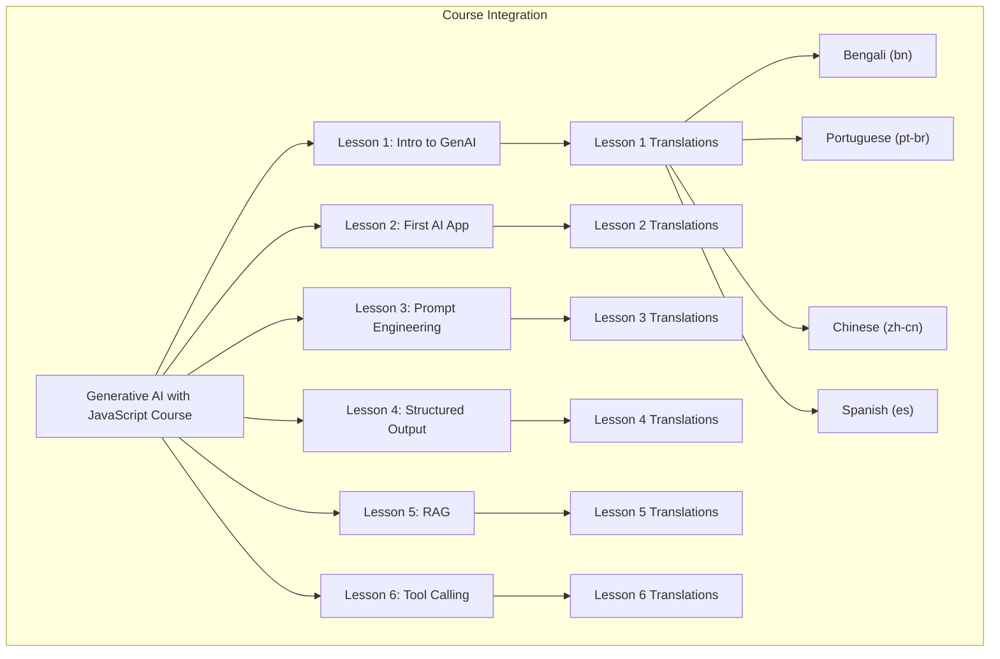

<!-- source: DeepWiki mcp.deepwiki.com · repo microsoft/generative-ai-with-javascript · page 6 Multilingual Support · fetched 2026-10-26 -->

# Multilingual Support

<details>
<summary>Relevant source files</summary>

The following files were used as context for generating this wiki page:

- [lessons/01-intro-to-genai/translations/README.bn.md](lessons/01-intro-to-genai/translations/README.bn.md)
- [lessons/01-intro-to-genai/translations/README.es.md](lessons/01-intro-to-genai/translations/README.es.md)
- [lessons/01-intro-to-genai/translations/README.pt-br.md](lessons/01-intro-to-genai/translations/README.pt-br.md)
- [lessons/01-intro-to-genai/translations/README.zh-cn.md](lessons/01-intro-to-genai/translations/README.zh-cn.md)
- [lessons/02-first-ai-app/translations/README.bn.md](lessons/02-first-ai-app/translations/README.bn.md)
- [lessons/02-first-ai-app/translations/README.es.md](lessons/02-first-ai-app/translations/README.es.md)
- [lessons/02-first-ai-app/translations/README.pt-br.md](lessons/02-first-ai-app/translations/README.pt-br.md)
- [lessons/02-first-ai-app/translations/README.zh-cn.md](lessons/02-first-ai-app/translations/README.zh-cn.md)
- [lessons/03-prompt-engineering/translations/README.es.md](lessons/03-prompt-engineering/translations/README.es.md)
- [lessons/03-prompt-engineering/translations/README.pt-br.md](lessons/03-prompt-engineering/translations/README.pt-br.md)
- [lessons/03-prompt-engineering/translations/README.zh-cn.md](lessons/03-prompt-engineering/translations/README.zh-cn.md)
- [lessons/04-structured-output/translations/README.bn.md](lessons/04-structured-output/translations/README.bn.md)
- [lessons/04-structured-output/translations/README.es.md](lessons/04-structured-output/translations/README.es.md)
- [lessons/04-structured-output/translations/README.pt-br.md](lessons/04-structured-output/translations/README.pt-br.md)
- [lessons/04-structured-output/translations/README.zh-cn.md](lessons/04-structured-output/translations/README.zh-cn.md)
- [lessons/05-rag/translations/README.es.md](lessons/05-rag/translations/README.es.md)
- [lessons/05-rag/translations/README.pt-br.md](lessons/05-rag/translations/README.pt-br.md)
- [lessons/05-rag/translations/README.zh-cn.md](lessons/05-rag/translations/README.zh-cn.md)

</details>


This document describes the multilingual support system in the Generative AI with JavaScript repository, which enables content accessibility across multiple languages. The system focuses on translating lesson materials, making the course content available to a global audience beyond just English speakers.

## Overview

The repository implements multilingual support through a structured translation system where course content is made available in multiple languages. This allows learners from different linguistic backgrounds to access the educational materials in their preferred language.

Sources: [lessons/01-intro-to-genai/translations/README.bn.md](lessons/01-intro-to-genai/translations/README.bn.md), [lessons/01-intro-to-genai/translations/README.pt-br.md](lessons/01-intro-to-genai/translations/README.pt-br.md)

## Translation Structure

The multilingual support is organized through a dedicated `translations` directory within each lesson folder. Each translated README file follows a naming convention that incorporates the language code.



**File Naming Convention:**
```
README.[language-code].md
```

Where `[language-code]` follows the [ISO language code](https://en.wikipedia.org/wiki/List_of_ISO_639-1_codes) format, sometimes including regional variants (e.g., `pt-br` for Brazilian Portuguese).

Sources: [lessons/01-intro-to-genai/translations/README.bn.md](lessons/01-intro-to-genai/translations/README.bn.md), [lessons/02-first-ai-app/translations/README.bn.md](lessons/02-first-ai-app/translations/README.bn.md), [lessons/03-prompt-engineering/translations/README.pt-br.md](lessons/03-prompt-engineering/translations/README.pt-br.md)

## Supported Languages

The repository currently supports the following languages:

| Language | Code | Status | Example Path |
|----------|------|--------|-------------|
| English | en | Primary | /lessons/01-intro-to-genai/README.md |
| Bengali | bn | Complete | /lessons/01-intro-to-genai/translations/README.bn.md |
| Portuguese (Brazil) | pt-br | Complete | /lessons/01-intro-to-genai/translations/README.pt-br.md |
| Chinese (Simplified) | zh-cn | Complete | /lessons/01-intro-to-genai/translations/README.zh-cn.md |
| Spanish | es | Placeholder | /lessons/01-intro-to-genai/translations/README.es.md |

Sources: [lessons/01-intro-to-genai/translations/README.bn.md](lessons/01-intro-to-genai/translations/README.bn.md), [lessons/01-intro-to-genai/translations/README.pt-br.md](lessons/01-intro-to-genai/translations/README.pt-br.md), [lessons/01-intro-to-genai/translations/README.zh-cn.md](lessons/01-intro-to-genai/translations/README.zh-cn.md), [lessons/03-prompt-engineering/translations/README.es.md](lessons/03-prompt-engineering/translations/README.es.md)

## Translation Content Workflow

The following diagram illustrates how content flows through the translation system:



Sources: [lessons/01-intro-to-genai/translations/README.bn.md](lessons/01-intro-to-genai/translations/README.bn.md), [lessons/02-first-ai-app/translations/README.bn.md](lessons/02-first-ai-app/translations/README.bn.md)

## Content Alignment

Translated content maintains the same structure as the original English content, including:

1. Headings and section organization
2. Code examples
3. Images and diagrams
4. Links to resources
5. Assignments and quizzes

Each translation preserves the narrative elements, technical explanations, and interactive components of the lessons, ensuring a consistent learning experience across languages.



Sources: [lessons/01-intro-to-genai/translations/README.bn.md](lessons/01-intro-to-genai/translations/README.bn.md), [lessons/04-structured-output/translations/README.bn.md](lessons/04-structured-output/translations/README.bn.md), [lessons/04-structured-output/translations/README.pt-br.md](lessons/04-structured-output/translations/README.pt-br.md)

## Navigation Between Translations

While the repository doesn't appear to have an automatic language switcher, users can navigate between translations by:

1. Identifying the current lesson they're viewing
2. Accessing the `translations` directory within that lesson
3. Selecting the README file with their desired language code

For example, if a user is viewing `/lessons/01-intro-to-genai/README.md` and wants the Bengali version, they would navigate to `/lessons/01-intro-to-genai/translations/README.bn.md`.

Sources: [lessons/01-intro-to-genai/translations/README.bn.md](lessons/01-intro-to-genai/translations/README.bn.md)

## Integration with Learning Content

Multilingual support is tightly integrated with the course structure. Each lesson in the curriculum has its own set of translations, ensuring comprehensive coverage of the course material across languages.



Sources: [lessons/01-intro-to-genai/translations/README.bn.md](lessons/01-intro-to-genai/translations/README.bn.md), [lessons/02-first-ai-app/translations/README.bn.md](lessons/02-first-ai-app/translations/README.bn.md), [lessons/04-structured-output/translations/README.bn.md](lessons/04-structured-output/translations/README.bn.md)

## Code Examples in Translations

All code examples in translations remain in JavaScript/English, ensuring consistency and making it easier for learners to relate the explanations to the actual code they'll write. However, the comments and explanations surrounding the code are translated to the target language.

Example from Bengali translation:

```javascript
// প্রসঙ্গ নির্ধারণ করুন

const messages = [ 
 { 
    "role": "user", 
    "content": "আমি ইতালিতে একটি ভ্রমণ বুক করতে চাই।" 
 }, 
 { 
    "role": "assistant", 
    "content": "নিশ্চয়ই, আপনি কখন যেতে চান?" 
 }
 // ... more messages
]; 
```

Sources: [lessons/02-first-ai-app/translations/README.bn.md:290-320](lessons/02-first-ai-app/translations/README.bn.md)

## Contributing Translations

While the repository doesn't explicitly document the process for contributing translations, the structure suggests a standard workflow for open-source contributions:

1. Fork the repository
2. Create translations for lessons without your language
3. Follow the existing naming conventions (README.[language-code].md)
4. Submit a pull request with your translations

For complete translations, contributors should ensure they translate:
- All headings and text
- Image captions
- Knowledge check questions and answers
- Assignment instructions

Sources: [lessons/01-intro-to-genai/translations/README.bn.md](lessons/01-intro-to-genai/translations/README.bn.md), [lessons/03-prompt-engineering/translations/README.es.md](lessons/03-prompt-engineering/translations/README.es.md)

## Translation Completeness

The repository shows varying degrees of translation completeness:

| Language | Lessons Translated | Completeness |
|----------|-------------------|--------------|
| Bengali (bn) | 1, 2, 4 | Comprehensive |
| Portuguese (pt-br) | 1, 2, 3, 4, 5 | Comprehensive |
| Chinese (zh-cn) | 1, 2, 3, 5 | Comprehensive |
| Spanish (es) | 3, 4 (placeholders) | Minimal |

Sources: [lessons/01-intro-to-genai/translations/README.bn.md](lessons/01-intro-to-genai/translations/README.bn.md), [lessons/03-prompt-engineering/translations/README.pt-br.md](lessons/03-prompt-engineering/translations/README.pt-br.md), [lessons/03-prompt-engineering/translations/README.es.md](lessons/03-prompt-engineering/translations/README.es.md)

## Future Expansion

The multilingual support system is designed to be extensible, allowing for:

1. Addition of new languages
2. Translation of new lessons as they're added to the curriculum
3. Improvement of existing translations

The Spanish placeholders indicate an intent to expand language support further.

Sources: [lessons/03-prompt-engineering/translations/README.es.md](lessons/03-prompt-engineering/translations/README.es.md), [lessons/04-structured-output/translations/README.es.md](lessons/04-structured-output/translations/README.es.md)

---

