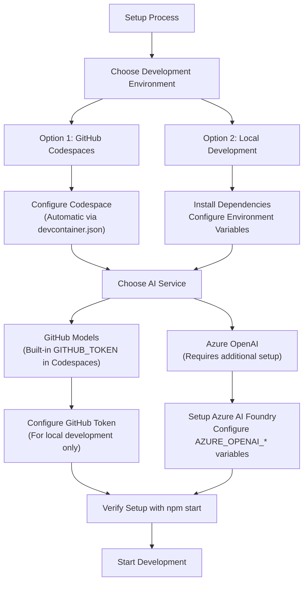
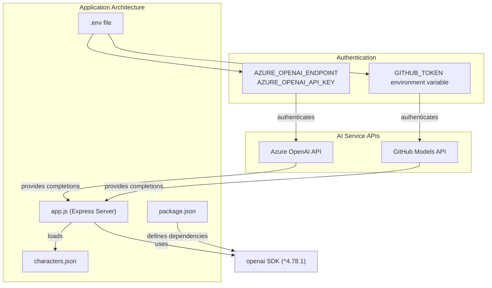
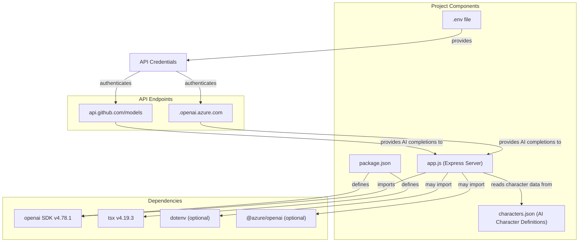

<!-- source: DeepWiki mcp.deepwiki.com · repo microsoft/generative-ai-with-javascript · page 7 Setup and Configuration · fetched 2026-10-26 -->

# Setup and Configuration

<details>
<summary>Relevant source files</summary>

The following files were used as context for generating this wiki page:

- [.github/workflows/links.yml](.github/workflows/links.yml)
- [.vscode/settings.json](.vscode/settings.json)
- [docs/images/background.png](docs/images/background.png)
- [docs/images/character-chat.png](docs/images/character-chat.png)
- [docs/images/create-codespace.png](docs/images/create-codespace.png)
- [docs/images/playground-snippets.png](docs/images/playground-snippets.png)
- [docs/images/playground.png](docs/images/playground.png)
- [docs/setup/README.md](docs/setup/README.md)
- [docs/setup/getting-started-azure-openai.md](docs/setup/getting-started-azure-openai.md)
- [package-lock.json](package-lock.json)
- [package.json](package.json)

</details>


This document provides comprehensive instructions for setting up the development environment and configuring API access for the Generative AI with JavaScript repository. It covers the prerequisites, development environment options, and step-by-step configuration for both GitHub Models and Azure OpenAI.

For information about the overall repository structure and components, see [Overview](#1).

## System Requirements

To work with this repository, you need:

- Node.js (version 18+ recommended)
- npm (for package management)
- Git (for version control)
- GitHub account (for Codespaces and GitHub Models access)
- Azure account (optional, only if using Azure OpenAI)

Sources:
- [package.json:1-12]()
- [package-lock.json:16-48]()

## Development Environment Options



Sources:
- [docs/setup/README.md:5-20]()
- [docs/setup/getting-started-azure-openai.md:1-9]()

### Option 1: GitHub Codespaces (Recommended)

GitHub Codespaces provides a pre-configured development environment with all necessary tools and libraries already installed. This is the fastest way to get started.

Steps to create a GitHub Codespace:

1. Fork the repository to your GitHub account
2. Click the **Code** dropdown button on your forked repository
3. Select the **Codespaces** tab
4. Click the **+** button to create a new codespace

The Codespace will automatically set up with the Visual Studio Code configuration and all required dependencies.

Sources:
- [docs/setup/README.md:100-113]()
- [.vscode/settings.json:1-9]()

### Option 2: Local Development Setup

If you prefer to work on your local machine:

1. Clone the repository:
   ```bash
   git clone https://github.com/microsoft/generative-ai-with-javascript.git
   cd generative-ai-with-javascript
   ```

2. Install dependencies:
   ```bash
   npm install
   ```

This will install the required packages:
- `openai` - OpenAI SDK (^4.78.1)
- `tsx` - TypeScript execution environment (dev dependency)

Sources:
- [package.json:6-11]()
- [docs/setup/README.md:149-165]()

## AI Service Configuration



Sources:
- [package.json:6-7]()
- [docs/setup/README.md:27-52]()
- [docs/setup/getting-started-azure-openai.md:10-20]()

### GitHub Models Configuration

GitHub Models provides free access to AI models and is the recommended option for this course.

#### In GitHub Codespaces

When using GitHub Codespaces, you can use the built-in `GITHUB_TOKEN` environment variable—no additional configuration required.

#### For Local Development

To use GitHub Models locally, create a personal access token (PAT):

1. Navigate to GitHub Settings > Developer Settings > Personal access tokens > Tokens (classic)
2. Click **Generate new token (classic)**
3. Provide a name (e.g., `GenAI-JavaScript-Course-Token`)
4. Set an expiration date (7 days recommended for security)
5. No need to add any specific permissions
6. Set the token as an environment variable:

   **macOS/Linux:**
   ```bash
   export GITHUB_TOKEN=<your-token-value>
   ```

   **Windows:**
   ```bash
   set GITHUB_TOKEN=<your-token-value>
   ```

   **Alternatively,** create a `.env` file in the root directory:
   ```
   GITHUB_TOKEN=<your-token-value>
   ```

Sources:
- [docs/setup/README.md:60-98]()

### Azure OpenAI Configuration (Alternative)

If you prefer using Azure OpenAI:

1. Create a hub and project in the Azure AI Foundry Portal
2. Deploy a model (e.g., `gpt-4o-mini`)
3. Note your model name, endpoint, and API key
4. Install additional required packages:
   ```bash
   npm install @azure/openai dotenv
   ```
5. Create a `.env` file with:
   ```
   AZURE_OPENAI_ENDPOINT=<your-endpoint>
   AZURE_OPENAI_API_KEY=<your-api-key>
   ```

Sources:
- [docs/setup/getting-started-azure-openai.md:18-56]()
- [docs/setup/getting-started-azure-openai.md:71-95]()

## Environment Variables Reference

The following environment variables are used in this project:

| Variable | Description | Required For |
|----------|-------------|-------------|
| `GITHUB_TOKEN` | GitHub personal access token | GitHub Models (local setup only) |
| `AZURE_OPENAI_ENDPOINT` | Azure OpenAI service endpoint URL | Azure OpenAI |
| `AZURE_OPENAI_API_KEY` | Azure OpenAI API key | Azure OpenAI |

Sources:
- [docs/setup/README.md:152-168]()
- [docs/setup/getting-started-azure-openai.md:93-95]()

## VSCode Configuration

The repository includes VSCode settings that configure:

```json
{
  "code-runner.executorMap": {
    "typescript": "tsx",
    "javascript": "node",
  },
  "code-runner.clearPreviousOutput": true,
  "code-runner.saveFileBeforeRun": true
}
```

This configuration ensures:
- TypeScript files run with `tsx`
- JavaScript files run with `node`
- Previous output is cleared when running code
- Files are automatically saved before running

Sources:
- [.vscode/settings.json:1-9]()

## Dependency and Data Flow



Sources:
- [package.json:6-11]()
- [docs/setup/README.md:122-135]()
- [docs/setup/getting-started-azure-openai.md:77-104]()

## Verifying Your Setup

After completing the setup, verify everything is working correctly:

1. Navigate to the app directory:
   ```bash
   cd app
   ```

2. Install dependencies (if not already done):
   ```bash
   npm install
   ```

3. Start the application:
   ```bash
   npm start
   ```

4. The terminal should display a message with a link to `http://localhost:3000`

If you encounter issues:
- Ensure all dependencies are installed
- Verify environment variables are set correctly
- Check network access to the AI service endpoints

Sources:
- [docs/setup/README.md:114-146]()

## Troubleshooting Common Issues

| Issue | Possible Solution |
|-------|-------------------|
| Authentication errors | Check that your GitHub token or Azure API key is correct and has proper permissions |
| Missing dependencies | Run `npm install` to ensure all packages are installed |
| Environment variable problems | Verify variables are set correctly in your environment or `.env` file |
| Running TypeScript files | Use `tsx` command (automatically configured in Codespaces) |

If you need additional help, open an issue in the GitHub repository.

Sources:
- [docs/setup/README.md:142-146]()
- [.vscode/settings.json:2-5]()

---

