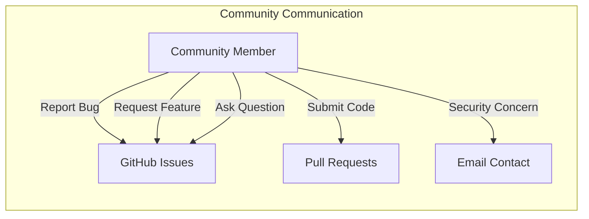
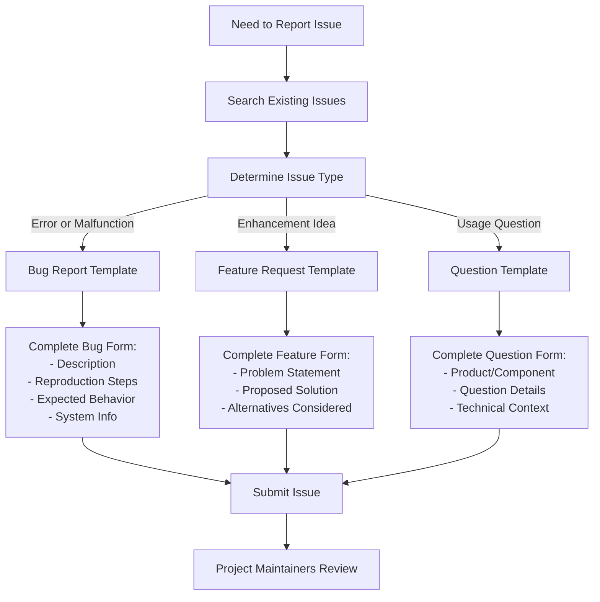
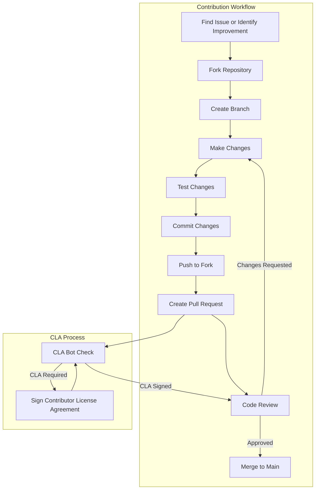
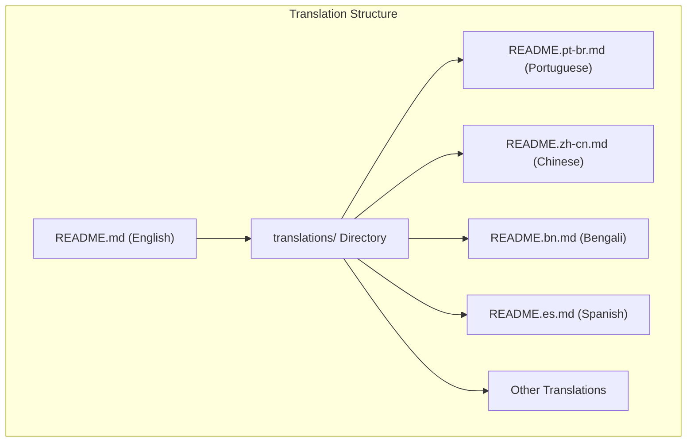
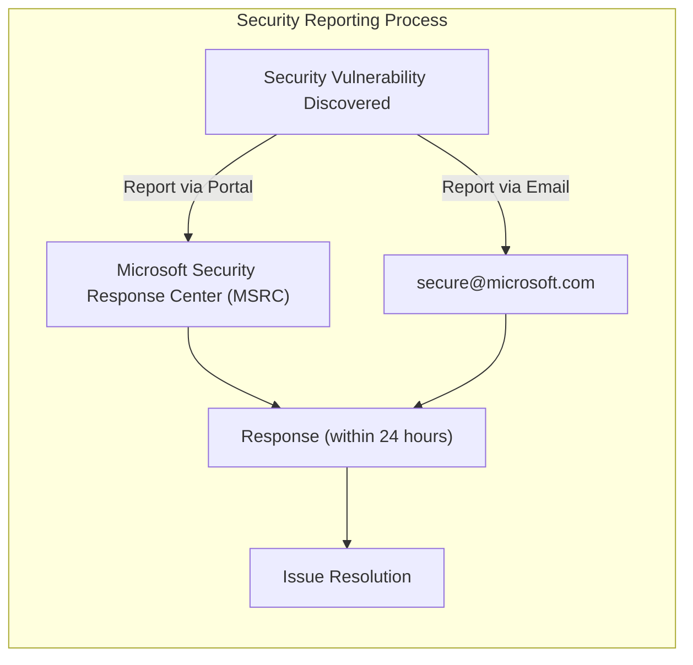
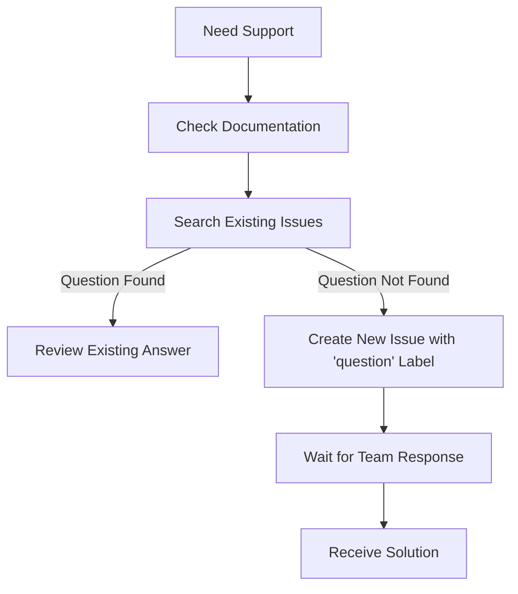

<!-- source: DeepWiki mcp.deepwiki.com · repo microsoft/generative-ai-with-javascript · page 8 Community and Contributions · fetched 2026-10-26 -->

# Community and Contributions

Relevant source files

The following files were used as context for generating this wiki page:

- [.github/CODE_OF_CONDUCT.md](.github/CODE_OF_CONDUCT.md)
- [.github/CONTRIBUTING.md](.github/CONTRIBUTING.md)
- [.github/ISSUE_TEMPLATE/bug.yml](.github/ISSUE_TEMPLATE/bug.yml)
- [.github/ISSUE_TEMPLATE/feature.yml](.github/ISSUE_TEMPLATE/feature.yml)
- [.github/ISSUE_TEMPLATE/question.yml](.github/ISSUE_TEMPLATE/question.yml)
- [.github/SECURITY.md](.github/SECURITY.md)
- [.github/SUPPORT.md](.github/SUPPORT.md)

This document provides guidance on how to engage with the Generative AI with JavaScript community and contribute to the project. It outlines the procedures for reporting issues, requesting features, submitting code contributions, and participating in the translation efforts. For information about setting up your development environment, see [Setup and Configuration](#7).

## Community Guidelines

The Generative AI with JavaScript project maintains an inclusive and respectful community environment governed by the Microsoft Open Source Code of Conduct.

### Code of Conduct

All participants in the project are expected to adhere to the Microsoft Open Source Code of Conduct which promotes respectful and inclusive interactions within the community.

Key principles include:
- Using welcoming and inclusive language
- Respecting differing viewpoints
- Accepting constructive criticism gracefully
- Focusing on what is best for the community
- Showing empathy toward other community members

For complete details, see the full code of conduct document.

Sources: [.github/CODE_OF_CONDUCT.md:1-10]()

### Communication Channels

The primary communication channels for the project are:

1. **GitHub Issues** - For bug reports, feature requests, and questions
2. **Pull Requests** - For code contributions and review discussions

Sources: [.github/SUPPORT.md:1-11](), [.github/CONTRIBUTING.md:15-23]()

## Issue Reporting System

The project uses GitHub Issues to track bugs, feature requests, and questions. Before submitting a new issue, search existing issues to avoid duplicates.

### Issue Templates

The repository provides specialized issue templates to streamline the reporting process:

1. **Bug Reports** - For reporting errors or unexpected behavior
2. **Feature Requests** - For suggesting enhancements or new functionality
3. **Questions** - For asking about usage or implementation details

Sources: [.github/ISSUE_TEMPLATE/bug.yml:1-109](), [.github/ISSUE_TEMPLATE/feature.yml:1-68](), [.github/ISSUE_TEMPLATE/question.yml:1-50]()

### Bug Reports

When submitting a bug report, provide detailed information to help maintainers understand and reproduce the issue:

- Clear description of the bug
- Steps to reproduce
- Expected behavior
- Actual behavior
- System information (OS, browser, version)
- Screenshots or logs if applicable

Sources: [.github/ISSUE_TEMPLATE/bug.yml:10-108](), [.github/CONTRIBUTING.md:46-56]()

### Feature Requests

Feature requests should include:

- Problem statement (if applicable)
- Detailed description of the proposed feature
- Use cases or scenarios where the feature would be beneficial
- Any alternatives considered

Sources: [.github/ISSUE_TEMPLATE/feature.yml:10-67](), [.github/CONTRIBUTING.md:30-37]()

### Questions

For general questions about the project:

- Specify which component or lesson your question relates to
- Provide context for your question
- Include any relevant code snippets or screenshots

Sources: [.github/ISSUE_TEMPLATE/question.yml:10-49](), [.github/SUPPORT.md:8-10]()

## Contribution Process

The project welcomes contributions from the community, including code, documentation, and translations.

### Contribution Workflow

Sources: [.github/CONTRIBUTING.md:58-82]()

### Pull Request Guidelines

When submitting a pull request:

1. Search for existing PRs to avoid duplicating efforts
2. Create your changes in a new git fork
3. Use descriptive commit messages
4. Push your fork to GitHub and create a pull request
5. Respond to any feedback and make necessary changes
6. Rebase your fork if needed before final merge

Note that most contributions require you to agree to a Contributor License Agreement (CLA) declaring that you have the right to grant Microsoft the rights to use your contribution.

Sources: [.github/CONTRIBUTING.md:60-82]()

### Code Contributions

For code contributions:

1. Follow the existing code style and patterns
2. Add appropriate tests for your changes
3. Ensure all tests pass locally before submitting
4. Update documentation to reflect any changes

For small features or bug fixes, you can directly submit a pull request. For larger features, submit an issue first to discuss the proposed changes.

Sources: [.github/CONTRIBUTING.md:25-37]()

## Translation Contributions

The project supports multiple languages and welcomes translation contributions to make the content accessible to a global audience.

### Translation Structure

Translations are organized in dedicated directories within each lesson:

Sources: [Multilingual Support System diagram in the prompt]

### Translation Guidelines

When contributing translations:

1. Start by forking the repository
2. Check if a translation file already exists for your target language
3. If not, create a new file following the naming pattern: `README.[language-code].md`
4. Translate the content, maintaining the original structure and formatting
5. Submit a pull request with your translation

For consistency, use standard language codes (e.g., pt-br for Brazilian Portuguese, zh-cn for Simplified Chinese).

## Security Reporting

Security vulnerabilities should **not** be reported through public GitHub issues.

### Reporting Security Issues

Sources: [.github/SECURITY.md:9-29]()

When reporting security vulnerabilities:

1. **Do not** use public GitHub issues
2. Report to the Microsoft Security Response Center (MSRC) at https://msrc.microsoft.com/create-report
3. Alternatively, email secure@microsoft.com
4. Include detailed information about the vulnerability:
   - Type of issue
   - Affected source files
   - Reproduction steps
   - Potential impact
   - Any proof-of-concept code

Microsoft follows the principle of Coordinated Vulnerability Disclosure.

Sources: [.github/SECURITY.md:1-41]()

## Support Resources

If you need help with using the project or have questions about its functionality:

1. Check existing documentation
2. Search existing issues for similar questions
3. Create a new issue with the "question" label if your question hasn't been addressed

The project team will respond to questions as resources permit.

Sources: [.github/SUPPORT.md:1-14]()

This structured approach to community engagement and contributions helps maintain a healthy, collaborative project environment while ensuring that all participants have clear guidelines for interaction and participation.