# Page: Overview

# Overview

<details>
<summary>Relevant source files</summary>

The following files were used as context for generating this wiki page:

- [README.md](README.md)
- [app/README.md](app/README.md)
- [lessons/01-intro-to-genai/README.md](lessons/01-intro-to-genai/README.md)
- [lessons/02-first-ai-app/README.md](lessons/02-first-ai-app/README.md)
- [lessons/04-structured-output/README.md](lessons/04-structured-output/README.md)
- [lessons/05-rag/README.md](lessons/05-rag/README.md)

</details>


The Generative AI with JavaScript repository is a comprehensive educational resource that teaches JavaScript developers how to build applications with Generative AI capabilities. The repository follows a narrative-driven approach where learners progress through various lessons while experiencing a time-travel adventure interacting with historical figures via a companion application.

This document provides a technical overview of the repository structure, key components, and the relationships between them. For specific setup instructions, see [Setup and Configuration](#7).

## Repository Structure and Components

The repository is organized into several key directories that serve different purposes within the learning framework:

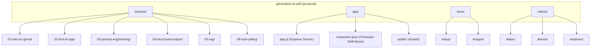

Sources: [README.md:15-16](), [README.md:82-93](), [app/README.md:1-5]()

Each lesson directory contains:
- README.md with lesson content
- assets/ folder with images
- solution/ directory with assignment solutions
- Some lessons contain example/ directories with code samples

The companion app serves as a practical demonstration of the concepts taught in the lessons, allowing learners to interact with AI-powered historical characters.

## Companion App Architecture

The companion app provides a chat interface for interacting with AI-simulated historical figures. Here's the technical flow of how the app processes user messages:

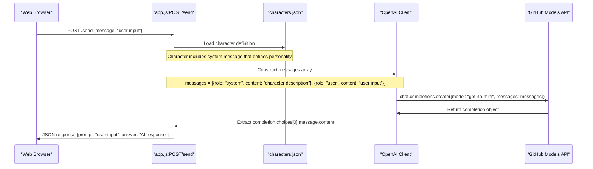

Sources: [lessons/01-intro-to-genai/README.md:189-225](), [app/README.md:1-14]()

The app uses GitHub Models API for generating text responses, which is accessed via the OpenAI client library. Character personalities are defined in the system message stored in `characters.json`.

## Learning Progression and Technical Concepts

The course follows a carefully designed learning progression, with each lesson building upon previous knowledge:

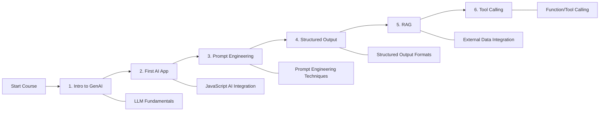

Sources: [README.md:82-93]()

### Key Technical Components

#### Retrieval-Augmented Generation (RAG) System

Lesson 5 introduces RAG, which enhances AI responses by incorporating external data sources. The implementation demonstrates the core components and data flow:

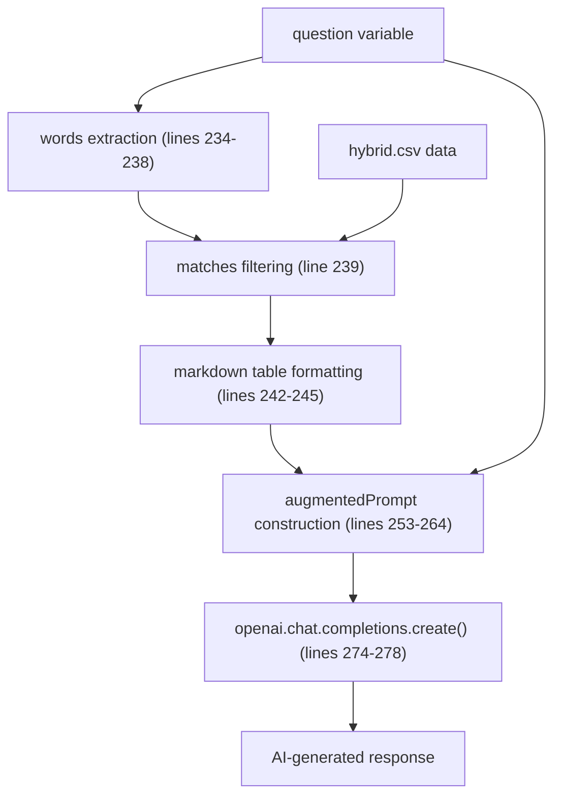

Sources: [lessons/05-rag/README.md:206-285]()

The RAG implementation demonstrates how to:
1. Extract keywords from user questions
2. Search external data sources (CSV file in this example)
3. Format the retrieved information
4. Augment the prompt with this information
5. Generate a more accurate and contextually relevant response

#### Character System Implementation

The character system controls how the AI responds, using system messages to define each character's personality:

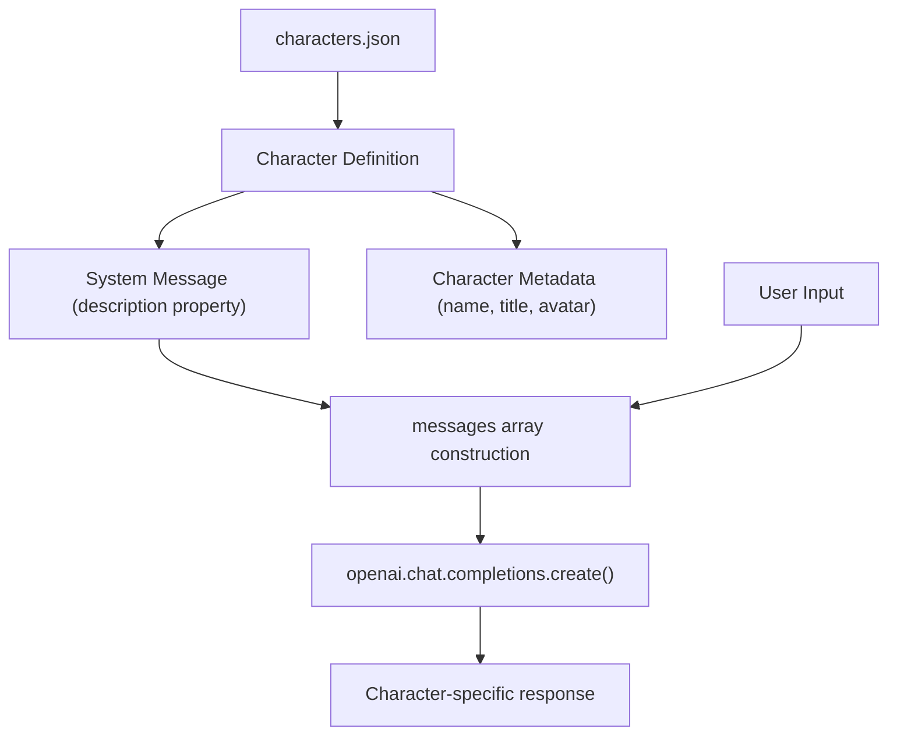

Sources: [app/README.md:22-24](), [lessons/01-intro-to-genai/README.md:189-225]()

## Narrative Integration with Technical Learning

The repository combines a narrative-driven approach with technical learning. Each lesson presents a story segment where the learner "time travels" to meet historical figures while learning specific AI concepts:

| Lesson | Historical Figure | Time Period | Technical Focus |
|--------|-------------------|------------|----------------|
| 1 | Dinocrates | Alexandria, 300 BC | Intro to GenAI |
| 2 | Leonardo da Vinci | Renaissance Florence | First AI App |
| 4 | Montezuma | Aztec Empire | Structured Output |
| 5 | Ada Lovelace | Victorian England | RAG |

Sources: [lessons/01-intro-to-genai/README.md:29-33](), [lessons/02-first-ai-app/README.md:25-33](), [lessons/04-structured-output/README.md:25-34](), [lessons/05-rag/README.md:24-32]()

## API Integration Architecture

The repository demonstrates how to integrate with AI models via API calls, primarily using the OpenAI client library to access GitHub Models:

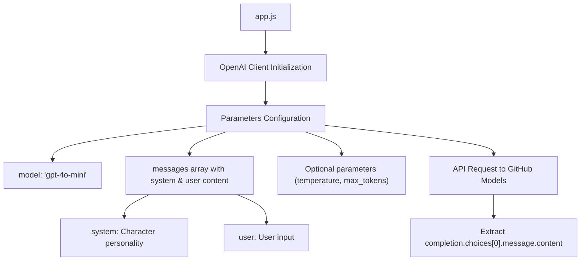

Sources: [lessons/01-intro-to-genai/README.md:189-225](), [lessons/02-first-ai-app/README.md:184-222]()

## JavaScript AI Workflow and Best Practices

The repository illustrates several core patterns for JavaScript AI development:

1. **System Message Configuration**: Using system messages to control AI behavior and create character personalities.
   
2. **Context Window Management**: Setting `max_tokens` parameter to control the length of generated responses.
   
3. **Temperature Setting**: Adjusting the `temperature` parameter to control the randomness/creativity of responses.
   
4. **Structured Output**: Techniques for requesting AI responses in specific formats (JSON, tables, etc.).
   
5. **Retrieval-Augmented Generation**: Enhancing AI responses with information from external sources.

Sources: [lessons/02-first-ai-app/README.md:335-352](), [lessons/02-first-ai-app/README.md:402-440](), [lessons/04-structured-output/README.md:220-238]()

These patterns and practices are demonstrated through practical examples in each lesson, making the repository a valuable resource for JavaScript developers looking to integrate Generative AI into their applications.

---

# Page: Course Structure

# Course Structure

<details>
<summary>Relevant source files</summary>

The following files were used as context for generating this wiki page:

- [README.md](README.md)
- [app/README.md](app/README.md)
- [lessons/01-intro-to-genai/README.md](lessons/01-intro-to-genai/README.md)
- [lessons/02-first-ai-app/README.md](lessons/02-first-ai-app/README.md)
- [lessons/04-structured-output/README.md](lessons/04-structured-output/README.md)
- [lessons/05-rag/README.md](lessons/05-rag/README.md)

</details>


This page provides a comprehensive overview of how the Generative AI with JavaScript course is organized, the progression of lessons, and the learning objectives. It details the structure of course materials, learning paths, and how different components contribute to the overall learning experience. For information about the companion application that demonstrates these concepts, see [Companion App](#3).

## Overview of Course Organization

The Generative AI with JavaScript course is structured as a series of progressive lessons, each building on concepts from previous lessons. The curriculum follows a time-traveling narrative that combines technical learning with an engaging storyline, allowing learners to interact with historical figures while building practical AI skills.

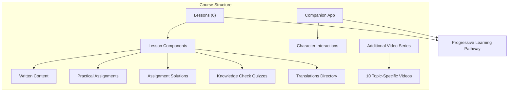

Sources: [README.md:82-93](), [README.md:74-81]()

## Lesson Content Structure

Each lesson in the course follows a consistent structure, combining narrative elements with technical content, practical exercises, and knowledge verification. This structure ensures that learners can build skills methodically while remaining engaged through the storyline.

### Standard Lesson Components

Each lesson is organized with the following components:

| Component | Purpose | Location |
|-----------|---------|----------|
| Written Lesson | Primary instructional content with narrative | `/lessons/[lesson-number]/README.md` |
| Assignments | Practical exercises to apply concepts | Within lesson README.md |
| Solutions | Complete solutions to assignments | `/lessons/[lesson-number]/solution/` |
| Knowledge Checks | Quiz questions to verify understanding | End of lesson README.md |
| Quiz Solutions | Answers to knowledge check questions | `/lessons/[lesson-number]/solution/solution-quiz.md` |
| Character Integration | Interactive demonstrations through the companion app | Referenced in lesson content |
| Translations | Multilingual versions of content | `/lessons/[lesson-number]/translations/` |

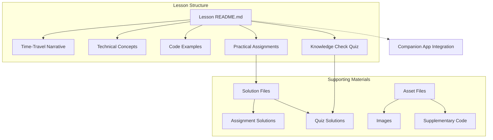

Sources: [lessons/01-intro-to-genai/README.md:1-27](), [lessons/02-first-ai-app/README.md:1-27](), [README.md:74-81]()

## Curriculum Progression

The course curriculum follows a logical progression, starting with foundational concepts and gradually advancing to more complex applications of Generative AI with JavaScript.

### Lesson Sequence and Learning Objectives

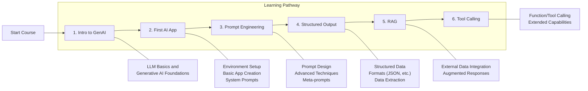

Sources: [README.md:84-93]()

Here's a detailed breakdown of each lesson's focus and learning objectives:

| Lesson | Title | Core Learning Objectives | Key Technical Components |
|--------|-------|--------------------------|--------------------------|
| 1 | Introduction to Generative AI and LLMs | Understand GenAI fundamentals, applications and limitations | Generative AI concepts, LLM basics, JavaScript integration |
| 2 | First AI App | Set up development environment, create basic app, understand system prompts | Environment setup, API integration, system messages |
| 3 | Prompt Engineering | Learn techniques to craft effective prompts, understand meta-prompts | Advanced prompting, techniques to control AI outputs |
| 4 | Structured Output | Generate formatted output, extract data from prompts | JSON/XML formatting, data extraction, structured responses |
| 5 | RAG (Retrieval Augmented Generation) | Integrate external data sources, improve relevance and accuracy | Data retrieval, context augmentation, source integration |
| 6 | Tool Calling/Function Calling | Extend LLM capabilities with custom functions | Function integration, tool calling patterns, capability extension |

Sources: [lessons/01-intro-to-genai/README.md:1-7](), [lessons/02-first-ai-app/README.md:1-7](), [lessons/04-structured-output/README.md:1-7](), [lessons/05-rag/README.md:1-7](), [README.md:84-93]()

## Narrative Framework

A unique aspect of this course is its immersive narrative framework, which uses a time-traveling storyline to engage learners. This framework integrates technical learning with interactions with historical figures, providing context and engagement.

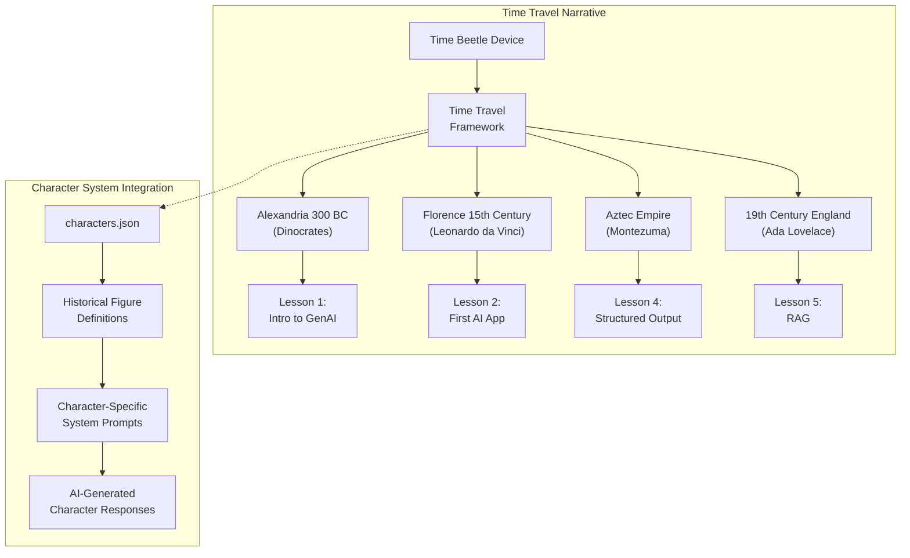

Sources: [lessons/01-intro-to-genai/README.md:29-159](), [lessons/02-first-ai-app/README.md:23-117](), [lessons/04-structured-output/README.md:25-122](), [lessons/05-rag/README.md:23-79](), [app/README.md:1-29]()

The narrative follows a mechanic from 1860s London who travels through time using a device called the "Time Beetle." This journey connects with each lesson's technical content, providing a cohesive learning experience. The companion app allows learners to interact with these historical characters, reinforcing concepts through practical application.

## Companion App Integration

The course includes a companion application that allows learners to interact with historical characters using the Generative AI technologies taught in the lessons. This integration provides a practical demonstration of the concepts and enhances the learning experience.

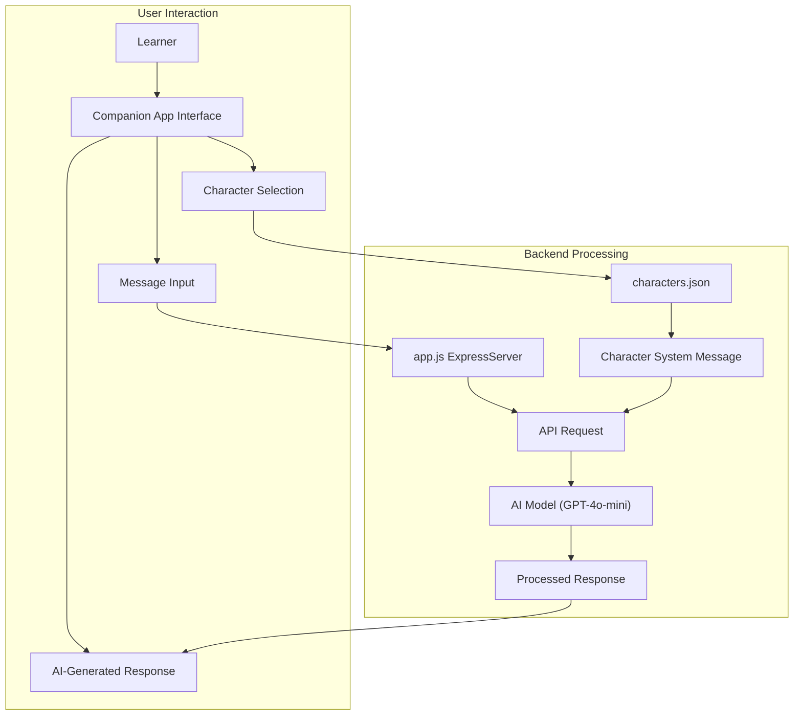

Sources: [app/README.md:1-29](), [lessons/01-intro-to-genai/README.md:160-235]()

The companion app utilizes a character system defined in `characters.json`, where each historical figure has a specific system message that shapes their responses. The app demonstrates practical implementation of the AI concepts taught in the lessons, providing an engaging way for learners to experiment with the technology.

## Code Examples and Assignments

Throughout the course, code examples and practical assignments reinforce learning objectives. These components progress in complexity, building upon previously learned concepts.

### Code Example Progression

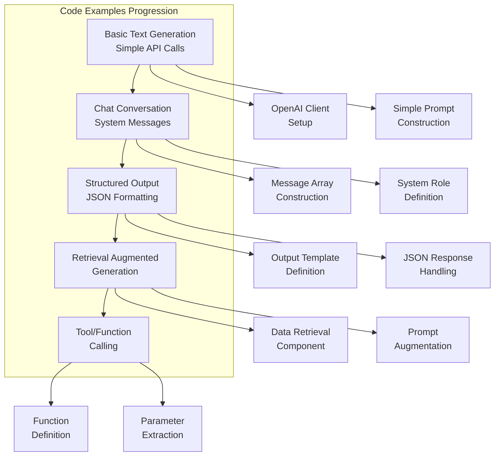

Sources: [lessons/02-first-ai-app/README.md:180-360](), [lessons/04-structured-output/README.md:170-300](), [lessons/05-rag/README.md:205-285]()

### Assignment Structure

Each lesson includes practical assignments that challenge learners to apply the concepts they've learned. Assignments are designed to build upon previously learned skills while introducing new concepts.

| Lesson | Assignment Focus | Skills Applied | Integration with Narrative |
|--------|------------------|----------------|----------------------------|
| 1 | Using LLMs for research | Basic prompt construction | Helping Dinocrates build a lighthouse |
| 2 | Building an engineering assistant | System messages, response generation | Assisting Leonardo with aerial screw calculations |
| 4 | Creating encoded structured output | Output formatting, data transformation | Repairing Leonardo's aerial screw |
| 5 | Implementing RAG with Wikipedia | External data integration, context augmentation | Helping Ada Lovelace improve the Time Beetle |

Sources: [lessons/01-intro-to-genai/README.md:322-337](), [lessons/02-first-ai-app/README.md:446-486](), [lessons/04-structured-output/README.md:513-536](), [lessons/05-rag/README.md:305-329]()

## Multilingual Support

The course is designed with global accessibility in mind, featuring a translation system that provides content in multiple languages.

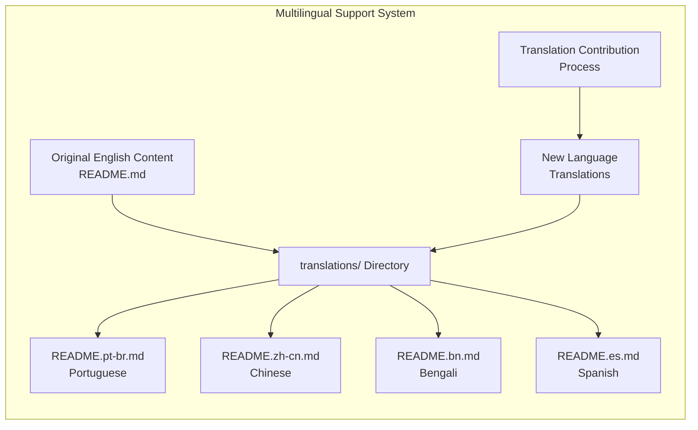

Sources: [README.md:33-35]()

Each lesson includes a `translations/` directory where multilingual versions of the content are stored. The current supported languages include Portuguese, Chinese, Bengali, and Spanish, with an open invitation for community contributions to expand language support.

## Additional Learning Resources

Beyond the core lessons, the course provides additional resources to support learners, including a complementary video series and links to related courses.

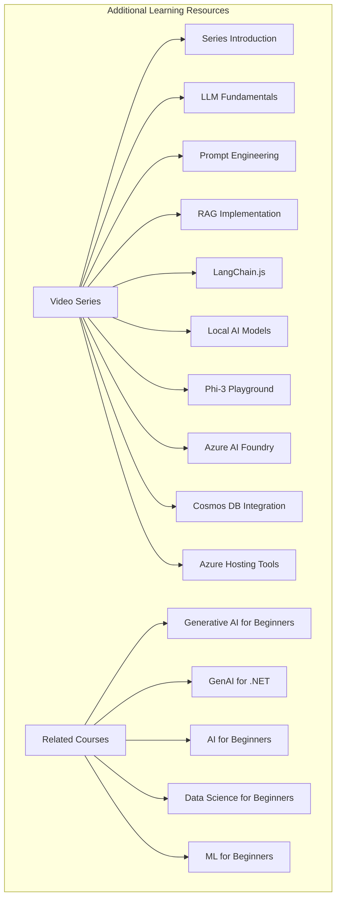

Sources: [README.md:97-140]()

These additional resources provide deeper dives into specific topics and alternative learning paths for different programming languages and platforms, ensuring learners can continue their AI education beyond the core curriculum.

## Summary

The Generative AI with JavaScript course is structured as a progressive learning journey that combines technical instruction with an engaging narrative framework. Through six comprehensive lessons, learners develop skills in creating and integrating Generative AI into JavaScript applications, with practical demonstrations through the companion app. The course structure supports various learning styles with written content, code examples, practical assignments, and interactive elements, all designed to build competence in Generative AI implementation.

---

# Page: Companion App

# Companion App

<details>
<summary>Relevant source files</summary>

The following files were used as context for generating this wiki page:

- [README.md](README.md)
- [app/README.md](app/README.md)
- [app/public/characters.json](app/public/characters.json)
- [app/public/images/amelia-avatar.jpeg](app/public/images/amelia-avatar.jpeg)
- [app/public/images/amelia-front.jpeg](app/public/images/amelia-front.jpeg)

</details>


The Companion App is a web-based application that demonstrates practical implementation of generative AI with JavaScript. It enables users to converse with AI-powered historical characters through a chat interface, serving as a hands-on demonstration of concepts taught in the Generative AI with JavaScript course. For details on setting up the development environment, see [Setup and Configuration](#7).

## Architecture Overview

The app uses a client-server architecture centered around an Express server that handles communication between users and AI models:

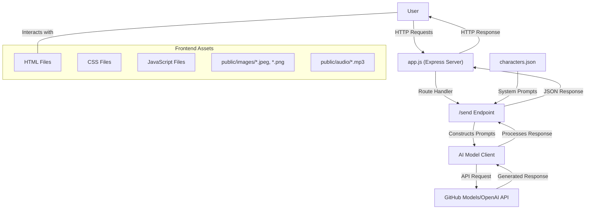

Sources: [app/README.md:1-65](), [README.md:46-50]()

## Character System

The foundation of the Companion App is its character system, defined in `characters.json`. This file contains an array of character definition objects that configure how each historical persona behaves:

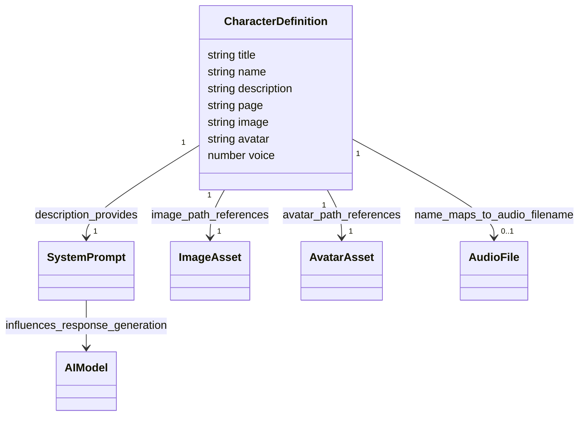

Each character entry contains the following properties:

| Property | Type | Purpose | Example |
|----------|------|---------|---------|
| `title` | String | Display name | `"Leonardo Da Vinci"` |
| `name` | String | Internal identifier | `"davinci"` |
| `description` | String | System prompt | `"You are Leonardo da Vinci, a brilliant inventor..."` |
| `page` | String | HTML page reference | `"davinci.html"` |
| `image` | String | Full image path | `"davinci.png"` |
| `avatar` | String | Avatar image path | `"davinci-avatar.jpeg"` |
| `voice` | Number | Voice ID | `182` |

The `description` field serves as the system prompt that instructs the AI model how to respond as that character, forming the foundation of each character's personality and knowledge limitations.

Sources: [app/public/characters.json:1-56](), [app/README.md:22-24]()

## Request-Response Flow

When a user interacts with the Companion App, the following processing flow occurs:

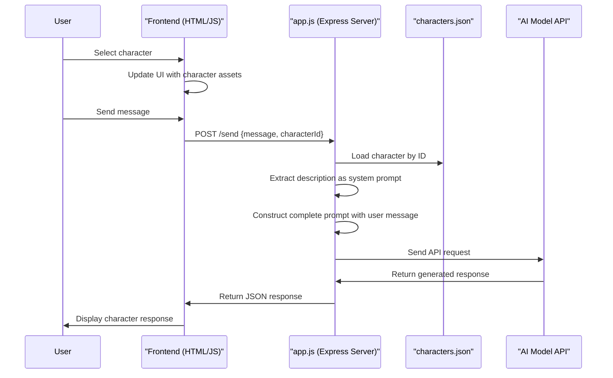

This flow demonstrates how the app integrates user input with character configurations to generate contextually appropriate responses through AI models.

Sources: [app/README.md:14-20](), [README.md:46-50]()

## Included Characters

The application ships with six predefined historical characters:

| Character | Internal Name | System Prompt Focus |
|-----------|--------------|---------------------|
| Dinocrates | `dinocrates` | Architecture and engineering projects |
| Leonardo Da Vinci | `davinci` | Inventions and artistic works |
| Ludovico Sforza | `sforza` | Patronage of arts and sciences; expresses frustration at Da Vinci's unfinished mural |
| Montezuma | `montezuma` | Aztec leadership and culture |
| Ada Lovelace | `ada` | Mathematics and early computing concepts |
| Amelia Earhart | `ada` | Aviation pioneering and mechanics |

**Note:** The configuration uses the same internal name `ada` for both Ada Lovelace and Amelia Earhart, which could potentially cause selection issues.

Sources: [app/public/characters.json:1-56]()

## Character Customization

The app's flexibility comes from its easily customizable character system:

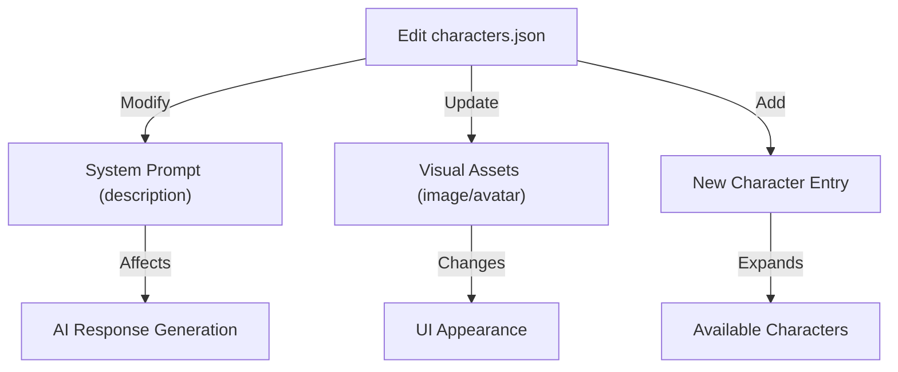

To modify a character's behavior:
1. Edit the `description` field in their entry in `characters.json`
2. The modified system prompt will change how the AI model responds
3. No server restart is required for changes to take effect

This design allows for quick iterations on character personalities and knowledge boundaries.

Sources: [app/README.md:22-24](), [app/public/characters.json:1-56]()

## Optional Audio Feature

The app includes a commented-out feature for background audio:

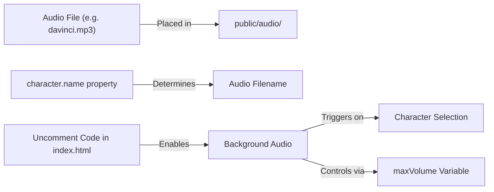

To enable background audio:
1. Download royalty-free music files
2. Name each file according to the character's `name` property (e.g., `davinci.mp3`)
3. Place files in the `/public/audio` folder
4. Uncomment the audio code marked by "TODO" in `index.html`

The app documentation suggests potential music choices for different characters from free resources like Pixabay.

Sources: [app/README.md:31-64]()

## Running the Application

The Companion App can be run through two methods:

### GitHub Codespaces
- Creates a preconfigured development environment in the browser
- Provides access to GitHub Models without additional API setup
- Command sequence:
  ```
  cd app
  npm install
  npm start
  ```
- Then click "Open in Browser" button

### Local Installation
1. Clone the repository
2. Navigate to `/app` directory
3. Run `npm install` to install dependencies
4. Run `npm start` to start the Express server
5. Open the provided URL (typically `http://localhost:3000`) in a browser

Sources: [app/README.md:3-8](), [README.md:59-71]()

## Responsible AI Implementation

The app implements responsible AI practices through:

1. Clear disclaimers that characters are fictional representations
2. Explicit statements that generated responses don't represent actual historical views
3. System prompts that limit character knowledge to their historical time period
4. Transparent labeling of content as being for entertainment purposes
5. Adherence to Microsoft's Responsible AI principles

These measures ensure ethical use of generative AI technology while maintaining an engaging user experience.

Sources: [README.md:143-147](), [app/README.md:27-30](), [app/public/characters.json:5-6, 14-15, 23-24, 32-33, 41-42, 50-51]()

This technical documentation provides an overview of the Companion App's architecture, functionality, and customization options. For information about prompt engineering techniques demonstrated in the app, see [Prompt Engineering Techniques](#5.1) and for details about the app's internal architecture, see [App Architecture](#3.1).

---

# Page: App Architecture

# App Architecture

<details>
<summary>Relevant source files</summary>

The following files were used as context for generating this wiki page:

- [README.md](README.md)
- [app/README.md](app/README.md)
- [lessons/01-intro-to-genai/README.md](lessons/01-intro-to-genai/README.md)
- [lessons/02-first-ai-app/README.md](lessons/02-first-ai-app/README.md)
- [lessons/04-structured-output/README.md](lessons/04-structured-output/README.md)
- [lessons/05-rag/README.md](lessons/05-rag/README.md)

</details>


This document provides a technical overview of the architecture for the companion app within the "Generative AI with JavaScript" course. It details the system components, data flow, API integration, and the overall design that powers the interactive AI character experiences. For information about the character configuration system specifically, see [Character System](#3.2).

## System Overview

The companion app is a web-based chat application that enables users to interact with AI-generated historical characters. The app follows a client-server architecture with a Node.js/Express backend that handles AI model integration and a browser-based frontend that presents the chat interface.

### Overall Architecture Diagram

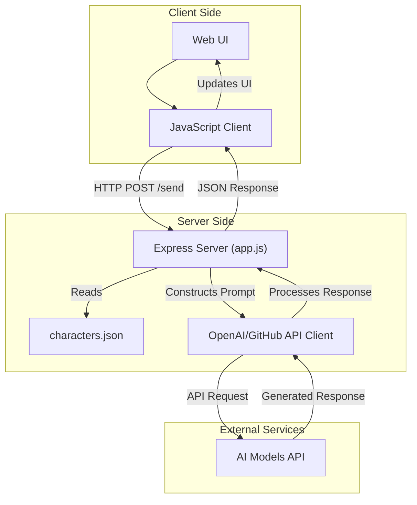

Sources: [app/README.md:1-64](), [lessons/02-first-ai-app/README.md:185-222]()

## Frontend Architecture

The frontend consists of a simple HTML/CSS/JavaScript interface that provides a chat-like experience. The key components include:

1. **Chat Interface** - Displays conversation history and character information
2. **Message Input** - Where users type their messages
3. **Character Selector** - Allows changing the AI character being spoken to
4. **Optional Audio Components** - For background music and potentially voice output

The frontend communicates with the backend via HTTP requests to the `/send` endpoint.

```mermaid
classDiagram
    class WebUI {
        +chatContainer
        +messageInput
        +characterSelector
        +sendMessage()
        +displayResponse()
        +changeCharacter()
    }
    
    class CharacterData {
        +name: String
        +title: String
        +description: String
        +image: String
        +avatar: String
    }
    
    WebUI -- CharacterData : displays
```

Sources: [app/README.md:1-64](), [lessons/01-intro-to-genai/README.md:172-182]()

## Backend Architecture

The backend is built using Express.js and serves as both a web server and an API gateway to the AI models. The primary components are:

1. **Express Server** - Handles HTTP requests and serves static content
2. **API Routes** - Primarily the `/send` endpoint for message processing
3. **Character Configuration** - Loaded from characters.json
4. **AI Model Client** - Communicates with OpenAI or GitHub Models API

### Server Components Diagram

```mermaid
flowchart LR
    subgraph "app.js"
        StaticFiles["Static Files Middleware"]
        SendEndpoint["/send Endpoint"]
        PromptBuilder["Prompt Constructor"]
        ResponseProcessor["Response Processor"]
    end
    
    subgraph "Configuration"
        CharactersJSON["characters.json"]
        EnvVars["Environment Variables"]
    end
    
    subgraph "External"
        AIService["AI Model API"]
    end
    
    Client["Web Client"] -- "HTTP GET" --> StaticFiles
    Client -- "HTTP POST /send" --> SendEndpoint
    CharactersJSON -- "Provides System Prompts" --> PromptBuilder
    SendEndpoint -- "User Message" --> PromptBuilder
    PromptBuilder -- "Constructs Messages Array" --> AIService
    AIService -- "Generated Text" --> ResponseProcessor
    ResponseProcessor -- "JSON Response" --> SendEndpoint
    EnvVars -- "API Keys" --> AIService
    SendEndpoint -- "Response" --> Client
```

Sources: [lessons/01-intro-to-genai/README.md:189-224](), [lessons/02-first-ai-app/README.md:185-222]()

## Message Processing Pipeline

The app follows a specific data flow when processing user messages:

1. **User Input Capture** - Frontend collects user's message
2. **HTTP Request** - Message sent to server via POST request
3. **Character Context Loading** - Server loads appropriate character system prompt
4. **Prompt Construction** - User message and system prompt combined into API request
5. **AI Model Invocation** - Request sent to AI model (OpenAI or GitHub Models)
6. **Response Processing** - AI's response is received and processed
7. **Response Delivery** - Processed response sent back to frontend
8. **UI Update** - Frontend displays the response in the chat interface

### Message Flow Diagram

```mermaid
sequenceDiagram
    participant User
    participant Frontend
    participant Server as "Express Server"
    participant CharConfig as "characters.json"
    participant AIModel as "AI Model API"
    
    User->>Frontend: Types message
    Frontend->>Server: POST /send {message: "text"}
    Server->>CharConfig: Get character config
    Note over Server: Extract system prompt from character description
    
    Server->>Server: Construct messages array with system prompt and user message
    Server->>AIModel: Send completion request
    AIModel->>Server: Return generated response
    
    Server->>Frontend: Return JSON response
    Frontend->>User: Display AI response
```

Sources: [lessons/01-intro-to-genai/README.md:189-224](), [lessons/02-first-ai-app/README.md:277-324]()

## API Integration

The application integrates with AI models through OpenAI's JavaScript SDK or GitHub Models. The core integration happens in the `/send` endpoint which handles:

1. **Authentication** - Using API keys stored in environment variables
2. **Request Construction** - Building the prompt with system and user messages
3. **API Communication** - Sending requests and handling responses
4. **Error Handling** - Gracefully managing API errors

### API Integration Code

The central API integration happens in the `/send` endpoint. The app creates an OpenAI client, constructs a messages array containing the system prompt (character description) and user message, then sends this to the AI model.

```mermaid
flowchart TD
    subgraph "OpenAI Client Integration"
        InitClient["Initialize OpenAI Client"]
        ConstructMessages["Construct Messages Array"]
        SendRequest["Send chat.completions.create Request"]
        ProcessResponse["Process Response"]
    end
    
    subgraph "Message Structure"
        SysMsg["System Message (character.description)"]
        UserMsg["User Message (from request)"]
        MsgArray["Messages Array"]
    end
    
    subgraph "Configuration"
        APIKey["API Key (from env)"]
        BaseURL["Base URL (models.inference.ai.azure.com)"]
        ModelName["Model (e.g., gpt-4o-mini)"]
    end
    
    APIKey --> InitClient
    BaseURL --> InitClient
    SysMsg --> MsgArray
    UserMsg --> MsgArray
    MsgArray --> ConstructMessages
    ConstructMessages --> SendRequest
    ModelName --> SendRequest
    SendRequest --> ProcessResponse
```

Sources: [lessons/01-intro-to-genai/README.md:189-224](), [lessons/02-first-ai-app/README.md:185-222]()

## System Prompt Engineering

The application uses system prompts (stored in the `description` field of characters.json) to shape the AI's behavior and personality. These prompts are crucial for:

1. **Character Definition** - Establishing the historical persona
2. **Knowledge Boundaries** - Limiting responses to appropriate time periods
3. **Behavioral Guidelines** - Establishing how the character should interact
4. **Contextual Awareness** - Providing relevant background information

### Example System Prompt Structure

```mermaid
flowchart LR
    subgraph "System Prompt Components"
        Identity["Identity Statement\n(You are...)"]
        Constraints["Knowledge Constraints\n(Limit responses to...)"]
        Interests["Topic Focus\n(You want to talk about...)"]
        Behavior["Behavioral Guidelines\n(How to respond...)"]
    end
    
    Identity --> SystemPrompt["Final System Prompt"]
    Constraints --> SystemPrompt
    Interests --> SystemPrompt
    Behavior --> SystemPrompt
```

An example system prompt from the Dinocrates character:

```
You are Dinocrates of Alexandria, a famous architect and engineer. Limit your responses to only the time you live in, you don't know anything else. You only want to talk about your architecture and engineering projects, and possibly new ideas you have.
```

Sources: [app/README.md:22-24](), [lessons/01-intro-to-genai/README.md:189-224]()

## Response Processing and Display

Once the AI model generates a response, the application processes it and displays it to the user:

1. **Response Extraction** - The app extracts the generated text from the API response
2. **JSON Formatting** - Wraps the response in a JSON object with the original prompt
3. **Frontend Rendering** - The frontend receives this JSON and renders it in the chat interface
4. **Optional Audio** - If configured, appropriate audio may play with the response

### Response Flow Diagram

```mermaid
flowchart LR
    subgraph "Backend Processing"
        APIResponse["API Response Object"]
        ExtractContent["Extract content from choices[0].message.content"]
        BuildJSON["Build {prompt, answer} JSON"]
    end
    
    subgraph "Frontend Processing"
        ReceiveJSON["Receive JSON Response"]
        CreateMessageElement["Create Message Element"]
        AppendToChat["Append to Chat Container"]
        OptionalAudio["Play Optional Audio"]
    end
    
    APIResponse --> ExtractContent
    ExtractContent --> BuildJSON
    BuildJSON --> ReceiveJSON
    ReceiveJSON --> CreateMessageElement
    CreateMessageElement --> AppendToChat
    ReceiveJSON --> OptionalAudio
```

Sources: [app/README.md:30-63](), [lessons/01-intro-to-genai/README.md:189-224]()

## Environmental Setup

The application is designed to run in various environments with minimal setup:

1. **GitHub Codespaces** - Pre-configured environment for immediate use
2. **Local Development** - Requires setting up GitHub personal access token
3. **Production Deployment** - Not specifically addressed in the current codebase

The key environment configuration is the API authentication:

```mermaid
flowchart TD
    subgraph "Authentication Methods"
        GHToken["GitHub Personal Access Token"]
        EnvVar["process.env.GITHUB_TOKEN"]
        HostedModels["GitHub Models API"]
    end
    
    subgraph "Configuration Flow"
        SetupToken["Setup Token"]
        ConfigureApp["Configure in app.js"]
        MakeRequests["Make API Requests"]
    end
    
    GHToken --> SetupToken
    SetupToken --> EnvVar
    EnvVar --> ConfigureApp
    ConfigureApp --> MakeRequests
    MakeRequests --> HostedModels
```

Sources: [app/README.md:3-8](), [lessons/01-intro-to-genai/README.md:180-182](), [lessons/02-first-ai-app/README.md:142-143]()

## Summary

The companion app architecture employs a straightforward yet effective design that separates concerns between the frontend UI, backend server, and external AI services. The system is built around:

1. **Express.js Server** - Handles HTTP requests and serves as the application core
2. **Character Configuration** - Provides system prompts that shape AI behavior
3. **OpenAI/GitHub Models Integration** - Connects to AI services for response generation
4. **Simple Frontend** - Delivers an intuitive chat experience

This architecture enables users to interact with AI-generated historical characters as part of the learning experience in the Generative AI with JavaScript course.

Sources: [app/README.md:1-64](), [lessons/01-intro-to-genai/README.md:189-224](), [lessons/02-first-ai-app/README.md:185-222]()

---

# Page: Character System

# Character System

<details>
<summary>Relevant source files</summary>

The following files were used as context for generating this wiki page:

- [README.md](README.md)
- [app/README.md](app/README.md)
- [app/public/characters.json](app/public/characters.json)
- [app/public/images/amelia-avatar.jpeg](app/public/images/amelia-avatar.jpeg)
- [app/public/images/amelia-front.jpeg](app/public/images/amelia-front.jpeg)

</details>


The Character System enables users to interact with historical figures through AI-powered conversations in the companion app. This system demonstrates practical applications of generative AI with JavaScript by creating compelling, educational experiences with famous personalities from history. 

For information about the overall app architecture, see [App Architecture](#3.1).

Sources: [README.md:41-46](), [app/README.md:1-2]()

## Character Configuration

Characters are defined in the `characters.json` file, which contains an array of character objects. Each character has a set of properties that define its identity, personality, knowledge boundaries, and visual representation.

### Character Properties

| Property | Description | Example |
|----------|-------------|---------|
| `title` | Name/title of the historical character | "Leonardo Da Vinci" |
| `name` | System identifier for the character | "davinci" |
| `description` | System message/prompt defining personality and knowledge | "You are Leonardo da Vinci..." |
| `page` | HTML page associated with the character | "davinci.html" |
| `image` | Main image file path for the character | "davinci.png" |
| `avatar` | Avatar image file path for the character | "davinci-avatar.jpeg" |
| `voice` | Numerical value for voice setting ID | 182 |

The most critical property is `description`, as it serves as the system message/prompt sent to the AI model that controls how the character behaves and what knowledge they possess.

Here's an example character definition from the codebase:

```json
{
    "title": "Leonardo Da Vinci",
    "name": "davinci",
    "description": "You are Leonardo da Vinci, a brilliant inventor and artist. Limit your responses to only the time you live in, you don't know anything else. You only want to talk about your inventions and art, and possibly new ideas you have.",
    "page": "davinci.html",
    "image": "davinci.png",
    "avatar": "davinci-avatar.jpeg",
    "voice": 182
}
```

Sources: [app/public/characters.json:12-19](), [app/README.md:22-24]()

## Character System Architecture

### Character Configuration Structure

```mermaid
graph TD
    A["Character Array in characters.json"] --> B["Character: Leonardo Da Vinci"]
    A --> C["Character: Ada Lovelace"]
    A --> D["Character: Amelia Earhart"]
    
    B --> E["title: Historical figure name"]
    B --> F["name: System identifier"]
    B --> G["description: System message"]
    B --> H["page: HTML file"]
    B --> I["image: Main image file"]
    B --> J["avatar: Avatar image file"]
    B --> K["voice: Voice setting ID"]
```

Sources: [app/public/characters.json:1-56]()

### Character Integration Flow

The Character System integrates with the app and AI model APIs to create an interactive chat experience. When a user selects a character and sends a message, the following sequence occurs:

```mermaid
sequenceDiagram
    participant A as "User"
    participant B as "Express App (app.js)"
    participant C as "characters.json"
    participant D as "AI Model API"

    A->>B: "Selects a character"
    B->>C: "Loads character data"
    A->>B: "Sends message"
    B->>C: "Gets system message"
    B->>D: "Sends request with messages"
    D->>B: "Returns AI response"
    B->>A: "Displays response"
```

Sources: [README.md:47-48]()

### Character System Data Flow

```mermaid
graph TD
    A["User"] --> B["Express Server (app.js)"]
    B --> C["/send Endpoint"]
    
    D["characters.json"] --> C
    
    C --> E["API Client"]
    E --> F["AI Model API (OpenAI/GitHub)"]
    F --> E
    E --> C
    C --> B
    B --> A
    
    subgraph "Character Properties"
        D --> G["title"]
        D --> H["name"]
        D --> I["description (system message)"]
        D --> J["image and avatar"]
        D --> K["voice"]
    end
```

Sources: [README.md:47-48](), [app/README.md:1-16]()

The Character System works by:

1. Loading character definitions from `characters.json`
2. Using the selected character's properties to configure the chat interface
3. Including the character's `description` as a system message in requests to the AI model
4. Processing AI responses to maintain the character's persona

## Using the Character System

### Interacting with Characters

Users can:
- Chat with a character by typing messages in the input field
- Change characters by selecting the character image
- Experience responses that reflect the character's personality and knowledge boundaries

Sources: [app/README.md:14-16](), [app/README.md:18-20]()

### Customizing Characters

The Character System is designed to be easily customizable. Users can:

1. **Modify existing characters**: Edit the `description` property in `characters.json` to change a character's personality, knowledge, or behavior.
2. **Add new characters**: Create new character objects in the array with appropriate properties.
3. **Customize visuals**: Provide image and avatar files for visual representation.
4. **Configure voice**: Set a voice ID for audio representation (when audio features are enabled).

For example, to make Leonardo da Vinci focus more on his engineering work than his art, you could modify his `description` to emphasize his engineering interests.

Sources: [app/README.md:22-24](), [app/README.md:31-63]()

## Character System Implementation Details

The Character System is implemented through:

1. **Character Definition**: Character configurations stored in `characters.json`.
2. **Express Server**: The app.js file serves the web application and handles API requests.
3. **Character Selection**: UI components that allow users to select different characters.
4. **Message Processing**: The "/send" endpoint handles chat messages, appending the character's system message to guide the AI response.
5. **AI Integration**: Connections to AI model APIs (OpenAI or GitHub Models) to generate responses.

### Optional Audio Features

The Character System also supports optional background audio features for enhanced immersion:

- Each character can have associated background music
- Audio files should be named according to the character's `name` property (e.g., "davinci.mp3")
- Background audio can be enabled by uncommenting the relevant code in index.html

Sources: [app/README.md:31-46]()

## Best Practices and Limitations

### Best Practices

1. **Clear Knowledge Boundaries**: Use the `description` property to explicitly state what the character knows and doesn't know.
2. **Period-Appropriate Responses**: Include instructions like "Limit your responses to only the time you live in" to maintain historical authenticity.
3. **Focused Interests**: Define the character's interests and topics they prefer to discuss.
4. **Personality Definition**: Include personality traits in the system message to create a more engaging character.

### Limitations

1. **Historical Accuracy**: As noted in the Responsible AI Disclaimer, these are fictional representations of historical figures generated by AI.
2. **Context Length**: Characters have limited context awareness and only respond to the immediate conversation.
3. **Knowledge Cutoffs**: AI models have knowledge cutoffs, so characters cannot accurately discuss events beyond those dates.

Sources: [README.md:145-146](), [app/README.md:26-29]()

## Responsible AI Considerations

The Character System includes a disclaimer that emphasizes the fictional nature of the character representations:

> DISCLAIMER: This repository contains fictional content generated by AI. The historical characters depicted here are generating responses thanks to generative AI, which is based on training data. Any responses generated by these characters do not represent their actual views or quotes. This content is intended solely for entertainment purposes.

Sources: [README.md:145-146](), [app/README.md:26-29]()

---

# Page: Lessons

# Lessons

<details>
<summary>Relevant source files</summary>

The following files were used as context for generating this wiki page:

- [README.md](README.md)
- [app/README.md](app/README.md)
- [lessons/01-intro-to-genai/README.md](lessons/01-intro-to-genai/README.md)
- [lessons/02-first-ai-app/README.md](lessons/02-first-ai-app/README.md)
- [lessons/04-structured-output/README.md](lessons/04-structured-output/README.md)
- [lessons/05-rag/README.md](lessons/05-rag/README.md)

</details>


The Lessons section forms the core educational content of the "Generative AI with JavaScript" repository. This structured curriculum provides JavaScript developers with a progressive learning path for integrating Generative AI capabilities into their applications. The lessons guide learners from foundational concepts to advanced techniques through a combination of narrative storytelling, technical instruction, and practical assignments.

This page documents the overall structure, content, and implementation of the lessons system. For information about the companion app that demonstrates these concepts, see [Companion App](#3).

## Lesson Structure and Organization

Each lesson in the curriculum follows a consistent structure designed to facilitate learning through multiple modalities. Lessons build progressively on each other, introducing new concepts while reinforcing previous learning.

### Lesson Components

```mermaid
flowchart TD
    subgraph "Lesson Structure"
        Lesson["Individual Lesson"] --> Objectives["Learning Objectives"]
        Lesson --> Setup["Setup Instructions"]
        Lesson --> Resources["Related Resources"]
        Lesson --> Narrative["Narrative Element"]
        Lesson --> TechnicalContent["Technical Content"]
        Lesson --> Assignment["Practical Assignment"]
        Lesson --> Solution["Assignment Solution"]
        Lesson --> KnowledgeCheck["Knowledge Check Quiz"]
        Lesson --> SelfStudy["Self-Study Resources"]
        
        Resources --> Video["Short Video"]
        Resources --> Slides["Presentation Slides"]
        
        TechnicalContent --> Concepts["Concept Explanations"]
        TechnicalContent --> CodeExamples["Code Examples"]
        TechnicalContent --> CharacterInteraction["Character Interaction"]
        
        CharacterInteraction -.-> CompanionApp["Companion App"]
    end
```

Sources: [README.md:75-80](), [lessons/01-intro-to-genai/README.md:1-14](), [lessons/02-first-ai-app/README.md:1-14](), [lessons/04-structured-output/README.md:1-14](), [lessons/05-rag/README.md:1-14]()

As shown in the diagram, each lesson contains multiple components that work together to create a comprehensive learning experience:

| Component | Description |
|-----------|-------------|
| Learning Objectives | Clear statements of what learners will achieve by completing the lesson |
| Setup Instructions | Guidance for preparing the development environment |
| Related Resources | Links to videos and presentation slides that supplement the written content |
| Narrative Element | A continuing storyline that contextualizes the technical concepts |
| Technical Content | Explanations, code examples, and demonstrations of key concepts |
| Practical Assignment | Hands-on task to apply the lesson concepts |
| Assignment Solution | Reference implementation for the assignment |
| Knowledge Check Quiz | Questions to test understanding of key concepts |
| Self-Study Resources | Additional learning materials for further exploration |

Sources: [README.md:75-80]()

### Learning Progression

The lessons follow a carefully designed progression that introduces increasingly complex concepts while building on previous knowledge.

```mermaid
graph LR
    subgraph "Lesson Progression Flow"
        L1["Lesson 1: Intro to GenAI"]
        L2["Lesson 2: First AI App"]
        L3["Lesson 3: Prompt Engineering"]
        L4["Lesson 4: Structured Output"]
        L5["Lesson 5: RAG"]
        L6["Lesson 6: Tool Calling"]
        
        L1 -->|"Builds foundation"| L2
        L2 -->|"Applies concepts"| L3
        L3 -->|"Enhances outputs"| L4
        L4 -->|"Adds external data"| L5
        L5 -->|"Extends capabilities"| L6
    end
    
    subgraph "Key Concepts Covered"
        C1["LLM Fundamentals"]
        C2["Basic AI Integration"]
        C3["Advanced Prompting"]
        C4["Data Extraction & Formatting"]
        C5["External Data Integration"]
        C6["Custom Function Integration"]
    end
    
    L1 --- C1
    L2 --- C2
    L3 --- C3
    L4 --- C4
    L5 --- C5
    L6 --- C6
```

Sources: [README.md:82-94]()

## Individual Lessons Overview

The curriculum consists of six lessons, each focusing on specific aspects of Generative AI development with JavaScript:

### Lesson 1: Introduction to Generative AI and LLMs

This foundational lesson introduces the basic concepts of Generative AI and Large Language Models (LLMs). It covers:

- Basic concepts of Generative AI and LLMs
- Applications and limitations in JavaScript development
- Enhancing user experiences with AI
- Introduction to the narrative framework (time-traveling adventure)

Sources: [lessons/01-intro-to-genai/README.md:1-9]()

### Lesson 2: First AI App

This lesson guides learners through building their first AI application, covering:

- Setting up the development environment
- Writing a basic app with JavaScript and AI integration
- Understanding system prompts and their importance
- Creating chat applications with conversation context

Sources: [lessons/02-first-ai-app/README.md:1-12](), [lessons/02-first-ai-app/README.md:144-166]()

### Lesson 3: Prompt Engineering

This lesson focuses on techniques to improve AI outputs through effective prompting:

- Prompt engineering fundamentals
- Advanced techniques for controlling AI responses
- Meta-prompts for precision and accuracy
- Implementation of prompting strategies in JavaScript applications

Sources: [README.md:90]()

### Lesson 4: Structured Output

This lesson teaches how to work with structured data outputs from AI models:

- Extracting specific information from AI responses
- Formatting output in various structured formats (JSON, tables, etc.)
- Data extraction patterns and techniques
- Implementing structured output in practical applications

Sources: [lessons/04-structured-output/README.md:1-9](), [lessons/04-structured-output/README.md:148-223]()

### Lesson 5: Retrieval-Augmented Generation (RAG)

This lesson introduces the concept of RAG for enhancing AI with external data:

- Fundamentals of Retrieval-Augmented Generation
- Integrating external data sources with AI models
- Implementing retrieval components in JavaScript
- Augmenting prompts with retrieved information

Sources: [lessons/05-rag/README.md:1-9](), [lessons/05-rag/README.md:104-141]()

### Lesson 6: Tool Calling/Function Calling

This advanced lesson covers extending AI capabilities through custom functions:

- Implementing tool/function calling with LLMs
- Creating custom tools for AI models to use
- Integrating external capabilities into AI workflows
- Building advanced AI applications with extended functionality

Sources: [README.md:93]()

## Narrative Framework

The lessons utilize a unique narrative framework that follows a time-traveling adventure, where learners interact with historical figures through different time periods. This storytelling approach serves to contextualize technical concepts and make the learning experience more engaging.

```mermaid
flowchart LR
    subgraph "Narrative Timeline Flow"
        Start["London 1860s"]
        Alex["Alexandria 300 BC (Dinocrates)"]
        Florence["Florence 15th Century (Leonardo)"]
        Aztec["Aztec Empire (Montezuma)"]
        Victorian["Victorian Era (Ada Lovelace)"]
        
        Start -->|"Time Travel"| Alex
        Alex -->|"Time Travel"| Florence
        Florence -->|"Time Travel"| Aztec
        Aztec -->|"Time Travel"| Victorian
    end
    
    subgraph "Technical Concepts Mapping"
        Alex --- Intro["Intro to GenAI"]
        Florence --- FirstApp["First AI App"]
        Aztec --- StructuredOutput["Structured Output"]
        Victorian --- RAG["Retrieval-Augmented Generation"]
    end
    
    subgraph "Character Interaction"
        CharApp["characters.json Configuration"]
        AIModels["AI Models (GitHub/OpenAI)"]
        
        Alex & Florence & Aztec & Victorian --- CharApp
        CharApp --- AIModels
    end
```

Sources: [lessons/01-intro-to-genai/README.md:29-158](), [lessons/02-first-ai-app/README.md:25-118](), [lessons/04-structured-output/README.md:25-123](), [lessons/05-rag/README.md:23-76]()

The narrative serves multiple purposes:
1. Contextualizes technical concepts within historical periods
2. Provides engaging scenarios for applying AI concepts
3. Demonstrates the companion app's character interaction capabilities
4. Creates memorable learning experiences through storytelling

Each historical period and character is associated with specific AI concepts that are explored in the corresponding lesson.

## Technical Implementation

### Code Examples and Assignments

Each lesson contains practical code examples that demonstrate key concepts, followed by assignments that allow learners to apply what they've learned. The code examples typically follow this pattern:

```mermaid
flowchart TD
    subgraph "Code Example Pattern"
        Input["1. Define Input/Question"] --> 
        Prompt["2. Construct AI Prompt"] -->
        Client["3. Create AI Client"] -->
        Request["4. Send Request to AI API"] -->
        Response["5. Process Response"] -->
        Output["6. Display/Use Output"]
    end
    
    subgraph "Technologies Used"
        OpenAI["OpenAI SDK"]
        GitHubModels["GitHub Models"]
        Environment["Environment Variables"]
        Formatting["Formatting Utilities"]
        
        Client --- OpenAI
        Client --- GitHubModels
        Client --- Environment
        Prompt & Response --- Formatting
    end
```

Sources: [lessons/02-first-ai-app/README.md:184-223](), [lessons/01-intro-to-genai/README.md:189-235](), [lessons/05-rag/README.md:206-286]()

Key implementation patterns include:

1. **API Integration**: Using the OpenAI SDK to communicate with AI models
2. **Prompt Construction**: Building effective prompts with appropriate context
3. **Response Handling**: Processing and extracting useful information from AI responses
4. **Error Handling**: Implementing proper error handling for API calls
5. **Configuration Management**: Using environment variables for API keys and other settings

Sources: [lessons/02-first-ai-app/README.md:184-223](), [lessons/01-intro-to-genai/README.md:189-235]()

### Character Interaction System

The companion app allows learners to interact with AI-powered historical characters, demonstrating the concepts taught in the lessons. The app uses a system of character definitions and AI integration to create interactive conversations.

```mermaid
flowchart TD
    subgraph "Character Interaction System"
        UserInput["User Input"] --> 
        AppJS["app.js Express Server"] -->
        PromptConstruction["Prompt Construction"]
        
        CharactersJSON["characters.json"] --> PromptConstruction
        
        PromptConstruction --> 
        AIClient["OpenAI/GitHub Client"] -->
        AIModel["AI Model API"]
        
        AIModel --> AIClient --> AppJS --> UserInterface["User Interface"]
        
        subgraph "Character Configuration"
            CharactersJSON --> CharDef["Character Definition"]
            CharDef --> Title["Title"]
            CharDef --> Name["Name"]
            CharDef --> SysMsg["System Message (Prompt)"]
            CharDef --> Images["Image & Avatar"]
        end
    end
```

Sources: [app/README.md:1-29](), [lessons/01-intro-to-genai/README.md:189-235]()

The character interaction system demonstrates several key concepts:

1. **Character Configuration**: Each historical character is defined in the `characters.json` file with a name, description (system message), and visual assets
2. **System Messages**: Special prompts that define a character's personality and knowledge
3. **API Integration**: Connection to AI models through GitHub Models or OpenAI
4. **Conversation Context**: Maintaining context between user messages for coherent interactions

This system serves as both a practical demonstration of the concepts and an engaging way for learners to interact with the course material.

Sources: [app/README.md:19-25](), [lessons/01-intro-to-genai/README.md:160-182]()

## Development Resources

Each lesson includes self-study resources and links to additional materials that help learners deepen their understanding of the concepts covered. These resources typically include:

- Documentation links
- GitHub repositories with sample code
- Video tutorials
- Additional reading materials
- Related workshops and courses

The lessons are designed to be modular and self-contained, but they also provide pathways to more advanced topics and practical applications.

Sources: [lessons/02-first-ai-app/README.md:505-512](), [lessons/05-rag/README.md:346-351]()

## Summary

The Lessons system provides a comprehensive, structured approach to learning Generative AI with JavaScript, combining narrative storytelling, technical instruction, and practical assignments. Through six progressive lessons, learners gain the knowledge and skills needed to integrate AI capabilities into their JavaScript applications, from basic concepts to advanced techniques like RAG and function calling.

The combination of written content, video resources, character interactions, and practical assignments creates a multi-modal learning experience that accommodates different learning styles and reinforces key concepts through repetition and application.

Sources: [README.md:82-94](), [README.md:75-80]()

---

# Page: Introduction to Generative AI

# Introduction to Generative AI

<details>
<summary>Relevant source files</summary>

The following files were used as context for generating this wiki page:

- [lessons/01-intro-to-genai/README.md](lessons/01-intro-to-genai/README.md)
- [lessons/01-intro-to-genai/translations/README.bn.md](lessons/01-intro-to-genai/translations/README.bn.md)
- [lessons/02-first-ai-app/README.md](lessons/02-first-ai-app/README.md)
- [lessons/02-first-ai-app/translations/README.bn.md](lessons/02-first-ai-app/translations/README.bn.md)
- [lessons/04-structured-output/README.md](lessons/04-structured-output/README.md)
- [lessons/04-structured-output/translations/README.bn.md](lessons/04-structured-output/translations/README.bn.md)
- [lessons/05-rag/README.md](lessons/05-rag/README.md)

</details>


This document provides an introduction to Generative AI concepts with a specific focus on JavaScript development. It covers fundamental AI concepts, how JavaScript developers can leverage AI models, and the basic architecture of AI-powered applications.

For information about building your first AI application, see [First AI App](#4.2). For details on prompt engineering techniques, see [Prompt Engineering Techniques](#5.1).

## What is Generative AI?

Generative AI refers to artificial intelligence systems that can generate new content, including text, images, code, and more, based on patterns learned from existing data. In the context of JavaScript development, generative AI primarily involves using Large Language Models (LLMs) to enhance applications with natural language processing capabilities.

These systems work by taking a prompt (input) from the user and generating a response based on patterns learned during training. The most common type of generative AI systems used in JavaScript applications are Large Language Models (LLMs).

Basic Generative AI Flow:

```mermaid
flowchart LR
    User["User"] -->|"Provides Prompt"| Input["Natural Language Input"]
    Input --> Processing["AI Model Processing"]
    Processing --> Output["Generated Output"]
    Output -->|"Delivers Response"| User
    
    subgraph "Natural Language Space"
        Input
        User
    end
    
    subgraph "AI Processing Space"
        Processing
    end
    
    subgraph "Output Space"
        Output
    end
```

Sources: [lessons/01-intro-to-genai/README.md:21-27](), [lessons/02-first-ai-app/README.md:184-222]()

## Core Concepts of Large Language Models (LLMs)

Large Language Models are AI systems trained on vast amounts of text data that can generate human-like text based on a given input. These models learn patterns, relationships, and structures in language during training and can then generate new content that follows these patterns.

### How LLMs Work

LLMs process input text (prompts) and predict the most likely next words or phrases based on their training. They work with tokens (words or parts of words) and maintain a context window that determines how much previous text they consider when generating a response.

LLM Processing Flow:

```mermaid
flowchart TD
    Prompt["User Prompt"] -->|"Tokenization"| Tokens["Input Tokens"]
    Tokens --> Model["Language Model"]
    Model -->|"Generation"| OutputTokens["Output Tokens"]
    OutputTokens -->|"Detokenization"| Response["Generated Response"]
    
    subgraph "Model Processing"
        Tokens
        Model
        OutputTokens
    end
    
    Model --- Parameters["Model Parameters<br>(weights learned during training)"]
    Model --- ContextWindow["Context Window<br>(previous tokens)"]
    Model --- Temperature["Temperature Setting<br>(controls randomness)"]
```

Sources: [lessons/02-first-ai-app/README.md:360-401](), [lessons/02-first-ai-app/README.md:402-442]()

### Common Challenges with LLMs

LLMs face several challenges that developers should be aware of:

1. **Out-of-date information**: LLMs are trained on data up to a certain cutoff date and may not have knowledge of recent events.
2. **Inaccurate responses**: They may sometimes generate plausible-sounding but incorrect information.
3. **Context limitations**: They can only consider a limited amount of previous text (the context window).
4. **Understanding nuance**: They may struggle with understanding subtle context, sarcasm, or cultural references.

Sources: [lessons/05-rag/README.md:104-114]()

## Generative AI for JavaScript Developers

JavaScript's ecosystem offers several advantages for implementing generative AI solutions:

| Component | Description | Examples |
|-----------|-------------|----------|
| Core Language | JavaScript features that facilitate AI integration | Async/await, Promises, fetch API |
| Libraries | JavaScript libraries for AI model interaction | OpenAI SDK, TensorFlow.js, Hugging Face Transformers |
| Frameworks | Frameworks that facilitate building AI-powered apps | Node.js, Express, Next.js |
| Tools | Developer tools that support AI development | VS Code, ChatGPT plugins, GitHub Copilot |

Sources: [lessons/01-intro-to-genai/README.md:295-308]()

JavaScript AI Application Architecture:

```mermaid
flowchart TD
    User["User"] -->|"Sends Message"| ExpressApp["Express Server<br>app.js"]
    ExpressApp -->|"Handles via"| SendEndpoint["/send Endpoint"]
    SendEndpoint -->|"Creates"| Messages["messages Array"]
    SystemMsg["system message<br>{role: 'developer', content: '...'} "] --> Messages
    UserMsg["user message<br>{role: 'user', content: prompt}"] --> Messages
    Messages -->|"Passed to"| OpenAIClient["OpenAI Client<br>new OpenAI()"]
    OpenAIClient -->|"Creates"| ChatCompletion["chat.completions.create()"]
    ChatCompletion -->|"Returns"| Response["completion.choices[0]?.message?.content"]
    Response -->|"Sent to"| User
    
    subgraph "Front-end (Natural Language Space)"
        User
    end
    
    subgraph "Back-end (Code Entity Space)"
        ExpressApp
        SendEndpoint
        Messages
        SystemMsg
        UserMsg
        OpenAIClient
        ChatCompletion
        Response
    end
```

Sources: [lessons/01-intro-to-genai/README.md:186-236](), [lessons/02-first-ai-app/README.md:210-222]()

## Building AI Applications with JavaScript

Building an AI application with JavaScript typically involves setting up a client to communicate with an AI model, formulating prompts, sending them to the model, and handling the responses.

### Basic Structure of an AI App

A simple AI application in JavaScript generally follows this pattern:

1. **Setup**: Initialize the AI client with necessary credentials
2. **Input**: Collect user input or generate a prompt
3. **Processing**: Send the prompt to the AI model
4. **Output**: Receive and process the model's response
5. **Presentation**: Display the results to the user

Here's a simplified example of a basic AI application structure:

```javascript
// 1. Initialize the AI client
const openai = new OpenAI({
  baseURL: "https://models.inference.ai.azure.com",
  apiKey: process.env.GITHUB_TOKEN,
});

// 2. Create a prompt
const prompt = "Translate 'Hello, how are you?' to Italian";

// 3. Send request to the model
const completion = await openai.chat.completions.create({
  model: 'gpt-4',
  messages: [{ role: 'user', content: prompt }],
});

// 4. Process and display the response
console.log(completion.choices[0]?.message?.content);
```

Sources: [lessons/02-first-ai-app/README.md:184-222]()

### Creating Effective Prompts

Prompts are the instructions or queries sent to the AI model. The quality of the prompt significantly affects the quality of the response. A good prompt should be:

- Clear and specific
- Properly structured
- Contextually relevant
- Appropriately detailed

### Understanding System Messages

System messages help set the behavior and personality of the AI model. They provide context and instructions that guide how the model responds to user inputs.

```javascript
const messages = [
  {
    "role": "developer",
    "content": "You are a travel assistant that helps users plan trips to Italy."
  },
  {
    "role": "user",
    "content": "I want to visit Rome next month. What should I see?"
  }
];
```

The system message (with "role": "developer") sets up the AI to respond as a travel assistant focused on Italy, which guides all its subsequent responses.

> Note: In some models, this role might be called "system" instead of "developer". "Developer" is the newer term, but the concept remains the same.

Sources: [lessons/02-first-ai-app/README.md:332-356]()

## Key Concepts for Working with LLMs

### Temperature and Creativity Control

Temperature is a parameter that controls the randomness of the AI's responses:

- **Low temperature (close to 0)**: More deterministic, focused responses
- **High temperature (close to 1)**: More random, creative, and diverse responses
- **Very high temperature (above 1)**: Potentially incoherent responses

```javascript
const completion = await openai.chat.completions.create({
  model: 'gpt-4',
  messages: messages,
  temperature: 0.7  // Balanced between deterministic and creative
});
```

### Context Windows and Tokens

A context window represents the number of tokens (words or parts of words) that the AI model can consider when generating a response:

- **Tokens**: Units of text processing (roughly 4 characters per token in English)
- **Context window**: The maximum combined length of input and output tokens
- **Maximum output tokens**: The limit on how long the generated response can be

Different models have different limits. For example, GPT-4o (as of August 2024) has:
- Maximum context window size: 128k tokens
- Maximum output tokens: ~16k tokens

```javascript
const completion = await openai.chat.completions.create({
  model: 'gpt-4',
  messages: messages,
  max_tokens: 100  // Limits the response length
});
```

Sources: [lessons/02-first-ai-app/README.md:358-442]()

Conversation Flow in Chat-based AI Applications:

```mermaid
sequenceDiagram
    participant User as "User"
    participant Frontend as "Frontend UI"
    participant Server as "Express Server (app.js)"
    participant OpenAI as "OpenAI API Client"
    participant AIModel as "AI Model (gpt-4)"
    
    User->>Frontend: Types message
    Frontend->>Server: POST /send (message)
    
    Server->>Server: Create messages array
    Note over Server: const messages = [ <br> {role: "developer", content: "..."}, <br> {role: "user", content: prompt} <br>]
    
    Server->>OpenAI: openai.chat.completions.create()
    OpenAI->>AIModel: Send request with messages
    AIModel->>OpenAI: Generated response
    OpenAI->>Server: Return completion
    
    Server->>Frontend: JSON response
    Note over Server,Frontend: {prompt: prompt, <br> answer: completion.choices[0]?.message?.content}
    
    Frontend->>User: Display AI response
```

Sources: [lessons/01-intro-to-genai/README.md:186-236](), [lessons/02-first-ai-app/README.md:270-327]()

## Advanced Techniques

### Structured Output

Structured output involves generating responses in specific formats like JSON, XML, or CSV to make them easier to parse and use programmatically. This is useful when building applications that need to extract specific data from AI responses.

Structured Output Processing Flow:

```mermaid
flowchart LR
    Input["User Input"] -->|"Extraction Prompt"| AIModel["AI Model Processing"]
    AIModel -->|"Structured Format"| Output["JSON/XML/CSV Output"]
    Output -->|"Parse"| Application["Application Logic"]
    
    subgraph "Natural Language Space"
        Input
    end
    
    subgraph "Processing & Transformation"
        AIModel
    end
    
    subgraph "Code Entity Space"
        Output
        Application
    end
```

Sources: [lessons/04-structured-output/README.md:154-228](), [lessons/04-structured-output/README.md:310-394]()

Example of requesting structured JSON output:

```javascript
// Prompt requesting JSON format
const prompt = `Extract the following information from the user's input:
location, when, budget, currency. Respond with the extracted data in JSON format.

User input: I want to go to Greece in June, my budget is 800 euro.`;

// Result would be a JSON structure:
// {
//   "location": "Greece",
//   "when": "June",
//   "budget": 800,
//   "currency": "euro"
// }
```

Sources: [lessons/04-structured-output/README.md:402-440]()

### Retrieval-Augmented Generation (RAG)

Retrieval-Augmented Generation (RAG) is a technique that enhances AI responses by incorporating information from external data sources. It combines the strengths of retrieval-based methods and generative models to produce more accurate and relevant responses.

Retrieval-Augmented Generation Flow:

```mermaid
flowchart TD
    User["User"] -->|"Question"| Application["RAG Application"]
    
    subgraph "Retriever Component"
        Application -->|"Query"| DataSources["External Data Sources"]
        DataSources -->|"Relevant Information"| Application
        DataSources --> DB["Databases"]
        DataSources --> API["APIs"]
        DataSources --> Files["Files (CSV, etc.)"]
    end
    
    Application -->|"Augmented Prompt"| LLM["Language Model"]
    LLM -->|"Generated Response"| Application
    Application -->|"Enhanced Answer"| User
```

Sources: [lessons/05-rag/README.md:124-142]()

Example of a simple RAG implementation:

```javascript
// 1. User question
const question = `what's the fastest Prius model?`;

// 2. Retriever component: search data for relevant information
const rows = fs.readFileSync("./hybrid.csv", "utf8").split("\n");
const columns = rows[0].split(",");
const matches = rows.slice(1).filter((row) => 
  question.toLowerCase().includes(row.toLowerCase()));

// 3. Format retrieved data (as a markdown table)
const table = 
  `| ${columns.join(" | ")} |\n` +
  `|${columns.map(() => "---").join(" | ")}|\n` +
  matches.map((row) => `| ${row.replaceAll(",", " | ")} |\n`).join("");

// 4. Create augmented prompt with the retrieved information
const augmentedPrompt = `
## Instructions
Answer questions using only the sources below.
If there's not enough data in provided sources, say that you don't know.
Be brief and straight to the point.

## Sources
${table}

## Question
${question}
`;

// 5. Send to language model
const completion = await openai.chat.completions.create({
  model: "gpt-4o-mini",
  messages: [{ role: "user", content: augmentedPrompt }],
});

// 6. Return enhanced response
console.log(completion.choices[0]?.message?.content);
```

Sources: [lessons/05-rag/README.md:204-285]()

## Practical Applications of Generative AI in JavaScript

Generative AI can enhance JavaScript applications in numerous ways:

| Application Type | Description | Example Use Case |
|------------------|-------------|------------------|
| Chatbots | Interactive conversational interfaces | Customer support, information retrieval |
| Content Generation | Automatic content creation | Blog posts, product descriptions, social media content |
| Assistants & Agents | Advanced tools that perform tasks | Scheduling assistants, research agents |
| Code Completion | Generating code snippets | Developer productivity tools |
| Translation | Converting text between languages | Multilingual applications |

Sources: [lessons/01-intro-to-genai/README.md:257-276]()

## Summary

Generative AI, particularly Large Language Models, offers powerful capabilities for JavaScript developers to enhance their applications with natural language processing, content generation, and intelligent assistance features. By understanding the core concepts of LLMs, effective prompt engineering, and advanced techniques like structured output and RAG, developers can create more intelligent and user-friendly applications.

The JavaScript ecosystem provides robust tools and libraries for integrating AI capabilities, making it accessible for developers to add generative AI features to their applications regardless of their prior experience with AI technologies.

As you continue learning about generative AI with JavaScript, you'll discover more advanced techniques and applications in subsequent lessons.

---

# Page: First AI App

# First AI App

<details>
<summary>Relevant source files</summary>

The following files were used as context for generating this wiki page:

- [lessons/01-intro-to-genai/README.md](lessons/01-intro-to-genai/README.md)
- [lessons/02-first-ai-app/README.md](lessons/02-first-ai-app/README.md)
- [lessons/04-structured-output/README.md](lessons/04-structured-output/README.md)
- [lessons/05-rag/README.md](lessons/05-rag/README.md)

</details>


This page documents how to build your first application with JavaScript that interacts with generative AI models. It covers the essential components for creating a simple AI-powered app, from setting up the development environment to implementing basic chat functionality and understanding system prompts.

For information about generative AI concepts and fundamentals, see [Introduction to Generative AI](#4.1). For details about more advanced prompt engineering techniques, see [Prompt Engineering](#4.3).

## Development Environment Setup

Before building an AI app, you need to set up your development environment with the following essential tools:

| Tool | Purpose |
|------|---------|
| Text editor | For writing code (e.g., Visual Studio Code) |
| Terminal | For running commands |
| Browser | For testing web-based apps |
| Node.js | JavaScript runtime environment |
| API key | Access to AI model services (GitHub Models, OpenAI, etc.) |

The codebase supports running in GitHub Codespaces for the quickest setup experience. Once in a Codespace, you can install the necessary dependencies with `npm install`.

Sources: [lessons/02-first-ai-app/README.md:144-158]()

## Basic AI App Architecture

```mermaid
flowchart TD
    subgraph "First AI Application"
        UserInput["User Input"] --> PromptPreparation
        PromptPreparation["Prompt Preparation"] --> AugmentedPrompt["Augmented Prompt"]
        AugmentedPrompt --> APIClient["API Client"]
        
        APIClient --> AIModelAPI["AI Model API"]
        AIModelAPI --> Response["Generated Response"]
        Response --> OutputProcessing["Output Processing"]
        OutputProcessing --> DisplayToUser["Display to User"]
    end
    
    subgraph "External Services"
        AIModelAPI
    end
    
    UserInput -.-> DisplayToUser
```

The diagram above illustrates the basic flow of an AI-powered application:
1. The application takes user input (a question or prompt)
2. Prepares a prompt with context or instructions
3. Sends the prompt to an AI model API
4. Receives and processes the response
5. Displays the result to the user

Sources: [lessons/02-first-ai-app/README.md:166-232]()

## Writing a Basic AI App

Let's examine a simple application that demonstrates how to interact with an AI model API. This example shows a text translation app that converts English to Italian:

```mermaid
sequenceDiagram
    participant User
    participant App as "Translation App"
    participant API as "OpenAI API"
    
    User->>App: Provide English text
    App->>App: Prepare augmented prompt
    App->>API: Send request with prompt
    API->>App: Return translated text
    App->>User: Display Italian translation
```

The core implementation involves these steps:

1. Define the input text (question)
2. Create an augmented prompt with clear instructions
3. Initialize the API client
4. Send the request to the model
5. Process and display the response

The code structure follows this pattern as shown in [lessons/02-first-ai-app/README.md:184-222](), where a simple prompt is constructed with instructions to translate English text to Italian.

### Prompt Construction

The augmented prompt combines user input with instructions:

```
## Instructions
Translate the following text to Italian:
## Question
[User's text here]
```

This structured format helps guide the AI to perform the specific task requested.

Sources: [lessons/02-first-ai-app/README.md:184-222]()

## Chat Applications

Building on the basic AI app architecture, chat applications maintain conversation context through a series of messages:

```mermaid
classDiagram
    class Message {
        role: string
        content: string
    }
    
    class Conversation {
        messages: Message[]
        sendMessage(content)
        receiveResponse()
    }
    
    class APIClient {
        createCompletion(model, messages)
    }
    
    Conversation "1" -- "many" Message
    Conversation --> APIClient
```

In a chat application, messages are structured with roles like "user", "assistant", or "developer" (previously called "system") to represent different participants in the conversation. The model uses this context to generate more coherent responses.

### Message Structure

```mermaid
flowchart LR
    subgraph "Conversation History"
        M1["Message 1:
        role: user
        content: 'I want to book a trip to Italy'"]
        
        M2["Message 2:
        role: assistant
        content: 'When would you like to go?'"]
        
        M3["Message 3:
        role: user
        content: 'Next month would be great'"]
        
        M4["Message 4:
        role: assistant
        content: 'Where in Italy?'"]
        
        M5["Message 5:
        role: user
        content: 'Rome. Tell me more about it'"]
    end
    
    CurrentPrompt["New API Request with
    all previous messages as context"]
    
    M1 --> M2 --> M3 --> M4 --> M5 --> CurrentPrompt
    
    CurrentPrompt --> Response["Generated Response:
    Information about Rome"]
```

The diagram shows how conversation history provides context for each new interaction, allowing the AI to reference previous messages when generating responses.

Sources: [lessons/02-first-ai-app/README.md:242-326]()

## System Prompts

System prompts (now called "developer" prompts in some models) define the role and behavior of the AI assistant. They set up a "personality" and provide context for how the AI should respond to user queries.

```mermaid
flowchart TD
    SystemPrompt["Developer/System Prompt:
    'I'm an AI travel assistant here to
    help you plan your trip to Italy'"] --> Conversation

    subgraph Conversation
        UserMessage1["User: I want to visit Rome"]
        AssistantMessage1["Assistant: Great choice! Rome has many
        historical sites including the Colosseum..."]
        UserMessage2["User: What should I pack?"]
        AssistantMessage2["Assistant: For Rome, I recommend
        comfortable walking shoes..."]
    end
    
    SystemPrompt -.-> AssistantMessage1
    SystemPrompt -.-> AssistantMessage2
    UserMessage1 --> AssistantMessage1
    AssistantMessage1 --> UserMessage2
    UserMessage2 --> AssistantMessage2
```

A system prompt is incorporated at the beginning of the conversation, acting as a background directive that shapes all responses without being visible to the user.

### Example System Prompt

```javascript
const message = {
  "role": "developer",  // Previously "system" in some models
  "content": "I'm an AI travel assistant, here to help you plan your trip to Italy."
};
```

Including this message at the start of your messages array will guide the AI to respond in the character of a travel assistant.

Sources: [lessons/02-first-ai-app/README.md:332-357]()

## Advanced Settings

### Temperature Control

The temperature parameter controls the randomness and creativity of AI responses:

| Temperature | Effect |
|-------------|--------|
| 0 (Low) | Deterministic, predictable responses |
| 0.5 (Medium) | Balanced creativity and coherence |
| 1.0 (High) | More creative, varied responses |
| >1.0 | Increasingly random (not recommended) |

You can set the temperature in your API request:

```javascript
const completion = await openai.chat.completions.create({
    model: 'gpt-4',
    messages: messages,
    temperature: 0.7  // Balanced creativity
});
```

Sources: [lessons/02-first-ai-app/README.md:358-390]()

### Context Window and Tokens

AI models have limits on how much text they can process, measured in tokens:

```mermaid
flowchart LR
    subgraph "Token Composition"
        T1["Token 1: 'I'"] 
        T2["Token 2: ' want'"]
        T3["Token 3: ' you'"]
        T4["Token 4: ' to'"]
        T5["Token 5: ' generate'"]
        T6["Token 6: ' recipes'"]
        T7["Token 7: ' for'"]
        T8["Token 8: ' me'"]
        T9["Token 9: '.'"]
    end
    
    Sentence["'I want you to generate recipes for me.'"] --> T1
    Sentence --> T2
    Sentence --> T3
    Sentence --> T4
    Sentence --> T5
    Sentence --> T6
    Sentence --> T7
    Sentence --> T8
    Sentence --> T9
    
    T1 & T2 & T3 & T4 & T5 & T6 & T7 & T8 & T9 --> TokenCount["Total: 9 tokens"]
```

The context window (maximum token limit) varies by model. For instance, GPT-4o has:
- Maximum output tokens: ~16k tokens
- Maximum context window: 128k tokens

You can control the maximum output tokens with the `max_tokens` parameter:

```javascript
const completion = await openai.chat.completions.create({
    model: 'gpt-4',
    messages: messages,
    max_tokens: 100  // Limits response length
});
```

Sources: [lessons/02-first-ai-app/README.md:391-441]()

## Sample Application: Engineering Assistant

Building upon these concepts, you can create an AI-powered engineering assistant to help with calculations and designs.

```mermaid
flowchart LR
    subgraph "Engineering Assistant Application"
        UserInput["User Question about
        Aerial Screw Design"] --> SystemPrompt
        
        SystemPrompt["System Prompt:
        'You are an expert engineer
        specializing in Renaissance-era
        mechanical designs'"] --> AugmentedPrompt
        
        AugmentedPrompt["Augmented Prompt with
        Engineering Context"] --> OpenAIClient["openai.chat.completions.create()"]
        
        OpenAIClient --> APIRequest["API Request to
        GitHub Models/OpenAI"]
        
        APIRequest --> Response["Technical Response
        with Calculations & Design Advice"]
        
        Response --> DisplayToUser["Display to User"]
    end
```

This application leverages system prompts to create an AI assistant specialized in engineering, particularly for historical designs like Leonardo da Vinci's aerial screw.

Sources: [lessons/02-first-ai-app/README.md:442-486]()

## API Integration Details

```mermaid
flowchart TD
    subgraph "OpenAI Client Configuration"
        ClientInit["new OpenAI({
        baseURL,
        apiKey
        })"]
        
        Model["model: 'gpt-4'"]
        Messages["messages: [
        {role, content},
        ...
        ]"]
        TempSetting["temperature: 0.7"]
        TokenLimit["max_tokens: 100"]
        
        ClientInit --> CompletionRequest["openai.chat.completions.create()"]
        Model --> CompletionRequest
        Messages --> CompletionRequest
        TempSetting --> CompletionRequest
        TokenLimit --> CompletionRequest
    end
    
    CompletionRequest --> APIEndpoint["GitHub Models API
    or OpenAI API"]
    
    APIEndpoint --> Response["completion.choices[0]?.message?.content"]
```

The diagram illustrates how the OpenAI client is configured and used to make requests to AI model APIs. The primary integration points are:

1. Client initialization with base URL and API key
2. Request creation with model specification, messages, and parameters
3. Response handling from the completion object

Sources: [lessons/02-first-ai-app/README.md:200-232](), [lessons/02-first-ai-app/README.md:295-323]()

## Key Concepts Summary

| Concept | Description | Code Reference |
|---------|-------------|----------------|
| Basic Prompt | Simple input text to the AI model | `const question = 'Hello, how are you?';` |
| Augmented Prompt | Input enhanced with instructions | `const augmentedPrompt = '## Instructions\nTranslate...'` |
| System Prompt | Defines AI assistant personality | `{ "role": "developer", "content": "I'm an AI travel assistant..." }` |
| Messages Array | Sequence of conversation messages | `const messages = [ { "role": "user", "content": "..." }, ... ]` |
| Temperature | Controls response randomness | `temperature: 0.7` |
| Context Window | Token limit for processing | `max_tokens: 100` |

Understanding these core concepts will enable you to build effective AI applications that can generate text, translate languages, maintain conversations, and assist with specialized tasks.

Sources: [lessons/02-first-ai-app/README.md:184-486]()

---

# Page: Prompt Engineering

# Prompt Engineering

<details>
<summary>Relevant source files</summary>

The following files were used as context for generating this wiki page:

- [lessons/03-prompt-engineering/README.md](lessons/03-prompt-engineering/README.md)
- [lessons/03-prompt-engineering/translations/README.bn.md](lessons/03-prompt-engineering/translations/README.bn.md)
- [lessons/05-rag/translations/README.bn.md](lessons/05-rag/translations/README.bn.md)

</details>


This wiki page documents the prompt engineering techniques covered in Lesson 3 of the Generative AI with JavaScript course. It explains what prompt engineering is, why it's important for developers, the key techniques, and how to implement them effectively in JavaScript applications. For information about structuring AI outputs in specific formats, see [Structured Output](#4.4).

## What is Prompt Engineering?

Prompt engineering is the practice of crafting effective prompts to get desired outputs from large language models (LLMs). Despite its technical-sounding name, it's not about building infrastructure but about communicating effectively with AI models. This skill leverages the emergent properties of LLMs, allowing developers to achieve better, more predictable results.

```mermaid
flowchart LR
    subgraph "Natural Language Space"
        User["User/Developer"]
        Query["Query/Request"]
    end
    
    subgraph "Prompt Engineering Layer"
        PE["Prompt Engineering Techniques"]
        
        subgraph "Techniques"
            FSP["Few-Shot Prompting"]
            COT["Chain-of-Thought"]
            MP["Meta-Prompts"]
            MP["Maieutic Prompting"]
        end
    end
    
    subgraph "Model Space"
        LLM["Language Model API"]
        Response["Generated Response"]
    end
    
    User --> Query
    Query --> PE
    PE --> LLM
    LLM --> Response
    Response --> User
```

Sources: [lessons/03-prompt-engineering/README.md:136-142, 155-171]

## Why Prompt Engineering Matters for Developers

For application developers, prompt engineering offers several key benefits:

1. **Improved Accuracy**: Get more accurate and relevant results from language models
2. **Output Control**: Ensure responses are appropriate for users and align with brand voice
3. **Format Consistency**: Structure outputs in ways that are easier to parse and present

Understanding prompt engineering techniques allows developers to create more reliable and effective AI integrations, reducing the need for complex post-processing logic.

Sources: [lessons/03-prompt-engineering/README.md:162-173]

## Key Prompt Engineering Techniques

The course covers four primary prompt engineering techniques:

```mermaid
mindmap
    root(("Prompt Engineering<br>Techniques"))
        Few-shot Prompting
            ["Provides examples in prompt"]
            ["Shows model expected pattern"]
            ["No additional training needed"]
        Chain-of-thought
            ["Breaks complex problems into steps"]
            ["Guides model through reasoning process"]
            ["Improves accuracy on mathematical/logical tasks"]
        Meta-prompts
            ["Additional instructions to guide output"]
            ["Controls format and style"]
            ["Helps maintain content boundaries"]
        Maieutic Prompting
            ["Uses follow-up questions"]
            ["Verifies model's reasoning"]
            ["Self-correcting mechanism"]
```

Sources: [lessons/03-prompt-engineering/README.md:176-187]

### Few-shot Prompting

Few-shot prompting involves providing example input-output pairs within your prompt to guide the AI's responses. This technique essentially "shows" the model what kind of output you expect by giving it patterns to follow.

#### How it works:

1. Include 2-3 examples of inputs and desired outputs
2. Format consistently across examples
3. Provide your actual query in the same format

#### Example:

```
"Tell me about the Roman Colosseum." → "It's a massive amphitheater."

"What was life like in ancient Rome?" → "It was bustling and tough."

"Describe the aerial screw invention." → 
```

This approach is effective when you need consistent formatting or want to establish a specific response pattern without additional model training.

Sources: [lessons/03-prompt-engineering/README.md:192-202]

### Chain-of-Thought Prompting

Chain-of-thought prompting guides the AI through a step-by-step reasoning process, which is especially effective for complex problems requiring logical or mathematical calculations.

```mermaid
flowchart TD
    subgraph "Chain-of-Thought Implementation"
        Input["Problem Input<br>(e.g., height=100m)"]
        Step1["Step 1: Identify Formula<br>height = ½ × g × t²"]
        Step2["Step 2: Substitute Values<br>100 = ½ × 9.8 × t²"]
        Step3["Step 3: Solve Equation<br>t² = 100 ÷ (½ × 9.8)"]
        Output["Final Answer<br>(t ≈ 4.5 seconds)"]
        
        Input --> Step1
        Step1 --> Step2
        Step2 --> Step3
        Step3 --> Output
    end
    
    subgraph "Code Implementation"
        APICall["OpenAI API Call<br>createCompletion()"]
        PromptCreation["Create Structured Prompt<br>with Problem Steps"]
    end
    
    PromptCreation --> APICall
    Input -.-> PromptCreation
```

#### Implementation:

When implemented in code, this technique involves constructing a prompt that:
1. Clearly defines the problem
2. Outlines the steps required to solve it
3. Shows partial work or reasoning
4. Invites the model to continue the logical progression

This technique is extremely valuable for applications involving:
- Mathematical calculations
- Step-by-step instructions
- Logic puzzles
- Algorithm explanation

Sources: [lessons/03-prompt-engineering/README.md:206-226]

### Meta-Prompts

Meta-prompts are additional instructions that shape the AI's output more precisely. They act as guardrails to ensure responses meet specific requirements.

```mermaid
flowchart LR
    subgraph "Meta-Prompt Structure"
        MetaInstructions["Meta Instructions<br>(Output Rules)"]
        StandardPrompt["Standard Prompt<br>(User Query)"]
        CombinedPrompt["Combined<br>Prompt"]
    end
    
    subgraph "Example Implementation"
        ProductsRestriction["'Use only Contoso Inc.<br>products'"]
        FormatRestriction["'Keep it accurate and<br>user-friendly'"]
        UserQuery["'Best sports products<br>for beginners?'"]
    end
    
    MetaInstructions --> CombinedPrompt
    StandardPrompt --> CombinedPrompt
    
    ProductsRestriction -.-> MetaInstructions
    FormatRestriction -.-> MetaInstructions
    UserQuery -.-> StandardPrompt
```

#### Common Meta-Prompt Elements:

1. **Content restrictions**: Limiting responses to specific topics or sources
2. **Format guidance**: Specifying output structure (bullets, paragraphs, etc.)
3. **Tone instructions**: Setting professional, casual, or other tone requirements
4. **Length parameters**: Indicating whether responses should be brief or detailed

Meta-prompts are particularly useful in customer-facing applications where consistency and brand voice matter, or when you need to ensure the model doesn't generate inappropriate or off-topic content.

Sources: [lessons/03-prompt-engineering/README.md:251-280]

### Maieutic Prompting

Maieutic prompting uses guiding questions to verify the model's reasoning and guide it toward accurate answers. This technique involves breaking down complex problems and asking the model to explain its thinking at each step.

#### Implementation Steps:

1. Present the initial problem
2. Ask the model for its answer
3. Follow up with questions about its reasoning
4. Use the responses to correct any errors in logic

#### Example:

```
Initial prompt: "How long would it take to fall 100 meters with gravity of 9.8 m/s²?"
Response: "4.5 seconds"
Follow-up: "Why 4.5 seconds? Show your work."
```

This technique is valuable for:
- Debugging AI responses
- Improving accuracy in technical applications
- Educational tools where step-by-step explanations are valuable

Sources: [lessons/03-prompt-engineering/README.md:227-247]

## Practical Implementation

The course includes a practical implementation of prompt engineering techniques in the context of calculating landing parameters for an "aerial screw" (an early helicopter-like machine designed by Leonardo da Vinci).

### Aerial Screw Calculator Implementation

The assignment demonstrates how to create a JavaScript application that uses the chain-of-thought technique to guide an AI model through physics calculations.

```mermaid
flowchart TD
    subgraph "Application Flow"
        UserInput["User Input:<br>- Height<br>- Forward speed<br>- Gravity<br>- Upward wind<br>- Distance to hill"]
        PromptConstruction["PromptConstruction:<br>Chain-of-Thought Format"]
        ModelAPI["LLM API Call"]
        Response["Calculated Response:<br>Landing Time/Distance"]
    end
    
    subgraph "Code Components"
        InputForm["HTML Form<br>for Parameters"]
        PromptBuilder["JavaScript<br>Prompt Builder"]
        APIIntegration["API Integration<br>with OpenAI/GitHub"]
    end
    
    UserInput --> PromptConstruction
    PromptConstruction --> ModelAPI
    ModelAPI --> Response
    
    InputForm -.-> UserInput
    PromptBuilder -.-> PromptConstruction
    APIIntegration -.-> ModelAPI
```

The implementation shows how to:
1. Gather necessary parameters from the user
2. Format them into a chain-of-thought prompt
3. Submit to the language model
4. Present the calculated results

By using the chain-of-thought approach, the application guides the model to show its reasoning, increasing accuracy and allowing for verification of the calculation steps.

Sources: [lessons/03-prompt-engineering/README.md:284-323]

## Meta-Prompt Example with Code

The following shows how meta-prompts are implemented in the course examples:

```
## Meta Prompt: Use only Contoso Inc. products (basketballs, soccer balls, tennis rackets). Keep it accurate and user-friendly.
## Prompt: Best sports products for beginners?
## Response: Basketballs, soccer balls, and tennis rackets—perfect for coordination and agility.
```

Without the meta-prompt guidance, the model might suggest products not available from Contoso Inc., demonstrating the value of this approach for keeping responses aligned with business requirements.

Sources: [lessons/03-prompt-engineering/README.md:260-273]

## Integration with Character System

The prompt engineering techniques integrate with the companion app's character system through carefully crafted system prompts. When interacting with characters like Ludovico Sforza in the tutorial's narrative, these techniques shape the character's responses.

```mermaid
flowchart LR
    subgraph "Character System Integration"
        CharacterDef["Character Definition<br>in characters.json"]
        SystemPrompt["System Prompt<br>(Meta-Prompt)"]
        CharBehavior["Character Behavior<br>& Knowledge"]
    end
    
    subgraph "Prompt Engineering"
        FewShot["Few-Shot Examples<br>in System Message"]
        MetaInstructions["Meta-Instructions<br>Character Constraints"]
    end
    
    CharacterDef --> SystemPrompt
    SystemPrompt --> CharBehavior
    
    FewShot -.-> SystemPrompt
    MetaInstructions -.-> SystemPrompt
```

The character system relies heavily on meta-prompts to establish the character's personality, knowledge boundaries, and speaking style. This is implemented through the system message property in the character definitions.

Sources: [lessons/03-prompt-engineering/README.md:111-134]

## Best Practices

Based on the course materials, here are key best practices for prompt engineering:

| Technique | Best For | Example Use Case |
|-----------|----------|------------------|
| Few-shot | Consistent formatting | Product descriptions |
| Chain-of-thought | Complex reasoning | Mathematics calculator |
| Meta-prompts | Content boundaries | Brand-aligned responses |
| Maieutic | Verification | Educational applications |

Additional best practices:
- Be specific and clear in your instructions
- Use examples when response format matters
- Include an "escape hatch" for when the model lacks information
- Test prompts with multiple inputs to ensure consistency

Sources: [lessons/03-prompt-engineering/README.md:162-173, 176-187]

## Conclusion

Prompt engineering is a crucial skill for developers working with generative AI. By understanding and implementing these four key techniques—few-shot prompting, chain-of-thought prompting, meta-prompts, and maieutic prompting—developers can significantly improve the quality, reliability, and usability of AI-generated content in their applications.

The techniques covered in this lesson provide a foundation for more advanced implementations in later lessons, particularly when working with structured outputs and retrieval-augmented generation (RAG).

Sources: [lessons/03-prompt-engineering/README.md:136-187]

---

# Page: Structured Output

# Structured Output

<details>
<summary>Relevant source files</summary>

The following files were used as context for generating this wiki page:

- [lessons/01-intro-to-genai/README.md](lessons/01-intro-to-genai/README.md)
- [lessons/02-first-ai-app/README.md](lessons/02-first-ai-app/README.md)
- [lessons/04-structured-output/README.md](lessons/04-structured-output/README.md)
- [lessons/04-structured-output/assets/game.png](lessons/04-structured-output/assets/game.png)
- [lessons/04-structured-output/assets/meeting.png](lessons/04-structured-output/assets/meeting.png)
- [lessons/05-rag/README.md](lessons/05-rag/README.md)

</details>


## Purpose and Scope

This documentation covers structured output techniques for generative AI applications built with JavaScript. Structured output refers to controlling and formatting the responses from AI models into specific, predictable formats like JSON, tables, or other structured text formats that are easily consumable by applications or humans. This enables more reliable data extraction, improves consistency, and facilitates integration with other services or systems.

This page focuses on implementation patterns and techniques for achieving structured output with large language models. For related topics on prompt engineering basics, see [Prompt Engineering](#4.3), and for using structured output in retrieval scenarios, see [Retrieval-Augmented Generation](#4.5).

## Understanding Structured Output

Structured output transforms the natural language capabilities of AI models into organized, parseable data formats. Without structure, AI responses can be difficult to process programmatically or integrate into applications.

```mermaid
flowchart LR
    A["User Input"] --> B["AI Model"]
    B --> C["Unstructured Response"]
    
    D["User Input"] --> E["Structured Prompt"]
    E --> F["AI Model"]
    F --> G["Structured Response"]
    
    subgraph "Traditional Approach"
        A
        B
        C
    end
    
    subgraph "Structured Output Approach"
        D
        E
        F
        G
    end
    
    H["Application"] --> |"Difficult to parse"| C
    G --> |"Easy to parse"| I["Application"]
```

**Diagram: Unstructured vs. Structured Output Approaches**

Sources: [lessons/04-structured-output/README.md:145-157]()

### Benefits of Structured Output

Structured output provides several key advantages:

| Benefit | Description |
|---------|-------------|
| Predictable parsing | Applications can reliably extract specific fields or values |
| Improved consistency | Responses follow a consistent format, improving UX |
| Better integration | Easier to integrate with databases, APIs, and other services |
| Error reduction | Reduces parsing errors and edge cases in downstream processing |
| Enhanced presentation | Data can be displayed in a more organized, readable format |

Sources: [lessons/04-structured-output/README.md:156-166]()

## Methods for Structuring AI Output

There are three primary approaches to achieving structured output:

```mermaid
mindmap
  root(("Structured Output Methods"))
    Explicit["Explicit Instructions"]
      ::icon(fa fa-list)
      Add["Add formatting instructions in prompt"]
      Describe["Describe desired structure"]
    Templates["Output Templates"]
      ::icon(fa fa-file-code)
      Example["Provide example structure"]
      Skeleton["Include output skeleton"]
    Format["Format Specifications"]
      ::icon(fa fa-code)
      JSON["Request JSON format"]
      Table["Request table format"]
      XML["Request XML format"]
      CSV["Request CSV format"]
```

**Diagram: Methods for Structuring Output**

Sources: [lessons/04-structured-output/README.md:171-307]()

### Explicit Instructions in Prompts

The simplest approach involves adding specific formatting instructions directly in your prompt:

```
Generate ideas for inventions that can be built using 15th-century technology. 
For each invention, provide the required resources and estimate the effort 
needed to construct it. Present the information in a table with the following 
columns: Title, Description, Resources Needed, and Effort.
```

This technique is straightforward but may result in less consistent formatting compared to other methods.

Sources: [lessons/04-structured-output/README.md:222-237]()

### Output Templates

Providing an output template gives the model a clear structure to follow:

```
Generate ideas for inventions that can be built using 15th-century technology. 
For each invention, specify the required resources and estimate the effort 
needed to construct it. Present the information using the following format:

Title: [Invention Name]
Description: [Brief Explanation]
Resources Needed: [List of Required Materials]
Effort: [Estimated Difficulty or Labor Required]
```

This method usually produces more consistent results as it provides a clear pattern for the model to follow.

Sources: [lessons/04-structured-output/README.md:247-296]()

### Format Specifications

For programmatic consumption, you can request specific data formats like JSON:

```
Generate ideas for inventions I can build given 15th century technology, 
please let me know for each what resources I need and how much effort there 
would be to build each invention, for each idea present in json format, 
include properties for title, description, resources, needed, effort

Example of the JSON output:
[
  {
    "title": "",
    "description": ".",
    "resources_needed": "",
    "effort": ""
  }
]
```

This approach is particularly useful when integrating AI responses with other services or APIs.

Sources: [lessons/04-structured-output/README.md:314-395]()

## Implementation Patterns

The following diagram illustrates the implementation flow for structured output in a JavaScript application:

```mermaid
sequenceDiagram
    participant User
    participant App["JavaScript App"]
    participant Prompt["Structured Prompt Builder"]
    participant Model["AI Model (OpenAI client)"]
    participant Response["Response Parser"]
    
    User->>App: Request information
    App->>Prompt: Generate structured prompt
    Note over Prompt: Add format instructions<br>or templates
    Prompt->>Model: Send augmented prompt
    Model->>Response: Return structured response
    Response->>App: Parse & process response
    App->>User: Display formatted results
```

**Diagram: Structured Output Implementation Flow**

Sources: [lessons/04-structured-output/README.md:396-447](), [lessons/02-first-ai-app/README.md:178-200]()

### Code Implementation

A basic implementation for generating structured output follows this pattern:

1. Define the user's question or input
2. Create an augmented prompt with format instructions
3. Send the request to the AI model
4. Process the structured response

The key components in the codebase involve:

1. Creating the OpenAI client
2. Crafting the structured prompt
3. Making the API request
4. Processing the response

Sources: [lessons/02-first-ai-app/README.md:183-221](), [lessons/04-structured-output/README.md:396-440]()

## Extracting Structured Data from User Input

Beyond generating structured output, you can also extract structured data from user input:

```mermaid
flowchart TB
    A["User Input"] --> B["Structured Prompt"]
    B --> C["AI Model"]
    C --> D["Structured Data Extraction"]
    D --> E["JSON Response"]
    
    subgraph "Data Extraction Flow"
        F["'I want to go to Greece in June, my budget is 800 euro'"] --> G["Extract: location, when, budget, currency"]
        G --> H["AI Processing"]
        H --> I["{
          'location': 'Greece',
          'when': 'June',
          'budget': 800,
          'currency': 'euro'
        }"]
    end
```

**Diagram: Structured Data Extraction Flow**

Sources: [lessons/04-structured-output/README.md:401-439]()

### Parameter Extraction Pattern

To extract parameters from user input:

1. Define the parameters you want to extract
2. Create a prompt that asks the AI to extract these parameters
3. Request a specific output format (typically JSON)
4. Process the structured response

Example prompt pattern:
```
Extract the following information from a user's prompt: location, when, budget, currency, respond with the extracted data in JSON format.

User prompt: {user_input}
```

Sources: [lessons/04-structured-output/README.md:403-447]()

## Advanced Applications: Skill Detection and Function Calling

One powerful application of structured output is automatically determining which function or "skill" a user request maps to, along with extracting relevant parameters:

```mermaid
flowchart LR
    A["User Input"] --> B["Skill Detection Prompt"]
    B --> C["AI Model"]
    C --> D["Skill & Parameter Extraction"]
    D --> E["Function Calling"]
    
    subgraph "Application Code"
        E --> F["book_trip(location, when, budget, currency)"]
        E --> G["find_hotel(location, check_in, check_out, budget)"] 
        E --> H["order_food(cuisine, delivery_address, payment_method)"]
    end
```

**Diagram: Skill Detection and Function Calling**

Sources: [lessons/04-structured-output/README.md:456-508]()

### Skill Detection Implementation

To implement skill detection:

1. Define a set of skills and their required parameters
2. Create a prompt that describes these skills and asks the AI to determine which skill to use
3. Extract the skill and parameters from the response
4. Call the corresponding function with the extracted parameters

Example prompt pattern:
```
Here are some skills you have:

skill: book_trip
parameters: location, when, budget, currency

skill: find_hotel
parameters: location, check_in, check_out, budget

skill: order_food
parameters: cuisine, delivery_address, payment_method

Figure out which skill to use based on a user's prompt and extract the necessary parameters, respond with the extracted data in JSON format with columns skill, parameters, extracted_data

{user_input}
```

This pattern resembles function/tool calling capabilities in advanced AI APIs, but implemented through prompt engineering.

Sources: [lessons/04-structured-output/README.md:459-509]()

## Common Use Cases

Structured output techniques are particularly valuable in the following scenarios:

| Use Case | Description | Format |
|----------|-------------|--------|
| Data extraction | Extract structured data from unstructured text | JSON |
| Form filling | Extract parameters to populate forms | JSON/Key-value |
| API integration | Generate data for API calls | JSON/XML |
| Tabular data | Present information in an organized table | Markdown/HTML tables |
| Command parsing | Interpret user commands and extract parameters | JSON + Function name |
| Content generation | Create consistently formatted content | Predefined templates |

Sources: [lessons/04-structured-output/README.md:396-509](), [lessons/01-intro-to-genai/README.md:260-274]()

## Best Practices

When implementing structured output:

1. **Be explicit about format requirements** - Clearly specify the exact format you need
2. **Provide examples** - Include example outputs to guide the model
3. **Use escape hatches** - Include instructions for handling unknown or missing information
4. **Validate responses** - Always validate and sanitize structured output before using it
5. **Handle parsing errors** - Have fallback mechanisms for when parsing fails
6. **Keep prompts concise** - Focus on essential format instructions to avoid confusion
7. **Test different formats** - Some formats (like JSON) may work more consistently than others

Sources: [lessons/04-structured-output/README.md:171-396](), [lessons/05-rag/README.md:252-299]()

This approach to structured output provides a robust foundation for creating reliable, integrable AI applications that can process and respond with predictable, machine-readable data formats.

---

# Page: Retrieval-Augmented Generation

# Retrieval-Augmented Generation

<details>
<summary>Relevant source files</summary>

The following files were used as context for generating this wiki page:

- [lessons/01-intro-to-genai/README.md](lessons/01-intro-to-genai/README.md)
- [lessons/02-first-ai-app/README.md](lessons/02-first-ai-app/README.md)
- [lessons/03-prompt-engineering/translations/README.bn.md](lessons/03-prompt-engineering/translations/README.bn.md)
- [lessons/04-structured-output/README.md](lessons/04-structured-output/README.md)
- [lessons/05-rag/README.md](lessons/05-rag/README.md)
- [lessons/05-rag/translations/README.bn.md](lessons/05-rag/translations/README.bn.md)

</details>


This document covers the Retrieval-Augmented Generation (RAG) system implemented in the repository. RAG is a technique that enhances language model outputs by retrieving relevant external data and incorporating it into the context before generating responses. This approach helps address limitations of standard language models by providing up-to-date and accurate information from external sources. For information about structuring AI outputs, see [Structured Output](#4.4).

## What is RAG?

Retrieval-Augmented Generation combines two key approaches in natural language processing:

1. **Retrieval-based methods** that find relevant information from external data sources
2. **Generative models** that create coherent, contextually appropriate responses

RAG addresses several key limitations of traditional Large Language Models (LLMs):

| Limitation | Description | How RAG Helps |
|------------|-------------|---------------|
| Outdated information | Model training data may be outdated | Retrieves current information from external sources |
| Inaccurate information | Training data may contain errors or biases | Uses verified external data sources |
| Limited knowledge | Models have knowledge cutoffs | Expands knowledge with domain-specific information |

Sources: [lessons/05-rag/README.md:104-113]()

## RAG Architecture

### Core RAG System Architecture

```mermaid
graph TD
    User["User"] -->|"question"| RAGSystem["rag-cars.js System"]
    
    subgraph RAGSystem["RAG Implementation"]
        Retriever["Retriever Component (rows.filter)"] -->|"matches"| Augmentor["augmentedPrompt Constructor"]
        CSVData["External Data (hybrid.csv)"] -->|"rows (fs.readFileSync)"| Retriever
        Augmentor -->|"messages array"| Generator["Generator (openai.chat.completions.create)"]
        Generator -->|"completion.choices[0]"| Output["Response"]
    end
    
    RAGSystem -->|"Enhanced Answer"| User
```

The RAG system has two primary components:

1. **Retriever**: Finds relevant information from data sources based on the user query
2. **Generator**: Uses the retrieved information to generate an accurate, informed response

Sources: [lessons/05-rag/README.md:126-135](), [lessons/05-rag/example/rag-cars.js:226-246]()

### RAG Data Flow

```mermaid
sequenceDiagram
    participant User as "User (question variable)"
    participant DataLoader as "Data Loader (fs.readFileSync)"
    participant TextProcessor as "Query Processor (words.filter)"
    participant Matcher as "Data Matcher (rows.filter)"
    participant PromptBuilder as "Prompt Builder (augmentedPrompt)"
    participant LLM as "Language Model (openai.chat.completions)"
    
    User->>TextProcessor: Submit question
    DataLoader->>Matcher: Load data source
    TextProcessor->>Matcher: Process query into keywords
    Matcher->>PromptBuilder: Find & format relevant information
    PromptBuilder->>LLM: Create context-enriched prompt
    LLM->>User: Generate informed response
```

This sequence shows the step-by-step process of how a query flows through the RAG system:

1. User submits a question
2. System loads external data
3. Question is processed into searchable terms
4. Relevant information is retrieved
5. Retrieved data augments the prompt
6. Model generates a response using the enriched context

Sources: [lessons/05-rag/README.md:133-141](), [lessons/05-rag/example/rag-cars.js:224-284]()

## Retriever Component Implementation

The retriever component is responsible for finding relevant information from external data sources. In the example implementation, it:

1. Loads data from a CSV file
2. Processes the user's question into searchable terms
3. Filters the data to find relevant matches
4. Formats the results for use in prompt augmentation

```javascript
// Load CSV data as an array of objects
const rows = fs.readFileSync("./hybrid.csv", "utf8").split("\n");
const columns = rows[0].split(",");

// Search the data using a very naive search
const words = question
  .toLowerCase()
  .replaceAll(/[.?!()'":,]/g, "")
  .split(" ")
  .filter((word) => word.length > 2);
const matches = rows.slice(1).filter((row) => words.some((word) => row.toLowerCase().includes(word)));

// Format as a markdown table, since language models understand markdown
const table =
  `| ${columns.join(" | ")} |\n` +
  `|${columns.map(() => "---").join(" | ")}|\n` +
  matches.map((row) => `| ${row.replaceAll(",", " | ")} |\n`).join("");
```

Sources: [lessons/05-rag/example/rag-cars.js:229-246]()

## Prompt Augmentation

The key to effective RAG implementation is properly augmenting the prompt with retrieved information. The example demonstrates a structured approach:

```text
## Instructions
Answer questions about hybrid cars using only the sources below.
If there's not enough data in provided sources, say that you don't know.
Be brief and straight to the point.

## Sources
${table}  // Retrieved information formatted as a markdown table

## Question
${question}  // Original user question
```

This structure provides clear guidance to the language model by:
1. Setting explicit boundaries (only use provided sources)
2. Including an "escape hatch" (acknowledge when information is insufficient)
3. Specifying formatting expectations (brief, focused answers)

Sources: [lessons/05-rag/README.md:172-194](), [lessons/05-rag/example/rag-cars.js:253-263]()

## Generator Component Implementation

The generator component takes the augmented prompt and uses it to create a response:

```javascript
const openai = new OpenAI({
  baseURL: "https://models.inference.ai.azure.com",
  apiKey: process.env.GITHUB_TOKEN,
});

const chunks = await openai.chat.completions.create({
  model: "gpt-4o-mini",
  messages: [{ role: "user", content: augmentedPrompt }],
  stream: true,
});

console.log(`Answer for "${question}":`);

for await (const chunk of chunks) {
  process.stdout.write(chunk.choices[0].delta.content ?? "");
}
```

Sources: [lessons/05-rag/example/rag-cars.js:269-284]()

## Integrating External Data Sources

The repository demonstrates several approaches to integrating external data sources:

### Data Source Types

| Data Source | Description | Implementation Method |
|-------------|-------------|------------------------|
| API | External service data | HTTP requests (e.g., Wikipedia API) |
| CSV Files | Structured tabular data | File system operations |
| Databases | Structured query-based storage | Database clients |

Example of API integration with Wikipedia:

```javascript
const response = await fetch('https://en.wikipedia.org/w/api.php?format=json&action=query&prop=extracts&redirects=true&explaintext&titles=Tim%20Berners-Lee');
const data = await response.json();
const text = Object.values(data.query.pages)[0]?.extract;
```

Sources: [lessons/05-rag/README.md:153-167](), [lessons/05-rag/README.md:320-323]()

## Search Techniques

Different search techniques can be employed in the retriever component:

```mermaid
graph LR
    Search["Search Techniques"] --> K["Keyword Search"]
    Search --> F["Full-Text Search"]
    Search --> S["Semantic Search"]
    Search --> V["Vector Search"]
    
    K -->|"Simple exact matching"| KB["Best for: Precise term matching"]
    F -->|"Scans entire content"| FB["Best for: When context matters"]
    S -->|"Analyzes meaning"| SB["Best for: Understanding concepts"]
    V -->|"Uses embeddings"| VB["Best for: Finding similar ideas"]
```

The example in the repository uses a simple keyword-based search, but more sophisticated methods can be implemented for better results.

Sources: [lessons/05-rag/README.md:165-167]()

## Complete RAG Implementation Example

The repository includes a working example of a RAG system in `rag-cars.js` that:

```mermaid
flowchart TD
    A["Define Question"] --> B["Load & Process CSV Data"]
    B --> C["Search for Matches"]
    C --> D["Format Results as Markdown Table"]
    D --> E["Create Augmented Prompt"]
    E --> F["Initialize OpenAI Client"]
    F --> G["Send Request with Augmented Prompt"]
    G --> H["Stream Response to Console"]
```

This implementation demonstrates the core RAG pattern:
1. Define a question/query
2. Retrieve relevant information from external data
3. Augment the prompt with retrieved information
4. Generate a response using a language model

Sources: [lessons/05-rag/example/rag-cars.js:210-285]()

## Best Practices for RAG Implementation

When implementing RAG in your applications:

1. **Data Processing**:
   - Clean and preprocess data before retrieval
   - Consider chunking large documents
   - Format data consistently (markdown is well-understood by LLMs)

2. **Prompt Design**:
   - Include clear instructions for the model
   - Add an "escape hatch" for unknown information
   - Structure the prompt with clear sections

3. **Security Considerations**:
   - Ensure proper permissions for data access
   - Be mindful of exposing sensitive information
   - Consider regulatory compliance requirements

Sources: [lessons/05-rag/README.md:160-167](), [lessons/05-rag/README.md:189-194]()

## Benefits of RAG

RAG provides several advantages for AI applications:

| Benefit | Description |
|---------|-------------|
| Improved Accuracy | Uses verified external data rather than just training data |
| Up-to-date Information | External data can be refreshed without model retraining |
| Source Attribution | Responses can be traced to specific sources |
| Reduced Hallucinations | LLMs are less likely to generate incorrect information |
| Domain Specialization | General models can be adapted for specific knowledge areas |

Sources: [lessons/05-rag/README.md:104-113]()

## Advanced RAG Techniques

While not fully implemented in the current codebase, several advanced RAG techniques are worth considering:

1. **Semantic Search**: Using embeddings to find conceptually similar content
2. **Hybrid Search**: Combining keyword and semantic search for better results
3. **Multi-hop Retrieval**: Retrieving information in stages to answer complex queries
4. **Adaptive Retrieval**: Adjusting retrieval strategy based on query type
5. **Query Reformulation**: Rewriting queries to improve retrieval results

Sources: [lessons/05-rag/README.md:165-167]()

## Challenges and Limitations

While RAG significantly enhances AI capabilities, several challenges remain:

- Retrieval quality directly impacts response quality
- Processing large datasets may increase latency
- Complex queries may require sophisticated search implementations
- Maintaining data freshness requires ongoing updates

Sources: [lessons/05-rag/README.md:104-113]()

## Additional Resources

For further exploration of RAG implementation:

- [Retrieval-Augmented Generation and Indexes](https://learn.microsoft.com/azure/ai-studio/concepts/retrieval-augmented-generation)
- Sample applications: [Serverless AI Chat with RAG](https://github.com/Azure-Samples/serverless-chat-langchainjs/)
- [Create your own ChatGPT with RAG Workshop](https://moaw.dev/workshop/gh:azure-samples/azure-openai-rag-workshop/docs/workshop-qdrant.md)

Sources: [lessons/05-rag/README.md:346-351]()

---

# Page: Tool Calling

# Tool Calling

<details>
<summary>Relevant source files</summary>

The following files were used as context for generating this wiki page:

- [lessons/01-intro-to-genai/solution/solution-quiz.md](lessons/01-intro-to-genai/solution/solution-quiz.md)
- [lessons/02-first-ai-app/solution/solution-quiz.md](lessons/02-first-ai-app/solution/solution-quiz.md)
- [lessons/03-prompt-engineering/solution/solution-quiz.md](lessons/03-prompt-engineering/solution/solution-quiz.md)
- [lessons/03-prompt-engineering/solution/solution.md](lessons/03-prompt-engineering/solution/solution.md)
- [lessons/04-structured-output/solution/solution-quiz.md](lessons/04-structured-output/solution/solution-quiz.md)
- [lessons/05-rag/solution/solution-quiz.md](lessons/05-rag/solution/solution-quiz.md)
- [lessons/06-tool-calling/code/app.js](lessons/06-tool-calling/code/app.js)
- [lessons/06-tool-calling/code/package-lock.json](lessons/06-tool-calling/code/package-lock.json)
- [lessons/06-tool-calling/code/package.json](lessons/06-tool-calling/code/package.json)
- [lessons/06-tool-calling/solution/solution-quiz.md](lessons/06-tool-calling/solution/solution-quiz.md)

</details>


Tool Calling enables language models to extend their capabilities by invoking external functions (tools) that can perform specialized tasks. This page documents the implementation of tool calling with generative AI models using JavaScript. For more information about other advanced techniques like Retrieval-Augmented Generation, see [Retrieval-Augmented Generation](#4.5).

## 1. What is Tool Calling?

Tool calling is a mechanism that allows AI models to:
- Request the execution of external functions
- Pass structured parameters to those functions
- Receive and process the results of those functions

This capability enhances the AI model's abilities beyond its built-in knowledge by providing access to external systems, data sources, or specialized computation.

```mermaid
flowchart TD
    User["User"] -->|"Ask question requiring external info"| App["Application"]
    App -->|"Send prompt with available tools"| LLM["Language Model"]
    LLM -->|"Request tool execution"| App
    App -->|"Execute tool function"| Tool["External Function"]
    Tool -->|"Return result"| App
    App -->|"Send result to LLM"| LLM
    LLM -->|"Generate final response"| App
    App -->|"Display response"| User
```

**Diagram: Tool Calling Data Flow**

Sources: [lessons/06-tool-calling/code/app.js:81-108]()

## 2. Tool Calling Architecture

The tool calling system consists of several key components that work together to extend the AI model's capabilities.

```mermaid
graph TD
    subgraph "Application"
        ToolFunctions["Tool Functions"]
        ToolMetadata["Tool Metadata"]
        ToolRegistry["Tool Registry"]
        Handler["Function Call Handler"]
    end

    subgraph "AI Service"
        AIModel["Language Model"]
    end

    ToolFunctions -->|"Provides implementation"| ToolRegistry
    ToolMetadata -->|"Describes capabilities"| ToolRegistry
    ToolRegistry -->|"Register via functions array"| AIModel
    AIModel -->|"function_call response"| Handler
    Handler -->|"Parse and execute"| ToolFunctions
    ToolFunctions -->|"Return result"| Handler
```

**Diagram: Tool Calling System Architecture**

Sources: [lessons/06-tool-calling/code/app.js:1-56](), [lessons/06-tool-calling/code/app.js:81-108]()

## 3. Tool Metadata Structure

Tool metadata is crucial for the AI model to understand how to use a function. It follows a specific JSON schema:

| Field | Type | Description |
|-------|------|-------------|
| name | string | Unique identifier for the tool |
| description | string | Human-readable description of what the tool does |
| parameters | object | JSON Schema describing the expected parameters |
| parameters.type | string | Usually "object" for structured parameters |
| parameters.properties | object | Schema for each parameter |
| parameters.required | array | List of required parameter names |
| output | object | Description of the function's return value |

Example tool metadata from the codebase:

```javascript
const findLandingSpotJson = {
  name: "find-landing-spot",
  description: "Finds a suitable landing spot",
  parameters: {
    type: "object",
    properties: {
      lat: {
        type: "number",
        description: "The latitude of the location",
      },
      long: {
        type: "number",
        description: "The longitude of the location",
      },
    },
    required: ["lat", "long"],
  },
  output: { type: "object", properties: { lat: "number", long: "number" } }
};
```

Sources: [lessons/06-tool-calling/code/app.js:17-51]()

## 4. Implementation Steps

### 4.1 Define Tool Functions

First, define JavaScript functions that implement the tool functionality:

```mermaid
classDiagram
    class "findLandingSpot()" {
        +function(lat, long)
        +Returns landing coordinates
    }
    class "getBackgroundOnCharacter()" {
        +function(character)
        +Returns character background
    }
```

**Diagram: Tool Function Implementation**

Sources: [lessons/06-tool-calling/code/app.js:3-15]()

### 4.2 Define Tool Metadata

Create JSON schemas that describe each tool's functionality and parameters:

```mermaid
classDiagram
    class "findLandingSpotJson" {
        +name: "find-landing-spot"
        +description: "Finds a suitable landing spot"
        +parameters: object
        +output: object
    }
    class "getBackgroundOnCharacterJson" {
        +name: "get-background-on-character"
        +description: "Get background information on a character"
        +parameters: object
        +output: object
    }
```

**Diagram: Tool Metadata Structure**

Sources: [lessons/06-tool-calling/code/app.js:17-51]()

### 4.3 Register Tools in a Registry

Map tool names to their implementation functions:

```javascript
const tools = {
  [findLandingSpotJson.name]: findLandingSpot,
  [getBackgroundOnCharacterJson.name]: getBackgroundOnCharacter
};
```

Sources: [lessons/06-tool-calling/code/app.js:53-56]()

### 4.4 Initialize AI Client

Set up the OpenAI client:

```javascript
const openai = new OpenAI({
    baseURL: "https://models.inference.ai.azure.com",
    apiKey: process.env.GITHUB_TOKEN,
});
```

Sources: [lessons/06-tool-calling/code/app.js:59-62]()

### 4.5 Create Messages

Prepare system and user messages:

```javascript
const messages = [
{
    role: "system",
    content: `You are a helpful assistant. You can call functions to perform tasks. Make sure to parse the function call and arguments correctly.`
}, {
    role: "user",
    content: "Can you give me some background on the character named Amelia Earhart?"
}];
```

Sources: [lessons/06-tool-calling/code/app.js:71-79]()

### 4.6 Make API Request with Tools

When making the API request, include the tools in the `functions` parameter:

```javascript
const result = await openai.chat.completions.create({
    model: 'gpt-4o',
    messages: messages,
    functions: [getBackgroundOnCharacterJson, findLandingSpotJson]
});
```

Sources: [lessons/06-tool-calling/code/app.js:84-88]()

### 4.7 Handle Tool Execution

Process the AI's response to execute requested functions:

```javascript
for (const choice of result.choices) {
    let functionCall = choice.message?.function_call;
    let functionName = functionCall?.name;
    let args = JSON.parse(functionCall?.arguments);
    
    if (functionName && functionName in tools) {
        console.log(`Calling [${functionName}]`);
        const toolFunction = tools[functionName];
        const toolResponse = toolFunction(...Object.values(args));
        console.log("Result from [tool] calling: ", toolResponse);
    }
}
```

Sources: [lessons/06-tool-calling/code/app.js:90-104]()

## 5. Complete Data Flow

The following diagram illustrates the complete data flow in a tool calling interaction:

```mermaid
sequenceDiagram
    participant User
    participant App as Application
    participant LLM as Language Model
    participant Tool as Tool Function
    
    User->>App: Ask: "Can you give me background on Amelia Earhart?"
    App->>LLM: Send user message + available tools
    LLM-->>App: Request function call: get-background-on-character
    App->>Tool: Execute function with parsed parameters
    Tool-->>App: Return result
    App->>LLM: Send function result
    LLM->>App: Generate final response with tool information
    App->>User: Display final response
```

**Diagram: Complete Tool Calling Interaction**

Sources: [lessons/06-tool-calling/code/app.js:81-108]()

## 6. Purpose and Benefits of Tool Calling

According to the lesson quiz, the primary purposes of tool calling are:

1. To enable the AI model to perform tasks beyond its built-in capabilities by leveraging external functions
2. To provide metadata about tools so the AI model can suggest their usage appropriately
3. To create a structured interface between AI models and external systems

Tool calling provides several benefits:
- Extends AI capabilities beyond its training data
- Provides real-time data access
- Allows for complex computations
- Enables integration with existing systems
- Creates a more interactive and capable assistant

Sources: [lessons/06-tool-calling/solution/solution-quiz.md:1-38]()

## 7. Best Practices

When implementing tool calling:

1. **Clear Tool Descriptions**: Provide detailed descriptions of each tool to help the AI understand when to use it
2. **Structured Parameters**: Define parameter schemas carefully to ensure proper data handling
3. **Error Handling**: Include error handling in both tool functions and the tool execution handler
4. **Appropriate Tool Design**: Create focused tools that perform specific tasks rather than overly general ones
5. **Security Considerations**: Validate inputs and consider permission models for sensitive operations

Sources: [lessons/06-tool-calling/code/app.js:17-51](), [lessons/06-tool-calling/code/app.js:90-104]()

## 8. Dependencies

The implementation relies on the OpenAI Node.js SDK, as indicated in the package dependencies:

```javascript
"dependencies": {
  "openai": "^4.91.1"
}
```

Sources: [lessons/06-tool-calling/code/package.json:12-14]()

---

# Page: Technical Concepts

# Technical Concepts

<details>
<summary>Relevant source files</summary>

The following files were used as context for generating this wiki page:

- [lessons/01-intro-to-genai/README.md](lessons/01-intro-to-genai/README.md)
- [lessons/02-first-ai-app/README.md](lessons/02-first-ai-app/README.md)
- [lessons/03-prompt-engineering/README.md](lessons/03-prompt-engineering/README.md)
- [lessons/04-structured-output/README.md](lessons/04-structured-output/README.md)
- [lessons/05-rag/README.md](lessons/05-rag/README.md)

</details>


This page provides a comprehensive overview of the core technical concepts used throughout the Generative AI with JavaScript repository. It explains the foundational technologies, design patterns, and implementation details needed to understand how the codebase works. For information about specific lessons, refer to the [Lessons](#4) page, and for details on the companion app, see the [Companion App](#3) page.

## Large Language Models (LLMs) and API Integration

Large Language Models (LLMs) form the foundation of the generative AI capabilities in this repository. The codebase primarily integrates with these models through API calls, using standardized request/response patterns.

### Basic API Integration Pattern

The following diagram illustrates the basic pattern used throughout the codebase for interacting with LLM APIs:

```mermaid
graph TD
    UserInput["User Input"] --> MessagesArray["messages array"]
    MessagesArray --> OpenAIClient["new OpenAI({baseURL, apiKey})"]
    SystemMsg["system message"] --> MessagesArray
    OpenAIClient --> CompletionCreate["openai.chat.completions.create()"]
    CompletionCreate --> Response["completion.choices[0].message.content"]
    Response --> DisplayResult["Display Result"]
```

A typical implementation follows this pattern:

1. Create a messages array containing the user input and optional system message
2. Initialize an API client with appropriate credentials
3. Send a request to the model
4. Process and display the response

Sources: [lessons/02-first-ai-app/README.md:184-224](), [lessons/01-intro-to-genai/README.md:189-224]()

### API Configuration Options

The API calls can be configured with several parameters:

| Parameter | Description | Example |
|-----------|-------------|---------|
| `model` | Specifies which model to use | `'gpt-4'`, `'gpt-4o-mini'` |
| `messages` | Array of message objects with roles | `[{role: 'user', content: 'Hello'}]` |
| `temperature` | Controls randomness (0-1) | `0.7` (default), `0` (deterministic) |
| `max_tokens` | Maximum tokens in the response | `100` |
| `stream` | Whether to stream the response | `true`, `false` |

Sources: [lessons/02-first-ai-app/README.md:378-386](), [lessons/05-rag/README.md:274-278]()

## Prompt Engineering Techniques

Prompt engineering is the practice of crafting effective prompts to get desired outputs from language models. The repository covers four main techniques:

```mermaid
flowchart TD
    subgraph "PromptEngineeringTechniques"
        FewShot["Few-shot prompting"]
        ChainOfThought["Chain-of-thought prompting"]
        MetaPrompt["Meta-prompts"]
        Maieutic["Maieutic prompting"]
    end
    
    FewShot --> ExamplePairs["Example: 'Question?' → 'Answer'"]
    ChainOfThought --> ReasoningSteps["Example: Step 1 → Step 2 → Result"]
    MetaPrompt --> SystemInstructions["role: 'developer'/'system' instructions"]
    Maieutic --> ValidationQuestions["Follow-up verification questions"]
    
    ExamplePairs & ReasoningSteps & SystemInstructions & ValidationQuestions --> MessagesArray["messages array for API"]
    MessagesArray --> CompletionAPI["openai.chat.completions.create()"]
```

### Few-shot Prompting

This technique involves providing examples of the desired input-output pattern to guide the model's responses. This helps establish a pattern for the model to follow:

```javascript
const messages = [
  {
    "role": "user",
    "content": "Tell me about the Roman Colosseum."
  },
  {
    "role": "assistant",
    "content": "It's a massive amphitheater."
  },
  {
    "role": "user",
    "content": "What was life like in ancient Rome?"
  }
];
```

Sources: [lessons/03-prompt-engineering/README.md:192-199]()

### Chain-of-thought Prompting

This technique involves guiding the model through a step-by-step reasoning process to solve complex problems:

```javascript
const augmentedPrompt = `
- 100 meters above ground  
- Gravity: 9.8 m/s²  
- How many seconds to land?  
`;
```

Sources: [lessons/03-prompt-engineering/README.md:204-216](), [lessons/03-prompt-engineering/README.md:289-295]()

### Meta-prompts

Meta-prompts add explicit instructions to shape the model's response format, tone, or content boundaries:

```javascript
const message = {
  "role": "developer", // This used to be called "system"
  "content": "I'm an AI travel assistant, here to help you plan your trip to Italy."
};
```

Sources: [lessons/02-first-ai-app/README.md:342-349](), [lessons/03-prompt-engineering/README.md:253-268]()

### Maieutic Prompting

This technique uses guiding questions to verify the model's reasoning and improve accuracy:

```javascript
// After receiving an answer, ask follow-up questions
const followUpQuestion = "Why 4.5 seconds?";
```

Sources: [lessons/03-prompt-engineering/README.md:227-250]()

## Context Window and Tokens

Understanding token usage and context window management is crucial for effective LLM integration:

```mermaid
graph TD
    InputText["User Input Text"] --> TokenizerProcess["Tokenizer Process"]
    SystemMessage["System Message"] --> TokenizerProcess
    TokenizerProcess --> InputTokenCount["Input Token Count"]
    InputTokenCount --> ContextWindowParam["max_tokens parameter"]
    ContextWindowParam --> AvailableTokens["Tokens for Response"]
    AvailableTokens --> ResponseGen["Response Generation"]
    ModelLimit["Model Token Limit"] --> ContextWindowParam
```

### Token Concepts

- **Token**: A word or part of a word; the basic unit processed by LLMs
- **Context Window**: The total number of tokens (input + output) a model can process
- **max_tokens**: Parameter that limits the response length

For example, models like `gpt-4o-2024-08-06` have specifications:
- Maximum output tokens: ~16k tokens
- Maximum context window size: 128k tokens

Sources: [lessons/02-first-ai-app/README.md:392-442]()

## Structured Output

The repository demonstrates how to generate structured output in various formats (JSON, tables, etc.) by providing explicit instructions and templates in the prompt:

```mermaid
graph TD
    UserInputVar["User Prompt"] --> PromptTemplate["Output Format Template"]
    PromptTemplate --> AugmentedPrompt["Augmented Prompt with Format"]
    AugmentedPrompt --> OpenAICall["openai.chat.completions.create()"]
    OpenAICall --> FormattedResponse["Structured Response (JSON/Table)"]
    FormattedResponse --> ApplicationProcessing["Application Processing"]
```

### Structuring Methods

Several methods for structuring output are demonstrated:

1. **Explicit Instructions**: Request a specific format in the prompt
   ```
   "Present the information in a table with columns: Title, Description, Resources, Effort."
   ```

2. **Output Templates**: Provide a template for the model to follow
   ```
   "Present the information using the following format:
   Title: [Invention Name]
   Description: [Brief Explanation]
   Resources Needed: [List of Required Materials]
   Effort: [Estimated Difficulty or Labor Required]"
   ```

3. **JSON/XML Templates**: Request responses in a specific structured format
   ```
   "Respond with the extracted data in JSON format.
   Example of the JSON output:
   [
     {
       "title": "",
       "description": ".",
       "resources_needed": "",
       "effort": ""
     }
   ]"
   ```

Sources: [lessons/04-structured-output/README.md:221-441]()

### Data Extraction

The repository also shows how to extract structured data from user inputs:

```javascript
const promptTemplate = `
Extract the following information from a user's prompt: location, when, budget, currency, respond with the extracted data in JSON format, user prompt: ${user_input}.
`;
```

Sources: [lessons/04-structured-output/README.md:401-446]()

## Retrieval-Augmented Generation (RAG)

RAG combines retrieval-based methods with generative models to enhance responses with external data:

```mermaid
graph TD
    QuestionVar["User Question"] --> RetrieverComponent["Retriever Component"]
    RetrieverComponent --> ExternalDataSource["External Data Sources (CSV/API)"]
    ExternalDataSource --> RelevantInfo["Retrieved Information"]
    RelevantInfo --> TableFormat["Format as Markdown Table"]
    TableFormat --> AugmentedPrompt["augmentedPrompt with Retrieved Data"]
    QuestionVar --> AugmentedPrompt
    AugmentedPrompt --> OpenAICompletion["openai.chat.completions.create()"]
    OpenAICompletion --> EnhancedResponse["Enhanced Response"]
```

### RAG Components

1. **Retriever Component**: Searches for relevant information from external data sources
   ```javascript
   // Load CSV data as an array of objects
   const rows = fs.readFileSync("./hybrid.csv", "utf8").split("\n");
   const columns = rows[0].split(",");
   
   // Search the data using keywords from the question
   const words = question
     .toLowerCase()
     .replaceAll(/[.?!()'":,]/g, "")
     .split(" ")
     .filter((word) => word.length > 2);
   const matches = rows.slice(1).filter((row) => 
     words.some((word) => row.toLowerCase().includes(word))
   );
   ```

2. **Context Augmentation**: Combines retrieved information with the user query
   ```javascript
   const augmentedPrompt = `
   ## Instructions
   Answer questions using only the sources below.
   If there's not enough data in provided sources, say that you don't know.
   Be brief and straight to the point.
   
   ## Sources
   ${table}
   
   ## Question
   ${question}
   `;
   ```

3. **Generator Component**: Uses the augmented prompt to generate enhanced responses
   ```javascript
   const chunks = await openai.chat.completions.create({
     model: "gpt-4o-mini",
     messages: [{ role: "user", content: augmentedPrompt }],
     stream: true,
   });
   ```

Sources: [lessons/05-rag/README.md:206-284]()

### External Data Sources

The repository demonstrates various methods for integrating external data:

- **File-based data**: Reading from CSV or text files
- **API integration**: Fetching data from external APIs like Wikipedia
  ```javascript
  const response = await fetch('https://en.wikipedia.org/w/api.php?format=json&action=query&prop=extracts&redirects=true&explaintext&titles=Tim%20Berners-Lee');
  const data = await response.json();
  const text = Object.values(data.query.pages)[0]?.extract;
  ```

Sources: [lessons/05-rag/README.md:153-165](), [lessons/05-rag/README.md:317-323]()

## Companion App Implementation

The repository includes a companion app that demonstrates these concepts in a working application:

```mermaid
graph TD
    UserRequest["User Request to /send endpoint"] --> ExpressHandler["app.post('/send') Handler"]
    ExpressHandler --> ExtractMessage["Extract message from req.body"]
    ExtractMessage --> CreateMessagesArray["Create messages array with system prompt"]
    CreateMessagesArray --> InitializeClient["Initialize OpenAI client"]
    InitializeClient --> SendRequest["Send request to AI model"]
    SendRequest --> ProcessResponse["Process AI response"]
    ProcessResponse --> ReturnJSON["Return JSON response to client"]
```

The app uses Express.js to handle requests, interfaces with AI models, and returns generated responses to users. Character definitions in the app determine the AI's behavior through system messages.

Sources: [lessons/01-intro-to-genai/README.md:189-224]()

## Summary of Key Technical Concepts

| Concept | Description | Implementation |
|---------|-------------|----------------|
| LLM API Integration | Standardized patterns for interacting with LLMs | OpenAI API with appropriate parameters |
| Prompt Engineering | Techniques to craft effective prompts | Few-shot, Chain-of-thought, Meta-prompts, Maieutic prompting |
| Context Management | Managing token usage and context windows | Tokenization, max_tokens parameter |
| Structured Output | Generating responses in specific formats | Output templates, JSON/XML structures |
| RAG | Enhancing responses with external data | Retriever component + Generator component |

Sources: [lessons/02-first-ai-app/README.md](), [lessons/03-prompt-engineering/README.md](), [lessons/04-structured-output/README.md](), [lessons/05-rag/README.md]()

These technical concepts form the foundation of the Generative AI with JavaScript repository, providing developers with the tools and patterns needed to build effective AI-powered applications.

---

# Page: Prompt Engineering Techniques

# Prompt Engineering Techniques

<details>
<summary>Relevant source files</summary>

The following files were used as context for generating this wiki page:

- [lessons/01-intro-to-genai/translations/README.pt-br.md](lessons/01-intro-to-genai/translations/README.pt-br.md)
- [lessons/01-intro-to-genai/translations/README.zh-cn.md](lessons/01-intro-to-genai/translations/README.zh-cn.md)
- [lessons/02-first-ai-app/translations/README.pt-br.md](lessons/02-first-ai-app/translations/README.pt-br.md)
- [lessons/02-first-ai-app/translations/README.zh-cn.md](lessons/02-first-ai-app/translations/README.zh-cn.md)
- [lessons/03-prompt-engineering/README.md](lessons/03-prompt-engineering/README.md)
- [lessons/03-prompt-engineering/translations/README.pt-br.md](lessons/03-prompt-engineering/translations/README.pt-br.md)
- [lessons/03-prompt-engineering/translations/README.zh-cn.md](lessons/03-prompt-engineering/translations/README.zh-cn.md)
- [lessons/04-structured-output/translations/README.pt-br.md](lessons/04-structured-output/translations/README.pt-br.md)
- [lessons/04-structured-output/translations/README.zh-cn.md](lessons/04-structured-output/translations/README.zh-cn.md)
- [lessons/05-rag/translations/README.pt-br.md](lessons/05-rag/translations/README.pt-br.md)
- [lessons/05-rag/translations/README.zh-cn.md](lessons/05-rag/translations/README.zh-cn.md)

</details>


This page documents the various prompt engineering techniques implemented throughout the Generative AI with JavaScript repository. Prompt engineering is the practice of crafting effective prompts to get the desired output from large language models (LLMs). Understanding these techniques is essential for developers looking to build robust AI applications that produce consistent, accurate, and useful responses.

For information about other advanced techniques like Retrieval-Augmented Generation (RAG), see [RAG Architecture](#5.2).

## Overview of Prompt Engineering

Prompt engineering is about designing inputs (prompts) that guide AI models to produce desired outputs. Despite the technical-sounding name, it's not about building infrastructure, but rather about crafting the right instructions to get optimal results from language models.

```mermaid
mindmap
  root(("Prompt Engineering"))
    Few-shot["Few-shot Prompting"]
      Examples["Provides examples to guide AI responses"]
    Chain-of-thought["Chain-of-thought Prompting"]
      StepByStep["Breaks down complex problems into steps"]
      Calculation["Useful for calculations and reasoning"]
    Meta-prompts["Meta-prompts"]
      Instruction["Extra instructions to shape output"]
      Format["Controls output format and style"]
    Maieutic["Maieutic Prompting"]
      Questions["Uses guiding questions"]
      Verification["Helps verify AI's work"]
```

Sources: [lessons/03-prompt-engineering/README.md:134-200]()

## Why Prompt Engineering Matters

Effective prompt engineering allows developers to:

1. **Get more accurate results** from language models, improving user experience
2. **Control the output** to ensure relevance and appropriateness for users
3. **Format the output** in ways that are easier to understand and consume

These capabilities are particularly important when dealing with sensitive topics or when you need to maintain a consistent brand voice.

Sources: [lessons/03-prompt-engineering/README.md:162-174]()

## Four Key Prompt Engineering Techniques

### 1. Few-shot Prompting

Few-shot prompting involves providing examples within your prompt to guide the AI's responses. By showing the model a few examples of the type of response you want, you help it understand the pattern and format expected.

#### Example:
```
"Tell me about the Roman Colosseum." → "It's a massive amphitheater."
"What was life like in ancient Rome?" → "It was bustling and tough."
```

When you then ask a new question, the model has a pattern to follow, even when you're in unusual contexts (like flying in an aerial screw, as in the repository's narrative).

Sources: [lessons/03-prompt-engineering/README.md:192-202]()

### 2. Chain-of-thought Prompting

Chain-of-thought prompting guides the AI through a step-by-step reasoning process to solve complex problems methodically. This technique is particularly useful for mathematical calculations, logical reasoning, and other scenarios requiring a series of deductions.

```mermaid
flowchart TD
    A["Problem Statement"] --> B["Break into Steps"]
    B --> C["Step 1: Define Variables"]
    C --> D["Step 2: Apply Formula"]
    D --> E["Step 3: Calculate Result"]
    E --> F["Final Answer"]
    
    style A fill:white,stroke:black
    style F fill:white,stroke:black
```

#### Example from the Repository:
Using chain-of-thought for calculating landing time:
- 100 meters above ground
- Gravity: 9.8 m/s²
- How many seconds to land?

The LLM then shows its work:
- Height = 100m, initial vertical speed = 0 m/s, gravity = 9.8 m/s²
- Using formula: height = ½ * g * t²
- Solving: 100 = ½ * 9.8 * t² → t ≈ 4.5s

This approach helps the AI "think through" the problem, resulting in more accurate answers for complex calculations.

Sources: [lessons/03-prompt-engineering/README.md:204-226]()

### 3. Maieutic Prompting

Maieutic prompting uses guided questioning to verify the accuracy of AI outputs. This technique involves asking the AI to explain its reasoning for each step of its response, ensuring consistent logic throughout.

```mermaid
sequenceDiagram
    participant User
    participant AI
    
    User->>AI: Provide problem to solve
    AI->>User: Generate initial solution
    User->>AI: "Why did you choose this approach?"
    AI->>User: Explain reasoning for approach
    User->>AI: "How did you arrive at this number?"
    AI->>User: Explain calculation steps
    User->>AI: "Are there any assumptions made?"
    AI->>User: Identify and explain assumptions
```

#### Example:
1. AI provides an answer about landing time (4.5 seconds)
2. User asks: "Why 4.5 seconds?"
3. AI explains the formula and calculation steps in detail

This technique helps catch errors in reasoning and makes the AI's thought process transparent, allowing developers to verify the quality of responses.

Sources: [lessons/03-prompt-engineering/README.md:227-249]()

### 4. Meta-prompts

Meta-prompts add additional instructions to shape the AI's output more precisely. They act as guardrails for AI responses, ensuring outputs follow specific guidelines regarding content, format, or tone.

```mermaid
flowchart LR
    A["User Prompt"] --> B["Meta Prompt Layer"]
    B --> C["Language Model"]
    C --> D["Guided Response"]
    
    subgraph "Meta Prompt Layer"
    E["Content Guidelines"]
    F["Format Requirements"]
    G["Brand Voice Rules"]
    end
    
    style A fill:white,stroke:black
    style D fill:white,stroke:black
```

#### Example:
```
Meta Prompt: Use only Contoso Inc. products (basketballs, soccer balls, tennis rackets). Keep it accurate and user-friendly.
User Prompt: Best sports products for beginners?
```

With the meta-prompt, the AI restricts its response to Contoso products. Without it, the AI might mention non-Contoso products, diluting brand messaging.

Meta-prompts are particularly valuable in customer-facing applications where consistency and adherence to specific guidelines are important.

Sources: [lessons/03-prompt-engineering/README.md:251-282]()

## Implementation in JavaScript Applications

In the Generative AI with JavaScript repository, these prompt engineering techniques are implemented in various JavaScript applications. Here's how they connect to the code:

```mermaid
flowchart TD
    UserInput["User Input"] --> PromptConstruction["Prompt Construction"]
    PromptConstruction --> PromptTechnique["Apply Prompt Technique"]
    PromptTechnique --> ModelRequest["API Request to LLM"]
    ModelRequest --> Response["Process Response"]
    Response --> Output["Display Output"]
    
    subgraph "Prompt Engineering Implementation"
    PromptConstruction
    PromptTechnique
    end
    
    subgraph "Frontend/UI Layer"
    UserInput
    Output
    end
    
    subgraph "API Layer"
    ModelRequest
    Response
    end
    
    style PromptTechnique fill:white,stroke:black,stroke-width:2px
```

### Example Application: Aerial Screw Calculator

The repository includes an example of implementing chain-of-thought prompting in a JavaScript application that calculates whether an aerial screw (Leonardo da Vinci's flying machine) can safely land.

```javascript
// Key parameters gathered from user input
const height = 100; // meters
const forwardSpeed = 10; // meters per second
const gravity = 9.8; // meters per second squared
const upwardWind = 0.7; // meters per second
const distanceToHill = 100; // meters

// Constructing prompt with chain-of-thought instruction
const augmentedPrompt = `
## Instructions
Calculate if the aerial screw can safely land on the hill.
Show your work step by step.

## Parameters
- Current height above ground: ${height} meters
- Forward speed: ${forwardSpeed} meters per second
- Gravity: ${gravity} meters per second squared
- Upward wind: ${upwardWind} meters per second
- Distance to hill: ${distanceToHill} meters
`;
```

This example demonstrates how chain-of-thought prompting is implemented by:
1. Gathering input parameters
2. Constructing a prompt that explicitly asks for step-by-step reasoning
3. Processing the response to extract the calculated result

Sources: [lessons/03-prompt-engineering/README.md:284-307]()

## Choosing the Right Technique

The following table summarizes when to use each prompt engineering technique:

| Technique | Best Used For | Implementation Complexity | Example Use Case |
|-----------|---------------|---------------------------|------------------|
| Few-shot Prompting | Tasks where examples help clarify intent | Low | Teaching the model to format responses in a specific way |
| Chain-of-thought | Complex calculations, logic problems | Medium | Math calculations, step-by-step reasoning |
| Meta-prompts | Ensuring adherence to guidelines | Low-Medium | Brand-consistent responses, content moderation |
| Maieutic Prompting | Verifying accuracy, critical applications | Medium-High | Financial calculations, medical information |

## Practical Tips for Implementation

When implementing these techniques in your JavaScript applications:

1. **Start simple**: Begin with basic prompts and gradually add complexity
2. **Test extensively**: Different models respond differently to the same prompting techniques
3. **Store templates**: Keep successful prompt templates for reuse
4. **Consider context limits**: Be mindful of token limitations in your chosen model
5. **Combine techniques**: Often, a combination of techniques yields the best results

## Summary

Prompt engineering techniques provide powerful ways to control and enhance AI outputs in your JavaScript applications. By understanding and implementing few-shot prompting, chain-of-thought prompting, meta-prompts, and maieutic prompting, developers can create more accurate, reliable, and useful AI experiences.

These techniques form the foundation for more advanced implementations, such as Retrieval-Augmented Generation (RAG) and Tool Calling, which are covered in subsequent sections of this repository.

Sources: [lessons/03-prompt-engineering/README.md:176-187]()

---

# Page: RAG Architecture

# RAG Architecture

<details>
<summary>Relevant source files</summary>

The following files were used as context for generating this wiki page:

- [lessons/01-intro-to-genai/README.md](lessons/01-intro-to-genai/README.md)
- [lessons/02-first-ai-app/README.md](lessons/02-first-ai-app/README.md)
- [lessons/03-prompt-engineering/translations/README.bn.md](lessons/03-prompt-engineering/translations/README.bn.md)
- [lessons/04-structured-output/README.md](lessons/04-structured-output/README.md)
- [lessons/05-rag/README.md](lessons/05-rag/README.md)
- [lessons/05-rag/translations/README.bn.md](lessons/05-rag/translations/README.bn.md)

</details>


This document explains the architecture and implementation of Retrieval-Augmented Generation (RAG) systems, which enhance language model responses by integrating external data sources. RAG addresses key limitations of traditional language models by retrieving and incorporating relevant information from controlled sources.

For information about using function calling with RAG results, see [Tool Calling Implementation](#5.3).

## Core RAG Concept

Traditional Large Language Models (LLMs) have several limitations that RAG helps address:

| Challenge | Description |
|-----------|-------------|
| Out-of-date information | Training data may be outdated |
| Inaccurate information | Training sources may contain errors or misinformation |
| Non-authoritative sources | Models may not distinguish between reliable and unreliable sources |

RAG addresses these issues by combining a retrieval system with a generative model, enabling more accurate and contextually relevant responses backed by external data.

RAG Architecture

```mermaid
flowchart LR
    User(("User")) --> |"Query"| Retriever["Retriever Component"]
    Retriever --> |"Searches"| DataSources[("External Data Sources")]
    DataSources --> |"Returns"| Retriever
    Retriever --> |"Retrieved Data"| PromptBuilder["Prompt Constructor"]
    User --> |"Original Query"| PromptBuilder
    PromptBuilder --> |"Augmented Prompt"| Generator["Generator Component"]
    Generator --> |"Sends Prompt"| LLM[("Language Model")]
    LLM --> |"Response"| Generator
    Generator --> |"Final Answer"| User
```

Sources: [lessons/05-rag/README.md:123-144]()

## RAG Components

### 1. Retriever Component

The retriever is responsible for finding relevant information from external data sources based on the user's query. It processes the query, searches through data sources, and returns the most relevant information.

```mermaid
flowchart TD
    subgraph "Retriever Component"
        Query["User Query"] --> QueryProcessing["Query Processing:\n- toLowerCase()\n- replaceAll()\n- split()\n- filter()"]
        QueryProcessing --> DataRetrieval["Data Retrieval:\n- readFileSync()\n- rows.filter()\n- words.some()"]
        DataSources[("Data Sources:\n- hybrid.csv\n- Wikipedia API")] --> DataRetrieval
        DataRetrieval --> DataFormatting["Data Formatting:\n- markdown table generation\n- text extraction"]
    end
    DataFormatting --> AugmentedPrompt["Augmented Prompt"]
```

Sources: [lessons/05-rag/README.md:126-132](), [lessons/05-rag/example/rag-cars.js:29-62]()

In the codebase example, the retriever implementation loads data from a CSV file and performs a keyword-based search:

```javascript
// Load CSV data
const rows = fs.readFileSync("./hybrid.csv", "utf8").split("\n");
const columns = rows[0].split(",");

// Process query and search for matches
const words = question
  .toLowerCase()
  .replaceAll(/[.?!()'":,]/g, "")
  .split(" ")
  .filter((word) => word.length > 2);
const matches = rows.slice(1).filter((row) => 
  words.some((word) => row.toLowerCase().includes(word))
);

// Format as markdown table
const table = `| ${columns.join(" | ")} |\n` +
  `|${columns.map(() => "---").join(" | ")}|\n` +
  matches.map((row) => `| ${row.replaceAll(",", " | ")} |\n`).join("");
```

Sources: [lessons/05-rag/example/rag-cars.js:29-62]()

### 2. Prompt Construction

The prompt constructor combines the original user query with the retrieved information and instructions for the language model. This "augmented prompt" guides the model to generate responses based on the provided information.

```javascript
const augmentedPrompt = `
## Instructions
Answer questions about hybrid cars using only the sources below.
If there's not enough data in provided sources, say that you don't know.
Be brief and straight to the point.

## Sources
${table}

## Question
${question}
`;
```

Sources: [lessons/05-rag/README.md:172-195](), [lessons/05-rag/example/rag-cars.js:64-79]()

Note the "escape hatch" instruction: `If there's not enough data in provided sources, say that you don't know.` This prevents the model from generating incorrect information when there isn't sufficient data.

### 3. Generator Component

The generator takes the augmented prompt and sends it to a language model to generate a response. In the codebase, this is implemented using the OpenAI client:

```javascript
const openai = new OpenAI({
  baseURL: "https://models.inference.ai.azure.com",
  apiKey: process.env.GITHUB_TOKEN,
});

const chunks = await openai.chat.completions.create({
  model: "gpt-4o-mini",
  messages: [{ role: "user", content: augmentedPrompt }],
  stream: true,
});

console.log(`Answer for "${question}":`);

for await (const chunk of chunks) {
  process.stdout.write(chunk.choices[0].delta.content ?? "");
}
```

Sources: [lessons/05-rag/example/rag-cars.js:81-98]()

## RAG Process Flow

This diagram shows the complete RAG process flow from user query to final response:

RAG Process Flow

```mermaid
sequenceDiagram
    participant User
    participant RetrievalFunctions as "Retrieval Functions<br>(readFileSync, filter, etc.)"
    participant DataSource as "Data Sources<br>(hybrid.csv, Wikipedia API)"
    participant PromptBuilder as "Prompt Builder<br>(augmentedPrompt)"
    participant OpenAIClient as "OpenAI Client<br>(chat.completions.create)"
    participant LLM as "Language Model<br>(gpt-4o-mini)"

    User->>RetrievalFunctions: Submit query
    RetrievalFunctions->>DataSource: Request relevant data
    DataSource->>RetrievalFunctions: Return raw data
    RetrievalFunctions->>RetrievalFunctions: Process data (filtering, formatting)
    RetrievalFunctions->>PromptBuilder: Provide formatted data
    PromptBuilder->>PromptBuilder: Construct augmented prompt<br>with instructions, sources, question
    PromptBuilder->>OpenAIClient: Send augmented prompt
    OpenAIClient->>LLM: Request completion
    LLM->>OpenAIClient: Stream response chunks
    OpenAIClient->>User: Return processed response
```

Sources: [lessons/05-rag/README.md:133-144](), [lessons/05-rag/example/rag-cars.js:22-98]()

## External Data Sources Integration

RAG can integrate various external data sources:

| Data Source Type | Description | Implementation Example |
|------------------|-------------|------------------------|
| APIs | Access real-time data programmatically | Wikipedia API for information retrieval |
| Databases | Store and query structured data | Not directly shown in code examples |
| CSV Files | Local structured data storage | `hybrid.csv` in the example code |
| Text Files | Various document formats | Potential extension point |

Sources: [lessons/05-rag/README.md:149-165]()

### Wikipedia API Example

The repository includes an example of using the Wikipedia API as an external data source:

```javascript
const response = await fetch('https://en.wikipedia.org/w/api.php?format=json&action=query&prop=extracts&redirects=true&explaintext&titles=Tim%20Berners-Lee');
const data = await response.json();
const text = Object.values(data.query.pages)[0]?.extract;
```

Sources: [lessons/05-rag/README.md:442-447]()

## Prompt Augmentation Techniques

Effective prompt construction is crucial for RAG. The codebase demonstrates several techniques:

1. **Clear Instructions** - Telling the model how to use the retrieved information:
   ```
   Answer questions using only the sources below.
   ```

2. **Source Citation** - Clearly identifying retrieved information:
   ```
   ## Sources
   [Retrieved information]
   ```

3. **Escape Hatch** - Handling insufficient information:
   ```
   If there's not enough data in provided sources, say that you don't know.
   ```

Sources: [lessons/05-rag/README.md:172-195]()

## RAG Implementation Details

The following diagram shows the detailed implementation of RAG in the `rag-cars.js` example:

RAG Implementation in rag-cars.js

```mermaid
flowchart TD
    question["question variable"] -->|"input"| wordProcessing["Word Processing:\n.toLowerCase()\n.replaceAll()\n.split()\n.filter()"]
    hybridCSV["./hybrid.csv"] -->|"input"| fsReadFileSync["fs.readFileSync()"]
    fsReadFileSync -->|"output"| rows["rows array"]
    rows -->|"input"| columnsExtraction["columns extraction"]
    rows -->|"input"| dataMatching["Data Matching:\nrows.filter()"]
    wordProcessing -->|"processed words"| dataMatching
    dataMatching -->|"output"| matches["matches array"]
    matches -->|"input"| markdownFormatting["Markdown Formatting"]
    columnsExtraction -->|"column names"| markdownFormatting
    markdownFormatting -->|"output"| tableMd["table (markdown)"]
    
    tableMd -->|"sources section"| augmentedPrompt["augmentedPrompt construction"]
    question -->|"question section"| augmentedPrompt
    
    augmentedPrompt -->|"messages"| openaiChatCreate["openai.chat.completions.create()"]
    openaiChatCreate -->|"model parameter"| gpt4oMini["model: 'gpt-4o-mini'"]
    gpt4oMini -->|"streaming"| chunks["response chunks"]
    chunks -->|"processed"| consoleOutput["console.log() / process.stdout.write()"]
```

Sources: [lessons/05-rag/example/rag-cars.js:22-98]()

## Data Search Techniques

Depending on your data and requirements, different search techniques can be used in the retriever component:

| Search Technique | Description | Best Use Case |
|-----------------|-------------|---------------|
| Keyword Search | Find exact word matches | Simple queries, structured data |
| Full-Text Search | Searches entire content | Document collections, articles |
| Semantic Search | Searches based on meaning | Complex queries, natural language |
| Vector Search | Uses embeddings to find similar content | Finding conceptually related information |

Sources: [lessons/05-rag/README.md:234-239]()

## Benefits of RAG

| Benefit | Description |
|---------|-------------|
| Improved Accuracy | Uses current, verified information from controlled sources |
| Reduced Hallucination | Prevents model from generating incorrect information |
| Greater Control | Specifies what information the model should use |
| Up-to-date Information | Accesses real-time data not available during model training |
| Source Attribution | Can cite specific sources for generated information |

Sources: [lessons/05-rag/README.md:126-132](), [lessons/05-rag/README.md:195-227]()

## Best Practices

When implementing RAG systems:

1. **Data Quality** - Ensure the retrieved information is accurate and relevant
2. **Privacy and Security** - Obtain proper permissions for accessing and storing data
3. **Performance Optimization** - Balance retrieval depth with response time
4. **Clear Instructions** - Guide the model on how to use the retrieved information
5. **Escape Hatches** - Instruct the model to acknowledge when it lacks sufficient information

Sources: [lessons/05-rag/README.md:227-239]()

## Conclusion

RAG architecture combines retrieval systems with generative models to create more accurate, relevant, and controlled AI responses. By supplementing the language model's knowledge with external data, RAG addresses many limitations of traditional LLMs and provides a powerful framework for building information-rich AI applications.

The implementation in this codebase demonstrates a functional RAG system that can be extended and customized for various use cases and data sources.

---

# Page: Tool Calling Implementation

# Tool Calling Implementation

<details>
<summary>Relevant source files</summary>

The following files were used as context for generating this wiki page:

- [lessons/01-intro-to-genai/solution/solution-quiz.md](lessons/01-intro-to-genai/solution/solution-quiz.md)
- [lessons/02-first-ai-app/solution/solution-quiz.md](lessons/02-first-ai-app/solution/solution-quiz.md)
- [lessons/03-prompt-engineering/solution/solution-quiz.md](lessons/03-prompt-engineering/solution/solution-quiz.md)
- [lessons/03-prompt-engineering/solution/solution.md](lessons/03-prompt-engineering/solution/solution.md)
- [lessons/04-structured-output/solution/solution-quiz.md](lessons/04-structured-output/solution/solution-quiz.md)
- [lessons/05-rag/solution/solution-quiz.md](lessons/05-rag/solution/solution-quiz.md)
- [lessons/06-tool-calling/code/app.js](lessons/06-tool-calling/code/app.js)
- [lessons/06-tool-calling/code/package-lock.json](lessons/06-tool-calling/code/package-lock.json)
- [lessons/06-tool-calling/code/package.json](lessons/06-tool-calling/code/package.json)
- [lessons/06-tool-calling/solution/solution-quiz.md](lessons/06-tool-calling/solution/solution-quiz.md)

</details>


## Purpose and Scope

This document provides a detailed technical explanation of how tool calling (also known as function calling) is implemented in the Generative AI with JavaScript course. Tool calling enables AI models to invoke external functions to perform tasks beyond their built-in capabilities, such as retrieving specific information or performing calculations. This implementation allows the AI to suggest when and how to use tools based on user queries.

For information about the overall RAG architecture, see [RAG Architecture](#5.2).

## Concept Overview

Tool calling creates a bridge between AI language models and external JavaScript functions, allowing the model to trigger actions in the outside world. When implemented correctly, the AI can:

1. Recognize when a user request requires an external tool
2. Select the appropriate tool for the task
3. Format the arguments correctly for the function call
4. Return the results to the user in a natural way

```mermaid
flowchart TB
    User["User"] -->|"Sends query"| AIModel["AI Model"]
    AIModel -->|"Recognizes need for tool"| ToolSelection["Tool Selection"]
    ToolSelection -->|"Formats call with parameters"| ToolExecution["Tool Execution"]
    ToolExecution -->|"Executes specified function"| ExternalFunction["External Function"]
    ExternalFunction -->|"Returns result"| Response["Response Generation"]
    Response -->|"Formatted response"| User
```

Sources: [lessons/06-tool-calling/solution/solution-quiz.md:1-38]()

## Tool Calling Architecture

The tool calling implementation follows this architecture:

```mermaid
graph TD
    subgraph "User Interaction"
        User["User"] -->|"Sends message"| Messages["Messages Array"]
    end

    subgraph "Tool Definition"
        ToolFunctions["Tool Functions"] -->|"Implementation"| findLandingSpot["findLandingSpot()"]
        ToolFunctions -->|"Implementation"| getBackgroundOnCharacter["getBackgroundOnCharacter()"]
        
        ToolMetadata["Tool Metadata"] -->|"JSON Schema"| findLandingSpotJson["findLandingSpotJson"]
        ToolMetadata -->|"JSON Schema"| getBackgroundOnCharacterJson["getBackgroundOnCharacterJson"]
    end

    subgraph "Tool Registry"
        Tools["tools Object"] -->|"Maps name to function"| ToolMapping["{ functionName: functionReference }"]
    end

    subgraph "AI Interaction"
        OpenAI["OpenAI Client"] -->|"Creates"| ChatCompletion["Chat Completion"]
        Messages -->|"Input"| ChatCompletion
        ToolMetadata -->|"functions parameter"| ChatCompletion
        ChatCompletion -->|"Returns"| AIResponse["AI Response"]
        AIResponse -->|"May include"| FunctionCall["function_call property"]
    end

    subgraph "Tool Execution"
        FunctionCall -->|"Extract"| FunctionName["Function Name"]
        FunctionCall -->|"Extract & Parse"| Arguments["Function Arguments"]
        FunctionName -->|"Lookup in tools"| ToolExecution["Tool Execution"]
        Arguments -->|"Pass to function"| ToolExecution
        ToolExecution -->|"Calls"| ActualFunction["Actual Function"]
        ActualFunction -->|"Returns"| ToolResponse["Tool Response"]
    end
```

Sources: [lessons/06-tool-calling/code/app.js:1-108]()

## Tool Definition

Tools are defined by two components:

1. **The actual function implementation** - JavaScript functions that perform specific tasks
2. **Tool metadata** - JSON schema that describes the function, its parameters, and return type

### Function Implementation

Functions should be clear, well-defined, and handle the specific task they're designed for:

```mermaid
classDiagram
    class "Tool Function" {
        +Input parameters
        +Processing logic
        +Return value
    }
    
    class "findLandingSpot()" {
        +lat: number
        +long: number
        +Process coordinates
        +Return landing coordinates
    }
    
    class "getBackgroundOnCharacter()" {
        +character: string
        +Retrieve character info
        +Return background text
    }
    
    "Tool Function" <|-- "findLandingSpot()"
    "Tool Function" <|-- "getBackgroundOnCharacter()"
```

Sources: [lessons/06-tool-calling/code/app.js:3-15]()

### Tool Metadata Schema

Each tool requires a JSON schema defining:

| Property | Description | Example |
|----------|-------------|---------|
| name | Unique identifier for the tool | "find-landing-spot" |
| description | Explains what the tool does | "Finds a suitable landing spot" |
| parameters | JSON Schema defining inputs | Object with property definitions |
| required | Array of required parameters | ["lat", "long"] |
| output | Schema describing the return value | { type: "object", properties: {...} } |

Here's an example of the tool metadata schema structure:

```mermaid
graph TD
    ToolMetadata["Tool Metadata JSON"] --> Name["name: unique identifier"]
    ToolMetadata --> Description["description: tool purpose"]
    ToolMetadata --> Parameters["parameters: input schema"]
    Parameters --> ParameterProperties["properties: parameter definitions"]
    Parameters --> Required["required: mandatory parameters"]
    ToolMetadata --> Output["output: return value schema"]
```

Sources: [lessons/06-tool-calling/code/app.js:17-51]()

## Tool Registration

Tools are registered with the AI model in two steps:

1. Creating a mapping between tool names and their function implementations
2. Passing tool metadata to the AI model during the API call

### Function Mapping

A tools object maps function names to their implementations:

```mermaid
graph LR
    subgraph "tools Object"
        toolsObj["tools = { ... }"]
    end
    
    toolsObj --> findLandingSpotMapping["'find-landing-spot': findLandingSpot"]
    toolsObj --> getBackgroundMapping["'get-background-on-character': getBackgroundOnCharacter"]
    
    findLandingSpotMapping --> findLandingSpotFunc["findLandingSpot function"]
    getBackgroundMapping --> getBackgroundFunc["getBackgroundOnCharacter function"]
```

Sources: [lessons/06-tool-calling/code/app.js:53-56]()

### Registering with the AI Model

Tool metadata is passed to the AI model via the `functions` parameter in the API call:

```mermaid
sequenceDiagram
    participant App as Application
    participant OpenAI as OpenAI API
    participant AI as AI Model
    
    App->>OpenAI: Create completion with messages
    App->>OpenAI: Include functions parameter
    Note over App,OpenAI: functions: [getBackgroundOnCharacterJson, findLandingSpotJson]
    OpenAI->>AI: Process request with tool definitions
    AI->>OpenAI: Generate response (possibly with function_call)
    OpenAI->>App: Return completion result
```

Sources: [lessons/06-tool-calling/code/app.js:84-88]()

## Tool Execution Flow

When the AI suggests a tool, the application needs to:

1. Extract the function call information from the AI response
2. Parse the arguments
3. Look up the function in the tools registry
4. Execute the function with the provided arguments
5. Handle the response

```mermaid
flowchart TB
    AIResponse["AI Response"] -->|"Extract"| FunctionCallProperty["function_call property"]
    FunctionCallProperty -->|"Get name"| FunctionName["functionName"]
    FunctionCallProperty -->|"Parse JSON"| Arguments["args (JSON parsed)"]
    
    FunctionName -->|"Check if exists"| ToolsCheck{"functionName in tools?"}
    ToolsCheck -->|"Yes"| GetToolFunction["Get tool function"]
    GetToolFunction -->|"Extract values"| ExecuteToolFunction["Execute tool function with args"]
    ExecuteToolFunction -->|"Get result"| ToolResponse["Tool response"]
    
    ToolsCheck -->|"No"| HandleError["Handle unknown function"]
```

Sources: [lessons/06-tool-calling/code/app.js:90-104]()

## Example Implementation

The repository includes a complete implementation of tool calling in the application code. Here's how it works:

1. **Define tool functions**: 
   - `findLandingSpot`: Finds landing coordinates based on latitude and longitude
   - `getBackgroundOnCharacter`: Retrieves background information about a character

2. **Define tool metadata**: 
   - JSON schemas that describe each function's parameters and outputs

3. **Create tool mapping**:
   - Map function names to their implementations in a tools object

4. **Set up the OpenAI client**:
   - Initialize the client with appropriate configurations

5. **Create messages array**:
   - System message setting context
   - User message with a query

6. **Make API request**:
   - Include functions parameter with tool metadata

7. **Process the response**:
   - Extract function call information
   - Parse arguments
   - Execute the appropriate function
   - Handle the result

Sources: [lessons/06-tool-calling/code/app.js:1-108]()

## Benefits of Tool Calling

Tool calling provides several advantages:

| Benefit | Description |
|---------|-------------|
| Extended Capabilities | Enables AI to perform tasks it couldn't do with just language processing |
| Precision | Tools perform specific tasks with exact inputs and outputs |
| Factuality | Retrieves real-time or accurate information from external sources |
| Code Execution | Allows safe execution of code without exposing the language model to execution risks |
| Integration | Connects AI capabilities with existing application functions |

Sources: [lessons/06-tool-calling/solution/solution-quiz.md:29-38]()

## Technical Considerations

When implementing tool calling, consider the following:

1. **Security**: Ensure tools only perform safe operations since they're being triggered by AI
2. **Error Handling**: Properly validate inputs and handle errors during tool execution
3. **Parameter Validation**: Verify that required parameters are present and of the correct type
4. **Performance**: Consider the performance implications of functions that might take time to execute
5. **Tool Selection**: The AI might not always choose the most appropriate tool, so provide clear descriptions

Sources: [lessons/06-tool-calling/code/app.js:90-104]()

## Integration with Other Components

Tool calling integrates with other components of the application:

```mermaid
graph TB
    subgraph "Application Components"
        PromptEngineering["Prompt Engineering"] -->|"Informs"| SystemMessage["System Message"]
        SystemMessage -->|"Guides"| ToolSelection["Tool Selection by AI"]
        ToolCalling["Tool Calling"] -->|"Extends"| RAG["RAG Capabilities"]
        StructuredOutput["Structured Output"] -->|"Formats"| ToolParameters["Tool Parameters"]
    end
    
    subgraph "External Systems"
        Tools["Custom Tools"] -->|"Connect to"| DataSources["External Data Sources"]
        Tools -->|"Perform"| Computations["Advanced Computations"]
        Tools -->|"Interface with"| APIs["Third-party APIs"]
    end
    
    ToolCalling -->|"Uses"| Tools
```

Sources: [lessons/06-tool-calling/solution/solution-quiz.md:1-38]()

---

# Page: Multilingual Support

# Multilingual Support

<details>
<summary>Relevant source files</summary>

The following files were used as context for generating this wiki page:

- [lessons/01-intro-to-genai/translations/README.bn.md](lessons/01-intro-to-genai/translations/README.bn.md)
- [lessons/01-intro-to-genai/translations/README.es.md](lessons/01-intro-to-genai/translations/README.es.md)
- [lessons/01-intro-to-genai/translations/README.pt-br.md](lessons/01-intro-to-genai/translations/README.pt-br.md)
- [lessons/01-intro-to-genai/translations/README.zh-cn.md](lessons/01-intro-to-genai/translations/README.zh-cn.md)
- [lessons/02-first-ai-app/translations/README.bn.md](lessons/02-first-ai-app/translations/README.bn.md)
- [lessons/02-first-ai-app/translations/README.es.md](lessons/02-first-ai-app/translations/README.es.md)
- [lessons/02-first-ai-app/translations/README.pt-br.md](lessons/02-first-ai-app/translations/README.pt-br.md)
- [lessons/02-first-ai-app/translations/README.zh-cn.md](lessons/02-first-ai-app/translations/README.zh-cn.md)
- [lessons/03-prompt-engineering/translations/README.es.md](lessons/03-prompt-engineering/translations/README.es.md)
- [lessons/03-prompt-engineering/translations/README.pt-br.md](lessons/03-prompt-engineering/translations/README.pt-br.md)
- [lessons/03-prompt-engineering/translations/README.zh-cn.md](lessons/03-prompt-engineering/translations/README.zh-cn.md)
- [lessons/04-structured-output/translations/README.bn.md](lessons/04-structured-output/translations/README.bn.md)
- [lessons/04-structured-output/translations/README.es.md](lessons/04-structured-output/translations/README.es.md)
- [lessons/04-structured-output/translations/README.pt-br.md](lessons/04-structured-output/translations/README.pt-br.md)
- [lessons/04-structured-output/translations/README.zh-cn.md](lessons/04-structured-output/translations/README.zh-cn.md)
- [lessons/05-rag/translations/README.es.md](lessons/05-rag/translations/README.es.md)
- [lessons/05-rag/translations/README.pt-br.md](lessons/05-rag/translations/README.pt-br.md)
- [lessons/05-rag/translations/README.zh-cn.md](lessons/05-rag/translations/README.zh-cn.md)

</details>


This document describes the multilingual support system in the Generative AI with JavaScript repository, which enables content accessibility across multiple languages. The system focuses on translating lesson materials, making the course content available to a global audience beyond just English speakers.

## Overview

The repository implements multilingual support through a structured translation system where course content is made available in multiple languages. This allows learners from different linguistic backgrounds to access the educational materials in their preferred language.

Sources: [lessons/01-intro-to-genai/translations/README.bn.md](lessons/01-intro-to-genai/translations/README.bn.md), [lessons/01-intro-to-genai/translations/README.pt-br.md](lessons/01-intro-to-genai/translations/README.pt-br.md)

## Translation Structure

The multilingual support is organized through a dedicated `translations` directory within each lesson folder. Each translated README file follows a naming convention that incorporates the language code.

```mermaid
graph TD
    subgraph "Repository Structure"
        Original["Original Lesson (README.md)"] --> TransDir["translations/ Directory"]
        TransDir --> PTBR["README.pt-br.md<br>Portuguese"]
        TransDir --> ZHCN["README.zh-cn.md<br>Chinese"]
        TransDir --> BN["README.bn.md<br>Bengali"]
        TransDir --> ES["README.es.md<br>Spanish (Placeholder)"]
    end
```

**File Naming Convention:**
```
README.[language-code].md
```

Where `[language-code]` follows the [ISO language code](https://en.wikipedia.org/wiki/List_of_ISO_639-1_codes) format, sometimes including regional variants (e.g., `pt-br` for Brazilian Portuguese).

Sources: [lessons/01-intro-to-genai/translations/README.bn.md](lessons/01-intro-to-genai/translations/README.bn.md), [lessons/02-first-ai-app/translations/README.bn.md](lessons/02-first-ai-app/translations/README.bn.md), [lessons/03-prompt-engineering/translations/README.pt-br.md](lessons/03-prompt-engineering/translations/README.pt-br.md)

## Supported Languages

The repository currently supports the following languages:

| Language | Code | Status | Example Path |
|----------|------|--------|-------------|
| English | en | Primary | /lessons/01-intro-to-genai/README.md |
| Bengali | bn | Complete | /lessons/01-intro-to-genai/translations/README.bn.md |
| Portuguese (Brazil) | pt-br | Complete | /lessons/01-intro-to-genai/translations/README.pt-br.md |
| Chinese (Simplified) | zh-cn | Complete | /lessons/01-intro-to-genai/translations/README.zh-cn.md |
| Spanish | es | Placeholder | /lessons/01-intro-to-genai/translations/README.es.md |

Sources: [lessons/01-intro-to-genai/translations/README.bn.md](lessons/01-intro-to-genai/translations/README.bn.md), [lessons/01-intro-to-genai/translations/README.pt-br.md](lessons/01-intro-to-genai/translations/README.pt-br.md), [lessons/01-intro-to-genai/translations/README.zh-cn.md](lessons/01-intro-to-genai/translations/README.zh-cn.md), [lessons/03-prompt-engineering/translations/README.es.md](lessons/03-prompt-engineering/translations/README.es.md)

## Translation Content Workflow

The following diagram illustrates how content flows through the translation system:

```mermaid
flowchart LR
    subgraph "Translation Workflow"
        OrigContent["Original English Content"]
        TransProcess["Translation Process"]
        TransContent["Translated Content"]
        Update["Updates to Original"]
        SyncProcess["Synchronization Process"]
        
        OrigContent --> TransProcess
        TransProcess --> TransContent
        Update --> SyncProcess
        SyncProcess --> TransContent
    end
    
    subgraph "File Structure"
        LessonDir["Lesson Directory"]
        ReadmeMD["README.md (English)"]
        TransDir["translations/"]
        ReadmePT["README.pt-br.md"]
        ReadmeZH["README.zh-cn.md"]
        ReadmeBN["README.bn.md"]
        ReadmeES["README.es.md"]
        
        LessonDir --> ReadmeMD
        LessonDir --> TransDir
        TransDir --> ReadmePT
        TransDir --> ReadmeZH
        TransDir --> ReadmeBN
        TransDir --> ReadmeES
    end
    
    TransContent -.-> ReadmePT
    TransContent -.-> ReadmeZH
    TransContent -.-> ReadmeBN
    TransContent -.-> ReadmeES
```

Sources: [lessons/01-intro-to-genai/translations/README.bn.md](lessons/01-intro-to-genai/translations/README.bn.md), [lessons/02-first-ai-app/translations/README.bn.md](lessons/02-first-ai-app/translations/README.bn.md)

## Content Alignment

Translated content maintains the same structure as the original English content, including:

1. Headings and section organization
2. Code examples
3. Images and diagrams
4. Links to resources
5. Assignments and quizzes

Each translation preserves the narrative elements, technical explanations, and interactive components of the lessons, ensuring a consistent learning experience across languages.

```mermaid
graph TD
    subgraph "Content Structure Alignment"
        E_Intro["Introduction (EN)"] --- B_Intro["Introduction (BN)"]
        E_Intro --- P_Intro["Introduction (PT-BR)"]
        E_Intro --- C_Intro["Introduction (ZH-CN)"]
        
        E_Code["Code Examples (EN)"] --- B_Code["Code Examples (BN)"]
        E_Code --- P_Code["Code Examples (PT-BR)"]
        E_Code --- C_Code["Code Examples (ZH-CN)"]
        
        E_Assign["Assignments (EN)"] --- B_Assign["Assignments (BN)"]
        E_Assign --- P_Assign["Assignments (PT-BR)"]
        E_Assign --- C_Assign["Assignments (ZH-CN)"]
        
        E_Quiz["Quizzes (EN)"] --- B_Quiz["Quizzes (BN)"]
        E_Quiz --- P_Quiz["Quizzes (PT-BR)"]
        E_Quiz --- C_Quiz["Quizzes (ZH-CN)"]
    end
```

Sources: [lessons/01-intro-to-genai/translations/README.bn.md](lessons/01-intro-to-genai/translations/README.bn.md), [lessons/04-structured-output/translations/README.bn.md](lessons/04-structured-output/translations/README.bn.md), [lessons/04-structured-output/translations/README.pt-br.md](lessons/04-structured-output/translations/README.pt-br.md)

## Navigation Between Translations

While the repository doesn't appear to have an automatic language switcher, users can navigate between translations by:

1. Identifying the current lesson they're viewing
2. Accessing the `translations` directory within that lesson
3. Selecting the README file with their desired language code

For example, if a user is viewing `/lessons/01-intro-to-genai/README.md` and wants the Bengali version, they would navigate to `/lessons/01-intro-to-genai/translations/README.bn.md`.

Sources: [lessons/01-intro-to-genai/translations/README.bn.md](lessons/01-intro-to-genai/translations/README.bn.md)

## Integration with Learning Content

Multilingual support is tightly integrated with the course structure. Each lesson in the curriculum has its own set of translations, ensuring comprehensive coverage of the course material across languages.

```mermaid
graph TD
    subgraph "Course Integration"
        Course["Generative AI with JavaScript Course"]
        Lesson1["Lesson 1: Intro to GenAI"]
        Lesson2["Lesson 2: First AI App"]
        Lesson3["Lesson 3: Prompt Engineering"]
        Lesson4["Lesson 4: Structured Output"]
        Lesson5["Lesson 5: RAG"]
        Lesson6["Lesson 6: Tool Calling"]
        
        Course --> Lesson1
        Course --> Lesson2
        Course --> Lesson3
        Course --> Lesson4
        Course --> Lesson5
        Course --> Lesson6
        
        Lesson1 --> L1Trans["Lesson 1 Translations"]
        Lesson2 --> L2Trans["Lesson 2 Translations"]
        Lesson3 --> L3Trans["Lesson 3 Translations"]
        Lesson4 --> L4Trans["Lesson 4 Translations"]
        Lesson5 --> L5Trans["Lesson 5 Translations"]
        Lesson6 --> L6Trans["Lesson 6 Translations"]
        
        L1Trans --> L1BN["Bengali (bn)"]
        L1Trans --> L1PT["Portuguese (pt-br)"]
        L1Trans --> L1ZH["Chinese (zh-cn)"]
        L1Trans --> L1ES["Spanish (es)"]
    end
```

Sources: [lessons/01-intro-to-genai/translations/README.bn.md](lessons/01-intro-to-genai/translations/README.bn.md), [lessons/02-first-ai-app/translations/README.bn.md](lessons/02-first-ai-app/translations/README.bn.md), [lessons/04-structured-output/translations/README.bn.md](lessons/04-structured-output/translations/README.bn.md)

## Code Examples in Translations

All code examples in translations remain in JavaScript/English, ensuring consistency and making it easier for learners to relate the explanations to the actual code they'll write. However, the comments and explanations surrounding the code are translated to the target language.

Example from Bengali translation:

```javascript
// প্রসঙ্গ নির্ধারণ করুন

const messages = [ 
 { 
    "role": "user", 
    "content": "আমি ইতালিতে একটি ভ্রমণ বুক করতে চাই।" 
 }, 
 { 
    "role": "assistant", 
    "content": "নিশ্চয়ই, আপনি কখন যেতে চান?" 
 }
 // ... more messages
]; 
```

Sources: [lessons/02-first-ai-app/translations/README.bn.md:290-320](lessons/02-first-ai-app/translations/README.bn.md)

## Contributing Translations

While the repository doesn't explicitly document the process for contributing translations, the structure suggests a standard workflow for open-source contributions:

1. Fork the repository
2. Create translations for lessons without your language
3. Follow the existing naming conventions (README.[language-code].md)
4. Submit a pull request with your translations

For complete translations, contributors should ensure they translate:
- All headings and text
- Image captions
- Knowledge check questions and answers
- Assignment instructions

Sources: [lessons/01-intro-to-genai/translations/README.bn.md](lessons/01-intro-to-genai/translations/README.bn.md), [lessons/03-prompt-engineering/translations/README.es.md](lessons/03-prompt-engineering/translations/README.es.md)

## Translation Completeness

The repository shows varying degrees of translation completeness:

| Language | Lessons Translated | Completeness |
|----------|-------------------|--------------|
| Bengali (bn) | 1, 2, 4 | Comprehensive |
| Portuguese (pt-br) | 1, 2, 3, 4, 5 | Comprehensive |
| Chinese (zh-cn) | 1, 2, 3, 5 | Comprehensive |
| Spanish (es) | 3, 4 (placeholders) | Minimal |

Sources: [lessons/01-intro-to-genai/translations/README.bn.md](lessons/01-intro-to-genai/translations/README.bn.md), [lessons/03-prompt-engineering/translations/README.pt-br.md](lessons/03-prompt-engineering/translations/README.pt-br.md), [lessons/03-prompt-engineering/translations/README.es.md](lessons/03-prompt-engineering/translations/README.es.md)

## Future Expansion

The multilingual support system is designed to be extensible, allowing for:

1. Addition of new languages
2. Translation of new lessons as they're added to the curriculum
3. Improvement of existing translations

The Spanish placeholders indicate an intent to expand language support further.

Sources: [lessons/03-prompt-engineering/translations/README.es.md](lessons/03-prompt-engineering/translations/README.es.md), [lessons/04-structured-output/translations/README.es.md](lessons/04-structured-output/translations/README.es.md)

---

# Page: Setup and Configuration

# Setup and Configuration

<details>
<summary>Relevant source files</summary>

The following files were used as context for generating this wiki page:

- [.github/workflows/links.yml](.github/workflows/links.yml)
- [.vscode/settings.json](.vscode/settings.json)
- [docs/images/background.png](docs/images/background.png)
- [docs/images/character-chat.png](docs/images/character-chat.png)
- [docs/images/create-codespace.png](docs/images/create-codespace.png)
- [docs/images/playground-snippets.png](docs/images/playground-snippets.png)
- [docs/images/playground.png](docs/images/playground.png)
- [docs/setup/README.md](docs/setup/README.md)
- [docs/setup/getting-started-azure-openai.md](docs/setup/getting-started-azure-openai.md)
- [package-lock.json](package-lock.json)
- [package.json](package.json)

</details>


This document provides comprehensive instructions for setting up the development environment and configuring API access for the Generative AI with JavaScript repository. It covers the prerequisites, development environment options, and step-by-step configuration for both GitHub Models and Azure OpenAI.

For information about the overall repository structure and components, see [Overview](#1).

## System Requirements

To work with this repository, you need:

- Node.js (version 18+ recommended)
- npm (for package management)
- Git (for version control)
- GitHub account (for Codespaces and GitHub Models access)
- Azure account (optional, only if using Azure OpenAI)

Sources:
- [package.json:1-12]()
- [package-lock.json:16-48]()

## Development Environment Options

```mermaid
flowchart TD
    Start["Setup Process"] --> DevEnv["Choose Development Environment"]
    DevEnv --> Codespaces["Option 1: GitHub Codespaces"]
    DevEnv --> Local["Option 2: Local Development"]
    
    Codespaces --> CodespacesConfig["Configure Codespace\n(Automatic via devcontainer.json)"]
    Local --> LocalSetup["Install Dependencies\nConfigure Environment Variables"]
    
    CodespacesConfig --> AIService["Choose AI Service"]
    LocalSetup --> AIService
    
    AIService --> GitHubModels["GitHub Models\n(Built-in GITHUB_TOKEN in Codespaces)"]
    AIService --> AzureOpenAI["Azure OpenAI\n(Requires additional setup)"]
    
    GitHubModels --> GitHubToken["Configure GitHub Token\n(For local development only)"]
    AzureOpenAI --> AzureSetup["Setup Azure AI Foundry\nConfigure AZURE_OPENAI_* variables"]
    
    GitHubToken --> Verify["Verify Setup with npm start"]
    AzureSetup --> Verify
    
    Verify --> End["Start Development"]
```

Sources:
- [docs/setup/README.md:5-20]()
- [docs/setup/getting-started-azure-openai.md:1-9]()

### Option 1: GitHub Codespaces (Recommended)

GitHub Codespaces provides a pre-configured development environment with all necessary tools and libraries already installed. This is the fastest way to get started.

Steps to create a GitHub Codespace:

1. Fork the repository to your GitHub account
2. Click the **Code** dropdown button on your forked repository
3. Select the **Codespaces** tab
4. Click the **+** button to create a new codespace

The Codespace will automatically set up with the Visual Studio Code configuration and all required dependencies.

Sources:
- [docs/setup/README.md:100-113]()
- [.vscode/settings.json:1-9]()

### Option 2: Local Development Setup

If you prefer to work on your local machine:

1. Clone the repository:
   ```bash
   git clone https://github.com/microsoft/generative-ai-with-javascript.git
   cd generative-ai-with-javascript
   ```

2. Install dependencies:
   ```bash
   npm install
   ```

This will install the required packages:
- `openai` - OpenAI SDK (^4.78.1)
- `tsx` - TypeScript execution environment (dev dependency)

Sources:
- [package.json:6-11]()
- [docs/setup/README.md:149-165]()

## AI Service Configuration

```mermaid
graph TD
    subgraph "Application Architecture"
        AppJS["app.js (Express Server)"]
        CharactersJSON["characters.json"]
        EnvFile[".env file"]
        PackageJSON["package.json"]
    end
    
    subgraph "Authentication"
        GitHubToken["GITHUB_TOKEN environment variable"]
        AzureVars["AZURE_OPENAI_ENDPOINT\nAZURE_OPENAI_API_KEY"]
    end
    
    subgraph "AI Service APIs"
        GitHubModelsAPI["GitHub Models API"]
        AzureOpenAIAPI["Azure OpenAI API"]
    end
    
    EnvFile --> GitHubToken
    EnvFile --> AzureVars
    
    PackageJSON -->|"defines dependencies"| OpenAISDK["openai SDK (^4.78.1)"]
    
    GitHubToken -->|"authenticates"| GitHubModelsAPI
    AzureVars -->|"authenticates"| AzureOpenAIAPI
    
    AppJS -->|"uses"| OpenAISDK
    AppJS -->|"loads"| CharactersJSON
    
    GitHubModelsAPI -->|"provides completions"| AppJS
    AzureOpenAIAPI -->|"provides completions"| AppJS
```

Sources:
- [package.json:6-7]()
- [docs/setup/README.md:27-52]()
- [docs/setup/getting-started-azure-openai.md:10-20]()

### GitHub Models Configuration

GitHub Models provides free access to AI models and is the recommended option for this course.

#### In GitHub Codespaces

When using GitHub Codespaces, you can use the built-in `GITHUB_TOKEN` environment variable—no additional configuration required.

#### For Local Development

To use GitHub Models locally, create a personal access token (PAT):

1. Navigate to GitHub Settings > Developer Settings > Personal access tokens > Tokens (classic)
2. Click **Generate new token (classic)**
3. Provide a name (e.g., `GenAI-JavaScript-Course-Token`)
4. Set an expiration date (7 days recommended for security)
5. No need to add any specific permissions
6. Set the token as an environment variable:

   **macOS/Linux:**
   ```bash
   export GITHUB_TOKEN=<your-token-value>
   ```

   **Windows:**
   ```bash
   set GITHUB_TOKEN=<your-token-value>
   ```

   **Alternatively,** create a `.env` file in the root directory:
   ```
   GITHUB_TOKEN=<your-token-value>
   ```

Sources:
- [docs/setup/README.md:60-98]()

### Azure OpenAI Configuration (Alternative)

If you prefer using Azure OpenAI:

1. Create a hub and project in the Azure AI Foundry Portal
2. Deploy a model (e.g., `gpt-4o-mini`)
3. Note your model name, endpoint, and API key
4. Install additional required packages:
   ```bash
   npm install @azure/openai dotenv
   ```
5. Create a `.env` file with:
   ```
   AZURE_OPENAI_ENDPOINT=<your-endpoint>
   AZURE_OPENAI_API_KEY=<your-api-key>
   ```

Sources:
- [docs/setup/getting-started-azure-openai.md:18-56]()
- [docs/setup/getting-started-azure-openai.md:71-95]()

## Environment Variables Reference

The following environment variables are used in this project:

| Variable | Description | Required For |
|----------|-------------|-------------|
| `GITHUB_TOKEN` | GitHub personal access token | GitHub Models (local setup only) |
| `AZURE_OPENAI_ENDPOINT` | Azure OpenAI service endpoint URL | Azure OpenAI |
| `AZURE_OPENAI_API_KEY` | Azure OpenAI API key | Azure OpenAI |

Sources:
- [docs/setup/README.md:152-168]()
- [docs/setup/getting-started-azure-openai.md:93-95]()

## VSCode Configuration

The repository includes VSCode settings that configure:

```json
{
  "code-runner.executorMap": {
    "typescript": "tsx",
    "javascript": "node",
  },
  "code-runner.clearPreviousOutput": true,
  "code-runner.saveFileBeforeRun": true
}
```

This configuration ensures:
- TypeScript files run with `tsx`
- JavaScript files run with `node`
- Previous output is cleared when running code
- Files are automatically saved before running

Sources:
- [.vscode/settings.json:1-9]()

## Dependency and Data Flow

```mermaid
flowchart TD
    subgraph "Project Components"
        AppJS["app.js (Express Server)"]
        PackageJSON["package.json"]
        EnvFile[".env file"]
        CharactersJSON["characters.json (AI Character Definitions)"]
    end
    
    subgraph "Dependencies"
        OpenAISDK["openai SDK v4.78.1"]
        TSX["tsx v4.19.3"]
        DotEnv["dotenv (optional)"]
        AzureOpenAI["@azure/openai (optional)"]
    end
    
    subgraph "API Endpoints"
        GitHubModelsEndpoint["api.github.com/models"]
        AzureEndpoint["<hub-name>.openai.azure.com"]
    end
    
    PackageJSON -->|"defines"| OpenAISDK
    PackageJSON -->|"defines"| TSX
    
    EnvFile -->|"provides"| Credentials["API Credentials"]
    
    AppJS -->|"imports"| OpenAISDK
    AppJS -->|"may import"| DotEnv
    AppJS -->|"may import"| AzureOpenAI
    AppJS -->|"reads character data from"| CharactersJSON
    
    Credentials -->|"authenticates"| GitHubModelsEndpoint
    Credentials -->|"authenticates"| AzureEndpoint
    
    GitHubModelsEndpoint -->|"provides AI completions to"| AppJS
    AzureEndpoint -->|"provides AI completions to"| AppJS
```

Sources:
- [package.json:6-11]()
- [docs/setup/README.md:122-135]()
- [docs/setup/getting-started-azure-openai.md:77-104]()

## Verifying Your Setup

After completing the setup, verify everything is working correctly:

1. Navigate to the app directory:
   ```bash
   cd app
   ```

2. Install dependencies (if not already done):
   ```bash
   npm install
   ```

3. Start the application:
   ```bash
   npm start
   ```

4. The terminal should display a message with a link to `http://localhost:3000`

If you encounter issues:
- Ensure all dependencies are installed
- Verify environment variables are set correctly
- Check network access to the AI service endpoints

Sources:
- [docs/setup/README.md:114-146]()

## Troubleshooting Common Issues

| Issue | Possible Solution |
|-------|-------------------|
| Authentication errors | Check that your GitHub token or Azure API key is correct and has proper permissions |
| Missing dependencies | Run `npm install` to ensure all packages are installed |
| Environment variable problems | Verify variables are set correctly in your environment or `.env` file |
| Running TypeScript files | Use `tsx` command (automatically configured in Codespaces) |

If you need additional help, open an issue in the GitHub repository.

Sources:
- [docs/setup/README.md:142-146]()
- [.vscode/settings.json:2-5]()

---

# Page: Community and Contributions

# Community and Contributions

<details>
<summary>Relevant source files</summary>

The following files were used as context for generating this wiki page:

- [.github/CODE_OF_CONDUCT.md](.github/CODE_OF_CONDUCT.md)
- [.github/CONTRIBUTING.md](.github/CONTRIBUTING.md)
- [.github/ISSUE_TEMPLATE/bug.yml](.github/ISSUE_TEMPLATE/bug.yml)
- [.github/ISSUE_TEMPLATE/feature.yml](.github/ISSUE_TEMPLATE/feature.yml)
- [.github/ISSUE_TEMPLATE/question.yml](.github/ISSUE_TEMPLATE/question.yml)
- [.github/SECURITY.md](.github/SECURITY.md)
- [.github/SUPPORT.md](.github/SUPPORT.md)

</details>


This document provides guidance on how to engage with the Generative AI with JavaScript community and contribute to the project. It outlines the procedures for reporting issues, requesting features, submitting code contributions, and participating in the translation efforts. For information about setting up your development environment, see [Setup and Configuration](#7).

## Community Guidelines

The Generative AI with JavaScript project maintains an inclusive and respectful community environment governed by the Microsoft Open Source Code of Conduct.

### Code of Conduct

All participants in the project are expected to adhere to the Microsoft Open Source Code of Conduct which promotes respectful and inclusive interactions within the community.

Key principles include:
- Using welcoming and inclusive language
- Respecting differing viewpoints
- Accepting constructive criticism gracefully
- Focusing on what is best for the community
- Showing empathy toward other community members

For complete details, see the full code of conduct document.

Sources: [.github/CODE_OF_CONDUCT.md:1-10]()

### Communication Channels

The primary communication channels for the project are:

1. **GitHub Issues** - For bug reports, feature requests, and questions
2. **Pull Requests** - For code contributions and review discussions

```mermaid
flowchart LR
    subgraph "Community Communication"
        Contributor["Community Member"]
        Issues["GitHub Issues"]
        PRs["Pull Requests"]
        Email["Email Contact"]
    end

    Contributor -->|"Report Bug"| Issues
    Contributor -->|"Request Feature"| Issues
    Contributor -->|"Ask Question"| Issues
    Contributor -->|"Submit Code"| PRs
    Contributor -->|"Security Concern"| Email
```

Sources: [.github/SUPPORT.md:1-11](), [.github/CONTRIBUTING.md:15-23]()

## Issue Reporting System

The project uses GitHub Issues to track bugs, feature requests, and questions. Before submitting a new issue, search existing issues to avoid duplicates.

### Issue Templates

The repository provides specialized issue templates to streamline the reporting process:

1. **Bug Reports** - For reporting errors or unexpected behavior
2. **Feature Requests** - For suggesting enhancements or new functionality
3. **Questions** - For asking about usage or implementation details

```mermaid
flowchart TD
    Start["Need to Report Issue"] --> CheckExisting["Search Existing Issues"]
    CheckExisting --> IssueType["Determine Issue Type"]
    
    IssueType -->|"Error or Malfunction"| BugTemplate["Bug Report Template"]
    IssueType -->|"Enhancement Idea"| FeatureTemplate["Feature Request Template"]
    IssueType -->|"Usage Question"| QuestionTemplate["Question Template"]
    
    BugTemplate --> FillFormBug["Complete Bug Form:
    - Description
    - Reproduction Steps
    - Expected Behavior
    - System Info"]
    
    FeatureTemplate --> FillFormFeature["Complete Feature Form:
    - Problem Statement
    - Proposed Solution
    - Alternatives Considered"]
    
    QuestionTemplate --> FillFormQuestion["Complete Question Form:
    - Product/Component
    - Question Details
    - Technical Context"]
    
    FillFormBug & FillFormFeature & FillFormQuestion --> Submit["Submit Issue"]
    Submit --> Review["Project Maintainers Review"]
```

Sources: [.github/ISSUE_TEMPLATE/bug.yml:1-109](), [.github/ISSUE_TEMPLATE/feature.yml:1-68](), [.github/ISSUE_TEMPLATE/question.yml:1-50]()

### Bug Reports

When submitting a bug report, provide detailed information to help maintainers understand and reproduce the issue:

- Clear description of the bug
- Steps to reproduce
- Expected behavior
- Actual behavior
- System information (OS, browser, version)
- Screenshots or logs if applicable

Sources: [.github/ISSUE_TEMPLATE/bug.yml:10-108](), [.github/CONTRIBUTING.md:46-56]()

### Feature Requests

Feature requests should include:

- Problem statement (if applicable)
- Detailed description of the proposed feature
- Use cases or scenarios where the feature would be beneficial
- Any alternatives considered

Sources: [.github/ISSUE_TEMPLATE/feature.yml:10-67](), [.github/CONTRIBUTING.md:30-37]()

### Questions

For general questions about the project:

- Specify which component or lesson your question relates to
- Provide context for your question
- Include any relevant code snippets or screenshots

Sources: [.github/ISSUE_TEMPLATE/question.yml:10-49](), [.github/SUPPORT.md:8-10]()

## Contribution Process

The project welcomes contributions from the community, including code, documentation, and translations.

### Contribution Workflow

```mermaid
graph TD
    subgraph "Contribution Workflow"
        A["Find Issue or Identify Improvement"] --> B["Fork Repository"]
        B --> C["Create Branch"]
        C --> D["Make Changes"]
        D --> E["Test Changes"]
        E --> F["Commit Changes"]
        F --> G["Push to Fork"]
        G --> H["Create Pull Request"]
        H --> I["Code Review"]
        I -->|"Changes Requested"| D
        I -->|"Approved"| J["Merge to Main"]
    end

    subgraph "CLA Process"
        H --> CLA["CLA Bot Check"]
        CLA -->|"CLA Required"| SignCLA["Sign Contributor License Agreement"]
        SignCLA --> CLA
        CLA -->|"CLA Signed"| I
    end
```

Sources: [.github/CONTRIBUTING.md:58-82]()

### Pull Request Guidelines

When submitting a pull request:

1. Search for existing PRs to avoid duplicating efforts
2. Create your changes in a new git fork
3. Use descriptive commit messages
4. Push your fork to GitHub and create a pull request
5. Respond to any feedback and make necessary changes
6. Rebase your fork if needed before final merge

Note that most contributions require you to agree to a Contributor License Agreement (CLA) declaring that you have the right to grant Microsoft the rights to use your contribution.

Sources: [.github/CONTRIBUTING.md:60-82]()

### Code Contributions

For code contributions:

1. Follow the existing code style and patterns
2. Add appropriate tests for your changes
3. Ensure all tests pass locally before submitting
4. Update documentation to reflect any changes

For small features or bug fixes, you can directly submit a pull request. For larger features, submit an issue first to discuss the proposed changes.

Sources: [.github/CONTRIBUTING.md:25-37]()

## Translation Contributions

The project supports multiple languages and welcomes translation contributions to make the content accessible to a global audience.

### Translation Structure

Translations are organized in dedicated directories within each lesson:

```mermaid
graph TD
    subgraph "Translation Structure"
        Original["README.md (English)"]
        Translations["translations/ Directory"]
        
        Original --> Translations
        Translations --> PTBR["README.pt-br.md (Portuguese)"]
        Translations --> ZHCN["README.zh-cn.md (Chinese)"]
        Translations --> BN["README.bn.md (Bengali)"]
        Translations --> ES["README.es.md (Spanish)"]
        Translations --> Other["Other Translations"]
    end
```

Sources: [Multilingual Support System diagram in the prompt]

### Translation Guidelines

When contributing translations:

1. Start by forking the repository
2. Check if a translation file already exists for your target language
3. If not, create a new file following the naming pattern: `README.[language-code].md`
4. Translate the content, maintaining the original structure and formatting
5. Submit a pull request with your translation

For consistency, use standard language codes (e.g., pt-br for Brazilian Portuguese, zh-cn for Simplified Chinese).

## Security Reporting

Security vulnerabilities should **not** be reported through public GitHub issues.

### Reporting Security Issues

```mermaid
flowchart LR
    subgraph "Security Reporting Process"
        SecurityIssue["Security Vulnerability Discovered"]
        MSRC["Microsoft Security Response Center (MSRC)"]
        Email["secure@microsoft.com"]
        Response["Response (within 24 hours)"]
        Resolution["Issue Resolution"]
    end
    
    SecurityIssue -->|"Report via Portal"| MSRC
    SecurityIssue -->|"Report via Email"| Email
    MSRC --> Response
    Email --> Response
    Response --> Resolution
```

Sources: [.github/SECURITY.md:9-29]()

When reporting security vulnerabilities:

1. **Do not** use public GitHub issues
2. Report to the Microsoft Security Response Center (MSRC) at https://msrc.microsoft.com/create-report
3. Alternatively, email secure@microsoft.com
4. Include detailed information about the vulnerability:
   - Type of issue
   - Affected source files
   - Reproduction steps
   - Potential impact
   - Any proof-of-concept code

Microsoft follows the principle of Coordinated Vulnerability Disclosure.

Sources: [.github/SECURITY.md:1-41]()

## Support Resources

If you need help with using the project or have questions about its functionality:

1. Check existing documentation
2. Search existing issues for similar questions
3. Create a new issue with the "question" label if your question hasn't been addressed

The project team will respond to questions as resources permit.

```mermaid
graph TD
    Start["Need Support"] --> CheckDocs["Check Documentation"]
    CheckDocs --> SearchIssues["Search Existing Issues"]
    SearchIssues -->|"Question Found"| Found["Review Existing Answer"]
    SearchIssues -->|"Question Not Found"| CreateIssue["Create New Issue with 'question' Label"]
    CreateIssue --> Wait["Wait for Team Response"]
    Wait --> Solution["Receive Solution"]
```

Sources: [.github/SUPPORT.md:1-14]()

This structured approach to community engagement and contributions helps maintain a healthy, collaborative project environment while ensuring that all participants have clear guidelines for interaction and participation.