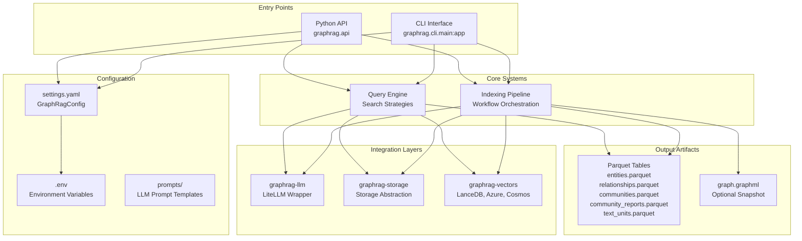

<!-- source: DeepWiki mcp.deepwiki.com · repo microsoft/graphrag · page 1 GraphRAG Overview · fetched 2026-10-26 -->

# GraphRAG Overview

Relevant source files

The following files were used as context for generating this wiki page:

- [CHANGELOG.md](CHANGELOG.md)
- [README.md](README.md)
- [breaking-changes.md](breaking-changes.md)
- [dictionary.txt](dictionary.txt)
- [docs/config/models.md](docs/config/models.md)
- [docs/get_started.md](docs/get_started.md)
- [docs/index.md](docs/index.md)
- [docs/index/byog.md](docs/index/byog.md)
- [docs/index/methods.md](docs/index/methods.md)
- [docs/visualization_guide.md](docs/visualization_guide.md)
- [mkdocs.yaml](mkdocs.yaml)
- [packages/graphrag-cache/pyproject.toml](packages/graphrag-cache/pyproject.toml)
- [packages/graphrag-chunking/pyproject.toml](packages/graphrag-chunking/pyproject.toml)
- [pyproject.toml](pyproject.toml)
- [tests/integration/storage/test_cosmosdb_storage.py](tests/integration/storage/test_cosmosdb_storage.py)

## Purpose and Scope

This page provides a high-level introduction to GraphRAG, a structured, hierarchical approach to Retrieval Augmented Generation (RAG) that uses knowledge graphs to enhance language model reasoning over private datasets. This overview covers the system's purpose, core components, and basic workflow. For detailed information about specific subsystems, see:

- [Key Concepts](#1.1) — Fundamental concepts like knowledge graphs, entities, relationships, and communities.
- [System Architecture](#1.2) — Detailed architecture and component interactions.
- [Installation and Dependencies](#1.3) — Setup and requirements.
- [Getting Started](#1.4) — Quick start guide with examples.

## What is GraphRAG?

GraphRAG is a data pipeline and transformation suite designed to extract meaningful, structured data from unstructured text using Large Language Models (LLMs). Unlike traditional "baseline RAG" approaches that rely solely on vector similarity search over text chunks, GraphRAG builds a knowledge graph from your documents and uses this structured representation to provide more comprehensive and contextually aware responses.

The system consists of two primary phases:

1.  **Indexing Pipeline**: Processes documents to extract entities, relationships, and communities, then generates hierarchical summaries.
2.  **Query System**: Uses the indexed knowledge graph to answer questions through multiple search strategies.

**Sources:** [README.md:22-26](), [docs/index.md:13-14]()

## Why GraphRAG Exists

Traditional RAG systems struggle with two key limitations:

| Limitation | Description | GraphRAG Solution |
| :--- | :--- | :--- |
| **Connecting the Dots** | Baseline RAG cannot traverse disparate pieces of information through shared attributes to synthesize insights. | Uses graph structure to follow entity relationships and build connected context. |
| **Holistic Understanding** | Vector search performs poorly when questions require understanding summarized semantic concepts across large collections. | Employs hierarchical community detection and generates multi-level summaries. |

GraphRAG addresses these limitations by creating a structured knowledge graph with hierarchical community summaries, enabling both detailed entity-specific queries and broad dataset-level questions.

**Sources:** [docs/index.md:24-30](), [README.md:24-26]()

## Core System Components

**GraphRAG System Component Overview**

GraphRAG is organized into several key layers:

### User Interface Layer
- **CLI**: Command-line interface defined in `graphrag.cli` for initialization, indexing, and querying [pyproject.toml:97-101]().
- **API**: Python library interface for programmatic integration.

### Configuration System
- **settings.yaml**: Main configuration file defining models, storage, workflows, and search parameters [docs/get_started.md:58-58]().
- **.env**: Environment variables for API keys and sensitive configuration [docs/get_started.md:56-57]().

### Core Pipeline System
- **Indexing Pipeline**: Orchestrates document processing, graph extraction, and community detection.
- **Query Engine**: Provides strategies like Global, Local, and DRIFT search [docs/index.md:44-51]().

### Integration Layers
- **LLM Provider**: Abstraction over models via `graphrag-llm` [packages/graphrag-llm/pyproject.toml:2-2](), utilizing LiteLLM [docs/config/models.md:9-11]().
- **Storage**: Pluggable backends via `graphrag-storage` [packages/graphrag-storage/pyproject.toml:2-2]().
- **Vector Stores**: Integration via `graphrag-vectors` [packages/graphrag-vectors/pyproject.toml:2-2]().

**Sources:** [README.md:22-36](), [docs/get_started.md:51-59](), [pyproject.toml:97-101](), [docs/config/models.md:9-11]()

## How GraphRAG Works

### Indexing Methods

GraphRAG supports multiple indexing strategies to balance cost and detail:

| Method | Description | Characteristics |
| :--- | :--- | :--- |
| **Standard** | Uses LLM for entity/relationship extraction and summarization. | High fidelity, rich descriptions, higher cost. |
| **Fast** | Uses NLP for portions of the indexing phase in lieu of LLM APIs. | Faster, cheaper, utilizes `extract_graph_nlp` [CHANGELOG.md:37-37](). |

**Sources:** [docs/index.md:36-42](), [docs/config/models.md:70-70](), [CHANGELOG.md:37-37]()

### Indexing Workflow

```mermaid
graph LR
    Input["Raw Documents<br/>txt/csv/json"]
    Load["load_input_documents<br/>InputReader"]
    Chunk["create_base_text_units<br/>Text Chunking"]
    Extract["extract_graph<br/>LLM or NLP Extraction"]
    Summarize["summarize_descriptions<br/>LLM Summarization"]
    Cluster["cluster_graph<br/>Leiden Algorithm"]
    Reports["create_community_reports<br/>LLM Summaries"]
    Embed["generate_text_embeddings<br/>Vector Embeddings"]
    Output["Parquet Tables<br/>TableProvider"]
    
    Input --> Load
    Load --> Chunk
    Chunk --> Extract
    Extract --> Summarize
    Summarize --> Cluster
    Cluster --> Reports
    Reports --> Embed
    Embed --> Output
```

**GraphRAG Indexing Pipeline Flow**

The indexing pipeline transforms unstructured documents into a queryable knowledge graph. Key workflows include:
- **Document Loading**: `load_input_documents` handles text, CSV, or JSON [CHANGELOG.md:58-61]().
- **Community Detection**: Uses the Leiden technique for hierarchical clustering [docs/index.md:40-40]().
- **Table Management**: Uses `TableProvider` and `DataReader` for handling Parquet/CSV artifacts [CHANGELOG.md:66-70]().

**Sources:** [docs/index.md:36-42](), [CHANGELOG.md:58-70]()

### Query Workflow

The query system provides four search strategies:

| Search Method | Use Case | Data Sources |
| :--- | :--- | :--- |
| **Global Search** | Holistic questions about the corpus. | Community summaries [docs/index.md:47-47](). |
| **Local Search** | Reasoning about specific entities and neighbors. | Entities and associated concepts [docs/index.md:48-48](). |
| **DRIFT Search** | Combines global/local with iterative refinement. | Community and neighbor context [docs/index.md:49-49](). |
| **Basic Search** | Standard top-k vector RAG. | Text chunks [docs/index.md:50-50](). |

**Sources:** [docs/index.md:44-51]()

## Package Architecture

GraphRAG is organized as a monorepo using `uv` workspaces [pyproject.toml:53-54]():

- **graphrag**: Main package containing CLI and orchestration [packages/graphrag/pyproject.toml:2-2]().
- **graphrag-llm**: LiteLLM integration and model providers [packages/graphrag-llm/pyproject.toml:2-2]().
- **graphrag-storage**: Storage abstraction (File, Blob, Cosmos) [packages/graphrag-storage/pyproject.toml:2-2]().
- **graphrag-vectors**: Vector store implementations [packages/graphrag-vectors/pyproject.toml:2-2]().
- **graphrag-common**: Shared types and utilities [pyproject.toml:58-58]().
- **graphrag-chunking**, **graphrag-input**, **graphrag-cache**: Specialized processing packages [pyproject.toml:57-61]().

**Sources:** [pyproject.toml:53-63]()

## Getting Started

1.  **Install**: Use `pip install graphrag` [docs/get_started.md:40-41]().
2.  **Initialize**: Run `graphrag init` to generate `settings.yaml` [pyproject.toml:99-99]().
3.  **Index**: Run `graphrag index` to build the graph [pyproject.toml:97-97]().
4.  **Query**: Run `graphrag query --method [global|local|drift]` [pyproject.toml:100-100]().

**Sources:** [README.md:28-30](), [pyproject.toml:97-101](), [docs/get_started.md:48-49]()

## Versioning and Migration

GraphRAG uses `semversioner` for release management [pyproject.toml:45-45](). Breaking changes are documented, and users are encouraged to run `graphrag init --force` between minor version bumps to ensure configuration compatibility [README.md:53-53](). Native support for `CosmosTableProvider` with namespace partitioning was introduced in version 3.1.0 [CHANGELOG.md:15-17]().

**Sources:** [pyproject.toml:112-127](), [README.md:49-55](), [CHANGELOG.md:15-17]()

---

