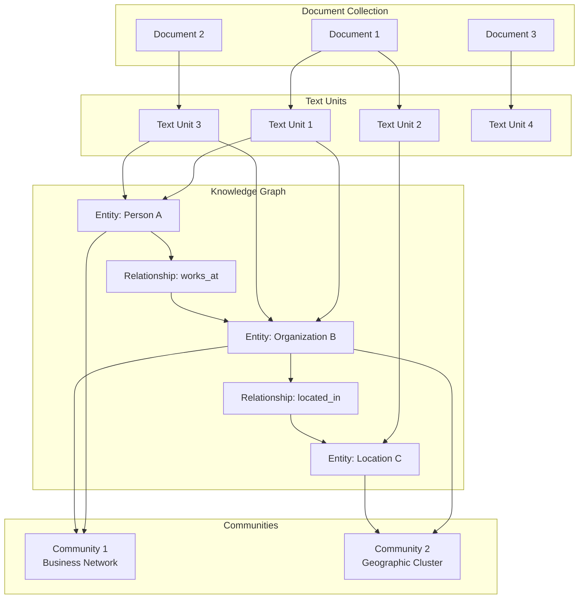
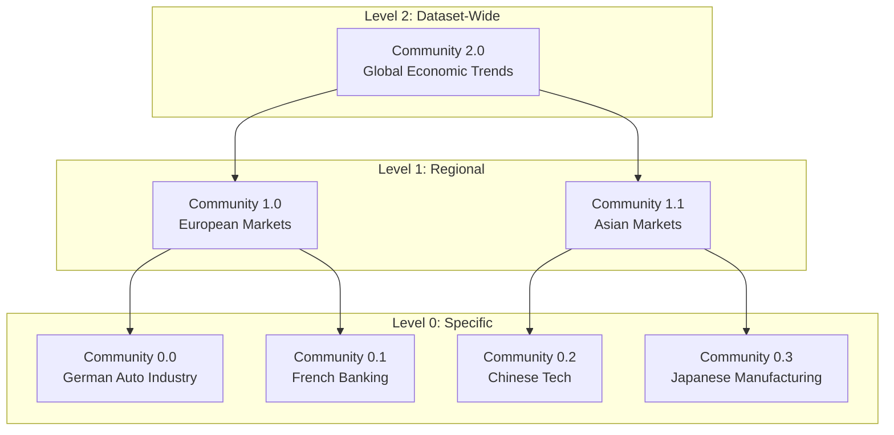
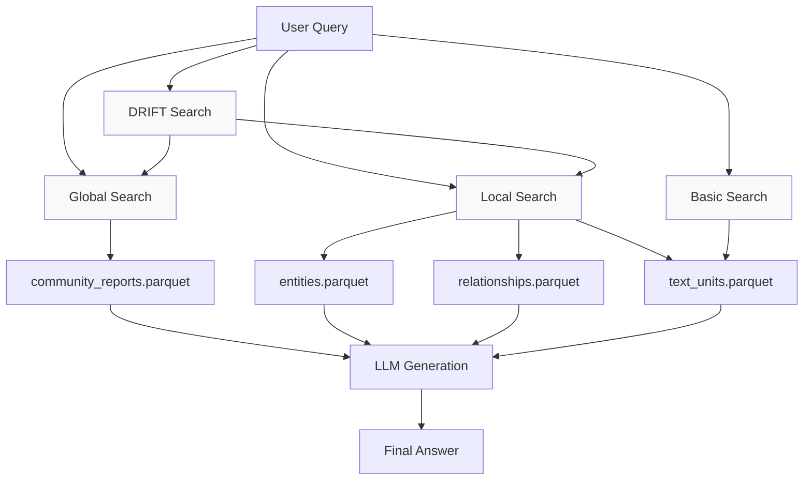
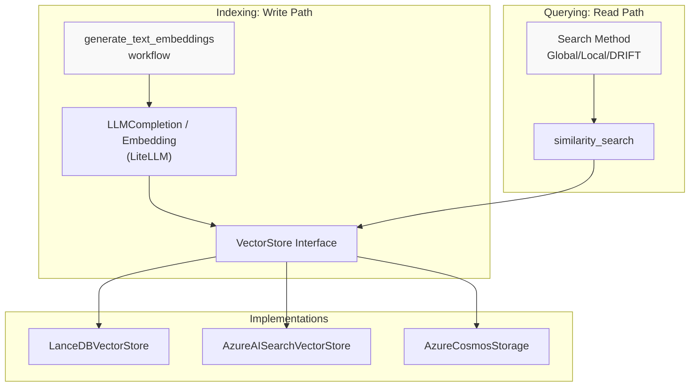

<!-- source: DeepWiki mcp.deepwiki.com · repo microsoft/graphrag · page 1.1 Key Concepts · fetched 2026-10-26 -->

# Key Concepts

Relevant source files

The following files were used as context for generating this wiki page:

- [README.md](README.md)
- [breaking-changes.md](breaking-changes.md)
- [dictionary.txt](dictionary.txt)
- [docs/config/models.md](docs/config/models.md)
- [docs/get_started.md](docs/get_started.md)
- [docs/index.md](docs/index.md)
- [docs/index/byog.md](docs/index/byog.md)
- [docs/index/methods.md](docs/index/methods.md)
- [docs/visualization_guide.md](docs/visualization_guide.md)
- [mkdocs.yaml](mkdocs.yaml)
- [tests/integration/storage/test_cosmosdb_storage.py](tests/integration/storage/test_cosmosdb_storage.py)

## Purpose and Scope

This document explains the fundamental concepts that underpin GraphRAG's approach to retrieval-augmented generation. It covers the core data structures (entities, relationships, communities, text units), the distinction between indexing and querying phases, and how GraphRAG differs from traditional RAG systems.

---

## GraphRAG vs Traditional RAG

Traditional RAG systems use vector similarity search to retrieve relevant text chunks, then feed those chunks directly to an LLM for answer generation. This approach works well for answering questions about specific facts contained in single documents, but struggles with queries that require synthesis across multiple sources or global understanding of a dataset [docs/index.md:23-31]().

GraphRAG introduces an intermediate knowledge representation layer: a **knowledge graph** extracted from source documents. Instead of retrieving raw text chunks, GraphRAG retrieves structured entities, relationships, and community summaries, enabling more sophisticated reasoning patterns [docs/index.md:13-17]().

### Key Differences

| Aspect | Traditional RAG | GraphRAG |
|--------|----------------|----------|
| **Intermediate Representation** | Vector embeddings of text chunks | Knowledge graph + embeddings |
| **Retrieval Unit** | Text chunks | Entities, relationships, communities, text units |
| **Query Types** | Specific factual questions | Both specific and global synthesis questions |
| **Preprocessing** | Chunking + embedding | LLM-based extraction + graph analysis + embedding |
| **Global Understanding** | Limited to aggregating similar chunks | Hierarchical community summaries |

Sources: [docs/index.md:13-31](), [docs/index/methods.md:5-45](), [README.md:22-26]()

---

## Knowledge Graph Components

GraphRAG constructs a knowledge graph from input documents during the indexing phase. This graph consists of three primary components: entities, relationships, and communities [docs/index.md:36-42]().

**Diagram: From Documents to Knowledge Graph Structure**

Sources: [docs/index/byog.md:5-15](), [docs/index.md:36-42]()

### Entities

**Entities** are the nodes of the knowledge graph, representing real-world objects, people, organizations, locations, concepts, or events extracted from the text [docs/index.md:40](). Each entity has:

- **id**: Unique identifier [docs/index/byog.md:17]()
- **title**: The entity name [docs/index/byog.md:17]()
- **type**: Classification (e.g., PERSON, ORGANIZATION, LOCATION) [docs/index/methods.md:9]()
- **description**: LLM-generated summary combining all mentions across documents [docs/index/methods.md:11]()
- **text_unit_ids**: List of text units where the entity appears [docs/index/byog.md:17]()

In **Standard GraphRAG**, entities are extracted by prompting an LLM to identify named entities from each text unit. The LLM also generates descriptions. When the same entity appears in multiple text units, their descriptions are summarized into a single consolidated description [docs/index/methods.md:7-12]().

In **FastGraphRAG**, entities are noun phrases extracted using NLP libraries (NLTK or spaCy), without LLM-generated descriptions. The source text units serve as the entity context [docs/index/methods.md:18-24]().

**Schema Reference**: [docs/index/byog.md:15-17]()

Sources: [docs/index/methods.md:5-30](), [docs/index/byog.md:15-17]()

### Relationships

**Relationships** are the edges of the knowledge graph, representing connections between entities. Each relationship has:

- **id**: Unique identifier [docs/index/byog.md:21]()
- **source**: Source entity id [docs/index/byog.md:21]()
- **target**: Target entity id [docs/index/byog.md:21]()
- **description**: LLM-generated description of the relationship [docs/index/byog.md:21]()
- **weight**: Importance score (crucial for community detection) [docs/index/byog.md:23]()
- **text_unit_ids**: List of text units containing evidence for the relationship [docs/index/byog.md:21]()

In **Standard GraphRAG**, the LLM is prompted to describe relationships between entity pairs in each text unit. Multiple descriptions of the same relationship are summarized into a consolidated description [docs/index/methods.md:10-12]().

In **FastGraphRAG**, relationships are defined by co-occurrence: if two entities appear in the same text unit, a relationship exists between them. No explicit description is generated [docs/index/methods.md:23]().

**Schema Reference**: [docs/index/byog.md:19-23]()

Sources: [docs/index/methods.md:5-30](), [docs/index/byog.md:19-23]()

### Communities

**Communities** are groups of entities that are densely connected in the graph, detected using the **Leiden algorithm** [docs/index.md:40](). Communities represent thematic clusters in the dataset and form a hierarchical structure [docs/index.md:14]().

The hierarchical structure allows GraphRAG to answer questions at multiple levels of abstraction:
- **Leaf communities**: Specific, detailed topics.
- **Parent communities**: Broader themes aggregating multiple sub-communities.

**Diagram: Hierarchical Community Structure**

Sources: [docs/index.md:36-42](), [docs/index/byog.md:27-33]()

---

## Text Units and Documents

### Text Units

**Text units** are the fundamental chunks of source text from which the knowledge graph is extracted. They are created during the indexing phase by splitting documents into manageable pieces [docs/index.md:38]().

**Chunking Strategy**:
- Standard GraphRAG typically uses larger chunks for extraction [docs/index/methods.md:9-14]().
- FastGraphRAG uses smaller chunks (50-100 tokens) to improve co-occurrence graphs [docs/index/methods.md:33]().

Sources: [docs/index.md:38](), [docs/index/methods.md:33]()

### Documents

**Documents** represent the original input files. Each document record contains the raw text and references to the text units created from it [docs/index/byog.md:5-9](). In version 3, the `text_units` table was updated to reference a single `document_id` instead of a list [breaking-changes.md:19]().

Sources: [docs/index/byog.md:5-9](), [breaking-changes.md:19]()

---

## Indexing vs Querying Phases

GraphRAG operates in two distinct phases:

### Indexing Phase

The **indexing phase** is a batch processing pipeline that transforms raw documents into knowledge graph artifacts.

**Key workflows**:
1. `load_input_documents` - Load and parse input files.
2. `create_base_text_units` - Chunk documents into text units [docs/index.md:38]().
3. `extract_graph` / `extract_graph_nlp` - Extract entities and relationships [docs/index/methods.md:9-23]().
4. `summarize_descriptions` - Consolidate entity/relationship descriptions [docs/index/methods.md:11-12]().
5. `cluster_graph` - Detect communities using Leiden algorithm [docs/index.md:40]().
6. `create_community_reports` - Generate LLM summaries for each community [docs/index.md:41]().
7. `generate_text_embeddings` - Create vector embeddings for text units and reports [docs/index/byog.md:45-48]().

```mermaid
graph LR
    Input["Input Documents"] --> Load["load_input_documents"]
    Load --> Chunk["create_base_text_units"]
    Chunk --> Extract["extract_graph<br/>extract_graph_nlp"]
    Extract --> Cluster["cluster_graph"]
    Cluster --> Reports["create_community_reports"]
    Reports --> Embed["generate_text_embeddings"]
    Embed --> Output["Parquet Tables<br/>+ Vector Store"]
    
    style Extract fill:#f9f9f9
    style Cluster fill:#f9f9f9
    style Reports fill:#f9f9f9
```

**Diagram: Simplified Indexing Pipeline Flow**

Sources: [docs/index.md:36-42](), [docs/index/methods.md:1-29](), [docs/index/byog.md:27-33]()

### Querying Phase

The **querying phase** is a runtime operation that retrieves relevant information from the indexed knowledge graph [docs/index.md:43-51]().

**Query methods**:
- **Global Search**: Uses community reports for dataset-wide synthesis [docs/index.md:47]().
- **Local Search**: Uses entity-centric graph traversal for specific questions [docs/index.md:48]().
- **DRIFT Search**: Hybrid approach combining global and local strategies [docs/index.md:49]().
- **Basic Search**: Traditional vector RAG baseline [docs/index.md:50]().

Sources: [docs/index.md:43-51]()

---

## Search Methods Overview

### Global Search
**Mechanism**: Uses community reports and a map-reduce pattern to answer questions about the entire corpus [docs/index.md:47](). It is ideal for holistic questions like "What are the main themes?" [docs/get_started.md:113-117]().

### Local Search
**Mechanism**: Focuses on specific entities and their immediate graph neighborhood [docs/index.md:48](). It retrieves related entities, relationships, and text units to provide detailed answers for entity-centric queries [docs/get_started.md:119-125]().

### DRIFT Search
**Mechanism**: An iterative search method that combines global community information with local graph traversal to refine answers [docs/index.md:49]().

### Basic Search
**Mechanism**: A standard vector similarity search over text units, serving as a baseline for performance comparison [docs/index.md:50]().

**Diagram: Search Method Data Flow**

Sources: [docs/index.md:43-51](), [docs/index/methods.md:42-45](), [docs/get_started.md:113-125]()

---

## Storage and Model Integration

GraphRAG abstracts data persistence and model calls to support various backends.

### Storage and Vector Stores
The system supports multiple storage backends for artifacts and vector embeddings:
- **LanceDB**: Default local vector store [breaking-changes.md:54]().
- **Azure Cosmos DB**: Supports storage and DiskANN-based vector indexing [tests/integration/storage/test_cosmosdb_storage.py:11-14]().
- **Azure AI Search**: Alternative vector store provider [breaking-changes.md:54]().

### Language Model Integration
GraphRAG uses `LiteLLM` for calling language models, supporting providers like OpenAI, Azure, and Gemini [docs/config/models.md:9-27](). Users can also register custom models using the `LLMCompletion` protocol [docs/config/models.md:84-98]().

**Diagram: Vector Store and Model Integration**

Sources: [docs/config/models.md:9-98](), [breaking-changes.md:54](), [tests/integration/storage/test_cosmosdb_storage.py:11-14]()

---

