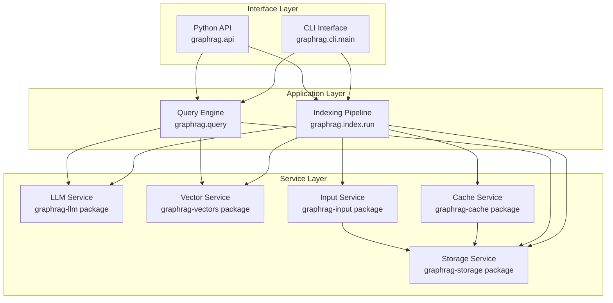
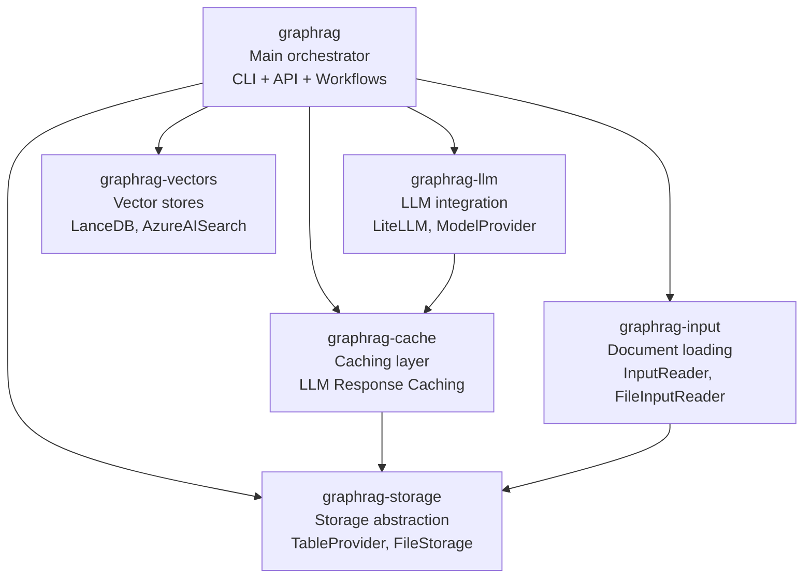
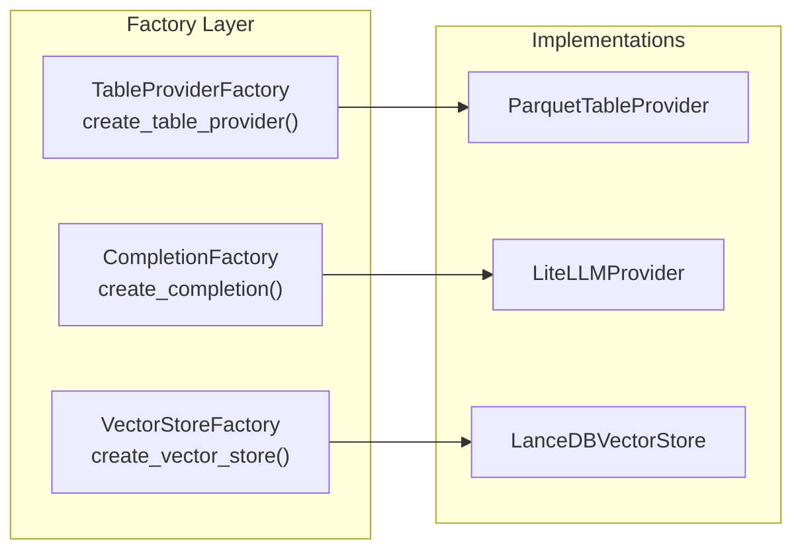
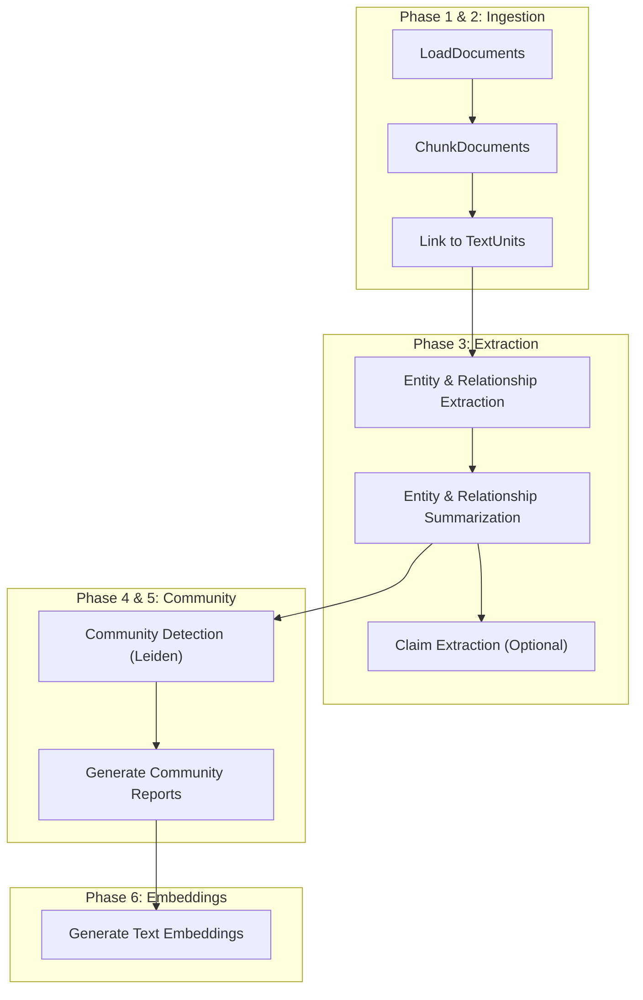

<!-- source: DeepWiki mcp.deepwiki.com · repo microsoft/graphrag · page 1.2 System Architecture · fetched 2026-10-26 -->

# System Architecture

Relevant source files

The following files were used as context for generating this wiki page:

- [README.md](README.md)
- [breaking-changes.md](breaking-changes.md)
- [docs/config/yaml.md](docs/config/yaml.md)
- [docs/examples_notebooks/drift_search.ipynb](docs/examples_notebooks/drift_search.ipynb)
- [docs/examples_notebooks/global_search.ipynb](docs/examples_notebooks/global_search.ipynb)
- [docs/examples_notebooks/global_search_with_dynamic_community_selection.ipynb](docs/examples_notebooks/global_search_with_dynamic_community_selection.ipynb)
- [docs/examples_notebooks/local_search.ipynb](docs/examples_notebooks/local_search.ipynb)
- [docs/index.md](docs/index.md)
- [docs/index/architecture.md](docs/index/architecture.md)
- [docs/index/byog.md](docs/index/byog.md)
- [docs/index/default_dataflow.md](docs/index/default_dataflow.md)
- [docs/index/inputs.md](docs/index/inputs.md)
- [docs/index/methods.md](docs/index/methods.md)
- [docs/index/outputs.md](docs/index/outputs.md)

## Purpose and Scope

This document describes the overall architecture of the GraphRAG system, including its monorepo structure, major components, and how they interact. It provides a technical overview of the system's organization and the relationships between packages and subsystems.

GraphRAG is designed as a modular, layered system that enables users to build knowledge graphs from unstructured documents and query them using multiple retrieval strategies. The architecture emphasizes extensibility through a provider-factory pattern, allowing for custom implementations of storage, language models, and vector databases.

**Sources:** [README.md:22-26](), [docs/index/architecture.md:37-53]()

---

## High-Level System Organization

GraphRAG is organized as a modular, layered system built on a monorepo architecture. The system transitions from unstructured "Natural Language Space" (documents, text chunks) to "Code Entity Space" (DataFrames, Graph Primitives, Vector Stores).

### System Layers

**Sources:** [docs/index/architecture.md:37-53](), [docs/index/default_dataflow.md:15-52]()

---

## Monorepo Package Structure

The repository manages distinct packages that handle infrastructure concerns. The main `graphrag` package orchestrates high-level workflows.

### Package Dependency Graph

### Package Responsibilities

| Package | Purpose | Key Code Entities |
|---------|---------|-------------|
| `graphrag` | Main entry point and workflow runner | `PipelineRunContext`, `GraphRagConfig` |
| `graphrag-storage` | Data persistence abstraction | `TableProvider`, `Storage`, `TableProviderFactory` |
| `graphrag-cache` | LLM interaction persistence | `CacheFactory`, `MemoryCache` |
| `graphrag-input` | Source data ingestion | `InputReader`, `InputReaderFactory` |
| `graphrag-llm` | Language model communication | `ModelConfig`, `CompletionFactory`, `EmbeddingFactory` |
| `graphrag-vectors` | Vector search and storage | `VectorStore`, `VectorStoreFactory`, `LanceDBVectorStore` |

**Sources:** [docs/index/architecture.md:37-53](), [docs/config/yaml.md:46-71](), [docs/examples_notebooks/local_search.ipynb:31-35]()

---

## Core Architectural Patterns

### Provider-Factory Pattern
GraphRAG uses a registration-based factory pattern to enable deep customization. Core components are instantiated via factories that look up registered types based on configuration.

**Sources:** [docs/index/architecture.md:37-53](), [docs/config/yaml.md:46-48]()

### Knowledge Model Abstraction
The system operates on a standardized Knowledge Model, represented as DataFrames managed by `TableProvider`.

| Entity Type | Storage Table | Description |
|-------------|---------------------|-------------|
| `Document` | `documents` | Original input source. [docs/index/default_dataflow.md:7-7]() |
| `TextUnit` | `text_units` | Chunks of text used for analysis. [docs/index/default_dataflow.md:8-8]() |
| `Entity` | `entities` | Extracted graph nodes. [docs/index/default_dataflow.md:9-9]() |
| `Relationship` | `relationships` | Edges connecting entities. [docs/index/default_dataflow.md:10-10]() |
| `Covariate` | `covariates` | Extracted claim information. [docs/index/default_dataflow.md:11-11]() |
| `Community` | `communities` | Clusters of entities. [docs/index/default_dataflow.md:12-12]() |
| `Community Report` | `community_reports` | LLM-generated summaries. [docs/index/default_dataflow.md:13-13]() |

**Sources:** [docs/index/default_dataflow.md:3-14](), [docs/index/outputs.md:13-109]()

---

## Indexing Pipeline Architecture

The indexing pipeline transforms raw text into the knowledge model through a series of phases.

### Pipeline Execution Flow

**Sources:** [docs/index/architecture.md:14-28](), [docs/index/default_dataflow.md:19-52]()

---

## Query System Architecture

The query system utilizes the indexed artifacts (Parquet tables and Vector indices) to provide multiple search strategies.

### Search Strategies

| Strategy | Implementation | Logic |
|----------|----------------|-------|
| **Global Search** | `GlobalSearch` | Map-Reduce over community reports. [docs/examples_notebooks/global_search.ipynb:40-42]() |
| **Local Search** | `LocalSearch` | Combines knowledge graph data with text chunks for entity-centric queries. [docs/examples_notebooks/local_search.ipynb:42-44]() |
| **DRIFT Search** | `DRIFTSearch` | Iterative fanning-out to neighbors with community context. [docs/index.md:49-49]() |
| **Basic Search** | Standard RAG | Similarity search over text units. [docs/index.md:50-50]() |

**Sources:** [docs/index.md:45-51](), [docs/examples_notebooks/local_search.ipynb:31-35](), [docs/examples_notebooks/global_search.ipynb:27-30]()

---

## Configuration and Environment

The system is configured via `settings.yaml` and environment variables.

### Configuration Components
* **LLM Setup**: Configured via `completion_models` and `embedding_models` using `LiteLLM`. [docs/config/yaml.md:20-42]()
* **Input/Output**: Configured via `input` and `output` blocks defining `storage` types (file, memory, blob, cosmosdb). [docs/config/yaml.md:73-116]()
* **Chunking**: Defines `size`, `overlap`, and `prepend_metadata`. [docs/config/yaml.md:96-107]()

**Sources:** [docs/config/yaml.md:1-116](), [docs/index/inputs.md:71-76]()

---

