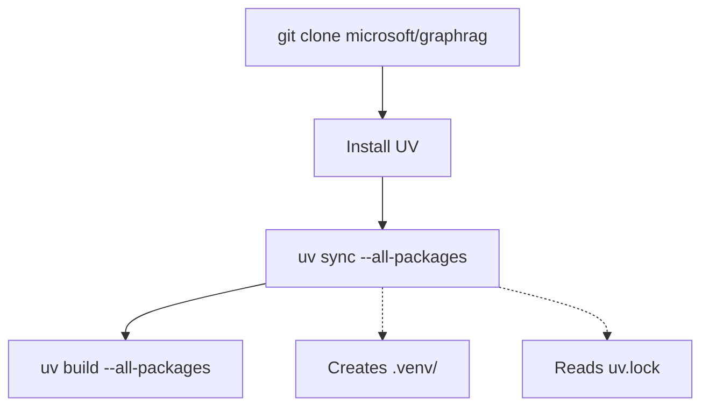
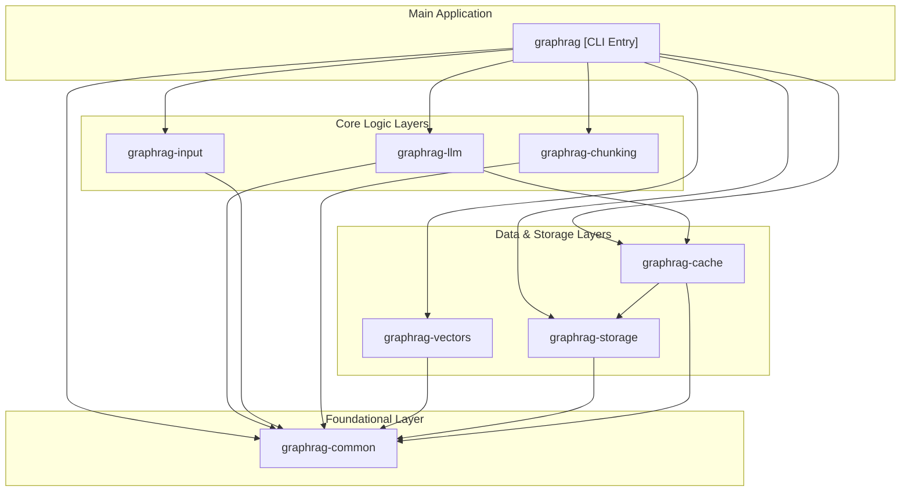
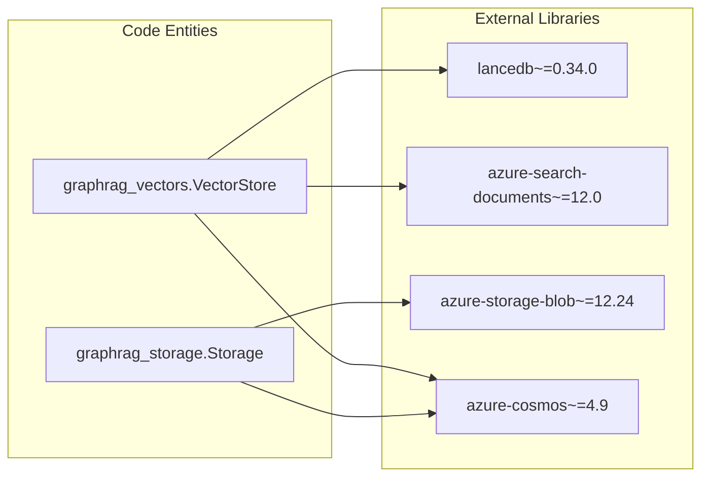
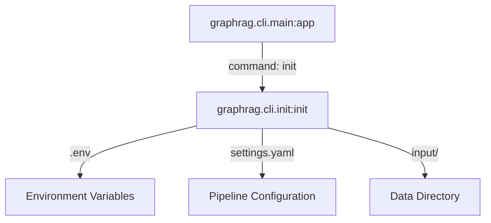

<!-- source: DeepWiki mcp.deepwiki.com · repo microsoft/graphrag · page 1.3 Installation and Dependencies · fetched 2026-10-26 -->

# Installation and Dependencies

<details>
<summary>Relevant source files</summary>

The following files were used as context for generating this wiki page:

- [CHANGELOG.md](CHANGELOG.md)
- [packages/graphrag-cache/pyproject.toml](packages/graphrag-cache/pyproject.toml)
- [packages/graphrag-chunking/pyproject.toml](packages/graphrag-chunking/pyproject.toml)
- [packages/graphrag-llm/pyproject.toml](packages/graphrag-llm/pyproject.toml)
- [packages/graphrag-storage/pyproject.toml](packages/graphrag-storage/pyproject.toml)
- [packages/graphrag-vectors/pyproject.toml](packages/graphrag-vectors/pyproject.toml)
- [packages/graphrag/pyproject.toml](packages/graphrag/pyproject.toml)
- [pyproject.toml](pyproject.toml)
- [uv.lock](uv.lock)

</details>


This page documents the prerequisites, installation procedures, and dependency structure for GraphRAG. It covers both end-user installation via PyPI and development setup using the `uv` package manager.

---

## Prerequisites

### Python Version Requirements

GraphRAG requires Python 3.11, 3.12, or 3.13. This requirement is enforced across all packages in the monorepo via `pyproject.toml` configurations. While some sub-packages like `graphrag-llm` support Python 3.10, the main application requires at least 3.11.

| Package | Python Requirement | Location |
|---------|-------------------|----------|
| `graphrag-monorepo` | `>=3.11, <3.14` | [pyproject.toml:24-24]() |
| `graphrag` | `>=3.11, <3.14` | [packages/graphrag/pyproject.toml:26-26]() |
| `graphrag-llm` | `>=3.10, <3.14` | [packages/graphrag-llm/pyproject.toml:26-26]() |
| `graphrag-common` | `>=3.11, <3.14` | [packages/graphrag-common/pyproject.toml:25-25]() |
| `graphrag-storage` | `>=3.11, <3.14` | [packages/graphrag-storage/pyproject.toml:25-25]() |
| `graphrag-vectors` | `>=3.11, <3.14` | [packages/graphrag-vectors/pyproject.toml:25-25]() |

**Sources:** [pyproject.toml:24-24](), [uv.lock:3-3](), [packages/graphrag/pyproject.toml:26-26](), [packages/graphrag-llm/pyproject.toml:26-26](), [packages/graphrag-vectors/pyproject.toml:25-25]()

### UV Package Manager

For development and monorepo management, GraphRAG uses [uv](https://docs.astral.sh/uv/). It handles workspace synchronization, dependency resolution, and virtual environment management for the monorepo members.

**Installation:**
```bash
# Follow instructions at https://docs.astral.sh/uv/
curl -LsSf https://astral.sh/uv/install.sh | sh
```

**Sources:** [pyproject.toml:50-54](), [uv.lock:1-11]()

---

## Installation Methods

### End-User Installation (PyPI)

Standard users should install the main `graphrag` package from PyPI. This pulls in all necessary sub-packages (llm, storage, vectors, etc.) at compatible versions.

```bash
# Create and activate a virtual environment
python -m venv .venv
source .venv/bin/activate # Unix/MacOS

# Install via pip
pip install graphrag
```

**Sources:** [packages/graphrag/pyproject.toml:34-63]()

### Development Installation

For contributors working within the monorepo, the following workflow sets up the entire workspace using the members defined in the root manifest [pyproject.toml:53-54]().



**Figure 1: Development Setup Workflow**

**Commands:**
```bash
git clone https://github.com/microsoft/graphrag.git
cd graphrag
uv sync --all-packages
```

**Sources:** [pyproject.toml:50-54](), [pyproject.toml:106-107](), [uv.lock:13-24]()

---

## Workspace Package Dependencies

GraphRAG is structured as a monorepo. The main `graphrag` package acts as the primary entry point and CLI provider, depending on specialized internal packages.



**Figure 2: Monorepo Package Dependency Hierarchy**

### Internal Package Versioning
All workspace packages are synchronized to the same version (currently `3.1.1`) to ensure strict compatibility across the monorepo.

**Sources:** [packages/graphrag/pyproject.toml:39-45](), [packages/graphrag-llm/pyproject.toml:38-41](), [packages/graphrag-cache/pyproject.toml:34-35](), [packages/graphrag-vectors/pyproject.toml:37-37]()

---

## Core External Dependencies

### Language Model Integration (`graphrag-llm`)

The LLM package abstracts interactions with various providers, primarily through **LiteLLM**.

| Dependency | Version | Role |
|------------|---------|------|
| `litellm` | `1.92.0` | Multi-provider LLM abstraction |
| `azure-identity` | `~=1.25` | Managed identity support for Azure OpenAI |
| `jinja2` | `~=3.1` | Prompt templating engine |
| `pydantic` | `~=2.10` | Data validation and settings models |
| `fastapi` | `>=0.136.3` | Required for LiteLLM tool calling |

**Sources:** [packages/graphrag-llm/pyproject.toml:34-47]()

### Data Processing and NLP (`graphrag`)

The main package handles graph construction, community detection, and complex NLP tasks.

| Dependency | Version | Purpose |
|------------|---------|---------|
| `networkx` | `~=3.4` | Graph data structures and algorithms |
| `graspologic-native` | `1.2.x` | Hierarchical clustering (Leiden) |
| `spacy` | `~=3.8` | NLP pipeline for entity extraction |
| `nltk` | `~=3.9` | Text tokenization and preprocessing |
| `pandas` | `~=3.0` | Dataframe manipulation for pipeline steps |
| `pyarrow` | `~=25.0` | Parquet file support for indexing outputs |
| `typer` | `~=0.16` | CLI implementation |

**Sources:** [packages/graphrag/pyproject.toml:46-63](), [CHANGELOG.md:28-28]()

### Storage and Vector Backends

GraphRAG supports multiple storage backends for both raw data and vector embeddings through specialized provider implementations in `graphrag-storage` and `graphrag-vectors`.



**Figure 3: Mapping Storage Code Entities to External Dependencies**

**Sources:** [packages/graphrag-vectors/pyproject.toml:32-42](), [packages/graphrag-storage/pyproject.toml:32-40](), [CHANGELOG.md:17-17]()

---

## Initialization and Workspace Setup

When a user runs `graphrag init`, the system prepares the local environment with necessary configuration files.



**Figure 4: Initialization Data Flow**

**Key Artifacts Created:**
- `.env`: Stores sensitive keys like `GRAPHRAG_API_KEY`.
- `settings.yaml`: Defines model providers, chunking sizes, and storage paths.
- `input/`: Default directory for source text files.

**Sources:** [packages/graphrag/pyproject.toml:65-66](), [pyproject.toml:99-99]()

---

## Troubleshooting Installation

### Python Version Mismatch
If using a version outside the `3.11-3.13` range, installation may fail or lead to runtime errors in packages like `numpy` or `pandas` which have strict version constraints. Note that `graphrag-llm` allows `3.10`, but the top-level `graphrag` package requires `3.11`.

### Dependency Conflicts
GraphRAG pins `graspologic-native` to the `1.2.x` line [packages/graphrag/pyproject.toml:49-49]() because `1.3.x` changes Leiden clustering outputs, which would break pinned regression tests.

**Sources:** [pyproject.toml:24-24](), [packages/graphrag/pyproject.toml:49-49](), [CHANGELOG.md:71-71]()

---

