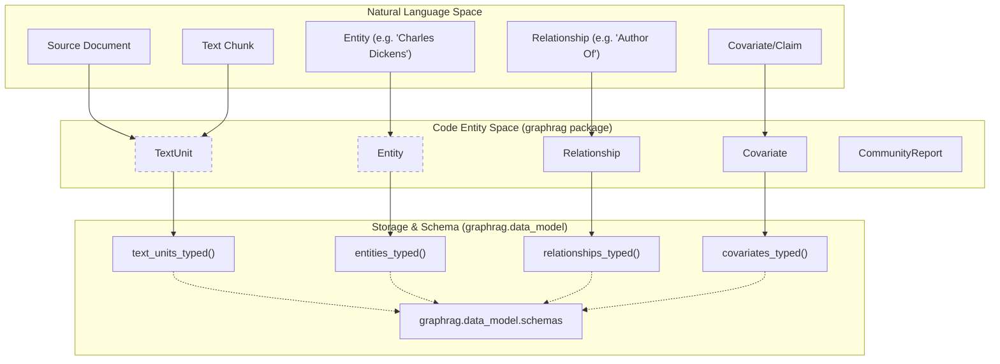
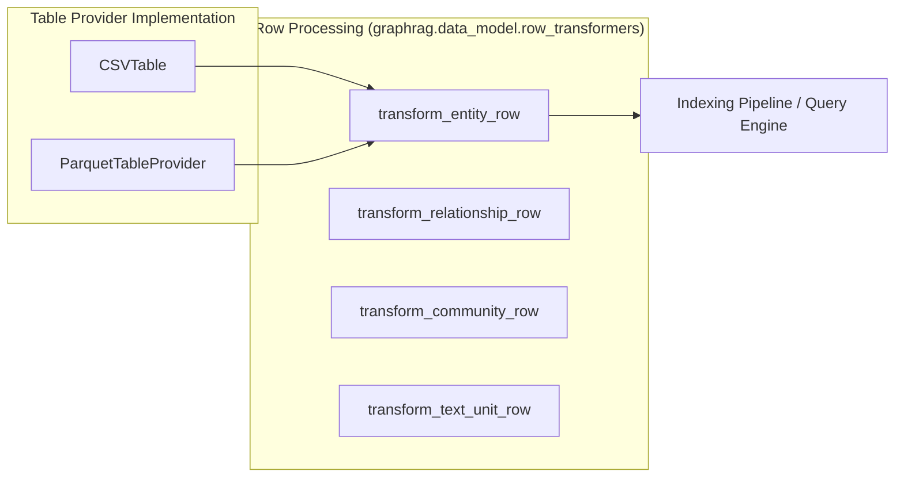

<!-- source: DeepWiki mcp.deepwiki.com · repo microsoft/graphrag · page 10 Data Models and Schemas · fetched 2026-10-26 -->

# Data Models and Schemas

<details>
<summary>Relevant source files</summary>

The following files were used as context for generating this wiki page:

- [docs/examples_notebooks/index_migration_to_v1.ipynb](docs/examples_notebooks/index_migration_to_v1.ipynb)
- [packages/graphrag-storage/graphrag_storage/tables/csv_table.py](packages/graphrag-storage/graphrag_storage/tables/csv_table.py)
- [packages/graphrag/graphrag/data_model/dfs.py](packages/graphrag/graphrag/data_model/dfs.py)
- [packages/graphrag/graphrag/data_model/row_transformers.py](packages/graphrag/graphrag/data_model/row_transformers.py)
- [packages/graphrag/graphrag/index/workflows/update_text_embeddings.py](packages/graphrag/graphrag/index/workflows/update_text_embeddings.py)
- [tests/unit/indexing/operations/__init__.py](tests/unit/indexing/operations/__init__.py)
- [tests/unit/indexing/operations/embed_text/__init__.py](tests/unit/indexing/operations/embed_text/__init__.py)
- [tests/unit/storage/test_csv_table.py](tests/unit/storage/test_csv_table.py)
- [tests/verbs/data/covariates.csv](tests/verbs/data/covariates.csv)
- [tests/verbs/data/entities.csv](tests/verbs/data/entities.csv)
- [tests/verbs/data/relationships.csv](tests/verbs/data/relationships.csv)
- [tests/verbs/data/text_units.csv](tests/verbs/data/text_units.csv)
- [tests/verbs/test_update_text_embeddings.py](tests/verbs/test_update_text_embeddings.py)

</details>


## Purpose and Scope

This page documents the data models and schemas used throughout the GraphRAG system to represent knowledge graphs, configuration, and intermediate processing artifacts. It covers the type system, serialization formats, and schema validation mechanisms that ensure data consistency across the indexing pipeline and query system.

For specific schema details, see:
- Knowledge graph entity, relationship, and community schemas: [Knowledge Graph Schema](#10.1)
- Configuration data models: [Configuration Schema](#10.2)
- Vector store document structures: [Vector Store Documents](#10.3)
- Pipeline artifact schemas: [Pipeline Artifacts](#10.4)
- Text unit structures and metadata: [Text Units Schema](#10.5)
- Covariate/claims schema: [Covariate Schema](#10.6)

For data serialization and table access patterns, see [Table Providers and Data Serialization](#4.11).

---

## Overview of Data Model Architecture

GraphRAG employs a layered data model architecture where strongly-typed schemas enforce consistency across storage backends, serialization formats, and processing workflows.

### Natural Language to Code Entity Space Mapping
The following diagram illustrates how natural language concepts extracted from documents map to specific code entities and storage structures within the GraphRAG system.


**Sources:** [packages/graphrag/graphrag/data_model/dfs.py:10-28](), [packages/graphrag/graphrag/data_model/row_transformers.py:73-225]()

---

## Schema Categories

GraphRAG organizes schemas into primary categories, each serving distinct purposes in the system:

| Category | Purpose | Key Tables | Reference |
|----------|---------|------------|-----------|
| **Knowledge Graph Schema** | Core graph entities and relationships | `entities`, `relationships`, `communities`, `community_reports` | [Knowledge Graph Schema](#10.1) |
| **Configuration Schema** | System configuration and settings | `GraphRagConfig`, model configs, workflow configs | [Configuration Schema](#10.2) |
| **Vector Store Schema** | Embedding storage and retrieval | `VectorStoreDocument`, `VectorStoreSearchResult` | [Vector Store Documents](#10.3) |
| **Pipeline Artifacts** | Intermediate and final outputs | `documents`, `text_units`, `covariates` | [Pipeline Artifacts](#10.4) |

**Sources:** [packages/graphrag/graphrag/data_model/dfs.py:10-28](), [packages/graphrag/graphrag/config/models/graph_rag_config.py:11-13]()

---

## Data Serialization Formats

### Parquet Format
Parquet is the primary storage format for final pipeline outputs. It provides columnar storage for efficient analytics and strong typing. Tables like `create_final_entities` and `create_final_relationships` are typically persisted as Parquet files. For details on migrating older Parquet formats to current versions, see [Data Model Migration](#11.2).

**Sources:** [docs/examples_notebooks/index_migration_to_v1.ipynb:114-122]()

### CSV Format
CSV format is used for test fixtures and human-readable inspection. The `CSVTable` implementation in `graphrag_storage` supports both truncate and append modes. Truncate mode allows safe concurrent reads by writing to a temporary file before replacing the original on `close()`.

**Sources:** [packages/graphrag-storage/graphrag_storage/tables/csv_table.py:50-87](), [packages/graphrag-storage/graphrag_storage/tables/csv_table.py:152-166]()

### Table Provider Abstraction
The `Table` interface provides a unified API for row-by-row streaming access, utilizing `RowTransformer` functions to ensure type safety during ingestion.


**Sources:** [packages/graphrag-storage/graphrag_storage/tables/csv_table.py:50-109](), [packages/graphrag/graphrag/data_model/row_transformers.py:1-11]()

---

## Type System and Conversions

### Schema Constants
Schema constants define the canonical column names used across all tables to prevent "magic string" errors.

```python
# [packages/graphrag/graphrag/data_model/dfs.py:10-28]()
COMMUNITY_ID = "community_id"
ENTITY_IDS = "entity_ids"
SHORT_ID = "human_readable_id"
TEXT_UNIT_IDS = "text_unit_ids"
```

### Typed DataFrame Functions
The `dfs.py` module provides functions to enforce correct types when reading from weakly-typed formats like CSV. It handles specialized serialization like newline-separated lists in CSV strings via `split_list_column`.

```python
# [packages/graphrag/graphrag/data_model/dfs.py:61-72]()
def entities_typed(df: pd.DataFrame) -> pd.DataFrame:
    """Return the entities dataframe with correct types."""
    if SHORT_ID in df.columns:
        df[SHORT_ID] = _safe_int(df[SHORT_ID])
    if TEXT_UNIT_IDS in df.columns:
        df[TEXT_UNIT_IDS] = df[TEXT_UNIT_IDS].apply(_split_list_column)
    # ...
    return df
```
**Sources:** [packages/graphrag/graphrag/data_model/dfs.py:36-54](), [packages/graphrag/graphrag/data_model/dfs.py:61-153]()

### Row Transformers
For streaming access, `row_transformers.py` provides per-row coercion logic. This is essential for `TableProvider.open()` calls. Transformers also support preparing rows for specific tasks, such as `transform_entity_row_for_embedding` which concatenates titles and descriptions.

```python
# [packages/graphrag/graphrag/data_model/row_transformers.py:73-89]()
def transform_entity_row(row: dict[str, Any]) -> dict[str, Any]:
    """Coerce types for an entity row."""
    if "human_readable_id" in row:
        row["human_readable_id"] = _safe_int(row["human_readable_id"])
    if "text_unit_ids" in row:
        row["text_unit_ids"] = _coerce_list(row["text_unit_ids"])
    # ...
    return row
```

**Sources:** [packages/graphrag/graphrag/data_model/row_transformers.py:12-216](), [packages/graphrag/graphrag/data_model/row_transformers.py:92-99]()

---

## Schema Examples from Production Data

### Entities Schema
| Column | Type | Description |
|--------|------|-------------|
| `id` | string | UUID identifier |
| `human_readable_id` | int | Sequential ID for display |
| `title` | string | Entity name |
| `type` | string | Entity category (e.g., PERSON) |
| `description` | string | Detailed summary |
| `text_unit_ids` | list[str] | Source text unit references |
| `degree` | int | Number of connections in the graph |

**Sources:** [tests/verbs/data/entities.csv:1-11](), [packages/graphrag/graphrag/data_model/dfs.py:69-70]()

### Text Units Schema
| Column | Type | Description |
|--------|------|-------------|
| `id` | string | UUID identifier |
| `text` | string | Raw chunk content |
| `n_tokens` | int | Token count |
| `document_ids` | list[str] | Parent document IDs |

**Sources:** [tests/verbs/data/text_units.csv:1-2](), [packages/graphrag/graphrag/data_model/dfs.py:134-134]()

### Relationships Schema
| Column | Type | Description |
|--------|------|-------------|
| `source` | string | Source entity title |
| `target` | string | Target entity title |
| `weight` | float | Strength of the relationship |
| `combined_degree` | int | Total degree count for the edge |

**Sources:** [tests/verbs/data/relationships.csv:1-2](), [packages/graphrag/graphrag/data_model/row_transformers.py:119-124]()

---

## Summary
The GraphRAG data model provides a robust bridge between unstructured text and structured knowledge. By using centralized schema constants in `graphrag.data_model.schemas` and strict type coercion in `dfs.py` and `row_transformers.py`, the system ensures that data remains consistent whether it is being processed in-memory as a Pandas DataFrame or streamed from a `CSVTable`.

For detailed implementation of these schemas, refer to the specific child pages:
- [Knowledge Graph Schema](#10.1)
- [Configuration Schema](#10.2)
- [Vector Store Documents](#10.3)
- [Pipeline Artifacts](#10.4)
- [Text Units Schema](#10.5)
- [Covariate Schema](#10.6)

---

