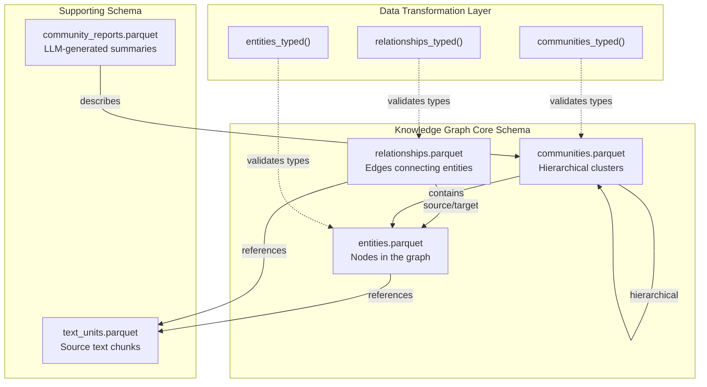
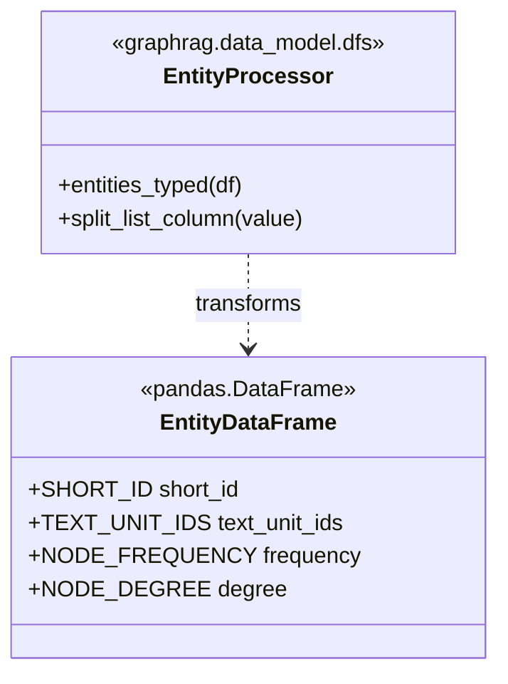
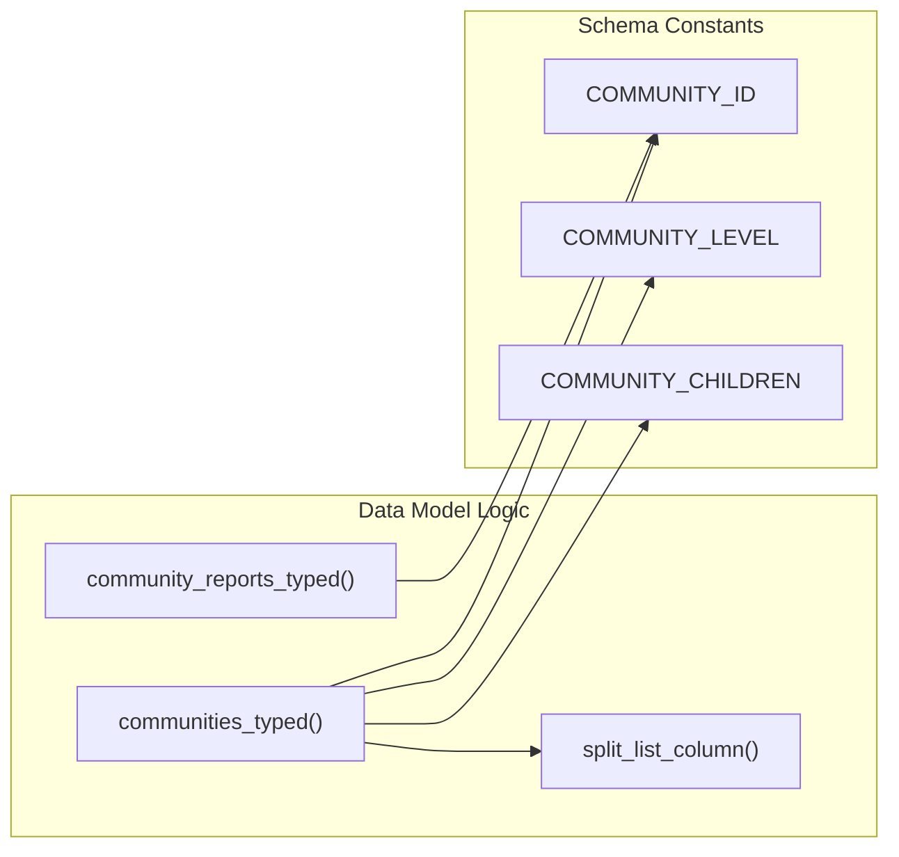

<!-- source: DeepWiki mcp.deepwiki.com · repo microsoft/graphrag · page 10.1 Knowledge Graph Schema · fetched 2026-10-26 -->

# Knowledge Graph Schema

Relevant source files

The following files were used as context for generating this wiki page:

- [packages/graphrag-storage/graphrag_storage/tables/csv_table.py](packages/graphrag-storage/graphrag_storage/tables/csv_table.py)
- [packages/graphrag/graphrag/data_model/dfs.py](packages/graphrag/graphrag/data_model/dfs.py)
- [tests/unit/storage/test_csv_table.py](tests/unit/storage/test_csv_table.py)
- [tests/verbs/data/communities.parquet](tests/verbs/data/communities.parquet)
- [tests/verbs/data/community_reports.parquet](tests/verbs/data/community_reports.parquet)
- [tests/verbs/data/covariates.csv](tests/verbs/data/covariates.csv)
- [tests/verbs/data/covariates.parquet](tests/verbs/data/covariates.parquet)
- [tests/verbs/data/documents.parquet](tests/verbs/data/documents.parquet)
- [tests/verbs/data/entities.csv](tests/verbs/data/entities.csv)
- [tests/verbs/data/entities.parquet](tests/verbs/data/entities.parquet)
- [tests/verbs/data/relationships.csv](tests/verbs/data/relationships.csv)
- [tests/verbs/data/relationships.parquet](tests/verbs/data/relationships.parquet)
- [tests/verbs/data/text_units.csv](tests/verbs/data/text_units.csv)
- [tests/verbs/data/text_units.parquet](tests/verbs/data/text_units.parquet)

This page documents the schema definitions for the core knowledge graph data structures in GraphRAG: entities, relationships, and communities. These schemas define the structured tables produced by the indexing pipeline and consumed by the query engine.

For information about text units and their schema, see [Text Units Schema](). For covariates (claims), see [Covariate Schema](). For a complete reference of all pipeline artifacts, see [Pipeline Artifacts]().

## Overview

The GraphRAG knowledge graph consists of primary data structures extracted during indexing. These are typically stored as Parquet files, though the system supports CSV streaming via the `CSVTable` implementation [packages/graphrag-storage/graphrag_storage/tables/csv_table.py:50-51](). The system uses a centralized set of schema constants to ensure consistency across the data model [packages/graphrag/graphrag/data_model/dfs.py:10-28]().

### Core Schema Architecture
The following diagram illustrates how the different knowledge graph components relate to one another and the code entities responsible for managing their types.

**Sources:** [packages/graphrag/graphrag/data_model/dfs.py:10-28](), [packages/graphrag/graphrag/data_model/dfs.py:61-105](), [packages/graphrag-storage/graphrag_storage/tables/csv_table.py:50-87]()

## Entity Schema

Entities represent nodes in the knowledge graph—people, places, organizations, events, and other named concepts. The `entities_typed` function ensures these dataframes maintain correct types during processing, specifically handling ID conversions and list splitting [packages/graphrag/graphrag/data_model/dfs.py:61-72]().

### Entity Fields

| Field | Type | Description | Source |
|-------|------|-------------|--------|
| `id` | string | Unique identifier (UUID format) | [tests/verbs/data/entities.parquet:1]() |
| `short_id` | int | Integer-based identifier for efficient lookup | [packages/graphrag/graphrag/data_model/dfs.py:63-64]() |
| `title` | string | Canonical entity name | [tests/verbs/data/entities.parquet:1]() |
| `type` | string | Entity category (e.g., PERSON, ORGANIZATION) | [tests/verbs/data/entities.parquet:1]() |
| `description` | string | Detailed description of the entity | [tests/verbs/data/entities.parquet:1]() |
| `text_unit_ids` | list[string] | References to source text units | [packages/graphrag/graphrag/data_model/dfs.py:65-66]() |
| `frequency` | int | Number of appearances in the text | [packages/graphrag/graphrag/data_model/dfs.py:67-68]() |
| `degree` | int | Number of connected relationships | [packages/graphrag/graphrag/data_model/dfs.py:69-70]() |

### Entity Code Mapping

**Sources:** [packages/graphrag/graphrag/data_model/dfs.py:36-72](), [packages/graphrag/graphrag/data_model/schemas.py:10-28](), [tests/verbs/data/entities.parquet:1]()

## Relationship Schema

Relationships represent edges in the graph, connecting source entities to target entities. The `relationships_typed` function enforces schema integrity, particularly for edge weights and connectivity metrics [packages/graphrag/graphrag/data_model/dfs.py:75-86]().

### Relationship Fields

| Field | Type | Description | Source |
|-------|------|-------------|--------|
| `id` | string | Unique identifier | [tests/verbs/data/relationships.parquet:1]() |
| `short_id` | int | Efficient integer identifier | [packages/graphrag/graphrag/data_model/dfs.py:77-78]() |
| `source` | string | Source entity title | [tests/verbs/data/relationships.parquet:1]() |
| `target` | string | Target entity title | [tests/verbs/data/relationships.parquet:1]() |
| `weight` | float | Relationship strength | [packages/graphrag/graphrag/data_model/dfs.py:79-80]() |
| `edge_degree` | int | Connectivity metric for the edge | [packages/graphrag/graphrag/data_model/dfs.py:81-82]() |
| `text_unit_ids` | list[string] | Supporting text unit IDs | [packages/graphrag/graphrag/data_model/dfs.py:83-84]() |

**Sources:** [packages/graphrag/graphrag/data_model/dfs.py:75-86](), [tests/verbs/data/relationships.parquet:1]()

## Community Schema

Communities are hierarchical clusters of entities detected via algorithms like Leiden. The `communities_typed` and `community_reports_typed` functions define the structure for cluster-based analysis [packages/graphrag/graphrag/data_model/dfs.py:89-119]().

### Community Fields

| Field | Type | Description | Source |
|-------|------|-------------|--------|
| `community_id` | int | Unique community identifier | [packages/graphrag/graphrag/data_model/dfs.py:93]() |
| `level` | int | Hierarchy level (0 = leaf) | [packages/graphrag/graphrag/data_model/dfs.py:94]() |
| `title` | string | Community name | [tests/verbs/data/communities.parquet:1]() |
| `entity_ids` | list[string] | Member entities | [packages/graphrag/graphrag/data_model/dfs.py:96-97]() |
| `relationship_ids` | list[string] | Internal relationships | [packages/graphrag/graphrag/data_model/dfs.py:98-99]() |
| `children` | list[string] | Sub-community identifiers | [packages/graphrag/graphrag/data_model/dfs.py:95]() |
| `size` | int | Number of entities in the community | [packages/graphrag/graphrag/data_model/dfs.py:103]() |

### Community Code Mapping

**Sources:** [packages/graphrag/graphrag/data_model/dfs.py:89-119](), [packages/graphrag/graphrag/data_model/schemas.py:11-13]()

## Data Serialization and Types

GraphRAG handles complex types (like lists of IDs) during CSV and Parquet serialization using specific utility functions to maintain backward compatibility with various serialization formats.

### List Column Handling
Because CSV formats may store lists as strings (e.g., standard `str(list)` like `"['a', 'b']"` or pandas `to_csv` newline-separated strings like `"['a'\\n 'b']"`), the `split_list_column` function is used to normalize these into Python lists by stripping brackets, quotes, and whitespace [packages/graphrag/graphrag/data_model/dfs.py:36-54]().

### Table Abstraction
The `CSVTable` implementation provides a row-by-row streaming interface for these schemas. It utilizes a `_apply_transformer` helper to convert raw dictionary rows into typed objects or Pydantic models during iteration [packages/graphrag-storage/graphrag_storage/tables/csv_table.py:39-47](). For `FileStorage` backends, it manages temporary files during writes to ensure concurrent read safety by using `tempfile.mkstemp` and moving the file upon `close()` [packages/graphrag-storage/graphrag_storage/tables/csv_table.py:152-168, 197-201]().

**Sources:** [packages/graphrag/graphrag/data_model/dfs.py:31-54](), [packages/graphrag-storage/graphrag_storage/tables/csv_table.py:39-101](), [packages/graphrag-storage/graphrag_storage/tables/csv_table.py:152-201]()

---

