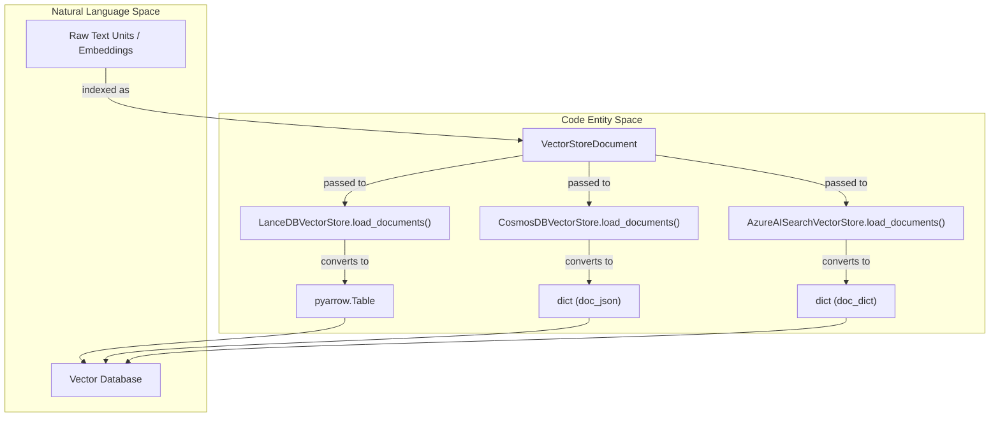
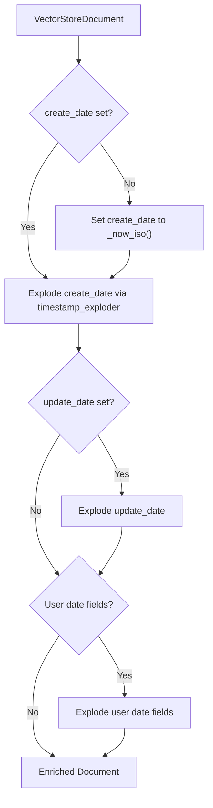
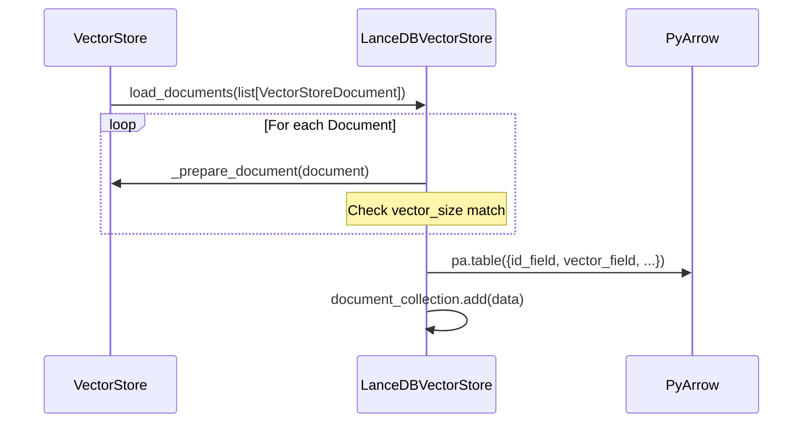

<!-- source: DeepWiki mcp.deepwiki.com · repo microsoft/graphrag · page 10.3 Vector Store Documents · fetched 2026-10-26 -->

# Vector Store Documents

<details>
<summary>Relevant source files</summary>

The following files were used as context for generating this wiki page:

- [packages/graphrag-vectors/graphrag_vectors/azure_ai_search.py](packages/graphrag-vectors/graphrag_vectors/azure_ai_search.py)
- [packages/graphrag-vectors/graphrag_vectors/cosmosdb.py](packages/graphrag-vectors/graphrag_vectors/cosmosdb.py)
- [packages/graphrag-vectors/graphrag_vectors/lancedb.py](packages/graphrag-vectors/graphrag_vectors/lancedb.py)
- [packages/graphrag-vectors/graphrag_vectors/vector_store.py](packages/graphrag-vectors/graphrag_vectors/vector_store.py)
- [tests/integration/vector_stores/test_azure_ai_search.py](tests/integration/vector_stores/test_azure_ai_search.py)
- [tests/integration/vector_stores/test_cosmosdb.py](tests/integration/vector_stores/test_cosmosdb.py)
- [tests/integration/vector_stores/test_factory.py](tests/integration/vector_stores/test_factory.py)
- [tests/integration/vector_stores/test_lancedb.py](tests/integration/vector_stores/test_lancedb.py)
- [tests/unit/query/context_builder/test_entity_extraction.py](tests/unit/query/context_builder/test_entity_extraction.py)

</details>


This document describes the core data structures used to represent documents and search results in GraphRAG's vector store abstraction layer. The `VectorStoreDocument` and `VectorStoreSearchResult` classes provide a unified interface for storing and retrieving vector-embedded documents across different vector database backends.

For information about the vector store interface and implementations, see [Vector Store Architecture](#7.4). For details on vector store configuration, see [Vector Store Configuration](#3.5).

## Overview

Vector store documents serve as the fundamental data structure for all vector database operations in GraphRAG. These documents encapsulate both the vector embedding and associated metadata, providing a consistent interface regardless of whether the underlying storage is LanceDB, Azure AI Search, or Cosmos DB.

**Sources:** [packages/graphrag-vectors/graphrag_vectors/vector_store.py:1-217]()

## VectorStoreDocument Structure

The `VectorStoreDocument` dataclass represents a single document in vector storage with the following fields:

| Field | Type | Description |
|-------|------|-------------|
| `id` | `str \| int` | Unique identifier for the document [packages/graphrag-vectors/graphrag_vectors/vector_store.py:29-30]() |
| `vector` | `list[float] \| None` | Vector embedding representation of the document [packages/graphrag-vectors/graphrag_vectors/vector_store.py:32-33]() |
| `data` | `dict[str, Any]` | Additional metadata fields (default: empty dict) [packages/graphrag-vectors/graphrag_vectors/vector_store.py:35-36]() |
| `create_date` | `str \| None` | ISO 8601 timestamp when document was created [packages/graphrag-vectors/graphrag_vectors/vector_store.py:38-39]() |
| `update_date` | `str \| None` | ISO 8601 timestamp when document was last updated [packages/graphrag-vectors/graphrag_vectors/vector_store.py:41-42]() |

### Code Entity Space Mapping

The following diagram shows how the generic `VectorStoreDocument` is handled by specific database implementations like `LanceDBVectorStore`, `CosmosDBVectorStore`, and `AzureAISearchVectorStore`.



**Sources:** [packages/graphrag-vectors/graphrag_vectors/vector_store.py:26-43](), [packages/graphrag-vectors/graphrag_vectors/lancedb.py:81-118](), [packages/graphrag-vectors/graphrag_vectors/cosmosdb.py:166-187](), [packages/graphrag-vectors/graphrag_vectors/azure_ai_search.py:168-188]()

## VectorStoreSearchResult Structure

The `VectorStoreSearchResult` dataclass wraps search results with similarity scores:

| Field | Type | Description |
|-------|------|-------------|
| `document` | `VectorStoreDocument` | The matched document [packages/graphrag-vectors/graphrag_vectors/vector_store.py:49-50]() |
| `score` | `float` | Similarity score between -1 and 1 (higher is more similar) [packages/graphrag-vectors/graphrag_vectors/vector_store.py:52-53]() |

The `score` field represents the similarity between the query vector and the document's vector. For example, in `LanceDBVectorStore`, search results are returned as `VectorStoreSearchResult` objects where the score is extracted from the database's distance metric [packages/graphrag-vectors/graphrag_vectors/lancedb.py:20-24]().

**Sources:** [packages/graphrag-vectors/graphrag_vectors/vector_store.py:46-54](), [packages/graphrag-vectors/graphrag_vectors/lancedb.py:27-28]()

## Document Lifecycle and Timestamp Management

### Document Preparation Flow

When documents are inserted into a vector store, they undergo automatic enrichment with timestamp metadata through the `_prepare_document()` method in the base `VectorStore` class [packages/graphrag-vectors/graphrag_vectors/vector_store.py:97-121]().



**Sources:** [packages/graphrag-vectors/graphrag_vectors/vector_store.py:97-121]()

### Timestamp Explosion

GraphRAG automatically decomposes ISO 8601 timestamps into filterable component fields using a `timestamp_exploder` function (defaulting to `explode_timestamp`) [packages/graphrag-vectors/graphrag_vectors/vector_store.py:68-69](). This allows metadata filtering on specific date parts. The `VectorStore` class auto-registers these component fields in its `fields` dictionary during initialization [packages/graphrag-vectors/graphrag_vectors/vector_store.py:82-90]().

**Sources:** [packages/graphrag-vectors/graphrag_vectors/vector_store.py:68-90](), [packages/graphrag-vectors/graphrag_vectors/timestamp.py:13-17]()

## Usage Across Vector Store Implementations

### LanceDB Implementation

`LanceDBVectorStore` uses `pyarrow` to batch load documents. It maps the `VectorStoreDocument` fields to Arrow schema types: `str`, `int`, `float`, and `bool` [packages/graphrag-vectors/graphrag_vectors/lancedb.py:47-52](). It specifically checks that document vector dimensions match the configured `vector_size` [packages/graphrag-vectors/graphrag_vectors/lancedb.py:95-101]().



**Sources:** [packages/graphrag-vectors/graphrag_vectors/lancedb.py:81-126]()

### Azure AI Search Implementation

`AzureAISearchVectorStore` maps field types to `SearchFieldDataType` using `FIELD_TYPE_MAPPING` [packages/graphrag-vectors/graphrag_vectors/azure_ai_search.py:40-45](). It constructs a list of dictionaries (`doc_dict`) from `VectorStoreDocument` objects, ensuring `id`, `vector`, and timestamp fields are correctly named according to the store's configuration [packages/graphrag-vectors/graphrag_vectors/azure_ai_search.py:171-188]().

**Sources:** [packages/graphrag-vectors/graphrag_vectors/azure_ai_search.py:40-45](), [packages/graphrag-vectors/graphrag_vectors/azure_ai_search.py:168-188]()

### Cosmos DB Implementation

`CosmosDBVectorStore` requires the `id_field` to be exactly `"id"` [packages/graphrag-vectors/graphrag_vectors/cosmosdb.py:43-45](). It iterates through documents and uses `upsert_item` for each, as Cosmos DB does not support native batch upsert in the current implementation [packages/graphrag-vectors/graphrag_vectors/cosmosdb.py:166-186]().

**Sources:** [packages/graphrag-vectors/graphrag_vectors/cosmosdb.py:43-45](), [packages/graphrag-vectors/graphrag_vectors/cosmosdb.py:166-186]()

## Field Type Handling

The system supports the following type mappings for metadata fields in the `data` dictionary:

| Type String | LanceDB Type | Azure AI Search Type |
|-------------|--------------|----------------------|
| `"str"` | `pa.string` [packages/graphrag-vectors/graphrag_vectors/lancedb.py:48]() | `SearchFieldDataType.String` [packages/graphrag-vectors/graphrag_vectors/azure_ai_search.py:41]() |
| `"int"` | `pa.int64` [packages/graphrag-vectors/graphrag_vectors/lancedb.py:49]() | `SearchFieldDataType.Int64` [packages/graphrag-vectors/graphrag_vectors/azure_ai_search.py:42]() |
| `"float"` | `pa.float32` [packages/graphrag-vectors/graphrag_vectors/lancedb.py:50]() | `SearchFieldDataType.Double` [packages/graphrag-vectors/graphrag_vectors/azure_ai_search.py:43]() |
| `"bool"` | `pa.bool_` [packages/graphrag-vectors/graphrag_vectors/lancedb.py:51]() | `SearchFieldDataType.Boolean` [packages/graphrag-vectors/graphrag_vectors/azure_ai_search.py:44]() |
| `"date"` | Converted to `"str"` [packages/graphrag-vectors/graphrag_vectors/vector_store.py:86]() | N/A (Handled as exploded strings) |

**Sources:** [packages/graphrag-vectors/graphrag_vectors/lancedb.py:47-52](), [packages/graphrag-vectors/graphrag_vectors/azure_ai_search.py:40-45](), [packages/graphrag-vectors/graphrag_vectors/vector_store.py:82-87]()

## Document Operations

### Searching by Text vs. Vector

The `VectorStore` provides a convenience method `similarity_search_by_text` which uses a `TextEmbedder` to convert a string into a vector before calling the abstract `similarity_search_by_vector` [packages/graphrag-vectors/graphrag_vectors/vector_store.py:176-195]().

```python
# From packages/graphrag-vectors/graphrag_vectors/vector_store.py
def similarity_search_by_text(
    self,
    text: str,
    text_embedder: TextEmbedder,
    k: int = 10,
    ...
) -> list[VectorStoreSearchResult]:
    query_embedding = text_embedder(text)
    if query_embedding:
        return self.similarity_search_by_vector(query_embedding=query_embedding, k=k, ...)
    return []
```

**Sources:** [packages/graphrag-vectors/graphrag_vectors/vector_store.py:176-195]()

---

