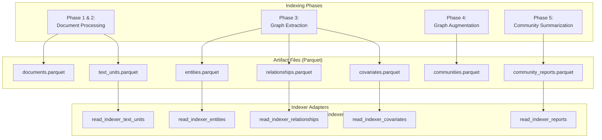
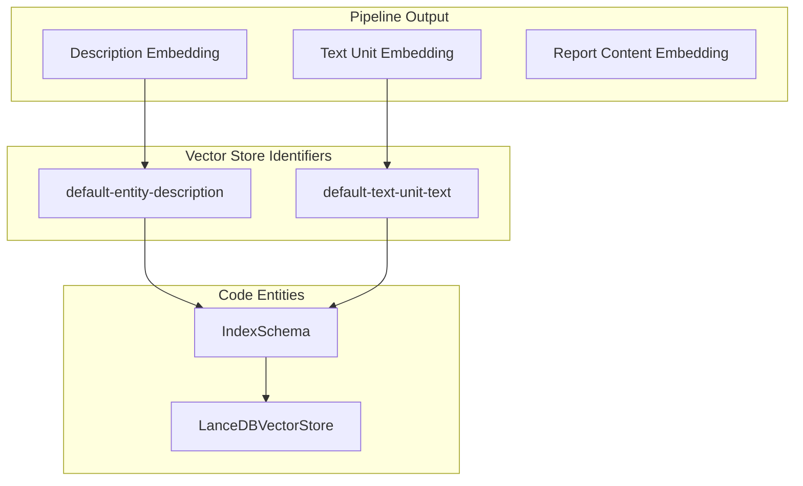

<!-- source: DeepWiki mcp.deepwiki.com · repo microsoft/graphrag · page 10.4 Pipeline Artifacts · fetched 2026-10-26 -->

# Pipeline Artifacts

<details>
<summary>Relevant source files</summary>

The following files were used as context for generating this wiki page:

- [docs/examples_notebooks/drift_search.ipynb](docs/examples_notebooks/drift_search.ipynb)
- [docs/examples_notebooks/global_search.ipynb](docs/examples_notebooks/global_search.ipynb)
- [docs/examples_notebooks/global_search_with_dynamic_community_selection.ipynb](docs/examples_notebooks/global_search_with_dynamic_community_selection.ipynb)
- [docs/examples_notebooks/local_search.ipynb](docs/examples_notebooks/local_search.ipynb)
- [docs/index/default_dataflow.md](docs/index/default_dataflow.md)
- [docs/index/outputs.md](docs/index/outputs.md)
- [tests/verbs/data/communities.parquet](tests/verbs/data/communities.parquet)
- [tests/verbs/data/community_reports.parquet](tests/verbs/data/community_reports.parquet)
- [tests/verbs/data/covariates.parquet](tests/verbs/data/covariates.parquet)
- [tests/verbs/data/documents.parquet](tests/verbs/data/documents.parquet)
- [tests/verbs/data/entities.parquet](tests/verbs/data/entities.parquet)
- [tests/verbs/data/relationships.parquet](tests/verbs/data/relationships.parquet)
- [tests/verbs/data/text_units.parquet](tests/verbs/data/text_units.parquet)

</details>


Pipeline artifacts are the intermediate and final output files produced by the GraphRAG indexing pipeline. These artifacts encode the knowledge graph structure (entities, relationships, communities), text segmentation (text units, documents), optional claims (covariates), and vector embeddings required for query operations. The pipeline primarily uses the Apache Parquet columnar format for efficient storage and scanning, ensuring that large-scale graph data remains performant for downstream RAG operations.

This page documents artifact file naming, column schemas, production workflows, and the data model structures used to represent these outputs.

Sources: [docs/index/default_dataflow.md:3-13](), [docs/index/outputs.md:1-4]()

## Artifact Overview

The indexing pipeline produces five primary artifact categories that align with the conceptual knowledge model:

1.  **Graph Artifacts**: `entities.parquet`, `relationships.parquet` - The extracted nodes and edges of the knowledge graph.
2.  **Community Artifacts**: `communities.parquet`, `community_reports.parquet` - Hierarchical clustering results and LLM-generated summaries.
3.  **Text Artifacts**: `text_units.parquet`, `documents.parquet` - Chunked text segments and source document metadata.
4.  **Claim Artifacts**: `covariates.parquet` - Extracted factual statements (optional).
5.  **Embedding Artifacts**: Parquet files containing vector representations for entities, text units, and reports.

All tables share two identifier fields: `id` (a generated UUID) and `human_readable_id` (an incremented short ID used for citations).

Sources: [docs/index/outputs.md:5-12](), [docs/index/default_dataflow.md:5-13]()

## Artifact Production Workflows

The production of artifacts follows a multi-phase dataflow, transforming raw text into a structured knowledge model.

### Workflow to Artifact Mapping

The following diagram associates the system workflow phases with the resulting file artifacts and the code entities responsible for loading them.

**Natural Language to Code Entity Mapping: Workflows and Adapters**

Sources: [docs/index/default_dataflow.md:23-52](), [docs/examples_notebooks/local_search.ipynb:22-29](), [docs/examples_notebooks/global_search.ipynb:22-26]()

### Core Artifact Schemas

#### entities
Contains the list of all entities found by the LLM. Entities are merged by `title` and `type` during extraction.

| Name | Type | Description |
| :--- | :--- | :--- |
| `title` | str | Name of the entity. |
| `type` | str | Entity category (e.g., person, geo). |
| `description` | str | LLM-derived summary of all extracted descriptions. |
| `degree` | int | Connectedness in the graph. |

Sources: [docs/index/outputs.md:75-86](), [docs/index/default_dataflow.md:108-117]()

#### relationships
The edge list for the graph, representing entity-to-entity connections.

| Name | Type | Description |
| :--- | :--- | :--- |
| `source` | str | Name of the source entity. |
| `target` | str | Name of the target entity. |
| `weight` | float | Summed "strength" measure from LLM instances. |
| `description` | str | LLM-derived summary of the relationship. |

Sources: [docs/index/outputs.md:87-97](), [docs/index/default_dataflow.md:112-116]()

#### community_reports
Summarized insights for each detected community. These are critical for Global Search.

| Name | Type | Description |
| :--- | :--- | :--- |
| `community` | int | Short ID of the community. |
| `summary` | str | LLM-generated summary. |
| `full_content` | str | Full report content. |
| `findings` | dict[] | List of top insights (summary + explanation). |
| `rank` | float | Relevance ranking based on member salience. |

Sources: [docs/index/outputs.md:29-47](), [docs/examples_notebooks/global_search.ipynb:131-148]()

## Embedding Artifacts

Embedding artifacts store vector representations used for semantic retrieval. In standard deployments, these are often managed by a vector store like `LanceDBVectorStore`, but they originate from pipeline embeddings of specific artifact columns.

**Natural Language to Code Entity Mapping: Embedding Storage**

Sources: [docs/examples_notebooks/local_search.ipynb:102-105](), [docs/index/default_dataflow.md:47-51]()

## Claim Artifacts (Covariates)

If claim extraction is enabled, the pipeline produces `covariates.parquet`. This artifact contains statements about entities that are often time-bound or status-dependent.

| Name | Type | Description |
| :--- | :--- | :--- |
| `subject_id` | str | Source entity performing the behavior. |
| `object_id` | str | Target entity of the behavior. |
| `status` | str | Assessment: [TRUE, FALSE, SUSPECTED]. |
| `start_date` | str | ISO8601 start of activity. |

Sources: [docs/index/outputs.md:48-63](), [docs/index/default_dataflow.md:118-123]()

## Programmatic Access

Downstream systems (like the Query API) access these artifacts using indexer adapters. These functions, found in `graphrag.query.indexer_adapters`, convert Parquet/Dataframe rows into structured Python objects for search context builders.

Example usage for loading context:
```python
# Read entities and communities
entity_df = pd.read_parquet(f"{INPUT_DIR}/entities.parquet")
community_df = pd.read_parquet(f"{INPUT_DIR}/communities.parquet")

# Adapter converts dataframes to knowledge model objects
entities = read_indexer_entities(entity_df, community_df, COMMUNITY_LEVEL)
```
Sources: [docs/examples_notebooks/local_search.ipynb:94-98](), [docs/examples_notebooks/global_search.ipynb:22-26]()

---

