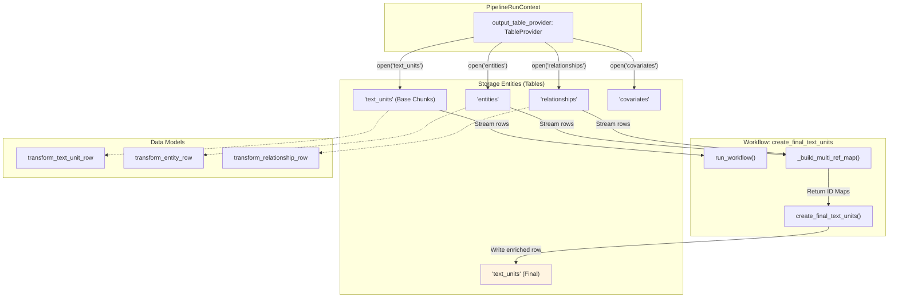
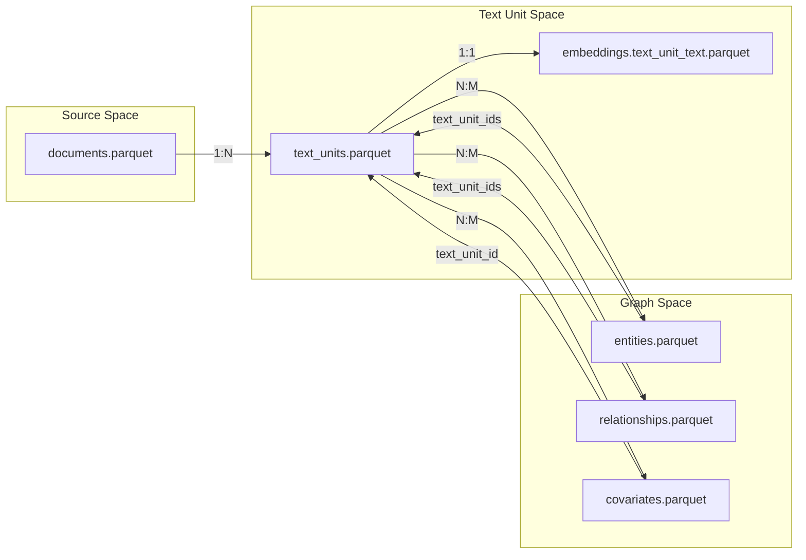

<!-- source: DeepWiki mcp.deepwiki.com · repo microsoft/graphrag · page 10.5 Text Units Schema · fetched 2026-10-26 -->

# Text Units Schema

Relevant source files

The following files were used as context for generating this wiki page:

- [packages/graphrag-storage/graphrag_storage/memory_storage.py](packages/graphrag-storage/graphrag_storage/memory_storage.py)
- [packages/graphrag-storage/graphrag_storage/tables/csv_table.py](packages/graphrag-storage/graphrag_storage/tables/csv_table.py)
- [packages/graphrag/graphrag/cli/query.py](packages/graphrag/graphrag/cli/query.py)
- [packages/graphrag/graphrag/data_model/dfs.py](packages/graphrag/graphrag/data_model/dfs.py)
- [packages/graphrag/graphrag/index/workflows/create_community_reports.py](packages/graphrag/graphrag/index/workflows/create_community_reports.py)
- [packages/graphrag/graphrag/index/workflows/create_final_text_units.py](packages/graphrag/graphrag/index/workflows/create_final_text_units.py)
- [packages/graphrag/graphrag/index/workflows/update_covariates.py](packages/graphrag/graphrag/index/workflows/update_covariates.py)
- [tests/unit/storage/test_csv_table.py](tests/unit/storage/test_csv_table.py)
- [tests/unit/storage/test_parquet_table_provider.py](tests/unit/storage/test_parquet_table_provider.py)
- [tests/verbs/data/covariates.csv](tests/verbs/data/covariates.csv)
- [tests/verbs/data/entities.csv](tests/verbs/data/entities.csv)
- [tests/verbs/data/relationships.csv](tests/verbs/data/relationships.csv)
- [tests/verbs/data/text_units.csv](tests/verbs/data/text_units.csv)

## Purpose and Scope

This document defines the schema and structure of text units in GraphRAG. Text units represent chunked segments of source documents and serve as the fundamental indexing granularity for text content in the knowledge graph. 

Text units are the primary "atomic" data structure used during retrieval. While the knowledge graph provides structure, the text units provide the raw evidence and context required by LLMs to answer queries.

---

## Overview

Text units are the atomic text segments produced by chunking source documents. Each text unit:

- Contains a contiguous segment of text from a source document.
- Has a unique identifier for reference and retrieval (typically a SHA256 hash of the content).
- Links back to its parent document via `document_id`.
- Optionally references extracted entities, relationships, and covariates (claims) found within its specific text span.
- Serves as the basis for text embeddings used in vector similarity search.

Text units bridge raw documents and the knowledge graph, enabling both semantic search (via embeddings) and structured retrieval (via entity/relationship links).

**Sources:** [packages/graphrag/graphrag/index/workflows/create_final_text_units.py:97-107](), [packages/graphrag/graphrag/data_model/dfs.py:130-142](), [tests/verbs/data/text_units.csv:1-211]()

---

## Text Unit Lifecycle

The text unit lifecycle involves initial chunking followed by an enrichment phase where extracted graph elements are mapped back to the source chunks.

### Data Flow and System Entities

The following diagram illustrates how the `create_final_text_units` workflow interacts with storage abstractions and data models to produce the final enriched text units.

**Sources:** [packages/graphrag/graphrag/index/workflows/create_final_text_units.py:25-72](), [packages/graphrag/graphrag/index/workflows/create_final_text_units.py:75-114](), [packages/graphrag/graphrag/index/workflows/create_final_text_units.py:117-127]()

---

## Schema Definition

The final text unit schema is defined by the `TEXT_UNITS_FINAL_COLUMNS` constant and enforced during the finalization workflow.

### Core Columns

| Column Name | Data Type | Required | Description |
|------------|-----------|----------|-------------|
| `id` | string (UUID) | Yes | Unique identifier for the text unit. |
| `human_readable_id` | integer | Yes | A sequential integer ID assigned during finalization for easier reference. |
| `text` | string | Yes | The actual text content of the chunk. |
| `n_tokens` | integer | Yes | Token count of the text content. |
| `document_id` | string | Yes | ID of the parent document. |

### Graph Reference Columns

These columns are populated by performing reverse lookups against the extracted graph elements.

| Column Name | Data Type | Required | Description |
|------------|-----------|----------|-------------|
| `entity_ids` | list[string] | No | IDs of entities extracted from this text unit. |
| `relationship_ids` | list[string] | No | IDs of relationships extracted from this text unit. |
| `covariate_ids` | list[string] | No | IDs of covariates (claims) extracted from this text unit. |

**Sources:** [packages/graphrag/graphrag/index/workflows/create_final_text_units.py:97-108](), [packages/graphrag/graphrag/data_model/dfs.py:130-142](), [packages/graphrag/graphrag/data_model/schemas.py:18-18]()

---

## Implementation Detail: Finalization Workflow

The `create_final_text_units` workflow (defined in `packages/graphrag/graphrag/index/workflows/create_final_text_units.py`) is responsible for the "join" operation between chunks and graph elements.

### Reverse Lookup Mapping
Because entities and relationships store a list of `text_unit_ids` they belong to, the workflow must build a reverse map (`text_unit_id -> [entity_id]`) to populate the text unit's own reference columns. This is handled by `_build_multi_ref_map` [packages/graphrag/graphrag/index/workflows/create_final_text_units.py:117-127]().

### Concurrent Read/Write Safety
The workflow utilizes the `CSVTable` (or `ParquetTable`) abstraction which supports a "truncate-on-close" strategy. This allows the workflow to read from the original `text_units` table while simultaneously writing enriched rows to a temporary version of the same table name, which is finalized upon closing the handle [packages/graphrag_storage/graphrag_storage/tables/csv_table.py:152-166]().

**Sources:** [packages/graphrag/graphrag/index/workflows/create_final_text_units.py:44-62](), [packages/graphrag/graphrag/index/workflows/create_final_text_units.py:117-127](), [packages/graphrag_storage/graphrag_storage/tables/csv_table.py:152-166]()

---

## Relationships to Other Artifacts

The text unit is the central node in the indexing artifact graph, linking source documents to the extracted knowledge graph.

**Sources:** [packages/graphrag/graphrag/index/workflows/create_final_text_units.py:97-107](), [packages/graphrag/graphrag/data_model/dfs.py:61-152](), [tests/verbs/data/text_units.csv:1-211]()

---

## Data Typing and Serialization

When loading text units from storage (especially weakly-typed formats like CSV), the `text_units_typed` utility ensures correct Python types and handles the deserialization of list columns [packages/graphrag/graphrag/data_model/dfs.py:130-142]().

- **List Columns**: `entity_ids`, `relationship_ids`, and `covariate_ids` are stored as strings (e.g., `"['id1', 'id2']"`) and converted back to Python lists using `split_list_column` [packages/graphrag/graphrag/data_model/dfs.py:36-54]().
- **Numeric Columns**: `n_tokens` and `human_readable_id` are cast to `int` [packages/graphrag/graphrag/data_model/dfs.py:134-142]().

**Sources:** [packages/graphrag/graphrag/data_model/dfs.py:36-54](), [packages/graphrag/graphrag/data_model/dfs.py:130-142]()

---

## Example Record Structure

Based on the final output table, a typical text unit record is structured as follows:

| Column | Example Value |
| :--- | :--- |
| **id** | `f5b3fc5174b1a578f353e3c6341d6059b8c1b0fb837762000649f144be2692dc` |
| **human_readable_id** | `0` |
| **text** | `"The Project Gutenberg eBook of A Christmas Carol..."` |
| **n_tokens** | `1210` |
| **document_id** | `77fd5668fcbeb8d240a7816bf00854bd31af91a84d0318eebeed15bc91bf28c2` |
| **entity_ids** | `['a0d9230a...', 'b00b188a...']` |
| **relationship_ids** | `['522224ee...', '94a21326...']` |
| **covariate_ids** | `['b1ab4c97...', 'f1b7d035...']` |

**Sources:** [tests/verbs/data/text_units.csv:1-211](), [packages/graphrag/graphrag/index/workflows/create_final_text_units.py:97-107]()

---

