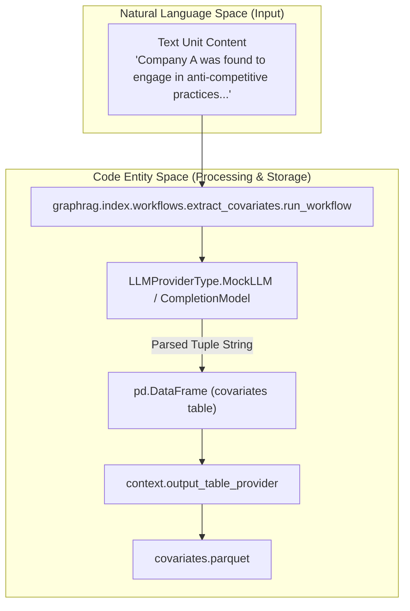
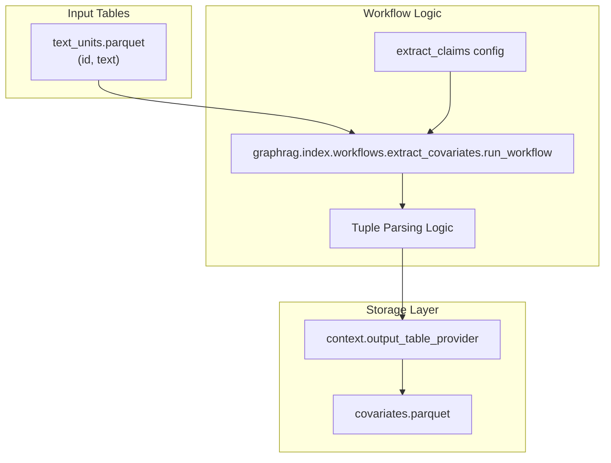

<!-- source: DeepWiki mcp.deepwiki.com · repo microsoft/graphrag · page 10.6 Covariate Schema · fetched 2026-10-26 -->

# Covariate Schema

<details>
<summary>Relevant source files</summary>

The following files were used as context for generating this wiki page:

- [tests/verbs/data/communities.parquet](tests/verbs/data/communities.parquet)
- [tests/verbs/data/community_reports.parquet](tests/verbs/data/community_reports.parquet)
- [tests/verbs/data/covariates.parquet](tests/verbs/data/covariates.parquet)
- [tests/verbs/data/documents.parquet](tests/verbs/data/documents.parquet)
- [tests/verbs/data/entities.parquet](tests/verbs/data/entities.parquet)
- [tests/verbs/data/relationships.parquet](tests/verbs/data/relationships.parquet)
- [tests/verbs/data/text_units.parquet](tests/verbs/data/text_units.parquet)
- [tests/verbs/test_create_communities.py](tests/verbs/test_create_communities.py)
- [tests/verbs/test_create_final_documents.py](tests/verbs/test_create_final_documents.py)
- [tests/verbs/test_extract_covariates.py](tests/verbs/test_extract_covariates.py)
- [tests/verbs/test_extract_graph_nlp.py](tests/verbs/test_extract_graph_nlp.py)

</details>


This document defines the covariate (claims) data structure in GraphRAG, including schema fields, extraction formats, and storage specifications. Covariates represent temporal claims or assertions extracted from text that relate two entities with additional context like dates, status, and supporting evidence.

## Overview

Covariates are optional structured claims extracted from text units using LLM-based extraction. Unlike entities and relationships which form the core knowledge graph, covariates capture time-bounded assertions about relationships between entities.

Covariates are disabled by default and must be explicitly enabled in the configuration via `config.extract_claims.enabled = True` [tests/verbs/test_extract_covariates.py:33-33](). When enabled, they are stored in the `covariates` output table and are associated with the source text units [tests/verbs/test_extract_covariates.py:43-43](), [tests/verbs/test_extract_covariates.py:52-52]().

**Sources**: [tests/verbs/test_extract_covariates.py:25-74]()

## Data Model Integration

The extraction process bridges raw text content into structured tabular data used for downstream analysis and querying.

### Natural Language to Code Entity Mapping


**Sources**: [tests/verbs/test_extract_covariates.py:5-7](), [tests/verbs/test_extract_covariates.py:18-22](), [tests/verbs/test_extract_covariates.py:41-43]()

## Schema Definition

### Covariate Columns

The `COVARIATES_FINAL_COLUMNS` constant defines the complete covariate schema used in the final output tables [tests/verbs/test_extract_covariates.py:4-4]().

| Column Name | Description |
|-------------|-------------|
| `id` | Unique identifier (UUID) for the covariate [tests/verbs/data/covariates.parquet:1-1]() |
| `human_readable_id` | Sequential integer ID starting from 0 [tests/verbs/test_extract_covariates.py:55-56]() |
| `covariate_type` | Type of covariate (typically "claim") [tests/verbs/test_extract_covariates.py:59-59]() |
| `type` | Classification of the claim (e.g., "ANTI-COMPETITIVE PRACTICES") [tests/verbs/test_extract_covariates.py:62-62]() |
| `description` | Detailed explanation of the claim [tests/verbs/test_extract_covariates.py:66-69]() |
| `subject_id` | Entity acting as the subject of the claim [tests/verbs/test_extract_covariates.py:60-60]() |
| `object_id` | Entity acting as the object of the claim [tests/verbs/test_extract_covariates.py:61-61]() |
| `status` | Verification status (e.g., "TRUE", "FALSE") [tests/verbs/test_extract_covariates.py:63-63]() |
| `start_date` | ISO 8601 timestamp for validity start [tests/verbs/test_extract_covariates.py:64-64]() |
| `end_date` | ISO 8601 timestamp for validity end [tests/verbs/test_extract_covariates.py:65-65]() |
| `source_text` | Original text passage supporting the claim [tests/verbs/test_extract_covariates.py:70-73]() |
| `text_unit_id` | Reference to source text unit ID [tests/verbs/test_extract_covariates.py:52-52]() |

**Sources**: [tests/verbs/test_extract_covariates.py:45-74](), [tests/verbs/data/covariates.parquet:1-1]()

## LLM Extraction Format

### Pipe-Delimited Response Format

The extraction workflow parses LLM responses that follow a specific pipe-delimited tuple format within parentheses [tests/verbs/test_extract_covariates.py:18-22]():

```text
(SUBJECT<|>OBJECT<|>TYPE<|>STATUS<|>START_DATE<|>END_DATE<|>DESCRIPTION<|>SOURCE_TEXT)
```

### Example Extraction
A mock response for a claim as processed by the pipeline [tests/verbs/test_extract_covariates.py:18-22]():
```text
(COMPANY A<|>GOVERNMENT AGENCY B<|>ANTI-COMPETITIVE PRACTICES<|>TRUE<|>2022-01-10T00:00:00<|>2022-01-10T00:00:00<|>Company A was found to engage in anti-competitive practices...<|>According to an article published on 2022/01/10...)
```

**Sources**: [tests/verbs/test_extract_covariates.py:18-22]()

## Extraction Workflow Execution

The `extract_covariates` workflow processes text units to generate the covariate table.

### Workflow Data Flow


**Sources**: [tests/verbs/test_extract_covariates.py:5-7](), [tests/verbs/test_extract_covariates.py:41-43]()

### Key Implementation Details
1. **Configuration Dependency**: The workflow requires `config.extract_claims.enabled` to be `True` to execute [tests/verbs/test_extract_covariates.py:33-33]().
2. **Context Provider**: The workflow utilizes the `PipelineRunContext` to access input tables (like `text_units`) and write the resulting `covariates` table [tests/verbs/test_extract_covariates.py:28-43]().
3. **ID Mapping**: The workflow ensures a strict mapping between the extracted covariate and its source text unit via `text_unit_id` [tests/verbs/test_extract_covariates.py:52-52]().

**Sources**: [tests/verbs/test_extract_covariates.py:25-50](), [tests/verbs/test_extract_covariates.py:52-52]()

## Storage and Output Format

Covariates are stored as tabular data, typically in Parquet format for optimized storage and retrieval.

- **Table Name**: "covariates" [tests/verbs/test_extract_covariates.py:43-43]().
- **Final Columns**: The schema is validated against `COVARIATES_FINAL_COLUMNS` during the final document creation and indexing steps [tests/verbs/test_extract_covariates.py:4-4](), [tests/verbs/test_extract_covariates.py:45-46]().

**Sources**: [tests/verbs/test_extract_covariates.py:43-46](), [tests/verbs/data/covariates.parquet:1-1]()

---

