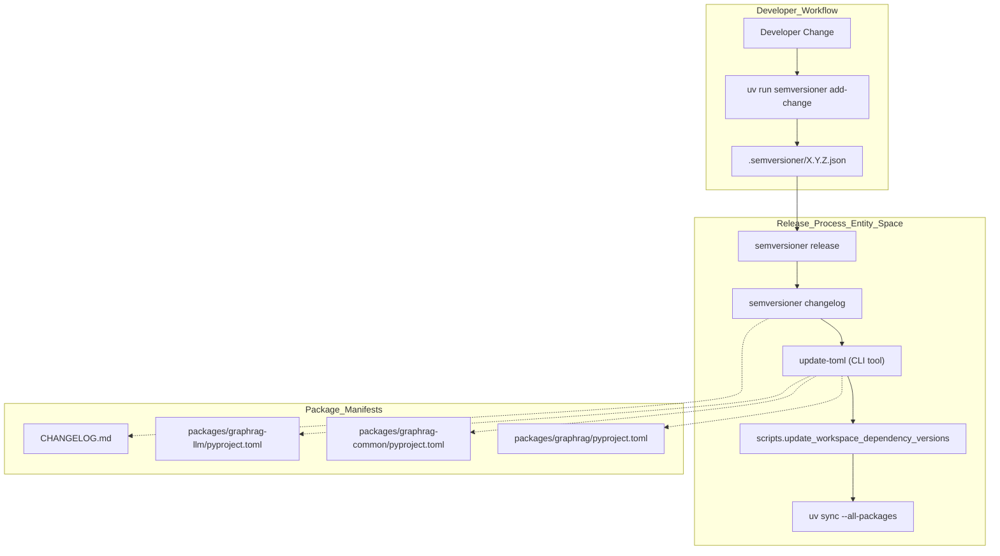
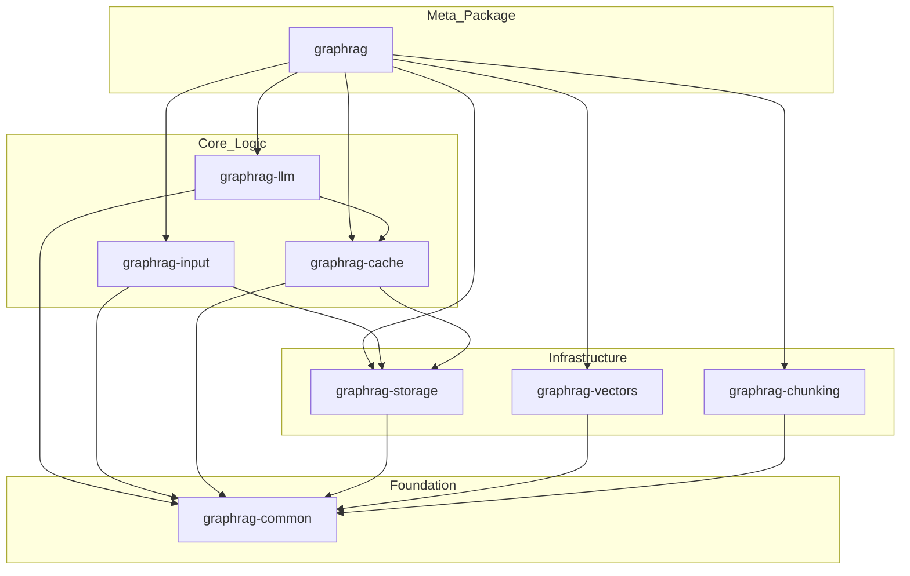

<!-- source: DeepWiki mcp.deepwiki.com · repo microsoft/graphrag · page 11 Migration and Version Management · fetched 2026-10-26 -->

# Migration and Version Management

<details>
<summary>Relevant source files</summary>

The following files were used as context for generating this wiki page:

- [.semversioner/3.0.4.json](.semversioner/3.0.4.json)
- [.semversioner/3.1.1.json](.semversioner/3.1.1.json)
- [DEVELOPING.md](DEVELOPING.md)
- [RELEASE.md](RELEASE.md)

</details>


This document describes GraphRAG's versioning policy, release management procedures, and data model migration processes. It covers how semantic versioning is enforced across the monorepo using `semversioner`, how to migrate indexes between major versions, and how breaking changes are tracked and communicated.

For information about developer environment setup, see [Development Environment Setup](#12.2). For details on the release process, see [Release Management](#12.5).

## Overview

GraphRAG uses semantic versioning to manage releases and track breaking changes. The project employs `semversioner` to automate and enforce version policies [DEVELOPING.md:64](). All packages in the monorepo are versioned synchronously, ensuring compatibility across the ecosystem [RELEASE.md:36-43](). When data model changes occur between major versions, migration procedures are documented to update existing indexes or configurations without requiring full re-indexing when possible.

**Sources:** [DEVELOPING.md:62-69](), [RELEASE.md:36-47]()

## Semantic Versioning Policy

### Version Format and Meaning

GraphRAG follows [Semantic Versioning 2.0.0](https://semver.org/) with version numbers in the format `MAJOR.MINOR.PATCH`. 

| Component | When Incremented | Example Impact |
|-----------|-----------------|----------------|
| **MAJOR** | Incompatible API changes or breaking data model changes | Monorepo restructure, package renames |
| **MINOR** | Backward-compatible functionality additions | New storage providers, new search methods |
| **PATCH** | Backward-compatible bug fixes | Dependency bumps, logging fixes [.semversioner/3.1.1.json:4-34]() |

For details, see [Semantic Versioning Policy](#11.3).

### Semversioner Integration

The project uses `semversioner` to manage version changes. Change metadata is stored in JSON files under the `.semversioner/` directory [.semversioner/3.1.1.json:1-38](). CI/CD pipelines enforce that every Pull Request includes a change file generated by the tool [DEVELOPING.md:64]().

**Release Automation Workflow**

The release process involves generating a new version, updating all package manifests, and synchronizing workspace dependencies.



**Sources:** [DEVELOPING.md:62-69](), [RELEASE.md:27-47]()

### Adding Changes

Developers record changes using the `semversioner add-change` command [DEVELOPING.md:66](). This creates a JSON entry describing the change type and description.

```bash
uv run semversioner add-change -t patch -d "Fix logging bug."
```

**Sources:** [DEVELOPING.md:66](), [.semversioner/3.1.1.json:32-34]()

### Monorepo Version Synchronization

All packages in the monorepo share the same version number to ensure compatibility. The `graphrag` meta-package depends on all specialized sub-packages [RELEASE.md:163-174]().

**Package Dependency Hierarchy**



**Sources:** [RELEASE.md:163-174]()

## Data Model Migration

### Migration Requirements

Data model migrations are typically required during **MAJOR** version increments. These may involve changes to the Parquet table schemas, configuration layouts, or storage structures. 

For detailed instructions on migrating indexes between major versions, see [Data Model Migration](#11.2).

### Migration Procedures

When schemas change, GraphRAG provides guidance on updating artifacts. Common patterns include:
- **Configuration Refresh**: Using `graphrag init` to generate updated `settings.yaml` structures.
- **Incremental Updates**: Utilizing the `graphrag update` command to reconcile existing graph structures with new data or schemas.

**Sources:** [DEVELOPING.md:86-87](), [RELEASE.md:36-43]()

## Version History and Breaking Changes

The `CHANGELOG.md` (generated by `semversioner`) serves as the source of truth for all version history [RELEASE.md:29]().

### Identifying Versions

To check the current version of the monorepo, developers can use:
```bash
uv run semversioner current-version
```
Individual package versions are located in their respective `pyproject.toml` files under the `[project]` section [RELEASE.md:32-43]().

For a full list of historical changes, see [Version History and Breaking Changes](#11.1).

**Sources:** [RELEASE.md:28-32](), [DEVELOPING.md:64-69]()

---

