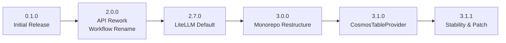
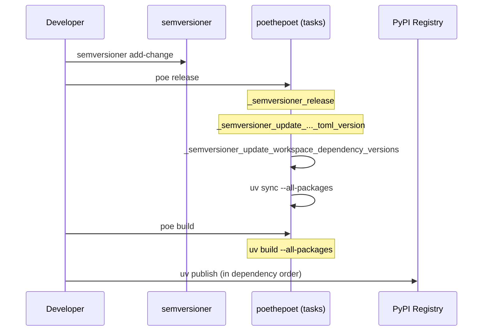

<!-- source: DeepWiki mcp.deepwiki.com · repo microsoft/graphrag · page 11.1 Version History and Breaking Changes · fetched 2026-10-26 -->

# Version History and Breaking Changes

<details>
<summary>Relevant source files</summary>

The following files were used as context for generating this wiki page:

- [.semversioner/3.0.4.json](.semversioner/3.0.4.json)
- [CHANGELOG.md](CHANGELOG.md)
- [DEVELOPING.md](DEVELOPING.md)
- [RELEASE.md](RELEASE.md)
- [packages/graphrag-cache/pyproject.toml](packages/graphrag-cache/pyproject.toml)
- [packages/graphrag-chunking/pyproject.toml](packages/graphrag-chunking/pyproject.toml)
- [pyproject.toml](pyproject.toml)

</details>


## Purpose and Scope

This document provides a comprehensive history of GraphRAG releases and documents breaking changes across versions. It serves as a reference for understanding architectural shifts, data model evolutions, and the impact of upgrading. For specific guidance on migrating indexes between major versions, see [Data Model Migration](11.2). For information about the semantic versioning policy, see [Semantic Versioning Policy](11.3).

**Important Note**: As stated in [CHANGELOG.md:2](), version releases in the 0.x.y range may introduce breaking changes without advancing the major version number.

## Current Version

As of this documentation, the current version is **3.1.1** across all packages in the monorepo. All package versions are synchronized following the 3.0.0 monorepo restructure.

Current package versions (from `pyproject.toml` tasks and package metadata):
- `graphrag`: 3.1.1
- `graphrag-cache`: 3.1.1
- `graphrag-chunking`: 3.1.1
- `graphrag-common`: 3.1.1
- `graphrag-input`: 3.1.1
- `graphrag-llm`: 3.1.1
- `graphrag-storage`: 3.1.1
- `graphrag-vectors`: 3.1.1

Sources: [CHANGELOG.md:4](), [pyproject.toml:77-84](), [packages/graphrag-chunking/pyproject.toml:3](), [packages/graphrag-cache/pyproject.toml:3]()

## Version Timeline



Sources: [CHANGELOG.md:4-172]()

## Major Version History

### Version 3.x Series (Monorepo Architecture)

Version 3.0.0 introduced the most significant architectural change in GraphRAG's history: a complete monorepo restructure separating functionality into distinct packages.

#### 3.1.1 - Stability and Patch (Patch)

**Key Fixes:**
- **Vector Length Validation**: Fail fast when document vector length mismatches the configured `vector_size` [CHANGELOG.md:7]().
- **Type Annotations**: Explicit return types for `batched()` and `chunk_text()` generators [CHANGELOG.md:8]().
- **JSONL Loading**: Fixed loader to skip blank lines and ignore invalid JSON rows [CHANGELOG.md:12]().
- **Dependency Bumps**: Updated `litellm` and `nltk` to address security advisories (CVE-2025-14009) [CHANGELOG.md:18, 28]().

#### 3.1.0 - Native Cosmos Support (Minor)

**Key Features:**
- **CosmosTableProvider**: Implementation of a native provider for Azure Cosmos DB featuring namespace partitioning, transactional batch writes, and simplified `AzureCosmosStorage` [CHANGELOG.md:17]().

#### 3.0.0 - Monorepo Restructure (Breaking)

**Package Dependency Graph:**

```mermaid
graph TD
    subgraph "Packages (Natural Language to Code Space)"
        ["graphrag (Entrypoint)"] -- "orchestrates" --> ["graphrag-llm (Model Management)"]
        ["graphrag (Entrypoint)"] -- "orchestrates" --> ["graphrag-vectors (Embeddings/Search)"]
        ["graphrag (Entrypoint)"] -- "orchestrates" --> ["graphrag-input (Data Loading)"]
        ["graphrag (Entrypoint)"] -- "orchestrates" --> ["graphrag-chunking (Text Splitting)"]
        ["graphrag (Entrypoint)"] -- "orchestrates" --> ["graphrag-storage (IO Abstraction)"]
        ["graphrag (Entrypoint)"] -- "orchestrates" --> ["graphrag-cache (Result Persistence)"]
        ["graphrag (Entrypoint)"] -- "orchestrates" --> ["graphrag-common (Shared Utils)"]
    end

    ["graphrag-llm"] -- "uses" --> ["graphrag-cache"]
    ["graphrag-llm"] -- "uses" --> ["graphrag-common"]
    ["graphrag-cache"] -- "uses" --> ["graphrag-storage"]
    ["graphrag-input"] -- "uses" --> ["graphrag-storage"]
    ["graphrag-vectors"] -- "uses" --> ["graphrag-common"]
    ["graphrag-storage"] -- "uses" --> ["graphrag-common"]
```

**Breaking Changes:**
- **Monorepo Split**: Functionality moved from a single `graphrag` package into 8 specialized packages [CHANGELOG.md:86-93]().
- **Config Layout**: New configuration schema requires running `graphrag init --force` to reinitialize settings with the new layout [CHANGELOG.md:96]().
- **LiteLLM Adoption**: LiteLLM became the default for chat and embedding providers [CHANGELOG.md:104, 110]().

Sources: [CHANGELOG.md:82-97](), [RELEASE.md:163-174](), [pyproject.toml:53-63]()

#### 3.0.1 - 3.0.9 (Patch Releases)

| Version | Key Changes |
|---------|-------------|
| 3.0.9 | Implement Parquet reader and client-side JSON validation [CHANGELOG.md:22-24]() |
| 3.0.3 | Vector store API extensions (insert/count/remove/update) and streaming support for workflows [CHANGELOG.md:52-62]() |
| 3.0.2 | Added `CSVTableProvider`, `DataReader` class, and removed `NetworkX` from graph utilities in favor of `graphrag.graphs` DataFrame implementations [CHANGELOG.md:66-73]() |

Sources: [CHANGELOG.md:20-80]()

### Version 2.x Series (API & Workflow Stabilization)

#### 2.0.0 - Major API Rework (Breaking)

**Breaking Changes:**
- **Community Hierarchy**: Added `children` to communities to avoid re-computation [CHANGELOG.md:173]().
- **Workflow Renaming**: Significant reorganization of workflow names and their corresponding outputs [CHANGELOG.md:174]().
- **Callback API**: Reworked the library API to accept progress and lifecycle callbacks [CHANGELOG.md:175]().
- **Config Inheritance**: Removed configuration inheritance, hydration, and automatic environment variable overlays [CHANGELOG.md:181]().

Sources: [CHANGELOG.md:172-182]()

## Release Automation System

The project uses `semversioner` and `poethepoet` to manage the release lifecycle across the monorepo.

**Release Pipeline Logic:**



**Key Release Commands:**
- `semversioner_add`: Adds a change description for the next release [pyproject.toml:86]().
- `release`: Orchestrates version bumping, changelog generation, and dependency syncing [pyproject.toml:112-127]().
- `build`: Invokes `uv build` for all packages in the workspace [pyproject.toml:109-110]().

Sources: [pyproject.toml:66-127](), [DEVELOPING.md:62-69](), [RELEASE.md:18-47]()

## Breaking Changes Surface Areas

The project categorizes breaking changes based on the following surface areas:

1.  **CLI Interface**: Commands like `index`, `query`, and `init` [pyproject.toml:97-100]().
2.  **Library API**: The public functions and classes within the `graphrag` packages.
3.  **Settings Schema**: The structure of `settings.yaml` [CHANGELOG.md:96]().
4.  **Data Model**: The Parquet/GraphML schemas of the indexing artifacts [CHANGELOG.md:174]().

Sources: [CHANGELOG.md:2, 96, 174](), [pyproject.toml:97-101]()

---

