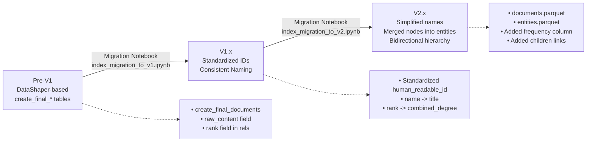
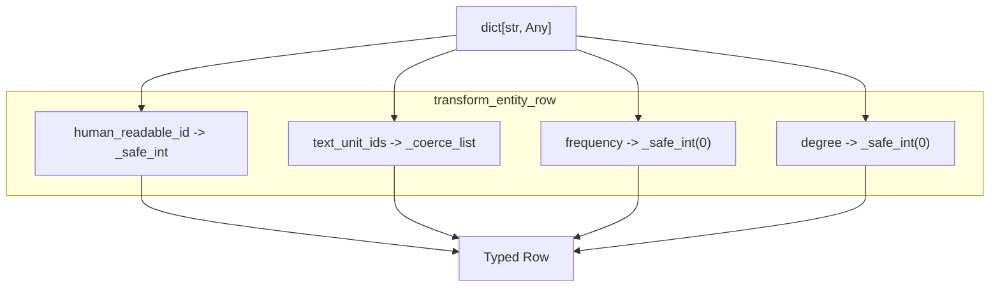
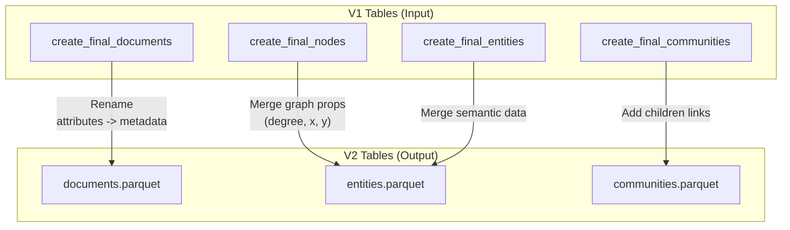
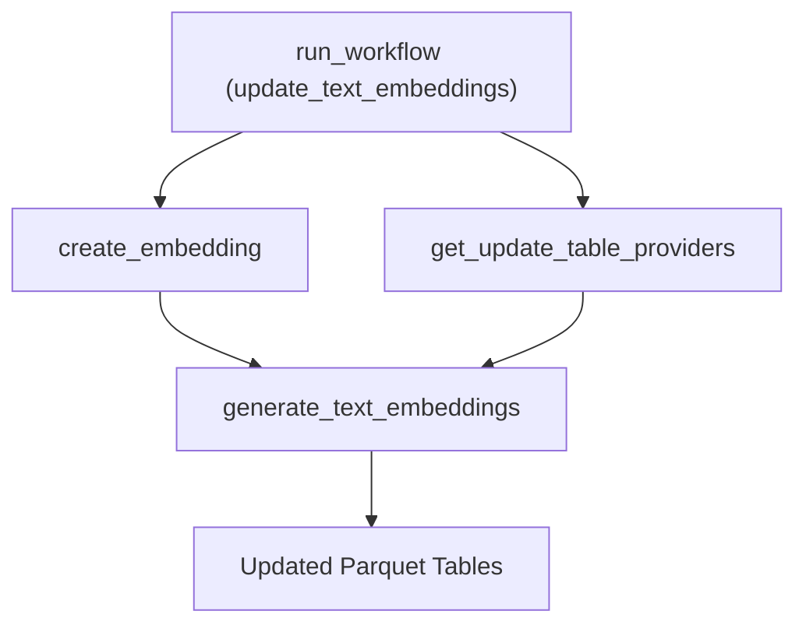

<!-- source: DeepWiki mcp.deepwiki.com · repo microsoft/graphrag · page 11.2 Data Model Migration · fetched 2026-10-26 -->

# Data Model Migration

<details>
<summary>Relevant source files</summary>

The following files were used as context for generating this wiki page:

- [docs/examples_notebooks/index_migration_to_v1.ipynb](docs/examples_notebooks/index_migration_to_v1.ipynb)
- [docs/examples_notebooks/index_migration_to_v2.ipynb](docs/examples_notebooks/index_migration_to_v2.ipynb)
- [packages/graphrag/graphrag/data_model/row_transformers.py](packages/graphrag/graphrag/data_model/row_transformers.py)
- [packages/graphrag/graphrag/index/workflows/update_text_embeddings.py](packages/graphrag/graphrag/index/workflows/update_text_embeddings.py)
- [tests/unit/indexing/operations/__init__.py](tests/unit/indexing/operations/__init__.py)
- [tests/unit/indexing/operations/embed_text/__init__.py](tests/unit/indexing/operations/embed_text/__init__.py)
- [tests/verbs/test_update_text_embeddings.py](tests/verbs/test_update_text_embeddings.py)

</details>


This document explains how to migrate GraphRAG index data between major versions without requiring expensive re-indexing. It covers the schema transformations, migration notebooks, and step-by-step procedures for upgrading existing indexes.

For information about version history and breaking changes in other areas (CLI, API, configuration), see [Version History and Breaking Changes](#11.1). For semantic versioning policy details, see [Semantic Versioning Policy](#11.3).

---

## Purpose and Scope

GraphRAG's data model has evolved across major versions to improve consistency, reduce redundancy, and align with best practices. Each major version includes schema changes to the parquet output files that store the knowledge graph artifacts. Rather than requiring users to re-run the expensive indexing pipeline, GraphRAG provides **migration notebooks** that transform existing data to the new schema format.

This document covers:
- Overview of data model changes across v1 and v2.
- Migration notebook usage and location.
- Detailed schema transformations for each version.
- Step-by-step migration procedures.
- Data type coercion and row-level transformations.

---

## Version Evolution Overview

### Migration Path Diagram
Title: Data Model Version Transitions


**Sources:** [docs/examples_notebooks/index_migration_to_v1.ipynb:17-23](), [docs/examples_notebooks/index_migration_to_v2.ipynb:17-24]()

---

## Migration Approach

### Migration Notebooks vs. Re-indexing

GraphRAG provides Jupyter notebooks that perform in-place data transformations to upgrade existing indexes. This approach is significantly cheaper than re-indexing because:

1. **No LLM calls required**: Migration only restructures existing data without calling language models.
2. **Preserves expensive artifacts**: Entity extraction, relationship extraction, and summarization results are retained.
3. **Fast execution**: Migration typically completes in minutes rather than hours.
4. **Cache preservation**: Existing LLM response caches remain valid for future updates.

### Migration Notebook Locations

The repository includes migration notebooks for major version transitions:

- **Pre-v1 to v1 Migration:** `docs/examples_notebooks/index_migration_to_v1.ipynb`
- **v1 to v2 Migration:** `docs/examples_notebooks/index_migration_to_v2.ipynb`

**Sources:** [docs/examples_notebooks/index_migration_to_v1.ipynb:1-12](), [docs/examples_notebooks/index_migration_to_v2.ipynb:1-12]()

---

## Data Type Coercion and Row Transformers

A critical part of migration (and general data loading) is ensuring that raw data (often strings from CSV or promoted floats from Parquet) is coerced into the correct types expected by the GraphRAG query engine. The `graphrag.data_model.row_transformers` module provides these utilities.

### Core Coercion Functions

| Function | Logic | Code Reference |
|----------|-------|----------------|
| `_safe_int` | Converts to int; returns -1 (or fill) on NaN/Empty | [packages/graphrag/graphrag/data_model/row_transformers.py:18-30]() |
| `_safe_float` | Converts to float; returns 0.0 (or fill) on NaN/Empty | [packages/graphrag/graphrag/data_model/row_transformers.py:33-49]() |
| `_coerce_list` | Parses CSV-encoded strings or numpy arrays into Python lists | [packages/graphrag/graphrag/data_model/row_transformers.py:52-67]() |

### Entity Row Transformation
Title: Row Coercion Logic in transform_entity_row


**Sources:** [packages/graphrag/graphrag/data_model/row_transformers.py:73-89]()

---

## V1 to V2 Migration Details

### Schema Changes Overview

Version 2 introduced major table renaming and structural improvements to eliminate DataShaper naming constraints and improve data model consistency.

Title: V1 to V2 Schema Mapping


### Key Transformations

#### 1. Table Renaming
All `create_final_*` prefixes were removed to simplify naming. For example, `create_final_documents` becomes `documents.parquet`. [docs/examples_notebooks/index_migration_to_v2.ipynb:126-132]()

#### 2. Node-Entity Merge
The separate `create_final_nodes` table was eliminated. Graph-specific properties (`degree`, `x`, `y`) were merged into the `entities` table using the `id` field as a join key.

From [docs/examples_notebooks/index_migration_to_v2.ipynb:93-100]():
```python
graph_props = (
    final_nodes.loc[:, ["id", "degree", "x", "y"]].groupby("id").first().reset_index()
)
final_entities = final_entities.merge(graph_props, on="id", how="left")
final_entities["frequency"] = final_entities["text_unit_ids"].count()
```

#### 3. Bidirectional Community Hierarchy
Communities and community reports gained a `children` column to enable efficient traversal. This is computed by grouping the `parent` column.

From [docs/examples_notebooks/index_migration_to_v2.ipynb:102-115]():
```python
parent_grouped = final_communities.groupby("parent").agg(
    children=("community", "unique")
)
final_communities = final_communities.merge(
    parent_grouped,
    left_on="community",
    right_on="parent",
    how="left",
)
```

**Sources:** [docs/examples_notebooks/index_migration_to_v2.ipynb:78-132]()

---

## Pre-V1 to V1 Migration Details

### Key Transformations

#### 1. Field Alignment
- **Documents**: `raw_content` is renamed to `text`. [docs/examples_notebooks/index_migration_to_v1.ipynb:126-127]()
- **Entities**: `name` is renamed to `title`. [docs/examples_notebooks/index_migration_to_v1.ipynb:134-135]()
- **Relationships**: `rank` is renamed to `combined_degree`. [docs/examples_notebooks/index_migration_to_v1.ipynb:157-158]()

#### 2. Community Parent Calculation
V1 introduced a structured parent-child relationship for communities based on levels and node membership.

From [docs/examples_notebooks/index_migration_to_v1.ipynb:74-95]():
```python
def get_community_parent(nodes):
    parent_mapping = nodes.loc[:, ["level", "community", "title"]]
    parent_mapping["level"] += 1  # Shift levels for parent relationship
    parent_mapping.rename(columns={"community": "parent"}, inplace=True)
    nodes = nodes.merge(parent_mapping, on=["level", "title"], how="left")
    nodes["parent"] = nodes["parent"].fillna(-1).astype(int)
    # ... aggregation logic
```

**Sources:** [docs/examples_notebooks/index_migration_to_v1.ipynb:74-158]()

---

## Incremental Indexing and Embeddings

When migrating data, users may need to update embeddings for new or changed entities. The `update_text_embeddings` workflow handles this during incremental runs.

### Embedding Update Flow
Title: Workflow update_text_embeddings execution


The workflow `run_workflow` in `graphrag.index.workflows.update_text_embeddings` uses `get_update_table_providers` to identify merged tables from upstream incremental steps and then calls `generate_text_embeddings` to refresh vectors [packages/graphrag/graphrag/index/workflows/update_text_embeddings.py:22-52]().

**Sources:** [packages/graphrag/graphrag/index/workflows/update_text_embeddings.py:22-52](), [tests/verbs/test_update_text_embeddings.py:18-54]()

---

## Migration Step-by-Step Procedure

1. **Backup**: Always copy your `output` directory before running migration notebooks. [docs/examples_notebooks/index_migration_to_v2.ipynb:23]()
2. **Re-initialize Config**: Run `graphrag init` to get the latest `settings.yaml` format. [docs/examples_notebooks/index_migration_to_v2.ipynb:21]()
3. **Setup Table Provider**: Use `ParquetTableProvider` with the configured storage.
   - [docs/examples_notebooks/index_migration_to_v2.ipynb:42-52]()
   - [docs/examples_notebooks/index_migration_to_v2.ipynb:73-76]()
4. **Run Notebook**: Execute cells to perform the DataFrame merges and renames.
5. **Finalize Storage**: The notebooks include commands to write the new Parquet files and delete the legacy ones. [docs/examples_notebooks/index_migration_to_v2.ipynb:126-142]()

**Sources:** [docs/examples_notebooks/index_migration_to_v2.ipynb:17-142]()

---

