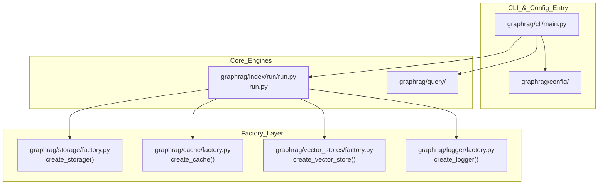
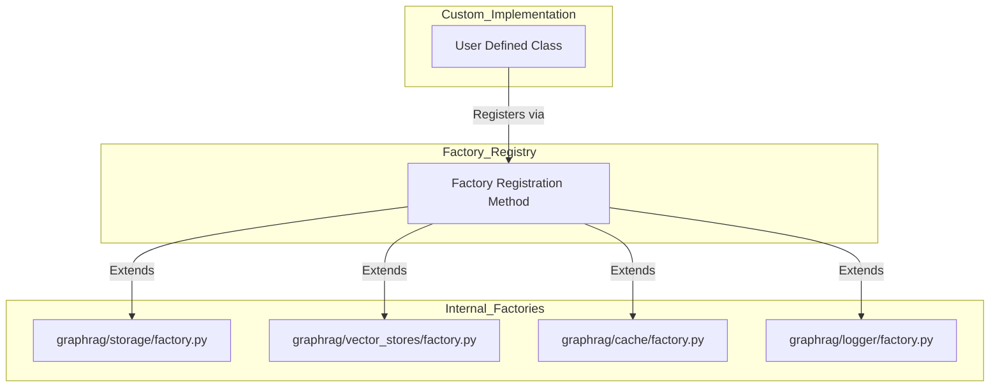

<!-- source: DeepWiki mcp.deepwiki.com · repo microsoft/graphrag · page 12 Development Guide · fetched 2026-10-26 -->

# Development Guide

<details>
<summary>Relevant source files</summary>

The following files were used as context for generating this wiki page:

- [.github/workflows/gh-pages.yml](.github/workflows/gh-pages.yml)
- [.github/workflows/python-integration-tests.yml](.github/workflows/python-integration-tests.yml)
- [.github/workflows/python-notebook-tests.yml](.github/workflows/python-notebook-tests.yml)
- [.github/workflows/python-smoke-tests.yml](.github/workflows/python-smoke-tests.yml)
- [.github/workflows/semver.yml](.github/workflows/semver.yml)
- [.github/workflows/spellcheck.yml](.github/workflows/spellcheck.yml)
- [.semversioner/3.0.4.json](.semversioner/3.0.4.json)
- [DEVELOPING.md](DEVELOPING.md)
- [RELEASE.md](RELEASE.md)
- [docs/developing.md](docs/developing.md)

</details>


This guide provides comprehensive documentation for developers who want to contribute to the GraphRAG codebase or extend its functionality. It covers development environment setup, testing procedures, CI/CD infrastructure, code quality standards, and extensibility patterns.

For information about configuring GraphRAG for end-users, see [Configuration System](#3). For details on the monorepo package structure from an architectural perspective, see [Monorepo Structure and Packages](#2).

---

## Requirements and Prerequisites

GraphRAG development requires the following tools:

| Tool | Version | Purpose | Installation |
|------|---------|---------|--------------|
| Python | 3.10-3.13 | Core language runtime | [python.org](https://www.python.org/downloads/) |
| uv | Latest | Package and workspace management | [astral.sh/uv](https://docs.astral.sh/uv/) |
| Node.js/npm | Latest | For Azurite test emulator | [nodejs.org](https://nodejs.org/) |
| Git | Latest | Version control | [git-scm.com](https://git-scm.com/) |

**Sources:** [DEVELOPING.md:3-8](), [RELEASE.md:13](), [docs/developing.md:5-8]()

---

## Development Environment Setup

### Initial Setup

Clone the repository and install all dependencies using UV's workspace synchronization:

```bash
# Clone the repository
git clone https://github.com/microsoft/graphrag.git
cd graphrag

# Install dependencies for all packages in the workspace
uv sync --all-packages

# Verify installation
uv run poe check
```

The `uv sync --all-packages` command installs dependencies for all packages in the monorepo workspace as defined in the release and development documentation [RELEASE.md:14](). For more details, see [Development Environment Setup](#12.2).

### Virtual Environment Management

UV automatically manages virtual environments. The `.venv` directory is created in the project root and should be excluded from version control.

### Development Dependencies

Development dependencies are managed via `uv`. The project utilizes `poethepoet` to manage custom build and check scripts [DEVELOPING.md:83-84]().

**Sources:** [DEVELOPING.md:10-16](), [RELEASE.md:13-14](), [docs/developing.md:12-17]()

---

## Project Structure and Code Organization

GraphRAG is organized as a monorepo with multiple specialized packages. For a detailed breakdown of the module structure, see [Project Structure](#12.1).

### Code Entry Points and Key Classes

The following table maps high-level functionality to specific code entry points:

| Functionality | Entry Point | Key Classes/Functions |
|---------------|-------------|----------------------|
| CLI Indexing | `graphrag/cli/main.py` | `index` command [DEVELOPING.md:43-47]() |
| CLI Query | `graphrag/cli/main.py` | `query` command [DEVELOPING.md:53]() |
| Storage Factory | `graphrag/storage/factory.py` | `create_storage()` [DEVELOPING.md:54-55]() |
| Cache Factory | `graphrag/cache/factory.py` | `create_cache()` [DEVELOPING.md:40-41]() |
| Vector Store Factory | `graphrag/vector_stores/factory.py` | `create_vector_store()` [DEVELOPING.md:57-58]() |
| Logger Factory | `graphrag/logger/factory.py` | `create_logger()` [DEVELOPING.md:48-49]() |

### Code Organization Mapping: Configuration to Runtime

This diagram maps the configuration and factory system to the actual code entities that implement the functionality:



**Figure 1: Configuration to Code Entity Mapping**

**Sources:** [DEVELOPING.md:38-59]()

---

## Testing Infrastructure

GraphRAG maintains distinct test categories, including unit, integration, smoke, and notebook tests. For detailed strategies and fixtures, see [Testing](#12.3).

### Running Tests

```bash
uv run poe test           # Run all tests
uv run poe test_unit      # Unit tests only
uv run poe test_integration # Integration tests (requires Azurite/Cosmos)
uv run poe test_smoke     # Smoke tests (requires Azurite)
uv run poe test_notebook  # Notebook execution tests
uv run poe test_verbs     # Basic workflow tests
```

Tests often require Azurite for emulating Azure Storage [DEVELOPING.md:71-79](). Integration tests on Windows runners may also launch the Azure Cosmos DB Emulator using `Start-CosmosDbEmulator` [.github/workflows/python-integration-tests.yml:86-91]().

**Sources:** [DEVELOPING.md:89-92](), [.github/workflows/python-notebook-tests.yml:73-75](), [.github/workflows/python-smoke-tests.yml:87-90](), [docs/developing.md:50-54]()

---

## CI/CD and Release Management

### CI/CD Pipeline
The CI/CD infrastructure uses GitHub Actions to run automated tests across Ubuntu and Windows [.github/workflows/python-smoke-tests.yml:36](). Workflows include:
- **Smoke Tests**: Validates core flows with emulated storage [.github/workflows/python-smoke-tests.yml:1]().
- **Integration Tests**: Validates cloud provider integrations, including Cosmos DB and Azure AI Search [.github/workflows/python-integration-tests.yml:1-44]().
- **Notebook Tests**: Ensures documentation examples remain functional [.github/workflows/python-notebook-tests.yml:1]().
- **Spellcheck**: Automated verification of documentation and code comments [.github/workflows/spellcheck.yml:1]().

### Release Process
GraphRAG uses `semversioner` to automate semantic versioning. Developers must add change records using `uv run semversioner add-change` [DEVELOPING.md:64-67](). The release process involves bumping versions across all monorepo packages (e.g., `graphrag-common`, `graphrag-storage`, `graphrag-llm`) in dependency order before publishing to PyPI [RELEASE.md:36-43](), [RELEASE.md:111-141](). For the full process, see [Release Management](#12.5).

**Sources:** [DEVELOPING.md:62-69](), [RELEASE.md:27-47](), [RELEASE.md:111-141](), [.github/workflows/semver.yml:1-21]()

---

## Code Quality and Standards

Code quality is enforced via a suite of static checks. Developers should run `uv run poe check` to validate:
- Formatting and Linting
- Documentation formatting
- Security patterns
- Type-checking

Auto-fixes can be applied using `uv run poe fix` [DEVELOPING.md:93-101](). For the full list of standards, see [Code Quality and Standards](#12.6).

**Sources:** [DEVELOPING.md:93-101](), [docs/developing.md:55-63]()

---

## Extending GraphRAG

GraphRAG uses factory patterns to enable custom implementations of storage, vector stores, and LLM providers [DEVELOPING.md:35](). For a guide on creating custom providers, see [Extending GraphRAG](#12.7).

### Factory Extension Pattern



**Figure 2: Factory Extension Pattern**

**Sources:** [DEVELOPING.md:35-60]()

---

## Automation and Demo Apps

- **Task Automation**: Development tasks (indexing, querying, testing) are managed via `poethepoet` [DEVELOPING.md:83-101](). See [Task Automation with Poethepoet](#12.8).
- **Unified Search App**: A demo application for comparing search methods side-by-side. See [Unified Search App](#12.9).

---

