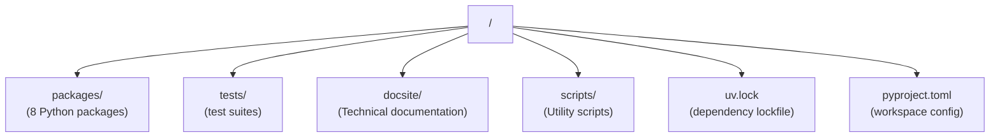
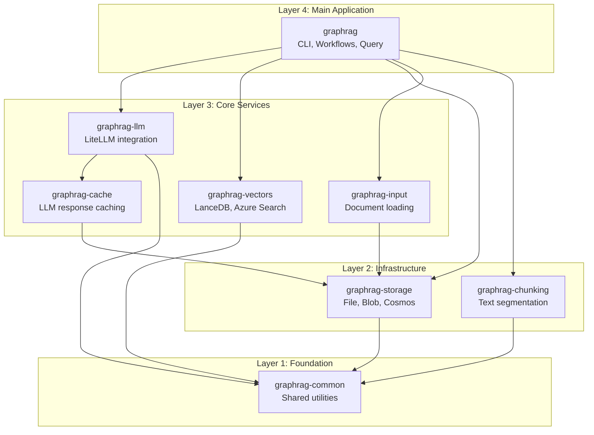
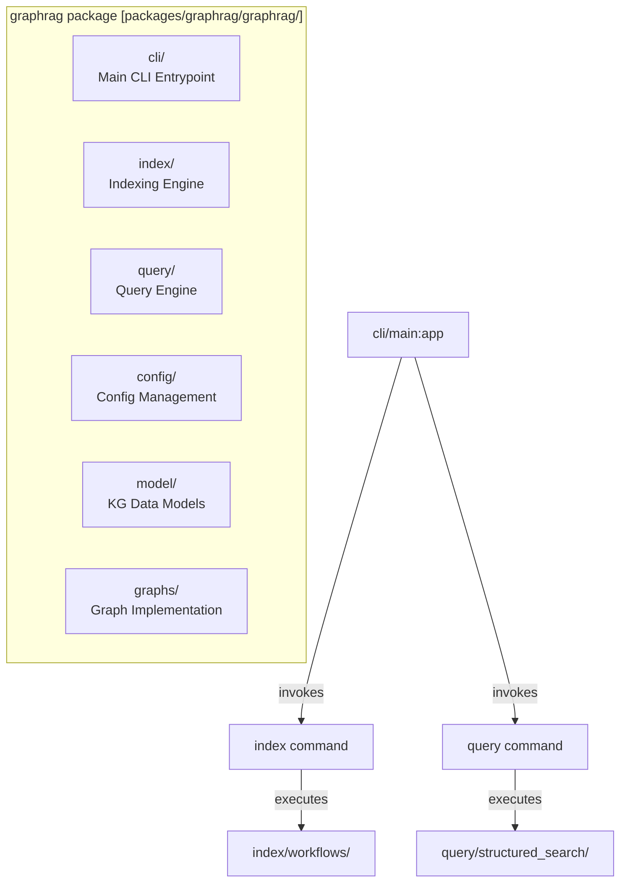
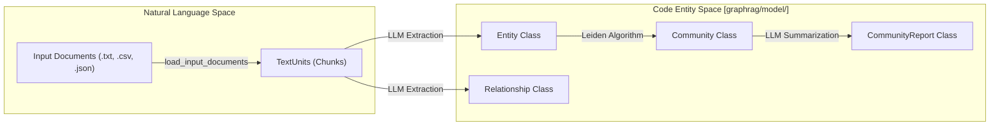

<!-- source: DeepWiki mcp.deepwiki.com · repo microsoft/graphrag · page 12.1 Project Structure · fetched 2026-10-26 -->

# Project Structure

Relevant source files

The following files were used as context for generating this wiki page:

- [CHANGELOG.md](CHANGELOG.md)
- [packages/graphrag-cache/pyproject.toml](packages/graphrag-cache/pyproject.toml)
- [packages/graphrag-chunking/pyproject.toml](packages/graphrag-chunking/pyproject.toml)
- [packages/graphrag-llm/pyproject.toml](packages/graphrag-llm/pyproject.toml)
- [packages/graphrag-storage/pyproject.toml](packages/graphrag-storage/pyproject.toml)
- [packages/graphrag-vectors/pyproject.toml](packages/graphrag-vectors/pyproject.toml)
- [packages/graphrag/pyproject.toml](packages/graphrag/pyproject.toml)
- [pyproject.toml](pyproject.toml)
- [uv.lock](uv.lock)

This page documents the directory layout, package organization, and code organization conventions within the GraphRAG repository. It is intended for developers who need to navigate the codebase, understand where different components live, and maintain consistency when adding new code.

---

## Repository Root Layout

The GraphRAG repository follows a monorepo structure managed by the [uv](https://docs.astral.sh/uv/) package manager [uv.lock:1-24](). The root directory contains workspace configuration, documentation, and the `packages/` directory housing all Python packages [uv.lock:13-24]().

**Sources:** [uv.lock:1-24](), [pyproject.toml:50-54]()

### Key Root Files and Directories

| File/Directory | Purpose | Reference |
|----------------|---------|-----------|
| `uv.lock` | Locked dependency versions across the workspace members | [uv.lock:1-24]() |
| `packages/` | Contains the individual library components (llm, storage, etc.) | [uv.lock:14-24]() |
| `pyproject.toml` | Root workspace configuration and developer task definitions (poethepoet) | [pyproject.toml:1-145]() |
| `scripts/` | Python scripts for build automation and version management | [pyproject.toml:73-85]() |
| `tests/` | Centralized test directory for unit, integration, and smoke tests | [pyproject.toml:91-96]() |

**Sources:** [uv.lock:1-24](), [pyproject.toml:1-145]()

---

## Monorepo Package Structure

The repository is organized into specialized packages that separate concerns like storage, LLM interaction, and vector operations. This modularity allows for the factory design pattern used throughout the system.

**Sources:** [packages/graphrag/pyproject.toml:34-45](), [packages/graphrag-llm/pyproject.toml:34-47](), [packages/graphrag-storage/pyproject.toml:32-40](), [packages/graphrag-vectors/pyproject.toml:32-42](), [packages/graphrag-cache/pyproject.toml:33-36]()

### Package Mapping Table

| Package Name | Directory | Primary Purpose | Key Dependencies |
|--------------|-----------|-----------------|------------------|
| `graphrag-common` | `packages/graphrag-common/` | Base utilities and shared types | `pydantic` |
| `graphrag-storage` | `packages/graphrag-storage/` | Storage abstraction (File, Blob, Cosmos) | `azure-storage-blob`, `azure-cosmos` |
| `graphrag-llm` | `packages/graphrag-llm/` | LLM and Embedding provider integration | `litellm`, `azure-identity` |
| `graphrag-vectors` | `packages/graphrag-vectors/` | Vector store implementations | `lancedb`, `azure-search-documents` |
| `graphrag-cache` | `packages/graphrag-cache/` | Persistent caching for LLM calls | `graphrag-storage` |
| `graphrag-input` | `packages/graphrag-input/` | Data loading and input handling | `graphrag-storage`, `graphrag-common` |
| `graphrag-chunking` | `packages/graphrag-chunking/` | Text chunking strategies | `graphrag-common` |
| `graphrag` | `packages/graphrag/` | Orchestration, CLI, and Query Engine | `networkx`, `pandas`, `graspologic-native` |

**Sources:** [packages/graphrag/pyproject.toml:34-63](), [packages/graphrag-llm/pyproject.toml:34-47](), [packages/graphrag-storage/pyproject.toml:32-40](), [packages/graphrag-vectors/pyproject.toml:32-42](), [CHANGELOG.md:82-93]()

---

## Main Application Package Structure

The `graphrag` package houses the primary logic for the indexing engine and query system. It utilizes a directory-based organization for major functional areas.

**Sources:** [packages/graphrag/pyproject.toml:66](), [CHANGELOG.md:175-182]()

### Key Components and Functionality

| Directory/Component | Purpose | Reference |
|-----------|---------|-----------|
| `cli/main.py` | Typer-based CLI entrypoint for `index`, `query`, `init`, and `prompt-tune` | [packages/graphrag/pyproject.toml:66]() |
| `index/` | Core indexing engine logic, including workflow orchestration and state management | [CHANGELOG.md:175-182]() |
| `query/` | Search algorithms including Global Search, Local Search, and DRIFT | [CHANGELOG.md:142-143](), [CHANGELOG.md:186]() |
| `graphs/` | DataFrame-based graph implementations replacing older NetworkX logic | [CHANGELOG.md:73]() |
| `model/` | Data model definitions for Knowledge Graph entities (Entities, Relationships, Communities) | [CHANGELOG.md:174]() |

**Sources:** [CHANGELOG.md:73-186]()

---

## Knowledge Model and Dataflow

The indexing pipeline transforms raw documents into a structured Knowledge Model. This model is represented by code entities that map to the system's output tables (Parquet/CSV).

**Sources:** [CHANGELOG.md:57-61](), [CHANGELOG.md:174-175]()

### Data Handling Abstractions
The system uses a provider-based abstraction layer to handle data operations across different storage backends.

| Class/Component | Purpose | Reference |
|----------|-------------|------------|
| `TableProvider` | Abstraction for table-based storage operations (Parquet/CSV/Cosmos) | [CHANGELOG.md:68]() |
| `CosmosTableProvider` | Native Cosmos DB provider with namespace partitioning and transactional writes | [CHANGELOG.md:17]() |
| `DataReader` | Class for typed dataframe loading from `TableProvider` across workflows | [CHANGELOG.md:67]() |
| `InputReader` | Async iterator for loading documents from configured storage | [CHANGELOG.md:69]() |

**Sources:** [CHANGELOG.md:17-70]()

---

## Code Organization Conventions

### Factory Design Pattern
GraphRAG heavily leverages the factory pattern to allow for registration-based extension of core components.

*   **Storage Factory:** Supports registration of custom storage providers (File, Blob, Cosmos) [CHANGELOG.md:131]().
*   **LLM Factory:** Manages model providers, supporting OpenAI, Azure OpenAI, and LiteLLM [CHANGELOG.md:177]().
*   **Vector Store Factory:** Consistent registration support for vector backends [CHANGELOG.md:119]().
*   **Table Provider Factory:** Orchestrates table-based data access [CHANGELOG.md:70]().

### Lifecycle Tasks (Poethepoet)
Development tasks are managed via `poethepoet` defined in the root `pyproject.toml` [pyproject.toml:66-105]().

| Task | Command | Description |
|------|---------|-------------|
| `index` | `python -m graphrag index` | Executes the indexing pipeline | [pyproject.toml:97]() |
| `query` | `python -m graphrag query` | Executes the query engine (Global/Local/Drift) | [pyproject.toml:100]() |
| `init` | `python -m graphrag init` | Initializes project configuration and directory structure | [pyproject.toml:99]() |
| `test_unit` | `pytest ./tests/unit` | Runs the unit test suite | [pyproject.toml:92]() |
| `check` | `ruff check .` | Runs linting and static analysis | [pyproject.toml:138-140]() |
| `release` | `semversioner release` | Manages monorepo versioning and changelog generation | [pyproject.toml:112-127]() |

**Sources:** [pyproject.toml:66-145]()

---

