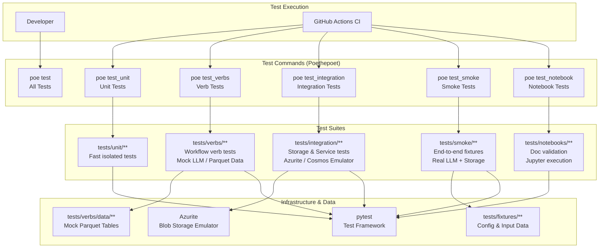
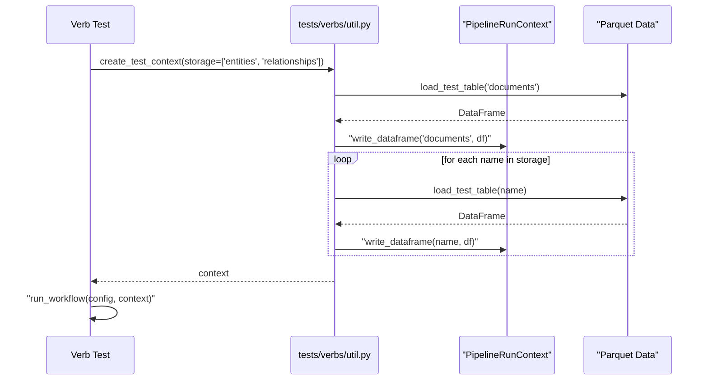
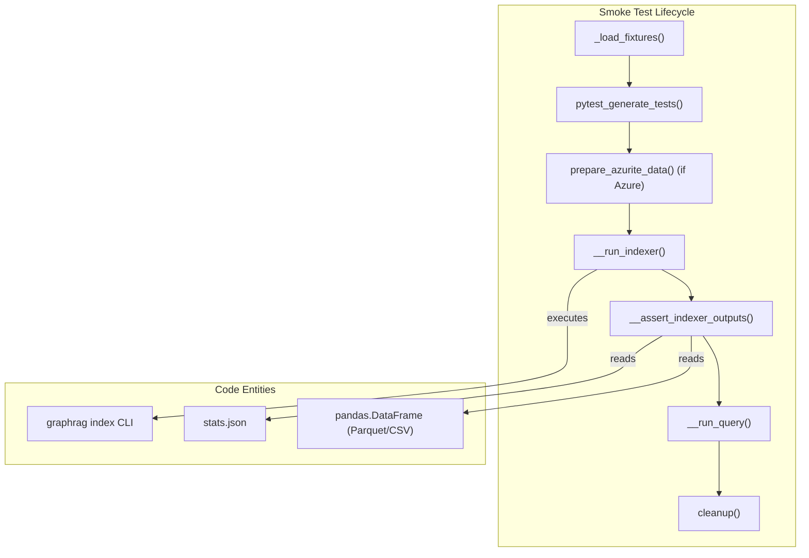

<!-- source: DeepWiki mcp.deepwiki.com · repo microsoft/graphrag · page 12.3 Testing · fetched 2026-10-26 -->

# Testing

<details>
<summary>Relevant source files</summary>

The following files were used as context for generating this wiki page:

- [.github/workflows/gh-pages.yml](.github/workflows/gh-pages.yml)
- [.github/workflows/python-integration-tests.yml](.github/workflows/python-integration-tests.yml)
- [.github/workflows/python-notebook-tests.yml](.github/workflows/python-notebook-tests.yml)
- [.github/workflows/python-smoke-tests.yml](.github/workflows/python-smoke-tests.yml)
- [.github/workflows/semver.yml](.github/workflows/semver.yml)
- [.github/workflows/spellcheck.yml](.github/workflows/spellcheck.yml)
- [docs/developing.md](docs/developing.md)
- [tests/fixtures/azure/settings.yml](tests/fixtures/azure/settings.yml)
- [tests/fixtures/min-csv/config.json](tests/fixtures/min-csv/config.json)
- [tests/fixtures/min-csv/settings.yml](tests/fixtures/min-csv/settings.yml)
- [tests/fixtures/text/config.json](tests/fixtures/text/config.json)
- [tests/fixtures/text/settings.yml](tests/fixtures/text/settings.yml)
- [tests/notebook/test_notebooks.py](tests/notebook/test_notebooks.py)
- [tests/smoke/test_fixtures.py](tests/smoke/test_fixtures.py)
- [tests/verbs/test_create_base_text_units.py](tests/verbs/test_create_base_text_units.py)
- [tests/verbs/test_create_final_text_units.py](tests/verbs/test_create_final_text_units.py)
- [tests/verbs/test_extract_graph.py](tests/verbs/test_extract_graph.py)
- [tests/verbs/util.py](tests/verbs/util.py)

</details>


## Purpose and Scope

This document describes the testing infrastructure in the GraphRAG codebase, including test strategy, execution, fixtures, and continuous integration. It covers unit tests, integration tests, smoke tests, verb tests, and notebook tests, as well as the tools and utilities used to validate system correctness across different storage backends and LLM providers.

For information about CI/CD pipelines and quality gates, see [CI/CD Pipeline](12.4). For development environment setup, see [Development Environment Setup](12.2). For task automation, see [Task Automation with Poethepoet](12.8).

---

## Test Architecture Overview

The GraphRAG testing system employs a multi-tier strategy to ensure code quality, from fast unit tests to comprehensive end-to-end smoke tests using real LLM providers.



**Sources:** [.github/workflows/python-smoke-tests.yml:87-91](), [.github/workflows/python-integration-tests.yml:93-95](), [.github/workflows/python-notebook-tests.yml:73-75](), [docs/developing.md:45-54]()

---

## Unit Tests

Unit tests validate individual functions and classes in isolation. They are designed to be fast and deterministic, mocking all I/O and external API calls.

**Execution:**
```bash
uv run poe test_unit
```

---

## Verb Tests

Verb tests validate individual workflow operations (verbs) using pre-computed test data stored as Parquet files. These tests bypass the full indexing pipeline by loading specific intermediate tables.

### Test Context Implementation

The `create_test_context` function in `tests/verbs/util.py` initializes a `PipelineRunContext` by loading existing Parquet data into the `output_table_provider`.



### Key Components
- **`create_test_context`**: Factory function to set up a `PipelineRunContext` with pre-loaded data [tests/verbs/util.py:12-26](). It uses `create_run_context` from `graphrag.index.run.utils` [tests/verbs/util.py:5-5]().
- **`load_test_table`**: Utility to read Parquet files from `tests/verbs/data/` [tests/verbs/util.py:29-31]().
- **`compare_outputs`**: Validates workflow results using `pandas.testing.assert_series_equal`, allowing for dtype differences and ignoring UUIDs [tests/verbs/util.py:34-66]().
- **`_FakeWriteTable`**: An in-memory write-only table implementation used to collect output rows during testing without persistent storage [tests/verbs/test_create_final_text_units.py:34-60]().

**Sources:** [tests/verbs/util.py:1-67](), [tests/verbs/test_create_final_text_units.py:34-90]()

---

## Integration Tests

Integration tests verify the system's interaction with external services like Azure Blob Storage and Cosmos DB.

### Service Emulators
- **Azurite**: Used for Azure Blob Storage testing. Started via `npm install -g azurite` and `azurite --silent` [.github/workflows/python-integration-tests.yml:76-80]().
- **Cosmos DB Emulator**: Used on Windows runners for Cosmos DB integration [.github/workflows/python-integration-tests.yml:86-91]().

**Execution:**
```bash
uv run poe test_integration
```

**Sources:** [.github/workflows/python-integration-tests.yml:1-96](), [docs/developing.md:31-39]()

---

## Smoke Tests

Smoke tests perform end-to-end validation of the indexing and query pipelines using real LLM calls and varied input formats.

### Test Fixtures
Fixtures are located in `tests/fixtures/`. Each subfolder contains a complete test scenario:
- **`config.json`**: Defines validation rules, row ranges, and query tests [tests/fixtures/text/config.json:1-111]().
- **`settings.yml`**: Configures the GraphRAG system, including `completion_models`, `embedding_models`, and `vector_store` types like `azure_ai_search` or `lancedb` [tests/fixtures/text/settings.yml:1-41](), [tests/fixtures/min-csv/settings.yml:26-30]().
- **`input/`**: Raw data files (`.txt` or `.csv`).

### Fixture Configuration Schema
The `config.json` file controls the smoke test execution and assertions:

| Field | Description |
|-------|-------------|
| `index_method` | `standard` or `fast` [tests/fixtures/text/config.json:4]() |
| `workflow_config` | Per-workflow assertions for `max_runtime`, `row_range`, and `expected_artifacts` [tests/fixtures/text/config.json:5-95]() |
| `query_config` | List of queries and methods (`local`, `global`, `drift`, `basic`) to test after indexing [tests/fixtures/text/config.json:96-109]() |
| `nan_allowed_columns` | Columns permitted to have null values during validation [tests/fixtures/text/config.json:24-26]() |

### Execution Flow
The `TestIndexer` class in `tests/smoke/test_fixtures.py` manages the lifecycle:



1. **Fixture Loading**: `_load_fixtures` reads all subdirectories in `tests/fixtures/` [tests/smoke/test_fixtures.py:33-48]().
2. **Data Preparation**: For Azure-based fixtures, `prepare_azurite_data` uses `AzureBlobStorage` from `graphrag_storage.azure_blob_storage` to upload local files to the emulator [tests/smoke/test_fixtures.py:91-119]().
3. **Indexing**: Runs the CLI command `uv run poe index` against the fixture root using `subprocess.run` [tests/smoke/test_fixtures.py:126-149]().
4. **Validation**: `__assert_indexer_outputs` verifies `stats.json` and artifact row counts against the `config.json` specs [tests/smoke/test_fixtures.py:150-199]().
5. **Querying**: Executes the `query_config` tests using the query CLI to ensure the generated index is searchable [tests/smoke/test_fixtures.py:201-218]().

**Sources:** [tests/smoke/test_fixtures.py:1-269](), [tests/fixtures/text/config.json:1-111](), [tests/fixtures/min-csv/config.json:1-105](), [tests/fixtures/text/settings.yml:1-41]()

---

## Notebook Tests

Notebook tests ensure that documentation and tutorial notebooks (`.ipynb`) remain functional as the API evolves.

**Execution:**
```bash
uv run poe test_notebook
```

**CI Implementation:**
The `Python Notebook Tests` workflow runs on Ubuntu and Windows, installing all packages and executing `poe test_notebook` [.github/workflows/python-notebook-tests.yml:1-76]().

---

## Continuous Integration

GraphRAG uses GitHub Actions to run the test suite on every push and pull request.

### CI Workflows
- **`python-smoke-tests.yml`**: Runs end-to-end fixtures. Uses `dorny/paths-filter` to trigger only on relevant code changes [.github/workflows/python-smoke-tests.yml:50-62]().
- **`python-integration-tests.yml`**: Runs storage integration tests with Azurite and Cosmos Emulator [.github/workflows/python-integration-tests.yml:1-96]().
- **`gh-pages.yml`**: Uses the `min-csv` smoke test (with `GH_PAGES=1` environment variable) to hydrate documentation artifacts when deploying the docsite [.github/workflows/gh-pages.yml:12-35]().

### Test Environment
CI environments are configured via secrets for LLM access:
- `GRAPHRAG_API_KEY`: OpenAI/Azure API key [.github/workflows/python-smoke-tests.yml:40]().
- `AZURE_AI_SEARCH_URL_ENDPOINT`: Endpoint for vector store testing [.github/workflows/python-smoke-tests.yml:43]().
- `WELL_KNOWN_AZURITE_CONNECTION_STRING`: Used for local Azurite emulator connections [tests/smoke/test_fixtures.py:28-28]().

**Sources:** [.github/workflows/python-smoke-tests.yml:1-98](), [.github/workflows/python-integration-tests.yml:1-96](), [.github/workflows/gh-pages.yml:1-49](), [tests/fixtures/text/settings.yml:4-5]()

---

