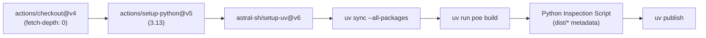
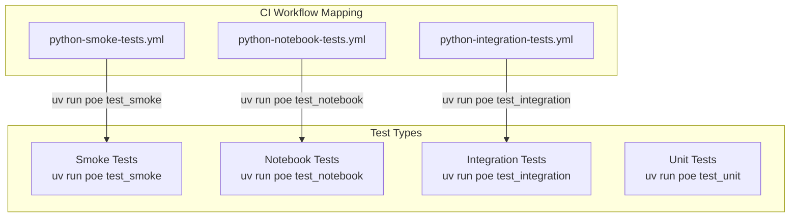

<!-- source: DeepWiki mcp.deepwiki.com · repo microsoft/graphrag · page 12.4 CI/CD Pipeline · fetched 2026-10-26 -->

# CI/CD Pipeline

Relevant source files

The following files were used as context for generating this wiki page:

- [.github/workflows/gh-pages.yml](.github/workflows/gh-pages.yml)
- [.github/workflows/issues-autoresolve.yml](.github/workflows/issues-autoresolve.yml)
- [.github/workflows/python-integration-tests.yml](.github/workflows/python-integration-tests.yml)
- [.github/workflows/python-notebook-tests.yml](.github/workflows/python-notebook-tests.yml)
- [.github/workflows/python-publish.yml](.github/workflows/python-publish.yml)
- [.github/workflows/python-smoke-tests.yml](.github/workflows/python-smoke-tests.yml)
- [.github/workflows/semver.yml](.github/workflows/semver.yml)
- [.github/workflows/spellcheck.yml](.github/workflows/spellcheck.yml)
- [docs/developing.md](docs/developing.md)
- [tests/integration/storage/__init__.py](tests/integration/storage/__init__.py)

## Purpose and Scope

This document describes the Continuous Integration and Continuous Deployment (CI/CD) infrastructure for the GraphRAG monorepo. The CI/CD system uses GitHub Actions workflows to automate testing, building, and publishing of GraphRAG packages. The pipeline ensures code quality through multi-platform testing, automated documentation deployment, and rigorous package inspection before distribution.

## CI/CD Architecture Overview

The GraphRAG CI/CD pipeline consists of several GitHub Actions workflows triggered by pushes, pull requests, releases, and scheduled cron jobs.

Title: CI/CD Workflow Orchestration

```mermaid
graph TB
    subgraph "Trigger Events"
        PushMain["Push to main"]
        PullRequest["Pull Request"]
        Release["Release Created"]
        Schedule["Daily Cron (1:30 AM)"]
    end
    
    subgraph "GitHub Actions Workflows"
        PublishWorkflow["python-publish.yml<br/>Build & Publish to PyPI"]
        SmokeWorkflow["python-smoke-tests.yml<br/>End-to-End Validation"]
        NotebookWorkflow["python-notebook-tests.yml<br/>Notebook Validation"]
        IntegrationWorkflow["python-integration-tests.yml<br/>External Service Tests"]
        SpellcheckWorkflow["spellcheck.yml<br/>Documentation Quality"]
        SemverWorkflow["semver.yml<br/>Version Validation"]
        IssuesWorkflow["issues-autoresolve.yml<br/>Stale Issue Management"]
        GHPagesWorkflow["gh-pages.yml<br/>Documentation Deployment"]
    end
    
    subgraph "Test Execution (Poe Tasks)"
        SmokeTests["uv run poe test_smoke"]
        NotebookTests["uv run poe test_notebook"]
        IntegrationTests["uv run poe test_integration"]
    end
    
    subgraph "External Service Emulators"
        Azurite["Azurite Emulator<br/>Azure Storage Mock"]
        CosmosEmulator["Cosmos DB Emulator<br/>Windows Only"]
    end
    
    subgraph "Artifacts & Outputs"
        PyPIPackages["PyPI Distribution<br/>.whl + .tar.gz"]
        TestArtifacts["smoke-test-artifacts<br/>tests/fixtures/*"]
        DocSite["GitHub Pages Site"]
    end
    
    PushMain --> PublishWorkflow
    PushMain --> SmokeWorkflow
    PushMain --> NotebookWorkflow
    PushMain --> IntegrationWorkflow
    PushMain --> SpellcheckWorkflow
    PushMain --> GHPagesWorkflow
    
    Release --> PublishWorkflow
    
    PullRequest --> SmokeWorkflow
    PullRequest --> NotebookWorkflow
    PullRequest --> IntegrationWorkflow
    PullRequest --> SpellcheckWorkflow
    PullRequest --> SemverWorkflow
    
    Schedule --> IssuesWorkflow
    
    SmokeWorkflow --> SmokeTests
    SmokeWorkflow --> Azurite
    
    NotebookWorkflow --> NotebookTests
    
    IntegrationWorkflow --> IntegrationTests
    IntegrationWorkflow --> Azurite
    IntegrationWorkflow --> CosmosEmulator
    
    PublishWorkflow --> PyPIPackages
    SmokeWorkflow --> TestArtifacts
    GHPagesWorkflow --> DocSite
```

**Sources:** [.github/workflows/python-publish.yml:1-101](), [.github/workflows/python-smoke-tests.yml:1-97](), [.github/workflows/python-notebook-tests.yml:1-76](), [.github/workflows/python-integration-tests.yml:1-96](), [.github/workflows/spellcheck.yml:1-23](), [.github/workflows/semver.yml:1-21](), [.github/workflows/issues-autoresolve.yml:1-30](), [.github/workflows/gh-pages.yml:1-49]()

## GitHub Actions Workflows

### Publish Workflow (python-publish.yml)

The publish workflow builds and uploads GraphRAG packages to PyPI. It is triggered on pushes to `main` and release creation events [[.github/workflows/python-publish.yml:3-7]()].

**Workflow Name:** `Python Publish (pypi)`  
**Environment:** `pypi` with OIDC token (`id-token: write`) [[.github/workflows/python-publish.yml:18-21]()]  
**Python Version:** 3.13 [[.github/workflows/python-publish.yml:10]()]

Title: PyPI Publication Data Flow

The workflow uses the `poe build` task to generate distributions [[.github/workflows/python-publish.yml:46]()]. The inspection step runs an inline Python script that validates all wheel (`.whl`) and source distribution (`.tar.gz`) files, ensuring the `Project Name` and `Version` metadata are correctly present in `.dist-info/METADATA` and `PKG-INFO` [[.github/workflows/python-publish.yml:51-97]()].

**Sources:** [.github/workflows/python-publish.yml:1-101](), [docs/developing.md:49]()

### Smoke Tests Workflow (python-smoke-tests.yml)

The smoke tests workflow runs end-to-end validation across multiple platforms to catch regressions in the indexing and query pipelines.

**Workflow Name:** `Python Smoke Tests`  
**Matrix Strategy:** Python 3.13, `ubuntu-latest`, and `windows-latest` [[.github/workflows/python-smoke-tests.yml:33-36]()]  
**Concurrency:** Uses `cancel-in-progress: true` to optimize runner usage [[.github/workflows/python-smoke-tests.yml:24-27]()]

**Environment Variables:**
- `GRAPHRAG_API_KEY`: OpenAI API key [[.github/workflows/python-smoke-tests.yml:40]()]
- `GRAPHRAG_API_BASE`: API endpoint [[.github/workflows/python-smoke-tests.yml:41]()]
- `AZURE_AI_SEARCH_URL_ENDPOINT` & `AZURE_AI_SEARCH_API_KEY`: Credentials for vector store testing [[.github/workflows/python-smoke-tests.yml:43-44]()]

**Path Filtering:**  
Execution is skipped if changes are limited to `.md` or `.semversioner` files [[.github/workflows/python-smoke-tests.yml:16-18]()]. It specifically watches for changes in `graphrag/**/*`, `uv.lock`, and `pyproject.toml` [[.github/workflows/python-smoke-tests.yml:50-63]()].

**Azurite Integration:**  
The workflow starts an Azurite emulator to mock Azure Blob Storage for pipeline I/O testing [[.github/workflows/python-smoke-tests.yml:81-85]()].

**Sources:** [.github/workflows/python-smoke-tests.yml:1-97]()

### Integration Tests Workflow (python-integration-tests.yml)

Runs integration tests that interact with external service emulators, specifically focusing on storage and database providers.

**Workflow Name:** `Python Integration Tests`  
**Test Command:** `uv run poe test_integration` [[.github/workflows/python-integration-tests.yml:95]()]

**External Service Emulators:**

| Service | Platform | Configuration |
|---------|----------|---------------|
| Azurite | All | `npm install -g azurite` [[.github/workflows/python-integration-tests.yml:79-80]()] |
| Cosmos DB Emulator | Windows only | `Start-CosmosDbEmulator -Timeout 500` [[.github/workflows/python-integration-tests.yml:86-91]()] |

The Cosmos DB emulator requires a Windows runner and a significant startup timeout [[.github/workflows/python-integration-tests.yml:87,91]()].

**Sources:** [.github/workflows/python-integration-tests.yml:1-96]()

### GitHub Pages Deployment (gh-pages.yml)

Automates documentation building and hosting.

**Workflow Name:** `gh-pages`  
**Triggers:** `push` to `main` [[.github/workflows/gh-pages.yml:4]()]  
**Execution:**
1. Installs dependencies via `uv sync --all-packages` [[.github/workflows/gh-pages.yml:34]()]
2. Builds the MkDocs site via `uv run poe build_docs` [[.github/workflows/gh-pages.yml:38]()]
3. Deploys the `site` folder to the `gh-pages` branch using `JamesIves/github-pages-deploy-action` [[.github/workflows/gh-pages.yml:43-49]()]

**Sources:** [.github/workflows/gh-pages.yml:1-49]()

### Issue Auto-Resolution (issues-autoresolve.yml)

Manages community engagement by closing inactive issues.

**Workflow Name:** `Close inactive issues`  
**Schedule:** Daily at 01:30 UTC [[.github/workflows/issues-autoresolve.yml:4]()]  
**Logic:**
- Identifies issues with the `awaiting_response` label [[.github/workflows/issues-autoresolve.yml:26]()]
- Marks as `stale` after 7 days of inactivity [[.github/workflows/issues-autoresolve.yml:20]()]
- Closes and labels as `autoresolved` after 5 additional days [[.github/workflows/issues-autoresolve.yml:21,23]()]

**Sources:** [.github/workflows/issues-autoresolve.yml:1-30]()

## Testing Infrastructure

### Test Execution Layers

GraphRAG uses `poethepoet` to abstract complex test commands [[docs/developing.md:43-63]()].

Title: Testing Hierarchy and Commands

**Sources:** [.github/workflows/python-smoke-tests.yml:90](), [.github/workflows/python-notebook-tests.yml:75](), [.github/workflows/python-integration-tests.yml:95](), [docs/developing.md:50-54]()

## Quality Control Workflows

### Spellcheck Workflow (spellcheck.yml)
- **Execution:** Runs `./scripts/spellcheck.sh` [[.github/workflows/spellcheck.yml:22]()].
- **Triggers:** Pull requests and pushes to `main`.

### Semantic Versioning Check (semver.yml)
- **Execution:** Runs `./scripts/semver-check.sh` [[.github/workflows/semver.yml:21]()].
- **Purpose:** Ensures PRs maintain valid versioning logic for automated releases.

**Sources:** [.github/workflows/spellcheck.yml:1-23](), [.github/workflows/semver.yml:1-21]()

---

