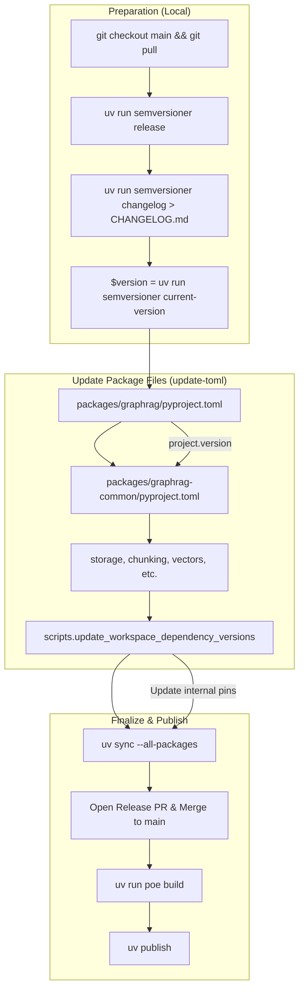
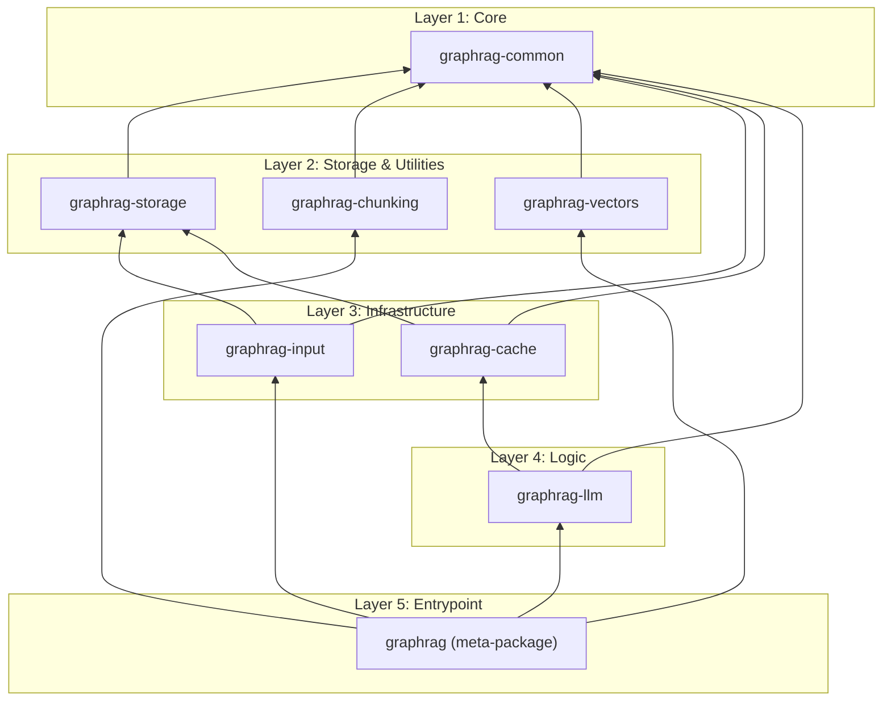

<!-- source: DeepWiki mcp.deepwiki.com · repo microsoft/graphrag · page 12.5 Release Management · fetched 2026-10-26 -->

# Release Management

<details>
<summary>Relevant source files</summary>

The following files were used as context for generating this wiki page:

- [.github/workflows/issues-autoresolve.yml](.github/workflows/issues-autoresolve.yml)
- [.github/workflows/python-publish.yml](.github/workflows/python-publish.yml)
- [.semversioner/3.0.4.json](.semversioner/3.0.4.json)
- [DEVELOPING.md](DEVELOPING.md)
- [RELEASE.md](RELEASE.md)
- [tests/integration/storage/__init__.py](tests/integration/storage/__init__.py)

</details>


This document describes GraphRAG's release management system, including semantic versioning, change tracking, version coordination across the monorepo, and the release workflow. The process ensures that all sub-packages in the monorepo are released with synchronized version numbers and correct inter-package dependency pins.

## Semantic Versioning with Semversioner

GraphRAG uses [semversioner](https://github.com/raulgomis/semversioner) to automate and enforce semantic versioning. This tool ensures that all PRs include a change description that dictates how the version number should increment.

### Semversioner Change Files

Developers track changes by creating JSON files via the CLI. When a release is triggered, these pending changes are consolidated into a version-specific JSON file in the `.semversioner/` directory.

**Example Version File Structure:**

| Field | Type | Description |
|-------|------|-------------|
| `version` | string | The semantic version number (e.g., "3.0.4") |
| `created_at` | string | ISO 8601 timestamp of version creation |
| `changes` | array | List of change objects (type and description) |

**Sources:** [DEVELOPING.md:62-68](), [.semversioner/3.0.4.json:1-10]()

### Change Types

Change types follow semantic versioning conventions:
- `major`: Breaking changes.
- `minor`: New features.
- `patch`: Bug fixes or dependency updates (e.g., "fix versions release").

**Sources:** [.semversioner/3.0.4.json:2-6](), [DEVELOPING.md:66-67]()

## Release Process Workflow

The release process is a multi-step procedure involving version calculation, file updates, and synchronization. While some automation exists via `poe` tasks, the final publication currently requires manual steps by a maintainer due to the CI publish workflow being non-functional.

### Release Task Sequence

The following diagram illustrates the sequence of commands executed during a release preparation, mapping natural language steps to the specific code entities and scripts used.

**Release Preparation Data Flow**


**Sources:** [RELEASE.md:18-47](), [RELEASE.md:87-90]()

### Step 1: Prepare the Release

The maintainer pulls the latest `main` branch and runs `semversioner release`. This command reads pending change fragments and calculates the next version number.

**Sources:** [RELEASE.md:18-28]()

### Step 2: Update Package Metadata

GraphRAG uses `update-toml` to synchronize the version across all eight sub-packages. This ensures that every `pyproject.toml` reflects the current release version in its `project.version` field.

The packages updated include:
- `packages/graphrag/pyproject.toml` [RELEASE.md:36-36]()
- `packages/graphrag-common/pyproject.toml` [RELEASE.md:37-37]()
- `packages/graphrag-chunking/pyproject.toml` [RELEASE.md:38-38]()
- `packages/graphrag-input/pyproject.toml` [RELEASE.md:39-39]()
- `packages/graphrag-storage/pyproject.toml` [RELEASE.md:40-40]()
- `packages/graphrag-cache/pyproject.toml` [RELEASE.md:41-41]()
- `packages/graphrag-vectors/pyproject.toml` [RELEASE.md:42-42]()
- `packages/graphrag-llm/pyproject.toml` [RELEASE.md:43-43]()

**Sources:** [RELEASE.md:36-43]()

### Step 3: Update Workspace Dependencies

Because packages within the monorepo depend on each other, the internal dependency pins must be updated to the new version. This is handled by the script `scripts.update_workspace_dependency_versions`.

**Sources:** [RELEASE.md:45-45](), [RELEASE.md:163-174]()

## Package Build and Distribution

Once the release PR is merged into `main`, the packages are built and published to PyPI.

### Build Process

The `uv run poe build` command generates distribution artifacts. These are placed in the `dist/` directory at the repository root. The build task is managed by `poethepoet`.

- **Wheels**: `.whl` files containing the packaged code.
- **SDists**: `.tar.gz` source distributions.

**Sources:** [RELEASE.md:90-93](), [DEVELOPING.md:83-88](), [.github/workflows/python-publish.yml:44-46]()

### Publication Order

Due to inter-package dependencies, if publishing individually with project-scoped tokens, packages must be uploaded in dependency order. The `graphrag` meta-package depends on all others, so it is published last.

**Package Dependency Hierarchy**


**Sources:** [RELEASE.md:111-142](), [RELEASE.md:163-174]()

## Automated CI/CD Publishing

The repository includes a GitHub Action `python-publish.yml` designed to automate PyPI uploads.

### Workflow Logic

The workflow is triggered by a release creation or a push to the `main` branch. It performs the following:
1. **Environment Setup**: Installs `uv` and syncs all packages using `uv sync --all-packages`.
2. **Build**: Executes `uv run poe build`.
3. **Inspection**: A Python script inspects the `dist/` directory to verify metadata (`Name` and `Version`) within the `.whl` and `.tar.gz` files using `zipfile` and `tarfile` modules.
4. **Publish**: Executes `uv publish` to upload to PyPI.

**Note**: As of the current documentation, this CI workflow is marked as non-functional in `RELEASE.md`, and manual publication is required.

**Sources:** [.github/workflows/python-publish.yml:1-101](), [RELEASE.md:5-6]()

## Release Verification

After publication, the release is verified by checking the live PyPI index:
```sh
pip index versions graphrag
```
Finally, a GitHub Release is created manually on the repository, selecting the pushed tag (e.g., `v3.0.4`) and generating release notes from the `CHANGELOG.md`.

**Sources:** [RELEASE.md:144-161]()

---

