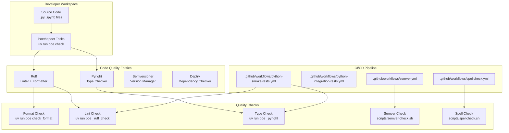

<!-- source: DeepWiki mcp.deepwiki.com · repo microsoft/graphrag · page 12.6 Code Quality and Standards · fetched 2026-10-26 -->

# Code Quality and Standards

Relevant source files

The following files were used as context for generating this wiki page:

- [.github/workflows/gh-pages.yml](.github/workflows/gh-pages.yml)
- [.github/workflows/python-integration-tests.yml](.github/workflows/python-integration-tests.yml)
- [.github/workflows/python-notebook-tests.yml](.github/workflows/python-notebook-tests.yml)
- [.github/workflows/python-smoke-tests.yml](.github/workflows/python-smoke-tests.yml)
- [.github/workflows/semver.yml](.github/workflows/semver.yml)
- [.github/workflows/spellcheck.yml](.github/workflows/spellcheck.yml)
- [CHANGELOG.md](CHANGELOG.md)
- [docs/developing.md](docs/developing.md)
- [packages/graphrag-cache/pyproject.toml](packages/graphrag-cache/pyproject.toml)
- [packages/graphrag-chunking/pyproject.toml](packages/graphrag-chunking/pyproject.toml)
- [pyproject.toml](pyproject.toml)

This page documents the code quality tools, linting rules, formatting standards, and type checking configuration used in the GraphRAG monorepo. It covers the Ruff linter/formatter, Pyright type checker, their configurations, and how quality standards are enforced through development workflows and CI/CD pipelines.

For information about testing infrastructure, see [Testing](#12.3). For CI/CD pipeline details, see [CI/CD Pipeline](#12.4). For task automation commands, see [Task Automation with Poethepoet](#12.8).

---

## Code Quality Tools Overview

GraphRAG uses several primary tools to maintain code quality across all packages. These are managed via `uv` and orchestrated through `poethepoet` tasks.

| Tool | Purpose | Implementation / Configuration |
|------|---------|----------------------|
| **Ruff** | Fast Python linter and formatter | Configured in `pyproject.toml` [pyproject.toml:147-174]() |
| **Pyright** | Static type checker | Configured in `pyproject.toml` [pyproject.toml:39]() |
| **Semversioner** | Automated semantic versioning | Configured in `pyproject.toml` [pyproject.toml:45]() |
| **Azurite** | Azure storage emulation for tests | Used in CI [.github/workflows/python-smoke-tests.yml:81-85]() |
| **Deptry** | Dependency issue checking | Configured in `pyproject.toml` [pyproject.toml:29]() |

All tools are configured in the root of the repository and apply to workspace packages. The configuration is enforced both locally during development and in CI/CD pipelines.

**Sources:** [pyproject.toml:26-48](), [docs/developing.md:5-9](), [docs/developing.md:41-64]()

---

## Quality Tool Integration Architecture

The following diagram illustrates how code quality standards are bridged from developer intent (Natural Language/Configuration) to the actual Code Entities (Linter/Formatter/Type Checker).

### From Standards to Execution
"Standardize Code" (Natural Language) -> `poe check` (Task Entity) -> `ruff` / `pyright` (Tool Entities)

This diagram shows how code quality tools integrate into both local development and CI/CD workflows. The `poe` tasks act as the primary interface for developers.

**Sources:** [pyproject.toml:66-107](), [docs/developing.md:41-64](), [.github/workflows/python-smoke-tests.yml:87-90](), [.github/workflows/semver.yml:1-21]()

---

## Ruff Linter and Formatter

Ruff is used as the unified linter and formatter. It is configured to target Python 3.10 and includes support for Jupyter Notebooks [pyproject.toml:147-149]().

### Configuration
The linter configuration includes specific rule selections such as:
- **E4, E7, E9**: Pycodestyle errors [pyproject.toml:159-161]()
- **LOG**: Logging standards [pyproject.toml:172]()
- **I**: Import sorting [pyproject.toml:67]()

The formatter uses a preview mode with specific docstring formatting settings [pyproject.toml:151-154]().

### Execution Tasks
Developers interact with Ruff through several `poe` tasks:
- `check_format`: `ruff format . --check` [pyproject.toml:88]()
- `fix`: `ruff check --fix .` [pyproject.toml:89]()
- `_format_code`: `ruff format .` [pyproject.toml:68]()
- `_sort_imports`: `ruff check --select I --fix .` [pyproject.toml:67]()

---

## Pyright Type Checker

Pyright provides static type checking for the repository. It ensures that type hints are consistent across the monorepo packages.

### Type Checking Scope
Type checking is integrated into the `check` sequence task [pyproject.toml:138-140](). The CI/CD pipelines for smoke tests and integration tests both perform a build step (`uv build --all-packages`) which implicitly validates package structure and dependencies before running tests [.github/workflows/python-smoke-tests.yml:77-80](), [.github/workflows/python-integration-tests.yml:72-75]().

Recent fixes in the `CHANGELOG.md` highlight the importance of explicit return type annotations for generators like `batched()` and `chunk_text()` to satisfy type checking [CHANGELOG.md:8]().

---

## Semantic Versioning Standards

GraphRAG uses `semversioner` to automate and enforce semantic versioning in the release process.

### Standards to Code Entity Mapping
"Declare Change" (Natural Language) -> `semversioner add-change` (CLI Command) -> `.semversioner/` (Data Entity)

```mermaid
graph LR
    Developer["Developer"] -- "Describes Change" --> SemverCLI["uv run poe semversioner_add"]
    SemverCLI -- "Generates Metadata" --> ChangeFile[".semversioner/"]
    ChangeFile -- "Validated by" --> SemverCheck["scripts/semver-check.sh"]
    SemverCheck -- "Required for" --> PR["Pull Request Merge"]
    PR -- "Triggers Release" --> ReleaseTask["uv run poe release"]
    ReleaseTask -- "Updates" --> ProjectVersions["pyproject.toml files"]
```

Every PR must include metadata generated by `semversioner`. This is used during the `release` task sequence to bump versions in `pyproject.toml` files across all workspace packages:
- `packages/graphrag/pyproject.toml` [pyproject.toml:77]()
- `packages/graphrag-common/pyproject.toml` [pyproject.toml:79]()
- `packages/graphrag-storage/pyproject.toml` [pyproject.toml:80]()
- `packages/graphrag-llm/pyproject.toml` [pyproject.toml:84]()

**Sources:** [pyproject.toml:74-86](), [pyproject.toml:112-127](), [.github/workflows/semver.yml:1-21]()

---

## Spell Checking Standards

The repository uses a dedicated script to maintain documentation and code comment quality.

### Enforcement
Spell checking is enforced via a dedicated GitHub Action [.github/workflows/spellcheck.yml:1-23]() that executes the `scripts/spellcheck.sh` script [.github/workflows/spellcheck.yml:22](). This check is triggered on pushes to `main` and all pull requests [.github/workflows/spellcheck.yml:2-12]().

---

## CI/CD Enforcement Gates

Quality standards are enforced through GitHub Actions to ensure no regressions reach the `main` branch.

### Automated Checks
1. **Python Smoke Tests:** Executes `uv run poe test_smoke` on PRs targeting `main` [.github/workflows/python-smoke-tests.yml:87-90]().
2. **Integration Tests:** Ensures full system functionality across Ubuntu and Windows, including Azure resource emulation via Azurite and Cosmos DB Emulator [.github/workflows/python-integration-tests.yml:76-96]().
3. **Notebook Tests:** Validates that example notebooks remain functional by running `uv run poe test_notebook` [.github/workflows/python-notebook-tests.yml:73-76]().
4. **Semver Check:** Validates that PRs contain the necessary versioning metadata using `scripts/semver-check.sh` [.github/workflows/semver.yml:20-21]().

**Sources:** [.github/workflows/python-smoke-tests.yml:1-97](), [.github/workflows/python-integration-tests.yml:1-96](), [.github/workflows/python-notebook-tests.yml:1-76](), [.github/workflows/semver.yml:1-21]()

---

