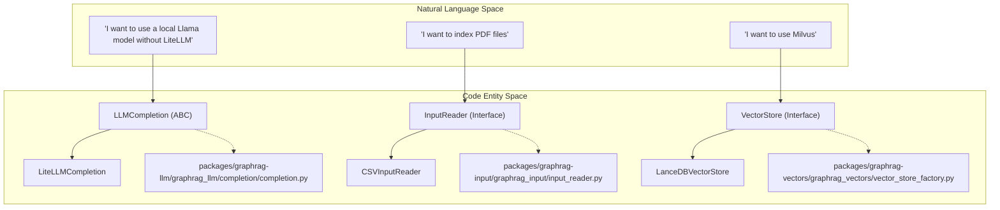
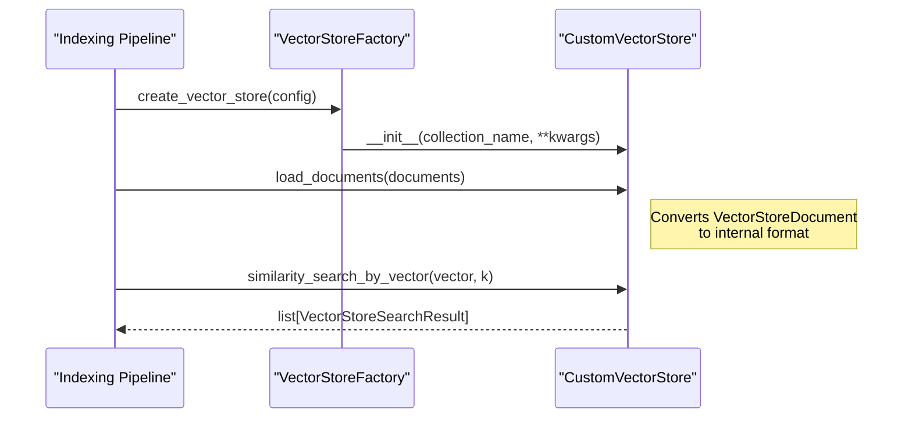

<!-- source: DeepWiki mcp.deepwiki.com · repo microsoft/graphrag · page 12.7 Extending GraphRAG · fetched 2026-10-26 -->

# Extending GraphRAG

<details>
<summary>Relevant source files</summary>

The following files were used as context for generating this wiki page:

- [docs/config/yaml.md](docs/config/yaml.md)
- [docs/index/architecture.md](docs/index/architecture.md)
- [docs/index/inputs.md](docs/index/inputs.md)
- [packages/graphrag-llm/graphrag_llm/completion/completion.py](packages/graphrag-llm/graphrag_llm/completion/completion.py)
- [packages/graphrag-llm/graphrag_llm/completion/lite_llm_completion.py](packages/graphrag-llm/graphrag_llm/completion/lite_llm_completion.py)
- [packages/graphrag-llm/graphrag_llm/completion/mock_llm_completion.py](packages/graphrag-llm/graphrag_llm/completion/mock_llm_completion.py)
- [packages/graphrag-llm/notebooks/03_structured_responses.ipynb](packages/graphrag-llm/notebooks/03_structured_responses.ipynb)
- [tests/integration/language_model/test_factory.py](tests/integration/language_model/test_factory.py)

</details>


This page documents how to extend GraphRAG by implementing custom components that integrate with the system's factory-based architecture. GraphRAG provides well-defined extension points for storage backends, vector stores, and language model providers.

## Extension Points Overview

GraphRAG uses a factory pattern with registration-based extensibility across several subsystems. Each factory maintains a registry of component types that can be instantiated from configuration.

### Extension Points and Factories
The following subsystems support deep customization through the provider/factory pattern:

| Subsystem | Factory / Provider | Purpose |
|-----------|--------------------|---------|
| **Language Model** | `completion_factory.py` / `LLMCompletion` | Implement custom completion providers beyond LiteLLM [packages/graphrag-llm/graphrag_llm/completion/completion.py:34-35](), [docs/index/architecture.md:43-43]() |
| **Language Model** | `embedding_factory.py` / `LLMEmbedding` | Implement custom embedding models [docs/index/architecture.md:43-43](), [tests/integration/language_model/test_factory.py:74-74]() |
| **Input Reader** | `InputReaderFactory` | Support custom file formats beyond text, CSV, JSON, etc [docs/index/architecture.md:44-44](), [docs/index/inputs.md:23-25]() |
| **Storage** | `TableProviderFactory` | Create storage providers for structured DataFrames [docs/index/architecture.md:47-47]() |
| **Vector Store** | `VectorStoreFactory` | Implement custom vector store backends [docs/index/architecture.md:48-48]() |
| **Workflows** | `WorkflowFactory` | Register custom indexing workflow steps or entire pipelines [docs/index/architecture.md:49-49]() |

### Natural Language to Code Entity Mapping
The following diagram bridges conceptual extension points to specific classes and files in the codebase.

**Code Entity Space Mapping**

**Sources:** [docs/index/architecture.md:37-53](), [packages/graphrag-llm/graphrag_llm/completion/completion.py:34-35](), [packages/graphrag-llm/graphrag_llm/completion/lite_llm_completion.py:45-45]()

## Custom Language Model Providers

While GraphRAG uses [LiteLLM](https://docs.litellm.ai/) by default to support 100+ model providers [docs/config/yaml.md:46-47](), you can implement a custom provider by inheriting from the abstract base classes.

### Implementing LLMCompletion
To create a custom chat completion provider, you must implement the `LLMCompletion` interface [packages/graphrag-llm/graphrag_llm/completion/completion.py:34-35]().

| Method | Parameters | Purpose |
|--------|------------|---------|
| `completion` | `messages, response_format, stream, **kwargs` | Synchronous chat completion [packages/graphrag-llm/graphrag_llm/completion/completion.py:81-85]() |
| `completion_async` | `messages, response_format, stream, **kwargs` | Asynchronous chat completion [packages/graphrag-llm/graphrag_llm/completion/completion.py:123-127]() |

**Provider Registration Example:**
```python
from graphrag_llm.completion import register_completion
register_completion("custom_chat", CustomChatModel)
```
**Sources:** [tests/integration/language_model/test_factory.py:34-71](), [packages/graphrag-llm/graphrag_llm/completion/completion.py:34-161]()

### Structured Responses
Custom providers should handle the `response_format` parameter, which accepts a Pydantic `BaseModel` for parsing structured outputs [packages/graphrag-llm/graphrag_llm/completion/completion.py:93-95](). Note that streaming is typically not supported when a structured response format is requested [packages/graphrag-llm/graphrag_llm/completion/lite_llm_completion.py:143-145]().

**Sources:** [packages/graphrag-llm/notebooks/03_structured_responses.ipynb:10-10](), [packages/graphrag-llm/graphrag_llm/completion/lite_llm_completion.py:143-145]()

## Custom Vector Stores

Vector stores are responsible for persisting and searching embeddings. All implementations are registered via the `VectorStoreFactory`.

### Vector Store Data Flow
The following diagram illustrates the interaction between the indexing pipeline and a `VectorStore` implementation.

**VectorStore Data Flow**


### Implementation Requirements
- **Configuration**: Components are typically configured via the `vector_store` block in `settings.yaml` [docs/config/yaml.md:126-133]().
- **Search**: Must support `similarity_search_by_vector` and optionally `similarity_search_by_text` [docs/index/architecture.md:48-48]().
- **Metadata**: Support for `VectorStoreDocument` which includes `id`, `text`, `vector`, and `attributes` (metadata) [docs/index/architecture.md:48-48]().

**Sources:** [docs/index/architecture.md:37-53](), [docs/config/yaml.md:126-133]()

## Custom Input Readers

If your data is in a format not supported by the built-in readers (Text, CSV, JSON, JSONL, Parquet, MarkItDown), you can implement an `InputReader` [docs/index/inputs.md:23-25]().

### Input Reader Logic
1. Inherit from `InputReader`.
2. Implement the logic to parse your file format into a standard `documents` DataFrame [docs/index/inputs.md:7-15]().
3. Register the class with `InputReaderFactory` [docs/index/inputs.md:23-25]().

The resulting DataFrame must conform to the following schema:
| Column | Type | Description |
|--------|------|-------------|
| `id` | str | Hash-based stable ID [docs/index/inputs.md:11-11]() |
| `text` | str | Full document content [docs/index/inputs.md:12-12]() |
| `title` | str | Document name [docs/index/inputs.md:13-13]() |
| `raw_data` | dict | Optional metadata for chunking [docs/index/inputs.md:15-15]() |

**Sources:** [docs/index/inputs.md:5-25](), [docs/index/architecture.md:44-44]()

## Summary of Extension Steps

1. **Define the Class**: Inherit from the appropriate base class (e.g., `LLMCompletion`, `InputReader`, `VectorStore`).
2. **Implement Abstract Methods**: Ensure all required interface methods are implemented (e.g., `completion`, `load_documents`).
3. **Register the Provider**: Use the corresponding factory's registration method (e.g., `register_completion`, `register_vector_store`).
4. **Update Configuration**: Update your `settings.yaml` to use the new type name.
   ```yaml
   # Example for a custom LLM
   completion_models:
     default_completion_model:
       type: custom_chat
       model_provider: my_provider
   ```

**Sources:** [docs/index/architecture.md:37-53](), [tests/integration/language_model/test_factory.py:61-61](), [docs/config/yaml.md:29-34]()

---

