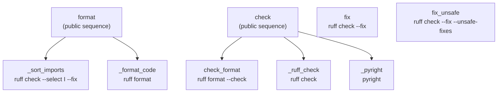
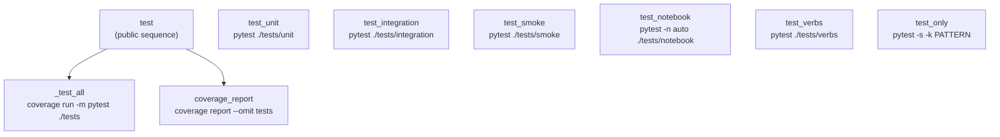
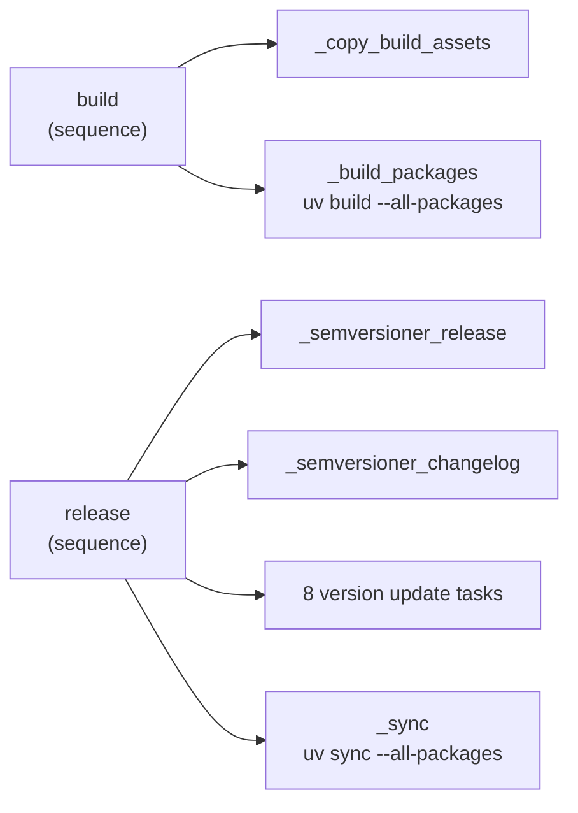
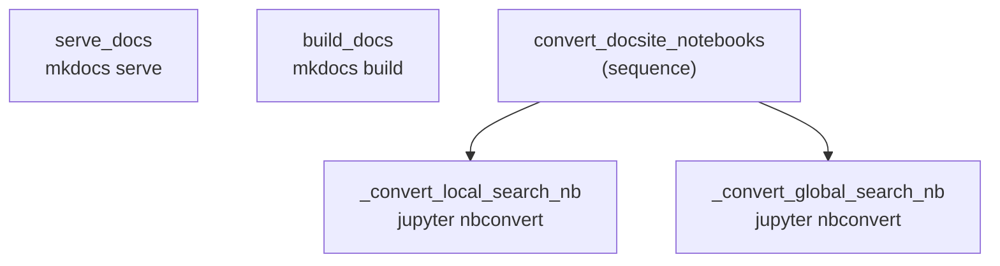

<!-- source: DeepWiki mcp.deepwiki.com · repo microsoft/graphrag · page 12.8 Task Automation with Poethepoet · fetched 2026-10-26 -->

# Task Automation with Poethepoet

Relevant source files

The following files were used as context for generating this wiki page:

- [.github/workflows/gh-pages.yml](.github/workflows/gh-pages.yml)
- [.github/workflows/python-integration-tests.yml](.github/workflows/python-integration-tests.yml)
- [.github/workflows/python-notebook-tests.yml](.github/workflows/python-notebook-tests.yml)
- [.github/workflows/python-smoke-tests.yml](.github/workflows/python-smoke-tests.yml)
- [.github/workflows/semver.yml](.github/workflows/semver.yml)
- [.github/workflows/spellcheck.yml](.github/workflows/spellcheck.yml)
- [CHANGELOG.md](CHANGELOG.md)
- [docs/developing.md](docs/developing.md)
- [packages/graphrag-cache/pyproject.toml](packages/graphrag-cache/pyproject.toml)
- [packages/graphrag-chunking/pyproject.toml](packages/graphrag-chunking/pyproject.toml)
- [pyproject.toml](pyproject.toml)

GraphRAG uses Poethepoet (`poe`) as its task automation system to provide a consistent interface for development, testing, building, and release operations across the monorepo. This document describes the available tasks, their organization, and common usage patterns.

For information about the broader development environment setup, see [Development Environment Setup](#12.2). For CI/CD automation that runs these tasks, see [CI/CD Pipeline](#12.4).

## Overview

Poethepoet is a Python task runner that provides a simpler alternative to Make or shell scripts. GraphRAG defines all tasks in the root `pyproject.toml` file [pyproject.toml:66-145](). Tasks are invoked using the `uv run poe` command as described in the development guide [docs/developing.md:43-63]().

The task system serves several purposes:
- **Standardization**: Consistent interface for common operations across the team.
- **Documentation**: Self-documenting commands with clear names in `pyproject.toml`.
- **Automation**: Complex multi-step workflows (like releases) automated as single commands.
- **Abstraction**: Hide implementation details of underlying tools like `ruff`, `pytest`, `semversioner`, or `nbconvert`.

Sources: [pyproject.toml:66-145](), [docs/developing.md:43-63]()

## Task Categories

Tasks are organized into functional categories, with private (implementation) tasks prefixed with underscore and public (user-facing) tasks exposed directly.

### Code Quality Tasks

This category handles linting, formatting, and type checking to maintain code standards.

**Code Quality Flow**

**Public Tasks:**
- `format`: Sorts imports and formats code using Ruff [pyproject.toml:134-136]().
- `check`: Validates formatting, linting, and type checking [pyproject.toml:138-140]().
- `check_format`: Verifies code is properly formatted without changes [pyproject.toml:88]().
- `fix`: Auto-fixes linting issues [pyproject.toml:89]().
- `fix_unsafe`: Auto-fixes including unsafe transformations [pyproject.toml:90]().

**Private Tasks:**
- `_sort_imports`: Runs Ruff import sorting [pyproject.toml:67]().
- `_format_code`: Runs Ruff code formatting [pyproject.toml:68]().
- `_ruff_check`: Runs Ruff linter [pyproject.toml:69]().
- `_pyright`: Runs Pyright type checker [pyproject.toml:70]().

Sources: [pyproject.toml:67-70](), [pyproject.toml:88-90](), [pyproject.toml:134-140]()

### Testing Tasks

The testing suite is divided into unit, integration, smoke, and specialized tests (notebooks/verbs). These tasks are frequently used in GitHub Actions workflows [python-smoke-tests.yml:90](), [python-notebook-tests.yml:75](), and [python-integration-tests.yml:95]().

**Testing Hierarchy**

**Public Tasks:**
- `test`: Runs all tests with coverage reporting [pyproject.toml:142-144]().
- `test_unit`: Runs unit tests only [pyproject.toml:92]().
- `test_integration`: Runs integration tests only [pyproject.toml:93]().
- `test_smoke`: Runs smoke tests only [pyproject.toml:94]().
- `test_notebook`: Runs notebook tests in parallel [pyproject.toml:95]().
- `test_verbs`: Runs workflow verb tests [pyproject.toml:96]().
- `test_only`: Runs tests matching a specific pattern [pyproject.toml:103]().
- `coverage_report`: Displays coverage report [pyproject.toml:87]().

Sources: [pyproject.toml:87-96](), [pyproject.toml:103](), [pyproject.toml:142-144](), [python-smoke-tests.yml:90]()

### Build and Release Tasks

These tasks manage the lifecycle of the monorepo packages, including versioning via `semversioner`.

**Build and Release Pipeline**

**Public Tasks:**
- `build`: Copies build assets and builds all packages [pyproject.toml:109-110]().
- `release`: Complete release workflow with versioning [pyproject.toml:112-128](). This sequence automates version updates across the monorepo packages.
- `semversioner_add`: Adds a new changelog entry [pyproject.toml:86]().

**Private Tasks:**
- `_copy_build_assets`: Copies required assets for build via `scripts.copy_build_assets` [pyproject.toml:73]().
- `_build_packages`: Builds all workspace packages using `uv build --all-packages` [pyproject.toml:106]().
- `_semversioner_release`: Creates new semantic version using `semversioner release` [pyproject.toml:74]().
- `_semversioner_changelog`: Generates `CHANGELOG.md` [pyproject.toml:75]().
- `_semversioner_update_*_toml_version`: Updates version in each package (e.g., `graphrag-llm`, `graphrag-storage`) using `update-toml` [pyproject.toml:77-84]().
- `_semversioner_update_workspace_dependency_versions`: Updates internal dependencies via `scripts.update_workspace_dependency_versions` [pyproject.toml:85]().
- `_sync`: Synchronizes all package dependencies using `uv sync` [pyproject.toml:107]().

Sources: [pyproject.toml:73-86](), [pyproject.toml:106-107](), [pyproject.toml:109-128]()

### CLI Interface Tasks

These tasks provide direct access to GraphRAG CLI commands for development within the monorepo context.

| Task | Command | Purpose |
|------|---------|---------|
| `index` | `python -m graphrag index` | Run indexing pipeline [pyproject.toml:97]() |
| `update` | `python -m graphrag update` | Run incremental update [pyproject.toml:98]() |
| `init` | `python -m graphrag init` | Initialize new project [pyproject.toml:99]() |
| `query` | `python -m graphrag query` | Run query operation [pyproject.toml:100]() |
| `prompt_tune` | `python -m graphrag prompt-tune` | Tune prompts [pyproject.toml:101]() |

Sources: [pyproject.toml:97-101](), [docs/developing.md:19-29]()

### Documentation Tasks

Manages the documentation site generation and notebook conversion. The `build_docs` task is used in the GitHub Pages deployment workflow [gh-pages.yml:38]().

**Documentation Workflow**

**Public Tasks:**
- `serve_docs`: Starts local documentation server using `mkdocs serve` [pyproject.toml:104]().
- `build_docs`: Builds documentation site using `mkdocs build` [pyproject.toml:105]().
- `convert_docsite_notebooks`: Converts example notebooks to markdown for the documentation site [pyproject.toml:130-132]().

**Private Tasks:**
- `_convert_local_search_nb`: Converts local search notebook to markdown [pyproject.toml:71]().
- `_convert_global_search_nb`: Converts global search notebook to markdown [pyproject.toml:72]().

Sources: [pyproject.toml:71-72](), [pyproject.toml:104-105](), [pyproject.toml:130-132](), [gh-pages.yml:38]()

## Version Update Task Chain

The release process updates version numbers across all 8 packages in the monorepo to maintain synchronization.

**Version Sync Logic**

```mermaid
graph TB
    _semversioner_release["_semversioner_release<br/>semversioner release"]
    _semversioner_changelog["_semversioner_changelog<br/>semversioner changelog"]
    
    subgraph "Update Package Versions (update-toml)"
        update1["_semversioner_update_graphrag_toml_version"]
        update2["_semversioner_update_graphrag_common_toml_version"]
        update3["_semversioner_update_graphrag_chunking_toml_version"]
        update4["_semversioner_update_graphrag_input_toml_version"]
        update5["_semversioner_update_graphrag_storage_toml_version"]
        update6["_semversioner_update_graphrag_cache_toml_version"]
        update7["_semversioner_update_graphrag_vectors_toml_version"]
        update8["_semversioner_update_graphrag_llm_toml_version"]
    end
    
    _semversioner_update_workspace["_semversioner_update_workspace_dependency_versions<br/>scripts.update_workspace_dependency_versions"]
    _sync["_sync<br/>uv sync --all-packages"]
    
    _semversioner_release --> _semversioner_changelog
    _semversioner_changelog --> update1
    _semversioner_changelog --> update2
    _semversioner_changelog --> update3
    _semversioner_changelog --> update4
    _semversioner_changelog --> update5
    _semversioner_changelog --> update6
    _semversioner_changelog --> update7
    _semversioner_changelog --> update8
    
    update1 --> _semversioner_update_workspace
    update2 --> _semversioner_update_workspace
    update3 --> _semversioner_update_workspace
    update4 --> _semversioner_update_workspace
    update5 --> _semversioner_update_workspace
    update6 --> _semversioner_update_workspace
    update7 --> _semversioner_update_workspace
    update8 --> _semversioner_update_workspace
    
    _semversioner_update_workspace --> _sync
```

Each package version update task uses `update-toml` to modify the `project.version` field based on the output of `uv run semversioner current-version` [pyproject.toml:77-84]().

Sources: [pyproject.toml:77-86](), [pyproject.toml:112-127]()

## Complete Task Reference

### Code Quality and Formatting

| Task | Type | Description |
|------|------|-------------|
| `format` | Sequence | Sort imports and format code using Ruff |
| `check` | Sequence | Run all quality checks (format, lint, types) |
| `check_format` | Command | Verify code is formatted correctly via `ruff format --check` |
| `fix` | Command | Auto-fix linting issues via `ruff check --fix` |
| `fix_unsafe` | Command | Auto-fix including unsafe changes via `ruff check --fix --unsafe-fixes` |

### Testing

| Task | Type | Description |
|------|------|-------------|
| `test` | Sequence | Run all tests with coverage |
| `test_unit` | Command | Run unit tests in `./tests/unit` |
| `test_integration` | Command | Run integration tests in `./tests/integration` |
| `test_smoke` | Command | Run smoke tests in `./tests/smoke` |
| `test_notebook` | Command | Run notebook tests in parallel using `pytest-xdist` |
| `test_verbs` | Command | Run workflow verb tests in `./tests/verbs` |
| `test_only` | Command | Run tests matching pattern (takes `-k` argument) |

### Build and Release

| Task | Type | Description |
|------|------|-------------|
| `build` | Sequence | Copy assets and build all packages into `dist/` |
| `release` | Sequence | Complete release workflow including version bumps |
| `semversioner_add` | Command | Add changelog entry for semantic versioning |
| `_sync` | Command | Sync all package dependencies via `uv sync` |

Sources: [pyproject.toml:66-145](), [docs/developing.md:43-63]()

---

