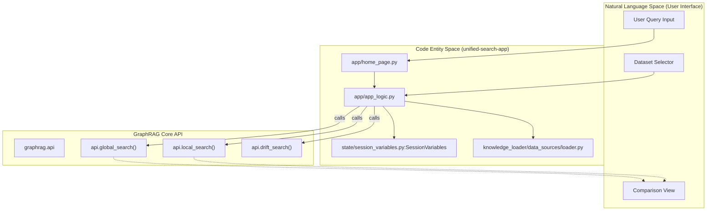
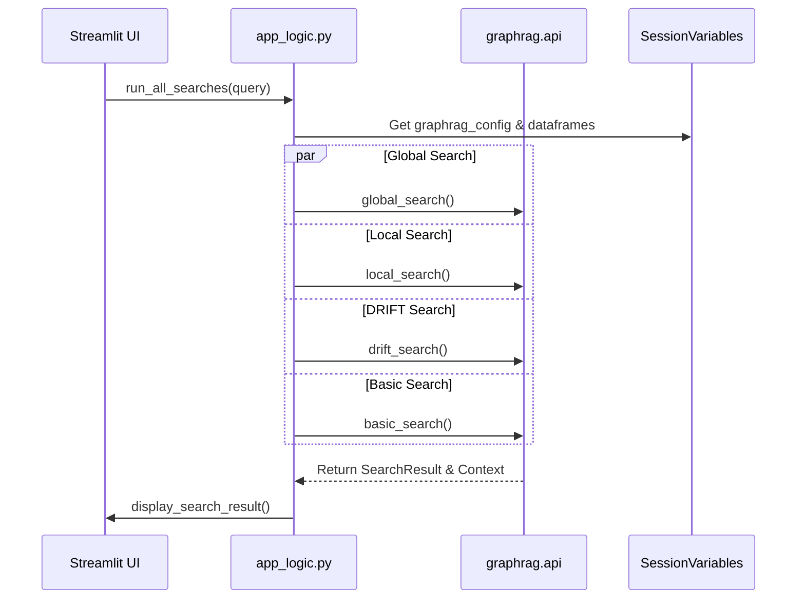

<!-- source: DeepWiki mcp.deepwiki.com · repo microsoft/graphrag · page 12.9 Unified Search App · fetched 2026-10-26 -->

# Unified Search App

<details>
<summary>Relevant source files</summary>

The following files were used as context for generating this wiki page:

- [docs/examples_notebooks/api_overview.ipynb](docs/examples_notebooks/api_overview.ipynb)
- [docs/examples_notebooks/input_documents.ipynb](docs/examples_notebooks/input_documents.ipynb)
- [packages/graphrag/graphrag/index/workflows/create_final_documents.py](packages/graphrag/graphrag/index/workflows/create_final_documents.py)
- [tests/verbs/test_create_community_reports.py](tests/verbs/test_create_community_reports.py)
- [unified-search-app/.vsts-ci.yml](unified-search-app/.vsts-ci.yml)
- [unified-search-app/Dockerfile](unified-search-app/Dockerfile)
- [unified-search-app/README.md](unified-search-app/README.md)
- [unified-search-app/app/app_logic.py](unified-search-app/app/app_logic.py)
- [unified-search-app/pyproject.toml](unified-search-app/pyproject.toml)

</details>


The **Unified Search App** is a Streamlit-based demonstration application designed to provide a side-by-side comparison of different GraphRAG search strategies. It allows users to evaluate the performance and context retrieval of Global, Local, DRIFT, and Basic search methods against the same dataset in a unified interface.

## Overview and Purpose

The application serves as a benchmark and visualization tool for GraphRAG indexing outputs. It supports multiple datasets, interactive question generation, and a "Community Explorer" for inspecting the hierarchical clusters generated during the indexing process.

Key features include:
*   **Multi-Strategy Comparison**: Execute queries across Local, Global, DRIFT, and Basic RAG simultaneously [unified-search-app/app/app_logic.py:67-102]().
*   **Dataset Management**: Switch between different GraphRAG projects defined in a `listing.json` file [unified-search-app/README.md:20-37]().
*   **Question Suggestion**: Uses Global Search to analyze the dataset and suggest relevant thematic questions [unified-search-app/app/app_logic.py:121-145]().
*   **Community Explorer**: A dedicated UI tab for browsing community reports and their associated findings [unified-search-app/README.md:108-109]().

---

## System Architecture and Data Flow

The app acts as a wrapper around the `graphrag.api` [unified-search-app/app/app_logic.py:10](). It manages state through a `SessionVariables` class and interacts with data sources (local or Azure Blob Storage) via a custom `knowledge_loader`.

### Component Interaction Diagram

This diagram illustrates how the Streamlit UI interacts with the GraphRAG API and the underlying data storage.

**UI to Code Entity Space Mapping**


**Sources:** [unified-search-app/app/app_logic.py:29-47](), [unified-search-app/app/app_logic.py:67-102](), [unified-search-app/README.md:89-109]()

---

## Data Configuration

The app requires a specific directory structure and a `listing.json` file to identify available indexes.

### Dataset Listing Format
The `listing.json` file must be placed in the root of your data directory.

| Field | Description |
| :--- | :--- |
| `key` | Unique identifier for the dataset (used in URL params) [unified-search-app/README.md:25]() |
| `path` | Relative path to the folder containing GraphRAG outputs [unified-search-app/README.md:26]() |
| `name` | Display name in the UI [unified-search-app/README.md:27]() |
| `description` | Summary of the dataset content [unified-search-app/README.md:28]() |
| `community_level` | The hierarchy level to use for community-based searches [unified-search-app/README.md:29]() |

**Sources:** [unified-search-app/README.md:23-37]()

### Storage Options
1.  **Local Storage**: Set the `DATA_ROOT` environment variable to the absolute path of your projects folder [unified-search-app/README.md:71-74]().
2.  **Azure Blob Storage**: Configure `BLOB_ACCOUNT_NAME` and `BLOB_CONTAINER_NAME` (defaults to `data`). The app uses `az login` credentials [unified-search-app/README.md:76-83]().

---

## Implementation Details

### Search Execution Flow
The app leverages Python's `asyncio` to run multiple search types in parallel when a user submits a query.


**Sources:** [unified-search-app/app/app_logic.py:67-102](), [unified-search-app/app/app_logic.py:147-198]()

### Key Functions
*   `initialize()`: Sets up the Streamlit page configuration, initializes the `SessionVariables`, and loads the initial dataset listing into session state [unified-search-app/app/app_logic.py:29-47]().
*   `load_dataset(dataset, sv)`: Updates the current dataset in `SessionVariables`, creates a datasource, and reads the `settings.yaml` [unified-search-app/app/app_logic.py:50-60]().
*   `run_global_search_question_generation(query, sv)`: Executes a global search with a specific prompt to extract thematic questions from the community reports, using `api.global_search` with `dynamic_community_selection=True` [unified-search-app/app/app_logic.py:121-145]().
*   `run_local_search(query, sv)`: Orchestrates the local search call, passing entities, communities, community reports, text units, relationships, and covariates to `api.local_search` [unified-search-app/app/app_logic.py:147-198]().

### Integration with Indexing Artifacts
The application consumes Parquet files generated by the indexing pipeline. For example, it utilizes `community_reports.parquet` to populate the Community Explorer and provide context for global searches [docs/examples_notebooks/api_overview.ipynb:123-125](), [tests/verbs/test_create_community_reports.py:58]().

**Sources:** [unified-search-app/app/app_logic.py:128-137](), [unified-search-app/app/app_logic.py:163-174](), [packages/graphrag/graphrag/index/workflows/create_final_documents.py:15]()

---

## Setup and Deployment

### Requirements
*   Python 3.11 [unified-search-app/README.md:7](), [unified-search-app/pyproject.toml:9]()
*   `uv` for dependency management [unified-search-app/README.md:8]()

### Installation
```bash
# Clone the repository
git clone https://github.com/microsoft/graphrag.git
cd graphrag/unified-search-app

# Sync dependencies
uv sync

# Start the application
uv run poe start
```
**Sources:** [unified-search-app/README.md:87-89](), [unified-search-app/pyproject.toml:39-41]()

### Docker and CI/CD
The application includes a `Dockerfile` based on the Oryx Python 3.11 image [unified-search-app/Dockerfile:5](). It uses `uv sync` to build the environment and exposes port 8501 [unified-search-app/Dockerfile:15-18]().

The repository also provides an Azure DevOps pipeline configuration (`.vsts-ci.yml`) that automates the build and push of the Docker image to a container registry and restarts the associated Azure App Service [unified-search-app/.vsts-ci.yml:29-41]().

**Sources:** [unified-search-app/Dockerfile:1-19](), [unified-search-app/.vsts-ci.yml:15-41]()

---

