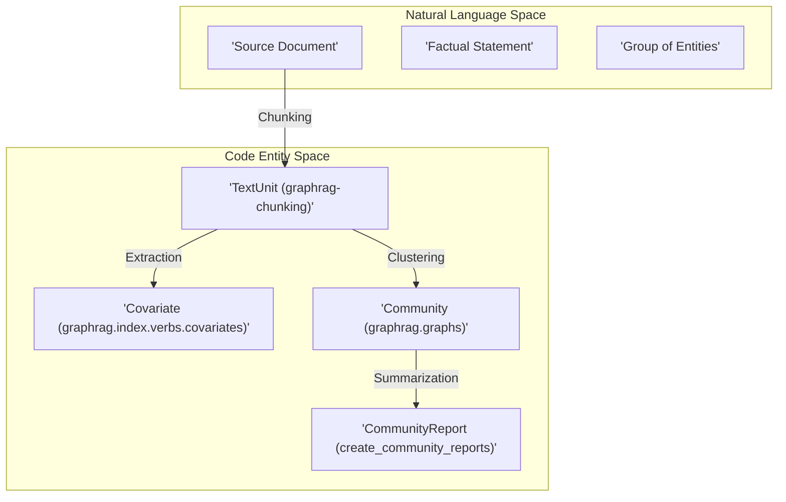
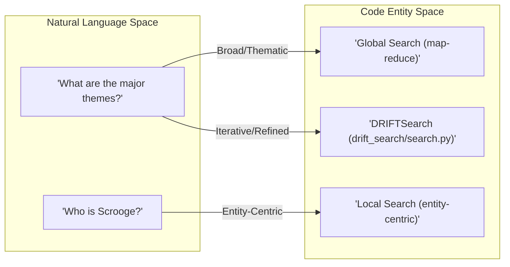

<!-- source: DeepWiki mcp.deepwiki.com · repo microsoft/graphrag · page 13 Glossary · fetched 2026-10-26 -->

# Glossary

Relevant source files

The following files were used as context for generating this wiki page:

- [CHANGELOG.md](CHANGELOG.md)
- [dictionary.txt](dictionary.txt)
- [docs/blog_posts.md](docs/blog_posts.md)
- [docs/config/models.md](docs/config/models.md)
- [docs/get_started.md](docs/get_started.md)
- [docs/index/overview.md](docs/index/overview.md)
- [docs/prompt_tuning/manual_prompt_tuning.md](docs/prompt_tuning/manual_prompt_tuning.md)
- [docs/query/drift_search.md](docs/query/drift_search.md)
- [docs/query/global_search.md](docs/query/global_search.md)
- [docs/query/local_search.md](docs/query/local_search.md)
- [docs/query/question_generation.md](docs/query/question_generation.md)
- [docs/visualization_guide.md](docs/visualization_guide.md)
- [mkdocs.yaml](mkdocs.yaml)
- [packages/graphrag-cache/pyproject.toml](packages/graphrag-cache/pyproject.toml)
- [packages/graphrag-chunking/pyproject.toml](packages/graphrag-chunking/pyproject.toml)
- [packages/graphrag-storage/graphrag_storage/tables/table_provider_config.py](packages/graphrag-storage/graphrag_storage/tables/table_provider_config.py)
- [packages/graphrag-storage/graphrag_storage/tables/table_provider_factory.py](packages/graphrag-storage/graphrag_storage/tables/table_provider_factory.py)
- [packages/graphrag-storage/graphrag_storage/tables/table_type.py](packages/graphrag-storage/graphrag_storage/tables/table_type.py)
- [packages/graphrag-vectors/graphrag_vectors/azure_ai_search.py](packages/graphrag-vectors/graphrag_vectors/azure_ai_search.py)
- [packages/graphrag-vectors/graphrag_vectors/cosmosdb.py](packages/graphrag-vectors/graphrag_vectors/cosmosdb.py)
- [packages/graphrag-vectors/graphrag_vectors/lancedb.py](packages/graphrag-vectors/graphrag_vectors/lancedb.py)
- [packages/graphrag-vectors/graphrag_vectors/vector_store.py](packages/graphrag-vectors/graphrag_vectors/vector_store.py)
- [packages/graphrag/graphrag/index/run/run_pipeline.py](packages/graphrag/graphrag/index/run/run_pipeline.py)
- [packages/graphrag/graphrag/index/run/utils.py](packages/graphrag/graphrag/index/run/utils.py)
- [pyproject.toml](pyproject.toml)
- [tests/integration/storage/test_cosmosdb_storage.py](tests/integration/storage/test_cosmosdb_storage.py)

This glossary defines codebase-specific terms, jargon, abbreviations, and domain concepts used throughout the GraphRAG repository. It serves as a technical reference for onboarding engineers to understand how natural language concepts map to specific code entities and data structures.

## Core Concepts

### Text Unit
A **Text Unit** is the fundamental unit of analysis in the indexing pipeline. It represents a chunk of text extracted from a source document. Text units are used as the basis for entity extraction and embedding generation.
*   **Implementation**: Text units are created during the initial phases of the pipeline to break down large documents into manageable segments.
*   **Code Pointer**: The `graphrag-chunking` package provides the logic for splitting text [packages/graphrag-chunking/pyproject.toml:4](), while workflows like `create_final_text_units` finalize the data for storage [CHANGELOG.md:59]().
*   **Schema**: Includes fields for metadata, entity associations, and relationship links.

### Community
A **Community** is a cluster of related entities within the knowledge graph, typically detected using the Leiden algorithm. Communities allow the system to summarize information at different levels of granularity (hierarchical clustering).
*   **Implementation**: Generated via the community detection workflows using hierarchical clustering techniques [CHANGELOG.md:57]().
*   **Graph Logic**: Graph utilities were refactored to move from NetworkX to DataFrame-based implementations in the `graphrag.graphs` package [CHANGELOG.md:73]().

### Community Report
A **Community Report** is an LLM-generated summary of a specific community. It includes findings, a title, a summary, and a rank indicating the importance of the community.
*   **Implementation**: Community reports are generated by summarizing the entities and relationships within a cluster [docs/query/drift_search.md:18]().
*   **Context Building**: Reports are used as context for Global Search and DRIFT search strategies [docs/query/drift_search.md:25]().

### Covariate (Claim)
A **Covariate** (often referred to as a **Claim**) is a statement or factual assertion extracted from the text that is associated with an entity but may not be a direct relationship between two entities.
*   **Implementation**: Extracted using specific workflows to capture temporal or factual attributes that don't fit the standard Entity-Relationship model [dictionary.txt:149-150]().
*   **Extraction**: Handled during the graph extraction phase, supporting both LLM and NLP methods [CHANGELOG.md:37]().

---

## Technical Jargon & Abbreviations

| Term | Definition | Code/File Reference |
| :--- | :--- | :--- |
| **AOAI** | Azure OpenAI Service. | [dictionary.txt:139]() |
| **DRIFT** | Dynamic Reasoning and Inference with Flexible Traversal; a search strategy combining global and local retrieval. | [docs/query/drift_search.md:7]() |
| **Verb** | A discrete processing step or unit of work within a GraphRAG workflow. | [pyproject.toml:96]() |
| **Table Provider** | An abstraction for reading/writing dataframes (CSV, Parquet, CosmosDB). | [packages/graphrag-storage/graphrag_storage/tables/table_provider_factory.py:17-21]() |
| **PipelineRunContext** | The state object passed between workflows during an indexing run. | [packages/graphrag/graphrag/index/run/run_pipeline.py:23]() |
| **Gleanings** | Additional extraction passes to capture missed entities or relationships. | [CHANGELOG.md:159]() |

---

## System Mapping: Natural Language to Code Entity

The following diagrams illustrate how abstract concepts from the "Natural Language Space" map to specific "Code Entity Space" objects.

### Data Transformation Flow
This diagram shows how raw input text is transformed into the internal representations used by the GraphRAG system.

Title: Input Transformation Mapping

**Sources**: [packages/graphrag-chunking/pyproject.toml:4](), [CHANGELOG.md:57-59](), [CHANGELOG.md:73]().

### Query Execution Mapping
This diagram maps search intents to the specific search method implementations.

Title: Search Intent to Code Entity Mapping

**Sources**: [docs/get_started.md:113-124](), [docs/query/drift_search.md:7-15](), [packages/graphrag/graphrag/index/run/run_pipeline.py:100]().

---

## Infrastructure Components

### Storage & Table Providers
The system uses a `TableProvider` abstraction to support multiple storage backends for indexing artifacts.

*   **TableProviderFactory**: Registry and factory for creating table providers [packages/graphrag-storage/graphrag_storage/tables/table_provider_factory.py:17-21]().
*   **CosmosTableProvider**: Native Cosmos DB support with namespace partitioning and transactional batch writes [CHANGELOG.md:17](), [packages/graphrag-storage/graphrag_storage/tables/table_type.py:15]().
*   **CSVTableProvider**: Handles standard CSV-based artifact storage [CHANGELOG.md:66](), [packages/graphrag-storage/graphrag_storage/tables/table_type.py:14]().
*   **ParquetTableProvider**: Implementation for Parquet file storage [packages/graphrag-storage/graphrag_storage/tables/table_type.py:13]().

### Vector Stores
The `VectorStore` interface handles embedding storage and similarity search across different backends.
*   **LanceDB**: Local vector storage implementation [dictionary.txt:72]().
*   **Azure AI Search**: Cloud-based vector search implementation.
*   **Cosmos DB**: Support for vector search with DiskANN indexing [CHANGELOG.md:52]().

### LLM Interaction
LLM calls are abstracted through providers to support various models.
*   **LiteLLM Integration**: The primary bridge for chat and embedding model providers, allowing for OpenAI, Azure, and other backends [CHANGELOG.md:110](), [dictionary.txt:88]().
*   **Rate Limiting**: Managed through configuration to handle TPM (Tokens Per Minute) and RPM (Requests Per Minute) limits [CHANGELOG.md:131]().

**Sources**:
- [packages/graphrag/graphrag/index/run/run_pipeline.py:30-116]()
- [packages/graphrag-storage/graphrag_storage/tables/table_provider_factory.py:17-109]()
- [packages/graphrag-storage/graphrag_storage/tables/table_type.py:10-16]()
- [docs/query/drift_search.md:7-28]()
- [CHANGELOG.md:17-82]()
- [dictionary.txt:138-153]()