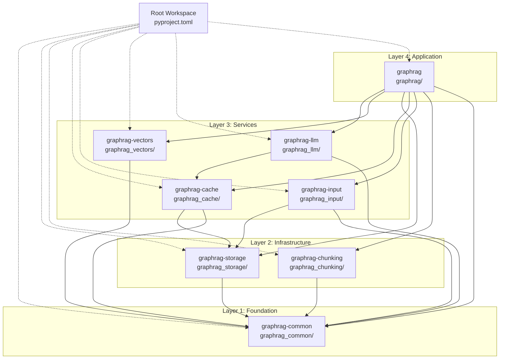
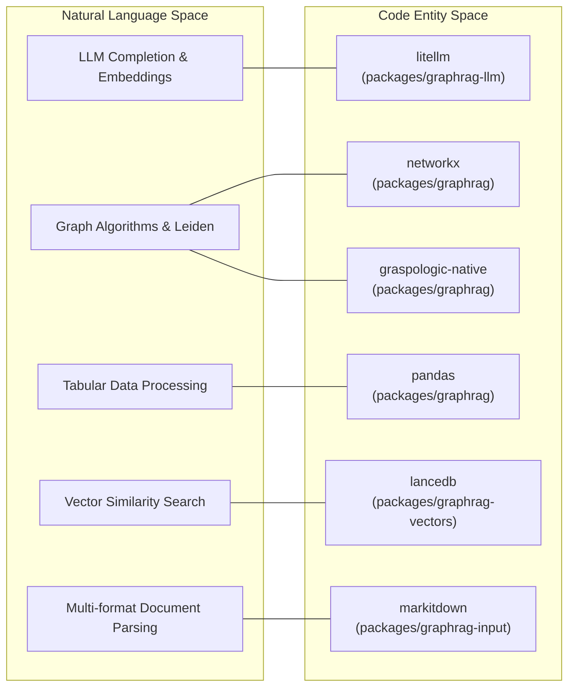

<!-- source: DeepWiki mcp.deepwiki.com · repo microsoft/graphrag · page 2 Monorepo Structure and Packages · fetched 2026-10-26 -->

# Monorepo Structure and Packages

<details>
<summary>Relevant source files</summary>

The following files were used as context for generating this wiki page:

- [CHANGELOG.md](CHANGELOG.md)
- [packages/graphrag-cache/pyproject.toml](packages/graphrag-cache/pyproject.toml)
- [packages/graphrag-chunking/pyproject.toml](packages/graphrag-chunking/pyproject.toml)
- [packages/graphrag-common/pyproject.toml](packages/graphrag-common/pyproject.toml)
- [packages/graphrag-input/pyproject.toml](packages/graphrag-input/pyproject.toml)
- [packages/graphrag-llm/pyproject.toml](packages/graphrag-llm/pyproject.toml)
- [packages/graphrag-storage/pyproject.toml](packages/graphrag-storage/pyproject.toml)
- [packages/graphrag-vectors/pyproject.toml](packages/graphrag-vectors/pyproject.toml)
- [packages/graphrag/pyproject.toml](packages/graphrag/pyproject.toml)
- [pyproject.toml](pyproject.toml)
- [uv.lock](uv.lock)

</details>


This document describes the GraphRAG monorepo organization, including workspace configuration, the eight specialized packages, their dependency hierarchy, and version management. It covers the technical structure managed by the [uv](https://github.com/astral-sh/uv) package manager and the build system.

For information about development workflows and CI/CD, see [Development Guide](#12). For configuration management, see [Configuration System](#3).

---

## Workspace Organization

GraphRAG uses a monorepo structure managed by UV, with a root workspace that coordinates eight specialized packages. The workspace is defined in [pyproject.toml:53-54]() using UV's workspace members feature.

### Root Workspace Configuration

```
graphrag-monorepo/
├── pyproject.toml              # Root workspace definition
├── packages/
│   ├── graphrag/               # Main package (CLI, Indexing, Query)
│   ├── graphrag-llm/           # LLM integration (LiteLLM)
│   ├── graphrag-vectors/       # Vector stores (LanceDB, Azure AI Search)
│   ├── graphrag-storage/       # Storage backends (Blob, Cosmos, File)
│   ├── graphrag-cache/         # Caching layer
│   ├── graphrag-input/         # Document loading (MarkItDown)
│   ├── graphrag-chunking/      # Text segmentation
│   └── graphrag-common/        # Shared utilities
├── tests/                      # Unit, integration, and smoke tests
├── examples_notebooks/         # Usage examples
└── uv.lock                     # Unified lockfile
```

The root workspace is marked as non-publishable with `package = false` at [pyproject.toml:51]() and declares workspace members at [pyproject.toml:54]() with `members = ["packages/*"]`. All packages use workspace references defined at [pyproject.toml:56-63]() using `{ workspace = true }` syntax.

**Sources**: [pyproject.toml:1-107](), [uv.lock:14-24]()

---

## Package Dependency Architecture

The monorepo follows a strict layered architecture where dependencies flow upward only, preventing circular dependencies.

### Dependency Layering Diagram



**Package Dependency Layers**

| Layer | Packages | Dependencies | Purpose |
|-------|----------|--------------|---------|
| Layer 1 | `graphrag-common` | None | Foundation utilities, types, YAML handling |
| Layer 2 | `graphrag-storage`, `graphrag-chunking` | `graphrag-common` | Storage backends, text segmentation |
| Layer 3 | `graphrag-cache`, `graphrag-input`, `graphrag-vectors`, `graphrag-llm` | Layers 1-2 | Specialized services and provider integrations |
| Layer 4 | `graphrag` | All packages | Main application, CLI, workflows, and NLP |

For details, see [Package Dependencies and Layering](#2.2).

**Sources**: [pyproject.toml:50-64](), [CHANGELOG.md:83-93]()

---

## Package Overview

This section provides a high-level summary of the packages. For a comprehensive list and detailed descriptions, see [Package Overview](#2.1).

### Foundation and Infrastructure
*   **graphrag-common**: Shared utilities for environment management (`python-dotenv`) and configuration parsing (`pyyaml`). [packages/graphrag-common/pyproject.toml:32-36]()
*   **graphrag-storage**: Abstractions for data persistence. Supports local file systems (`aiofiles`), Azure Blob Storage (`azure-storage-blob`), and Azure Cosmos DB (`azure-cosmos`). [packages/graphrag-storage/pyproject.toml:32-40]()
*   **graphrag-chunking**: Logic for splitting text into manageable units for indexing. [packages/graphrag-chunking/pyproject.toml:32-35]()

### Specialized Services
*   **graphrag-cache**: Implements response caching using the storage layer to reduce LLM costs and latency. [packages/graphrag-cache/pyproject.toml:33-36]()
*   **graphrag-input**: Document ingestion layer using `markitdown` to handle various file formats (PDF, JSON, etc.). [packages/graphrag-input/pyproject.toml:32-39]()
*   **graphrag-vectors**: Vector database integrations including `lancedb`, `azure-search-documents`, and `azure-cosmos` for vector similarity search. [packages/graphrag-vectors/pyproject.toml:32-42]()
*   **graphrag-llm**: The LLM interface layer built on `litellm`. Handles chat completions, embeddings, and provider-specific authentication. [packages/graphrag-llm/pyproject.toml:34-47]()

### Main Application
*   **graphrag**: The primary package containing the CLI (`graphrag.cli.main:app`), indexing workflows, and query engines (Global, Local, DRIFT). It integrates NLP libraries like `nltk`, `spacy`, and `textblob`, alongside graph processing via `networkx` and `graspologic-native`. [packages/graphrag/pyproject.toml:34-66]()

---

## External Dependencies

GraphRAG relies on several industry-standard libraries for its core functionality. For a detailed list and documentation of major external dependencies, see [External Dependencies](#2.3).

### Natural Language to Code Entity Mapping

The following diagram bridges system concepts to specific code-level dependencies.



**Sources**: [packages/graphrag/pyproject.toml:34-63](), [packages/graphrag-llm/pyproject.toml:41](), [packages/graphrag-vectors/pyproject.toml:38](), [packages/graphrag-input/pyproject.toml:36]()

---

## Version Management and Synchronization

All packages share a unified version number, currently `3.1.1`. This ensures compatibility across the monorepo.

### Version Synchronization Mechanism

The root workspace defines a `release` task at [pyproject.toml:112-127]() that synchronizes versions using `semversioner` and `update-toml`. Each package's `pyproject.toml` is updated via individual tasks such as `_semversioner_update_graphrag_toml_version` [pyproject.toml:77]().

### Workspace Dependency References

Packages reference each other using exact version pins. For example, the `graphrag` package depends on the other workspace members with strict equality:

```toml
dependencies = [
    "graphrag-cache==3.1.1",
    "graphrag-chunking==3.1.1",
    "graphrag-common==3.1.1",
    "graphrag-input==3.1.1",
    "graphrag-llm==3.1.1",
    "graphrag-storage==3.1.1",
    "graphrag-vectors==3.1.1",
]
```

**Sources**: [pyproject.toml:77-127](), [packages/graphrag/pyproject.toml:4-45](), [packages/graphrag-llm/pyproject.toml:3-39]()

---

## Build System Configuration

### Build Backend
All packages use **Hatchling** as the build backend, specified in the `[build-system]` section of their respective `pyproject.toml` files [packages/graphrag/pyproject.toml:72-73](), [packages/graphrag-llm/pyproject.toml:53-54]().

### Build Task
The root workspace defines a `build` task that executes `uv build --all-packages` [pyproject.toml:106-110]().

### Python Version Requirements
The monorepo requires Python `>=3.11,<3.14` [pyproject.toml:24](). Individual packages maintain similar constraints, though `graphrag-llm` supports `>=3.10` [packages/graphrag-llm/pyproject.toml:26]().

**Sources**: [pyproject.toml:24-110](), [packages/graphrag/pyproject.toml:72-73](), [packages/graphrag-llm/pyproject.toml:26]()

---

