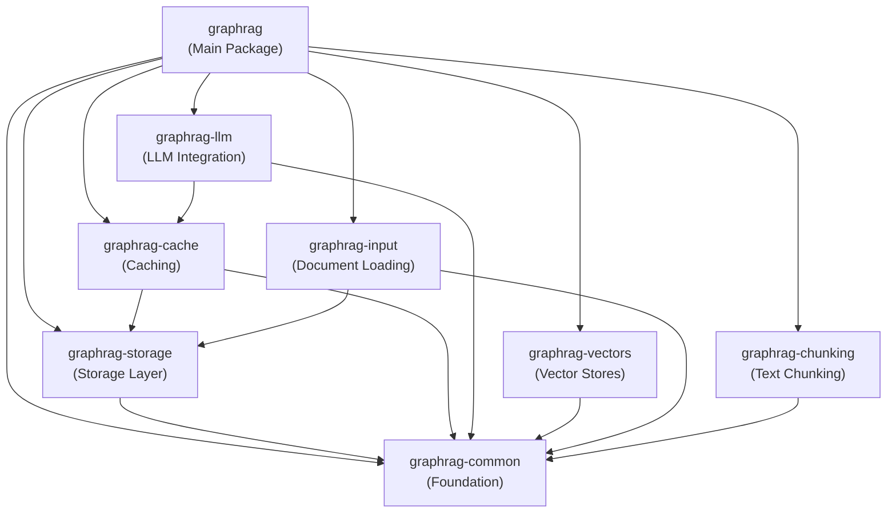
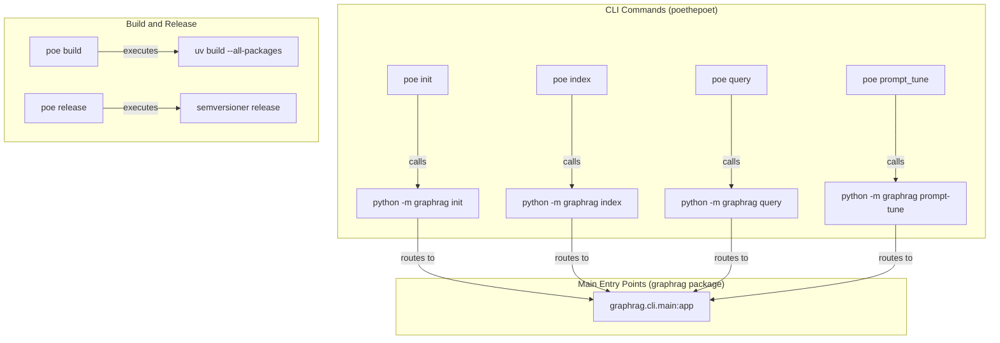

<!-- source: DeepWiki mcp.deepwiki.com · repo microsoft/graphrag · page 2.1 Package Overview · fetched 2026-10-26 -->

# Package Overview

Relevant source files

The following files were used as context for generating this wiki page:

- [CHANGELOG.md](CHANGELOG.md)
- [packages/graphrag-cache/pyproject.toml](packages/graphrag-cache/pyproject.toml)
- [packages/graphrag-chunking/pyproject.toml](packages/graphrag-chunking/pyproject.toml)
- [packages/graphrag-common/pyproject.toml](packages/graphrag-common/pyproject.toml)
- [packages/graphrag-input/pyproject.toml](packages/graphrag-input/pyproject.toml)
- [packages/graphrag-llm/pyproject.toml](packages/graphrag-llm/pyproject.toml)
- [packages/graphrag-storage/pyproject.toml](packages/graphrag-storage/pyproject.toml)
- [packages/graphrag-vectors/pyproject.toml](packages/graphrag-vectors/pyproject.toml)
- [packages/graphrag/pyproject.toml](packages/graphrag/pyproject.toml)
- [pyproject.toml](pyproject.toml)
- [uv.lock](uv.lock)

This page documents the eight packages that comprise the GraphRAG monorepo. Each package has a specific responsibility and is designed to be independently testable while working together to provide the complete GraphRAG system functionality.

For information about how these packages depend on each other and their architectural layering, see [Package Dependencies and Layering](). For details on external libraries used by these packages, see [External Dependencies]().

---

## Monorepo Structure

The GraphRAG codebase is organized as a monorepo with a root workspace and eight distinct packages located in the `packages/` directory. The workspace is managed using `uv` and defined in `[pyproject.toml:53-54]()`.

**Sources:** `[pyproject.toml:1-54]()`

---

## Package Summary

The following table provides an overview of all packages in the monorepo. All packages share a synchronized version, currently `3.1.1` following the latest release `[CHANGELOG.md:4-13]()`.

| Package Name | Directory | Version | Purpose | Python Version |
|-------------|-----------|---------|---------|----------------|
| `graphrag` | `packages/graphrag/` | 3.1.1 | Main orchestration package with CLI, API, and workflows | >=3.11,<3.14 |
| `graphrag-common` | `packages/graphrag-common/` | 3.1.1 | Shared utilities, types, and configuration loading | >=3.11,<3.14 |
| `graphrag-storage` | `packages/graphrag-storage/` | 3.1.1 | Storage abstraction for file, blob, and Cosmos DB backends | >=3.11,<3.14 |
| `graphrag-cache` | `packages/graphrag-cache/` | 3.1.1 | Caching layer for LLM responses and extraction results | >=3.11,<3.14 |
| `graphrag-llm` | `packages/graphrag-llm/` | 3.1.1 | LLM integration via LiteLLM with prompt management | >=3.10,<3.14 |
| `graphrag-vectors` | `packages/graphrag-vectors/` | 3.1.1 | Vector store abstractions for LanceDB, Azure AI, Cosmos | >=3.11,<3.14 |
| `graphrag-input` | `packages/graphrag-input/` | 3.1.1 | Document loading from various formats (CSV, JSON, text, PDF) | >=3.11,<3.14 |
| `graphrag-chunking` | `packages/graphrag-chunking/` | 3.1.1 | Text chunking utilities for document segmentation | >=3.11,<3.14 |

**Sources:** `[packages/graphrag/pyproject.toml:4-32]()`, `[packages/graphrag-common/pyproject.toml:3-31]()`, `[packages/graphrag-storage/pyproject.toml:3-31]()`, `[packages/graphrag-cache/pyproject.toml:3-32]()`, `[packages/graphrag-llm/pyproject.toml:3-33]()`, `[packages/graphrag-vectors/pyproject.toml:3-31]()`, `[packages/graphrag-input/pyproject.toml:3-31]()`, `[packages/graphrag-chunking/pyproject.toml:3-31]()`, `[CHANGELOG.md:4-13]()`

---

## Package Dependency Graph

This diagram illustrates the dependency relationships between packages. The `graphrag-common` package is the foundation with no internal dependencies. The `graphrag` package depends on all others and serves as the orchestration layer.

**Sources:** `[pyproject.toml:56-63]()`, `[packages/graphrag/pyproject.toml:34-63]()`

---

## Core Packages

### graphrag

**Location:** `packages/graphrag/`

The main `graphrag` package serves as the orchestration layer that brings together all other packages to provide the complete GraphRAG functionality. It contains:

- **CLI Interface**: Command-line interface exposed via the `graphrag` command, entry point defined at `[packages/graphrag/pyproject.toml:66]()`.
- **Python API**: Programmatic API for indexing and querying.
- **Workflow Orchestration**: Indexing pipeline workflows and search implementations.
- **Query Engine**: Multiple search strategies including Global, Local, DRIFT, and Basic.

**Key Dependencies:**
- All other graphrag packages (common, storage, cache, llm, vectors, input, chunking) `[packages/graphrag/pyproject.toml:39-45]()`.
- External libraries: `azure-identity`, `azure-search-documents`, `azure-storage-blob`, `networkx`, `pandas`, `pyarrow`, `spacy`, `nltk`, and `graspologic-native` `[packages/graphrag/pyproject.toml:35-63]()`.

**Primary Capabilities:**
- Document indexing pipeline execution.
- Knowledge graph construction and community detection using Leiden via `graspologic-native` `[packages/graphrag/pyproject.toml:49]()`.
- Multi-modal search operations.
- Incremental index updates.

**Sources:** `[packages/graphrag/pyproject.toml:1-73]()`

---

### graphrag-common

**Location:** `packages/graphrag-common/`

The `graphrag-common` package provides the foundational layer of shared utilities and types used across all other packages. It has minimal external dependencies and serves as the base layer in the package hierarchy.

**Key Dependencies:**
- `python-dotenv~=1.0` - Environment variable loading `[packages/graphrag-common/pyproject.toml:33]()`.
- `pyyaml~=6.0` - YAML configuration parsing `[packages/graphrag-common/pyproject.toml:34]()`.
- `toml~=0.10` - TOML file handling `[packages/graphrag-common/pyproject.toml:35]()`.

**Primary Capabilities:**
- Configuration file loading (YAML, TOML, environment variables).
- Shared type definitions and data structures.
- Common utility functions and logging infrastructure.

**Sources:** `[packages/graphrag-common/pyproject.toml:1-45]()`

---

## Infrastructure Packages

### graphrag-storage

**Location:** `packages/graphrag-storage/`

The `graphrag-storage` package provides an abstraction layer for storage operations. Recent updates introduced a native `CosmosTableProvider` with namespace partitioning and transactional batch writes `[CHANGELOG.md:17]()`.

**Key Dependencies:**
- `graphrag-common==3.1.1` `[packages/graphrag-storage/pyproject.toml:37]()`.
- `aiofiles~=25.1` - Async file I/O `[packages/graphrag-storage/pyproject.toml:33]()`.
- `azure-cosmos~=4.9`, `azure-storage-blob~=12.24` `[packages/graphrag-storage/pyproject.toml:34-36]()`.
- `pandas~=3.0` - DataFrame operations `[packages/graphrag-storage/pyproject.toml:38]()`.

**Primary Capabilities:**
- Storage interface abstraction.
- File system and Azure Blob Storage implementation.
- Azure Cosmos DB storage integration, including `CosmosTableProvider` `[CHANGELOG.md:17]()`.
- Table provider abstraction for structured data (CSV, Parquet).

**Sources:** `[packages/graphrag-storage/pyproject.toml:1-49]()`, `[CHANGELOG.md:17-68]()`

---

### graphrag-cache

**Location:** `packages/graphrag-cache/`

The `graphrag-cache` package implements caching strategies for expensive operations, particularly LLM API calls and extraction results.

**Key Dependencies:**
- `graphrag-common==3.1.1` `[packages/graphrag-cache/pyproject.toml:34]()`.
- `graphrag-storage==3.1.1` `[packages/graphrag-cache/pyproject.toml:35]()`.

**Primary Capabilities:**
- LLM response caching.
- Extraction result caching.
- JSON-based and in-memory cache implementations.

**Sources:** `[packages/graphrag-cache/pyproject.toml:1-44]()`

---

### graphrag-llm

**Location:** `packages/graphrag-llm/`

The `graphrag-llm` package provides the language model integration layer, supporting 100+ models through LiteLLM.

**Key Dependencies:**
- `graphrag-common==3.1.1`, `graphrag-cache==3.1.1` `[packages/graphrag-llm/pyproject.toml:38-39]()`.
- `litellm==1.92.0` - Unified LLM interface `[packages/graphrag-llm/pyproject.toml:41]()`.
- `jinja2~=3.1` - Prompt templating `[packages/graphrag-llm/pyproject.toml:40]()`.
- `pydantic~=2.10` - Request/response validation `[packages/graphrag-llm/pyproject.toml:45]()`.
- `fastapi` and `orjson` - Required for LiteLLM tool calling `[packages/graphrag-llm/pyproject.toml:37,44]()`.

**Primary Capabilities:**
- LiteLLM provider integration (OpenAI, Azure, Gemini, etc.).
- Prompt template management via Jinja2.
- Rate limiting, retry logic, and streaming support.
- Embedding model support.

**Sources:** `[packages/graphrag-llm/pyproject.toml:1-55]()`

---

### graphrag-vectors

**Location:** `packages/graphrag-vectors/`

The `graphrag-vectors` package provides vector store abstractions and implementations for similarity search operations.

**Key Dependencies:**
- `graphrag-common==3.1.1` `[packages/graphrag-vectors/pyproject.toml:37]()`.
- `azure-search-documents~=12.0`, `azure-cosmos~=4.9` `[packages/graphrag-vectors/pyproject.toml:34,36]()`.
- `lancedb~=0.34.0` - Local vector database `[packages/graphrag-vectors/pyproject.toml:38]()`.
- `numpy~=2.1`, `pyarrow~=25.0` `[packages/graphrag-vectors/pyproject.toml:39-40]()`.

**Primary Capabilities:**
- Vector store interface abstraction.
- LanceDB, Azure AI Search, and Cosmos DB implementations.
- Similarity search with filtering and metadata support.
- Dynamic vector size configuration and mismatch protection `[CHANGELOG.md:7,33]()`.

**Sources:** `[packages/graphrag-vectors/pyproject.toml:1-50]()`, `[CHANGELOG.md:7,33]()`

---

## Data Processing Packages

### graphrag-input

**Location:** `packages/graphrag-input/`

The `graphrag-input` package handles loading and parsing of input documents from various formats.

**Key Dependencies:**
- `graphrag-common==3.1.1`, `graphrag-storage==3.1.1` `[packages/graphrag-input/pyproject.toml:33-34]()`.
- `markitdown[pdf]~=0.1.0` - Multi-format document conversion `[packages/graphrag-input/pyproject.toml:36]()`.
- `pyarrow>=14.0.0` `[packages/graphrag-input/pyproject.toml:37]()`.

**Primary Capabilities:**
- Loading CSV, JSON, Parquet, and Plain Text documents.
- PDF document loading via `markitdown`.
- Async document iteration for pipeline workflows `[CHANGELOG.md:69]()`.
- Robust JSONL input loader that skips blank lines and invalid rows `[CHANGELOG.md:12]()`.

**Sources:** `[packages/graphrag-input/pyproject.toml:1-46]()`, `[CHANGELOG.md:12,69]()`

---

### graphrag-chunking

**Location:** `packages/graphrag-chunking/`

The `graphrag-chunking` package provides text segmentation utilities for breaking documents into processable units.

**Key Dependencies:**
- `graphrag-common==3.1.1` `[packages/graphrag-chunking/pyproject.toml:33]()`.
- `pydantic~=2.10` `[packages/graphrag-chunking/pyproject.toml:34]()`.

**Primary Capabilities:**
- Token-based text chunking with configurable size and overlap.
- Character-level and token-level splitting strategies.
- Type-annotated generators for `chunk_text` `[CHANGELOG.md:8]()`.

**Sources:** `[packages/graphrag-chunking/pyproject.toml:1-44]()`, `[CHANGELOG.md:8]()`

---

## Workspace Configuration and Automation

The monorepo uses `poethepoet` for task automation and `uv` for workspace management.

### CLI to Code Mapping

**Build Command:** `poe build` (executes `_copy_build_assets` and `_build_packages` tasks) `[pyproject.toml:109-111]()`.

**Release Command:** `poe release` (synchronizes versions across all packages using `semversioner` and `update-toml` for each specific `pyproject.toml` file) `[pyproject.toml:112-127]()`.

**Sources:** `[pyproject.toml:62-127]()`, `[uv.lock:13-24]()`

---

