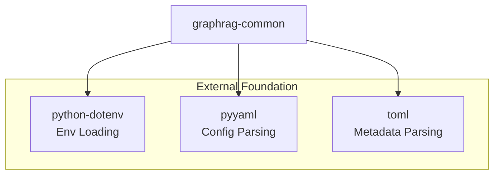
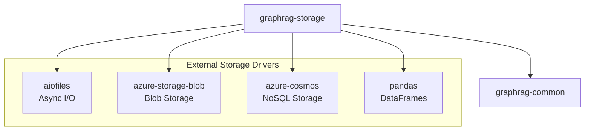
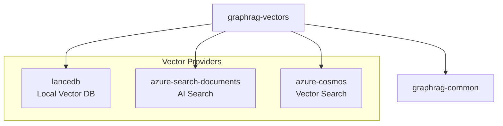
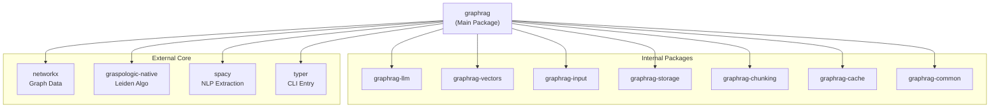
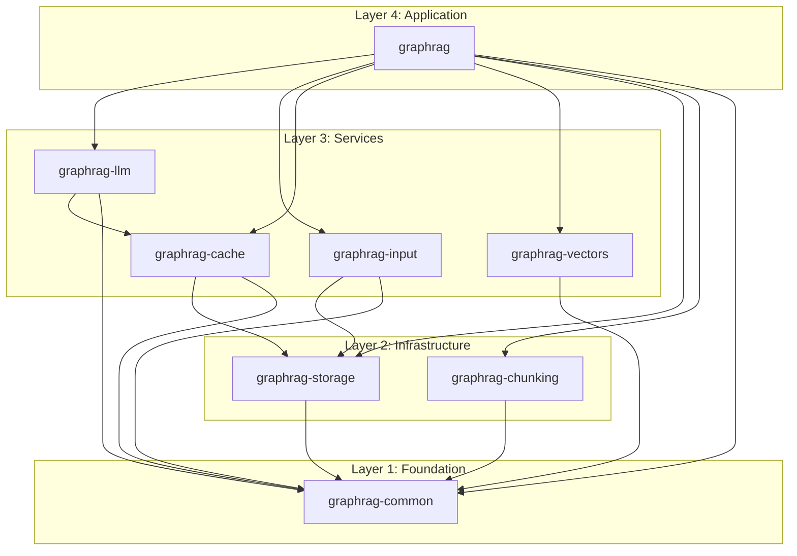

<!-- source: DeepWiki mcp.deepwiki.com · repo microsoft/graphrag · page 2.2 Package Dependencies and Layering · fetched 2026-10-26 -->

# Package Dependencies and Layering

<details>
<summary>Relevant source files</summary>

The following files were used as context for generating this wiki page:

- [packages/graphrag-common/pyproject.toml](packages/graphrag-common/pyproject.toml)
- [packages/graphrag-input/pyproject.toml](packages/graphrag-input/pyproject.toml)
- [packages/graphrag-llm/pyproject.toml](packages/graphrag-llm/pyproject.toml)
- [packages/graphrag-storage/pyproject.toml](packages/graphrag-storage/pyproject.toml)
- [packages/graphrag-vectors/pyproject.toml](packages/graphrag-vectors/pyproject.toml)
- [packages/graphrag/pyproject.toml](packages/graphrag/pyproject.toml)
- [uv.lock](uv.lock)

</details>


This page documents the dependency architecture and layering strategy of the GraphRAG monorepo. It explains how the 8 packages are organized into distinct layers, the rationale for this structure, and how dependencies flow bottom-up to prevent circular references.

For information about individual package contents and APIs, see [Package Overview](#2.1). For details on external library integrations, see [External Dependencies](#2.3).

## Overview

The GraphRAG monorepo employs a **strict layered architecture** where dependencies flow unidirectionally from higher layers to lower layers. This design prevents circular dependencies, enables independent testing of foundational components, and allows selective package installation based on use case.

The repository consists of 8 packages organized into 4 layers:

| Layer | Packages | Role |
|-------|----------|------|
| **Layer 1: Foundation** | `graphrag-common` | Shared utilities, types, configuration helpers |
| **Layer 2: Infrastructure** | `graphrag-storage`, `graphrag-chunking` | Storage abstraction and text segmentation |
| **Layer 3: Services** | `graphrag-cache`, `graphrag-input`, `graphrag-vectors`, `graphrag-llm` | Specialized domain services |
| **Layer 4: Application** | `graphrag` | CLI, workflows, indexing, querying |

All packages share the same version number (`3.1.1`) and are released together as part of the monorepo structure. The workspace is managed by the **uv package manager**, which provides fast dependency resolution and workspace management.

**Sources:** [uv.lock:14-24](), [packages/graphrag/pyproject.toml:4-4]()

## Monorepo Structure

### Workspace Configuration

The root workspace is configured using uv's workspace feature, as seen in the manifest members:

```toml
[manifest]
members = [
    "graphrag",
    "graphrag-cache",
    "graphrag-chunking",
    "graphrag-common",
    "graphrag-input",
    "graphrag-llm",
    "graphrag-monorepo",
    "graphrag-storage",
    "graphrag-vectors",
]
```

The unified lockfile `uv.lock` ensures that all packages in the workspace share compatible versions of external dependencies, such as `pydantic` or `pandas`.

**Sources:** [uv.lock:1-24]()

### Directory Layout

```
graphrag/
├── uv.lock                     # Unified lockfile for all packages
└── packages/
    ├── graphrag/               # Layer 4: Main application [packages/graphrag/pyproject.toml:2-2]()
    ├── graphrag-llm/           # Layer 3: LLM integration [packages/graphrag-llm/pyproject.toml:2-2]()
    ├── graphrag-vectors/       # Layer 3: Vector stores [packages/graphrag-vectors/pyproject.toml:2-2]()
    ├── graphrag-input/         # Layer 3: Document loading [packages/graphrag-input/pyproject.toml:2-2]()
    ├── graphrag-cache/         # Layer 3: Caching [packages/graphrag-cache/pyproject.toml:2-2]()
    ├── graphrag-storage/       # Layer 2: Storage abstraction [packages/graphrag-storage/pyproject.toml:2-2]()
    ├── graphrag-chunking/      # Layer 2: Text chunking [packages/graphrag-chunking/pyproject.toml:2-2]()
    └── graphrag-common/        # Layer 1: Foundation [packages/graphrag-common/pyproject.toml:2-2]()
```

**Sources:** [uv.lock:14-24]()

## Layer 1: Foundation

### graphrag-common

The `graphrag-common` package serves as the foundation for all other packages. It has **zero internal dependencies** on other GraphRAG packages and only depends on standard Python utilities.



**External Dependencies:**
- `python-dotenv~=1.0` - Environment variable loading.
- `pyyaml~=6.0` - YAML configuration parsing.
- `toml~=0.10` - TOML file handling.

**Sources:** [packages/graphrag-common/pyproject.toml:32-36]()

## Layer 2: Infrastructure

### graphrag-storage

The `graphrag-storage` package provides storage abstractions for file systems, Azure Blob Storage, and Azure Cosmos DB.



**Dependencies:**
- `graphrag-common==3.1.1` (Layer 1)
- `aiofiles~=25.1` - Asynchronous file operations.
- `azure-cosmos~=4.9` - Cosmos DB integration.
- `azure-storage-blob~=12.24` - Azure Blob Storage.
- `pandas~=3.0` - DataFrame serialization.

**Sources:** [packages/graphrag-storage/pyproject.toml:32-40]()

### graphrag-chunking

The `graphrag-chunking` package handles text segmentation logic.

**Dependencies:**
- `graphrag-common==3.1.1` (Layer 1)
- `pydantic~=2.10` - Data validation.

**Sources:** [packages/graphrag-chunking/pyproject.toml:32-35]()

## Layer 3: Services

Layer 3 packages build on Layers 1 and 2 to provide specialized domain services.

### graphrag-cache

Provides LLM response caching with pluggable storage backends.

**Dependencies:**
- `graphrag-common==3.1.1` (Layer 1)
- `graphrag-storage==3.1.1` (Layer 2)

**Sources:** [packages/graphrag-cache/pyproject.toml:33-36]()

### graphrag-input

Handles document loading and format conversion using MarkItDown.

**Dependencies:**
- `graphrag-common==3.1.1` (Layer 1)
- `graphrag-storage==3.1.1` (Layer 2)
- `markitdown[pdf]~=0.1.0` - Document format conversion.
- `pyarrow>=14.0.0` - Table data processing.

**Sources:** [packages/graphrag-input/pyproject.toml:32-38]()

### graphrag-vectors

Manages vector storage with support for LanceDB, Azure AI Search, and Cosmos DB.



**Dependencies:**
- `graphrag-common==3.1.1` (Layer 1)
- `azure-search-documents~=12.0` - Azure AI Search.
- `lancedb~=0.34.0` - Local vector database.
- `numpy~=2.1` and `pyarrow~=25.0` - Vector and table processing.

**Sources:** [packages/graphrag-vectors/pyproject.toml:32-42]()

### graphrag-llm

Integrates LLM providers via LiteLLM with caching support.

**Dependencies:**
- `graphrag-common==3.1.1` (Layer 1)
- `graphrag-cache==3.1.1` (Layer 3)
- `litellm==1.92.0` - Multi-provider LLM integration.
- `jinja2~=3.1` - Prompt templating.
- `fastapi>=0.136.3` and `orjson>=3.11.6` - Required for LiteLLM tool calling.

**Sources:** [packages/graphrag-llm/pyproject.toml:34-47]()

## Layer 4: Application

### graphrag

The main `graphrag` package orchestrates all lower layers to provide the complete indexing and querying system. It depends on all other specialized packages in the workspace.



**Internal Workspace Dependencies (v3.1.1):**
All 7 specialized packages are included as direct dependencies.

**Key External Dependencies:**
- `networkx~=3.4` - Graph data structures.
- `graspologic-native>=1.2,<1.3` - Community detection (pinned to avoid Leiden output changes).
- `spacy~=3.8` - NLP for entity extraction.
- `typer~=0.16` - CLI framework for `graphrag.cli.main:app`.
- `json-repair~=0.30` - Handling malformed LLM JSON.
- `pandas~=3.0` and `pyarrow~=25.0` - Data processing and storage formats.

**Sources:** [packages/graphrag/pyproject.toml:34-66]()

## Summary of Dependency Flow



**Key Observations:**
1. **Unidirectional Flow:** Dependencies always point toward lower layers or within the same layer (e.g., `LLM` -> `Cache`).
2. **Universal Foundation:** `graphrag-common` is the base for every package in the system.
3. **Storage Abstraction:** Both `graphrag-cache` and `graphrag-input` rely on `graphrag-storage` for data persistence and retrieval.

**Sources:** [packages/graphrag-llm/pyproject.toml:38-39](), [packages/graphrag-input/pyproject.toml:33-34](), [packages/graphrag-cache/pyproject.toml:35-36](), [packages/graphrag/pyproject.toml:39-45]()

---

