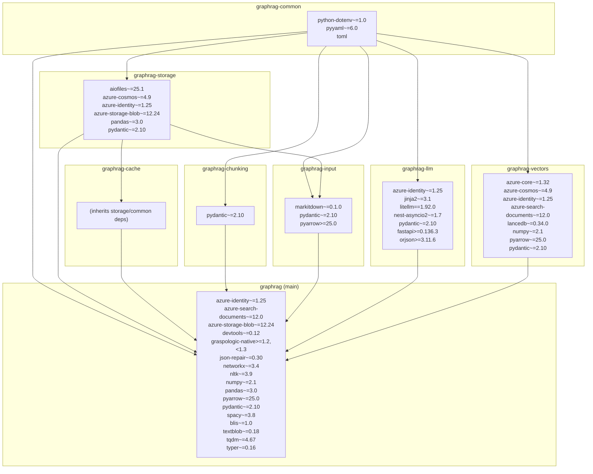
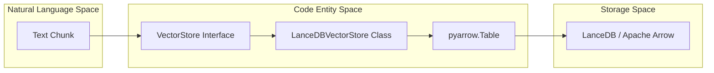
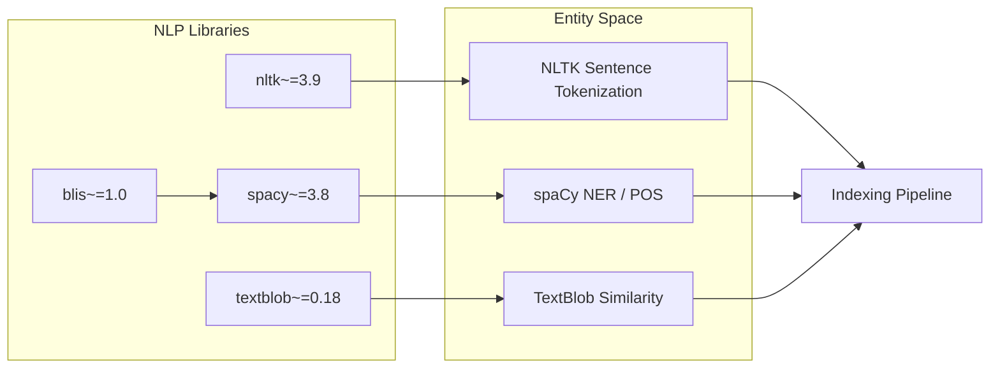
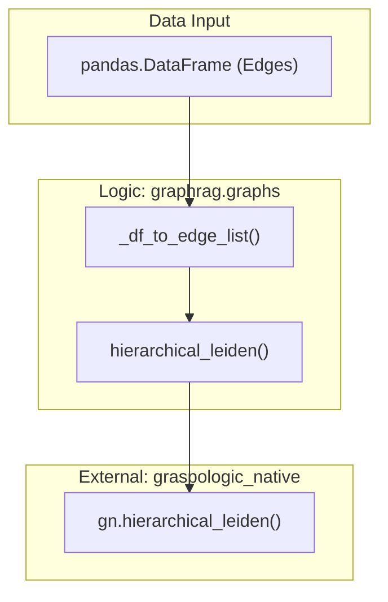

<!-- source: DeepWiki mcp.deepwiki.com · repo microsoft/graphrag · page 2.3 External Dependencies · fetched 2026-10-26 -->

# External Dependencies

Relevant source files

The following files were used as context for generating this wiki page:

- [CHANGELOG.md](CHANGELOG.md)
- [packages/graphrag-cache/pyproject.toml](packages/graphrag-cache/pyproject.toml)
- [packages/graphrag-chunking/pyproject.toml](packages/graphrag-chunking/pyproject.toml)
- [packages/graphrag-llm/pyproject.toml](packages/graphrag-llm/pyproject.toml)
- [packages/graphrag-storage/pyproject.toml](packages/graphrag-storage/pyproject.toml)
- [packages/graphrag-vectors/pyproject.toml](packages/graphrag-vectors/pyproject.toml)
- [packages/graphrag/pyproject.toml](packages/graphrag/pyproject.toml)
- [pyproject.toml](pyproject.toml)
- [uv.lock](uv.lock)

This page documents the external third-party libraries and services that GraphRAG depends on across all packages in the monorepo. These dependencies provide core functionality for language model integration, vector storage, cloud services, natural language processing, graph algorithms, and data manipulation.

For information about the internal package dependencies within the GraphRAG monorepo, see [2.2 Package Dependencies and Layering](). For configuration of external services like LLM providers and vector stores, see [3.3 Language Model Configuration](), [3.5 Vector Store Configuration](), and [3.4 Storage Configuration]().

## Overview of Dependency Categories

GraphRAG's external dependencies fall into several functional categories:

| Category | Purpose | Key Libraries |
|----------|---------|---------------|
| **LLM Integration** | Language model API access and management | LiteLLM, Azure Identity, Jinja2 |
| **Vector Storage** | Embeddings storage and similarity search | LanceDB, Azure AI Search, Azure Cosmos DB |
| **Cloud Storage** | Persistent storage backends | Azure Blob Storage, Azure Cosmos DB |
| **NLP Processing** | Text analysis and entity extraction | NLTK, spaCy, TextBlob |
| **Graph Processing** | Community detection and graph algorithms | NetworkX, graspologic-native |
| **Data Processing** | DataFrames and data manipulation | pandas, numpy, pyarrow |
| **Configuration** | Settings and environment management | pydantic, python-dotenv, PyYAML |

Sources: [packages/graphrag/pyproject.toml:34-63](), [packages/graphrag-llm/pyproject.toml:34-47](), [packages/graphrag-vectors/pyproject.toml:32-42]()

## Dependency Distribution Across Packages

The following diagram shows how external dependencies are distributed across the GraphRAG monorepo packages based on their respective `pyproject.toml` definitions.

Sources: [packages/graphrag/pyproject.toml:34-63](), [packages/graphrag-llm/pyproject.toml:34-47](), [packages/graphrag-storage/pyproject.toml:32-40](), [packages/graphrag-vectors/pyproject.toml:32-42](), [uv.lock:14-24]()

## LLM Integration Dependencies

### LiteLLM (`litellm==1.92.0`)

LiteLLM is the primary abstraction layer for language model API access, enabling GraphRAG to support multiple LLM providers through a unified interface.

**Package:** `graphrag-llm`  
**Purpose:** Provides a consistent API for calling OpenAI, Azure OpenAI, Google Gemini, Anthropic, and other LLM providers.  
**Key Features:**
- Unified completion and embedding interfaces.
- Automatic retry logic and rate limiting.
- Token counting and cost tracking.
- Tool calling support (requires `fastapi` and `orjson`) [packages/graphrag-llm/pyproject.toml:36-44]().

**Integration Points:**
- Used by the `graphrag-llm` package for all LLM calls [packages/graphrag-llm/pyproject.toml:41]().
- Configured through model settings in the main `graphrag` package.

Sources: [packages/graphrag-llm/pyproject.toml:41](), [CHANGELOG.md:18](), [CHANGELOG.md:32]()

### Jinja2 (`jinja2~=3.1`)

Jinja2 is used for prompt template rendering and token replacement.

**Package:** `graphrag-llm`  
**Purpose:** Template engine for constructing LLM prompts with dynamic content.  
**Integration Points:**
- Used to inject entities, relationships, and context into prompts before sending them to the LLM.

Sources: [packages/graphrag-llm/pyproject.toml:40]()

### Azure Identity (`azure-identity~=1.25`)

Azure Identity provides authentication for Azure services across multiple packages.

**Packages:** `graphrag`, `graphrag-llm`, `graphrag-storage`, `graphrag-vectors`  
**Purpose:** Handles authentication to Azure services using managed identities, service principals, or Azure CLI credentials.  

Sources: [packages/graphrag/pyproject.toml:35](), [packages/graphrag-llm/pyproject.toml:35](), [packages/graphrag-storage/pyproject.toml:35](), [packages/graphrag-vectors/pyproject.toml:35]()

## Vector Storage Dependencies

### LanceDB (`lancedb~=0.34.0`)

LanceDB is a local-first vector database built on Apache Arrow and Lance format.

**Package:** `graphrag-vectors`  
**Purpose:** Local vector storage and similarity search for embeddings.  

**Data Flow from Code to Storage:**

Sources: [packages/graphrag-vectors/pyproject.toml:38](), [packages/graphrag-vectors/pyproject.toml:40]()

### Azure AI Search (`azure-search-documents~=12.0`)

**Packages:** `graphrag`, `graphrag-vectors`  
**Purpose:** Cloud-native vector storage and hybrid search.  

Sources: [packages/graphrag/pyproject.toml:36](), [packages/graphrag-vectors/pyproject.toml:36]()

### Azure Cosmos DB (`azure-cosmos~=4.9`)

**Packages:** `graphrag-storage`, `graphrag-vectors`  
**Purpose:** 
- In `graphrag-storage`: NoSQL document storage for cache and pipeline artifacts.
- In `graphrag-vectors`: Vector search using Cosmos DB's native vector indexing.
- Supports native `CosmosTableProvider` with namespace partitioning [CHANGELOG.md:17]().

Sources: [packages/graphrag-storage/pyproject.toml:34](), [packages/graphrag-vectors/pyproject.toml:34](), [CHANGELOG.md:17]()

## Natural Language Processing Dependencies

The following diagram maps NLP dependencies to their usage in the extraction and resolution logic:

Sources: [packages/graphrag/pyproject.toml:52-59]()

### NLTK (`nltk~=3.9`)
Used for sentence tokenization and basic text processing [packages/graphrag/pyproject.toml:52](). Version bumped to resolve security vulnerabilities [CHANGELOG.md:28]().

### spaCy (`spacy~=3.8`)
Used for named entity recognition (NER), dependency parsing, and linguistic analysis [packages/graphrag/pyproject.toml:57](). Requires `blis` for optimized linear algebra [packages/graphrag/pyproject.toml:58]().

### TextBlob (`textblob~=0.18`)
Used for sentiment analysis and entity similarity calculations during deduplication [packages/graphrag/pyproject.toml:59]().

## Data Processing Dependencies

### pandas (`pandas~=3.0`)
The primary data structure for pipeline artifacts and in-memory data processing. GraphRAG maintains compatibility with the 3.0.x line [packages/graphrag/pyproject.toml:54]().

### numpy (`numpy~=2.1`)
Numerical computing library for array operations and vector computations, specifically for embedding management and vector store operations [packages/graphrag/pyproject.toml:53]().

### pyarrow (`pyarrow~=25.0`)
Apache Arrow Python bindings for columnar data processing, used for Parquet file support and high-performance data serialization across the indexing pipeline [packages/graphrag/pyproject.toml:55]().

## Graph Processing Dependencies

### NetworkX (`networkx~=3.4`)
Python library for creation, manipulation, and analysis of complex networks. While many graph utilities have been moved to DataFrame-based implementations [CHANGELOG.md:73](), NetworkX remains a core dependency for overall graph management [packages/graphrag/pyproject.toml:51]().

### graspologic-native (`graspologic-native>=1.2,<1.3`)
Used for hierarchical community detection using the Leiden algorithm. The version is pinned to avoid breaking changes in community counts and levels [packages/graphrag/pyproject.toml:46-49]().

**Implementation Flow:**

Sources: [packages/graphrag/pyproject.toml:49](), [CHANGELOG.md:73]()

## Python Version Requirements

All GraphRAG packages require Python 3.11 or higher, with support up to Python 3.13:

| Package | Python Requirement |
|---------|-------------------|
| graphrag | `>=3.11,<3.14` |
| graphrag-common | `>=3.11,<3.14` |
| graphrag-storage | `>=3.11,<3.14` |
| graphrag-cache | `>=3.11,<3.14` |
| graphrag-chunking | `>=3.11,<3.14` |
| graphrag-input | `>=3.11,<3.14` |
| graphrag-vectors | `>=3.11,<3.14` |
| graphrag-llm | `>=3.10,<3.14` |

Sources: [packages/graphrag/pyproject.toml:26](), [packages/graphrag-llm/pyproject.toml:26](), [packages/graphrag-storage/pyproject.toml:25](), [packages/graphrag-vectors/pyproject.toml:25](), [uv.lock:3]()

---

