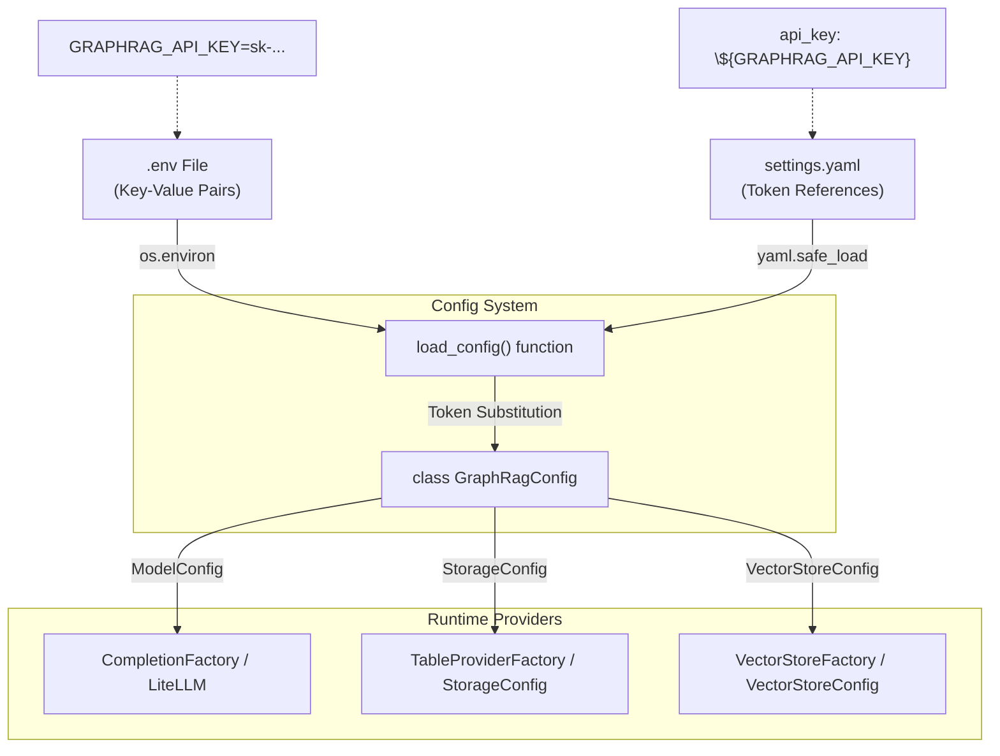
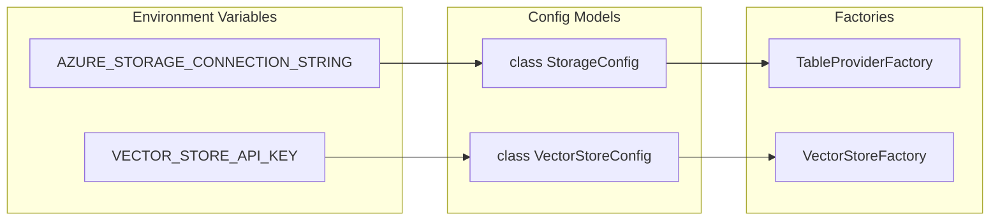

<!-- source: DeepWiki mcp.deepwiki.com · repo microsoft/graphrag · page 3.2 Environment Variables · fetched 2026-10-26 -->

# Environment Variables

<details>
<summary>Relevant source files</summary>

The following files were used as context for generating this wiki page:

- [docs/config/yaml.md](docs/config/yaml.md)
- [docs/index/architecture.md](docs/index/architecture.md)
- [docs/index/inputs.md](docs/index/inputs.md)
- [tests/unit/config/fixtures/minimal_config/settings.yaml](tests/unit/config/fixtures/minimal_config/settings.yaml)
- [tests/unit/config/fixtures/minimal_config_missing_env_var/settings.yaml](tests/unit/config/fixtures/minimal_config_missing_env_var/settings.yaml)
- [tests/unit/config/test_config.py](tests/unit/config/test_config.py)
- [tests/unit/config/utils.py](tests/unit/config/utils.py)

</details>


This document describes the environment variable system in GraphRAG, including how environment variables are defined, loaded, and used for configuration. Environment variables provide a secure and flexible way to manage sensitive information like API keys and to externalize configuration values.

For detailed information about the complete configuration system, see [Configuration Files](3.1). For specifics about configuring language models, see [Language Model Configuration](3.3).

## Overview

GraphRAG uses environment variables to:

1.  **Store sensitive credentials** - API keys, connection strings, and authentication tokens are kept out of version control [docs/config/yaml.md:10-11]().
2.  **Enable token replacement** - Environment variables can be referenced in `settings.yaml` using `${ENV_VAR}` syntax [docs/config/yaml.md:3-3]().
3.  **Support multiple environments** - A `.env` file can be loaded alongside the YAML configuration to provide context-specific values [docs/config/yaml.md:3-3]().
4.  **Simplify configuration** - Reuse the same variable across multiple configuration sections, such as sharing a key between completion and embedding models [docs/config/yaml.md:28-42]().

The environment variable system is initialized by the `graphrag init` command, which sets up a default project structure including a `.env` file template [docs/config/yaml.md:3-3]().

Sources: [docs/config/yaml.md:1-16](), [tests/unit/config/test_config.py:29-30]()

## Environment Variable Loading Flow

The following diagram shows how environment variables flow from the `.env` file through the configuration system to runtime components.

### Data Flow: From .env to Code Entities



Sources: [docs/config/yaml.md:3-16](), [tests/unit/config/load_config.py:8-10](), [graphrag/config/models/graph_rag_config.py:19-19]()

## The `.env` File

### File Creation

The `.env` file is typically created in your project root. While `graphrag init` sets up the initial structure, users must manually populate it with secrets [docs/config/yaml.md:3-3]().

```bash
# Example .env content
GRAPHRAG_API_KEY=some_api_key
```

**Location**: Data project root directory [docs/config/yaml.md:3-3]().

**Format**: Plain text, one variable per line, using `KEY=value` syntax. If a `.env` file is present along with a `settings.yml`, it is loaded, and variables are available for replacement [docs/config/yaml.md:3-3]().

Sources: [docs/config/yaml.md:3-11](), [tests/unit/config/fixtures/minimal_config/settings.yaml:1-5]()

## Token Replacement Syntax

Environment variables are referenced in `settings.yaml` using the `${ENV_VAR}` syntax. This allows the configuration to remain generic while the environment provides the specifics [docs/config/yaml.md:3-3]().

```yaml
completion_models:
  default_completion_model:
    model_provider: openai
    api_key: ${GRAPHRAG_API_KEY}
```

When the `load_config` function is called, the system performs token replacement on the configuration document before instantiating the Pydantic models [docs/config/yaml.md:3-3](), [tests/unit/config/test_config.py:8-8]().

Sources: [docs/config/yaml.md:3-16](), [tests/unit/config/fixtures/minimal_config/settings.yaml:1-12]()

## Common Environment Variables

The following variables are frequently used across the configuration sections:

| Variable Name | Purpose | Implementation Reference |
|--------------|---------|---------------|
| `GRAPHRAG_API_KEY` | Primary API key for LLM providers | [docs/config/yaml.md:11-11]() |
| `API_BASE` | Base URL for the LLM API endpoint | [docs/config/yaml.md:51-51]() |
| `API_VERSION` | API version for providers like Azure | [docs/config/yaml.md:52-52]() |
| `CONNECTION_STRING` | Azure Storage connection string | [docs/config/yaml.md:85-85]() |
| `CONTAINER_NAME` | Azure Storage container name | [docs/config/yaml.md:86-86]() |
| `DATABASE_NAME` | Database name for CosmosDB or Vector Stores | [docs/config/yaml.md:88-88]() |

Sources: [docs/config/yaml.md:46-95](), [tests/unit/config/utils.py:121-126]()

## Environment Variables in Component Configuration

### LLM Configuration
The `completion_models` and `embedding_models` sections rely on environment variables for authentication. GraphRAG uses LiteLLM for calling language models [docs/config/yaml.md:46-47]().

```yaml
completion_models:
  default_completion_model:
    model_provider: openai
    model: gpt-4.1
    api_key: ${GRAPHRAG_API_KEY}
```

Sources: [docs/config/yaml.md:28-42](), [tests/unit/config/utils.py:36-46]()

### Storage and Vector Stores
Storage backends for `input`, `output`, and `cache` use environment variables for connection strings and account details when using Azure-based providers [docs/config/yaml.md:81-88]().



Sources: [docs/config/yaml.md:81-88](), [tests/unit/config/utils.py:115-146](), [docs/index/architecture.md:47-48]()

## Implementation Detail: Configuration Loading

The `load_config` function handles the resolution of environment variables. If a variable referenced in the YAML via `${VAR}` is missing from the environment, the configuration may fail validation if the field is required [tests/unit/config/fixtures/minimal_config_missing_env_var/settings.yaml:1-12]().

In testing environments, `os.environ` is often mocked to simulate different environment variable states:
```python
@mock.patch.dict(os.environ, {"CUSTOM_API_KEY": FAKE_API_KEY}, clear=True)
def test_load_minimal_config() -> None:
    # ... logic to test config loading with environment variables
```
Sources: [tests/unit/config/test_config.py:29-39](), [docs/config/yaml.md:3-3]()

## Best Practices

1.  **Security**: Never commit your `.env` file to version control. It is designed to hold secrets that should not be in `settings.yaml` [docs/config/yaml.md:3-3]().
2.  **Managed Identity**: For Azure deployments, use `auth_method: azure_managed_identity` to avoid storing keys in environment variables where possible [docs/config/yaml.md:53-53]().
3.  **Defaults**: Rely on the built-in defaults in `graphrag.config.defaults` for non-sensitive values and only use environment variables for secrets or environment-specific overrides [docs/config/yaml.md:5-5]().

Sources: [docs/config/yaml.md:3-53](), [tests/unit/config/utils.py:5-32]()

---

