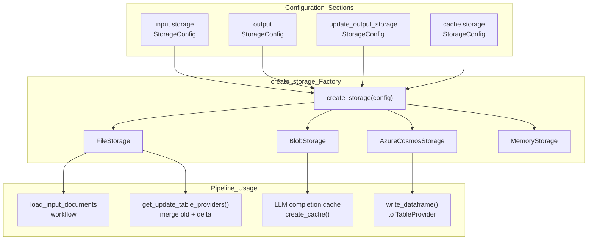
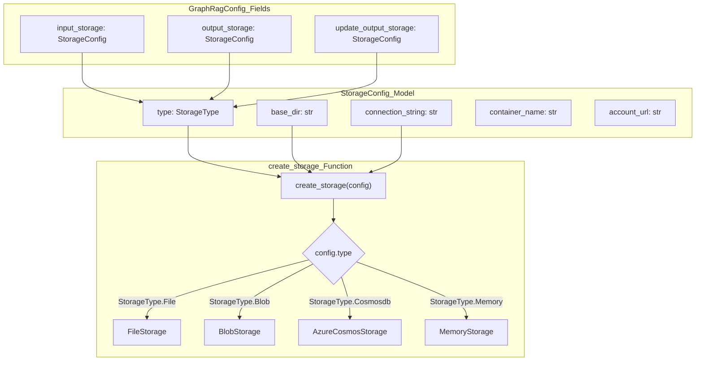
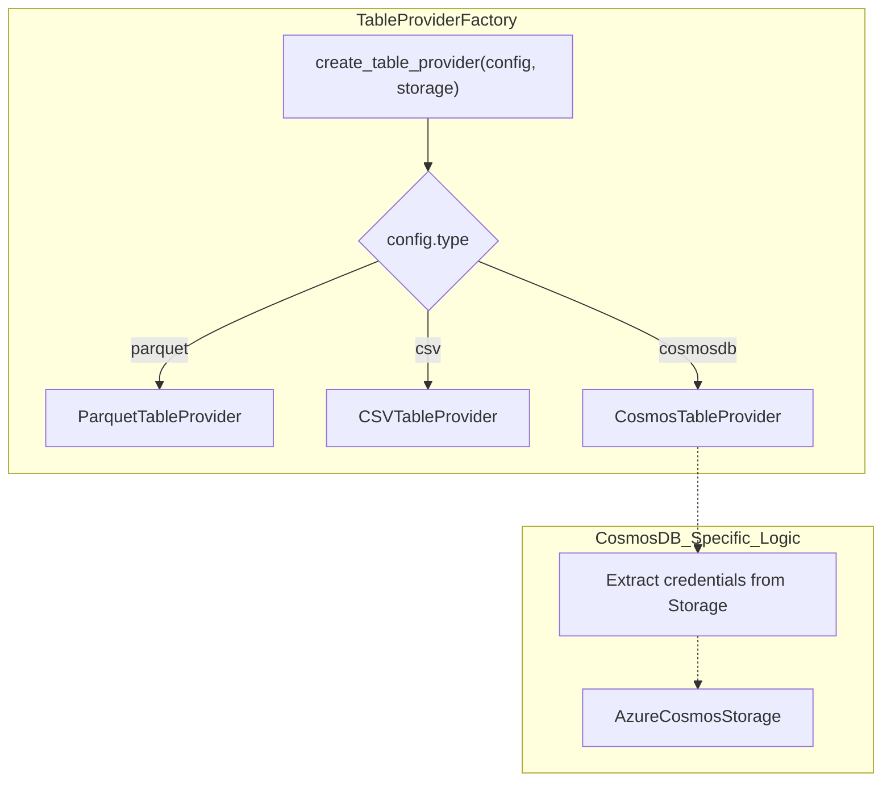
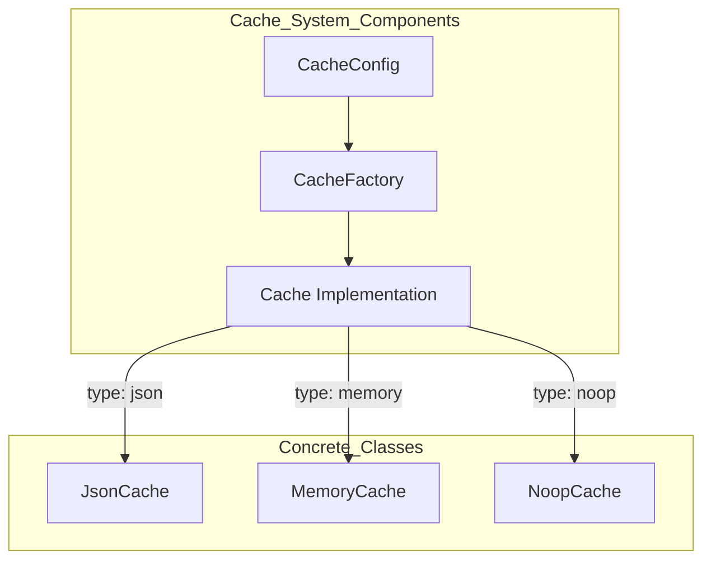

<!-- source: DeepWiki mcp.deepwiki.com · repo microsoft/graphrag · page 3.4 Storage Configuration · fetched 2026-10-26 -->

# Storage Configuration

Relevant source files

The following files were used as context for generating this wiki page:

- [docs/config/yaml.md](docs/config/yaml.md)
- [docs/index/architecture.md](docs/index/architecture.md)
- [docs/index/inputs.md](docs/index/inputs.md)
- [packages/graphrag-cache/graphrag_cache/cache_factory.py](packages/graphrag-cache/graphrag_cache/cache_factory.py)
- [packages/graphrag/graphrag/config/models/graph_rag_config.py](packages/graphrag/graphrag/config/models/graph_rag_config.py)
- [packages/graphrag/graphrag/index/typing/context.py](packages/graphrag/graphrag/index/typing/context.py)

This page documents how to configure GraphRAG's storage backends for input documents, pipeline outputs, and LLM response caching. Storage configuration controls where source documents are read from, where indexing artifacts are written, and where cached data is stored.

## Overview

GraphRAG uses three distinct storage configurations in the indexing pipeline:

**Storage Configuration in the Indexing Pipeline**

**Sources:** [packages/graphrag/graphrag/index/typing/context.py:17-35](), [docs/config/yaml.md:108-125](), [packages/graphrag/graphrag/config/models/graph_rag_config.py:76-130]()

### Storage Roles

| Storage Type | Purpose | Data Stored | Access Pattern |
|--------------|---------|-------------|----------------|
| **input.storage** | Document ingestion | Raw text files, CSV, JSON, Parquet | Read-only during document loading |
| **output** | Pipeline artifacts | Parquet tables or Cosmos DB documents | Write during indexing, read during query |
| **update_output_storage** | Incremental indexing | Timestamped delta + previous copies | Write during update workflows |
| **cache.storage** | LLM response caching | JSON-serialized LLM responses | Read/write during LLM calls |

**Sources:** [docs/config/yaml.md:75-169](), [packages/graphrag/graphrag/index/typing/context.py:21-30](), [docs/index/inputs.md:31-55]()

## Storage Configuration Structure

Storage configuration uses the `StorageConfig` data model and appears in multiple sections of `settings.yaml`. The `create_storage()` factory function instantiates concrete implementations based on the `type` field.

**GraphRagConfig Storage Fields and Factory Flow**

**Sources:** [packages/graphrag/graphrag/config/models/graph_rag_config.py:76-130](), [docs/config/yaml.md:81-88](), [packages/graphrag/graphrag/index/typing/context.py:17-25]()

### Storage Types

GraphRAG supports four storage backend types:

| Type | Enum Value | Implementation Class | Use Case | Required Fields |
|------|------------|---------------------|----------|-----------------|
| **File** | `file` | `FileStorage` | Local filesystem | `base_dir` |
| **Blob** | `blob` | `BlobStorage` | Azure Blob Storage | `connection_string`, `container_name` |
| **CosmosDB** | `cosmosdb` | `AzureCosmosStorage` | Azure CosmosDB (KV) | `connection_string` or `account_url`, `database_name` |
| **Memory** | `memory` | `MemoryStorage` | Testing, volatile data | None |

**Sources:** [docs/config/yaml.md:82-88](), [packages/graphrag/graphrag/config/models/graph_rag_config.py:86-92]()

## Table Provider Configuration

The `TableProvider` is an abstraction for handling tabular data (DataFrames). While `Storage` handles raw keys/values (like `context.json`), the `TableProvider` handles structured tables like `entities.parquet` or Cosmos DB items.

### Table Provider Factory

The `create_table_provider` function uses a factory to return specific implementations. If a `Storage` instance is provided, it is injected into the provider (primarily for file-based types like Parquet and CSV).

**TableProvider and Cosmos Mapping**

**Sources:** [packages/graphrag/graphrag/config/models/graph_rag_config.py:142-146](), [docs/index/architecture.md:47](), [packages/graphrag/graphrag/index/typing/context.py:25-28]()

## Cache Configuration

GraphRAG uses a cache to store LLM responses, ensuring idempotency and resilience to network errors. The `create_cache` factory instantiates the cache based on the `cache` configuration section.

**Cache Provider Association**

| Cache Type | Description | Implementation |
|------------|-------------|----------------|
| `memory` | Volatile in-memory cache | `MemoryCache` |
| `json` | Persistent cache backed by a `Storage` implementation | `JsonCache` |
| `noop` | Disables caching | `NoopCache` |

**Sources:** [packages/graphrag-cache/graphrag_cache/cache_factory.py:17-90](), [docs/index/architecture.md:30-36](), [packages/graphrag/graphrag/config/models/graph_rag_config.py:147-151]()

## Input Reader and Formats

Input configuration specifies how raw documents are loaded into the pipeline. This is handled by the `InputReader` which supports multiple formats.

| Format | Description |
|--------|-------------|
| **Plain Text** | Imports `.txt` files; filename becomes the title. |
| **CSV** | Each row is a document; supports custom `text_column` and `title_column`. |
| **JSON / JSONL** | Structured objects; supports arrays of objects or line-delimited objects. |
| **Parquet** | Structured rows similar to CSV. |
| **MarkItDown** | Document conversion via MarkItDown reader. |

**Sources:** [docs/index/inputs.md:31-55](), [docs/config/yaml.md:75-95](), [docs/index/architecture.md:44]()

---

