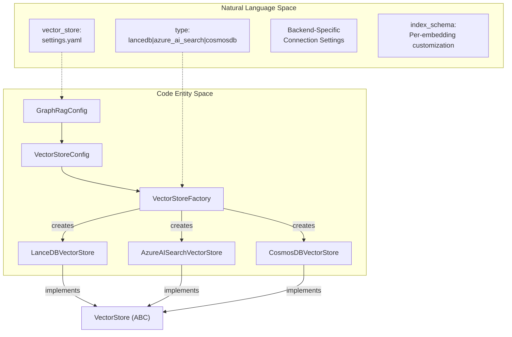
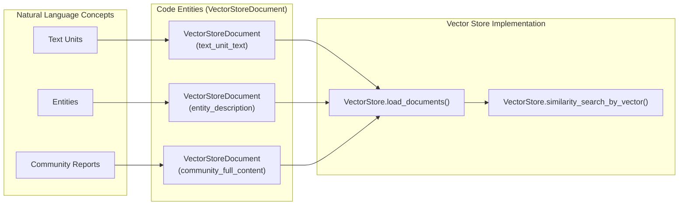
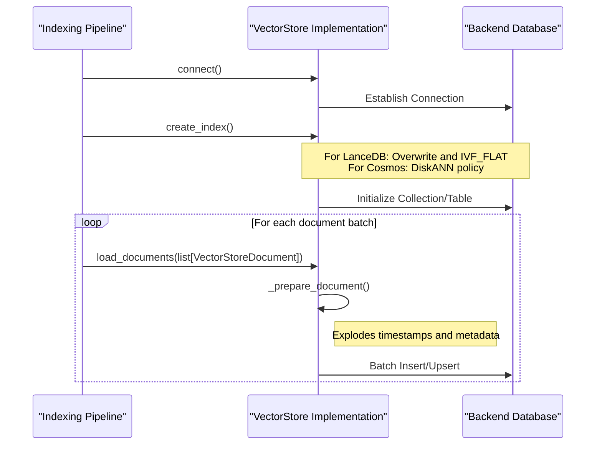

<!-- source: DeepWiki mcp.deepwiki.com · repo microsoft/graphrag · page 3.5 Vector Store Configuration · fetched 2026-10-26 -->

# Vector Store Configuration

<details>
<summary>Relevant source files</summary>

The following files were used as context for generating this wiki page:

- [docs/config/yaml.md](docs/config/yaml.md)
- [docs/index/architecture.md](docs/index/architecture.md)
- [docs/index/inputs.md](docs/index/inputs.md)
- [tests/integration/vector_stores/test_azure_ai_search.py](tests/integration/vector_stores/test_azure_ai_search.py)
- [tests/integration/vector_stores/test_cosmosdb.py](tests/integration/vector_stores/test_cosmosdb.py)
- [tests/integration/vector_stores/test_factory.py](tests/integration/vector_stores/test_factory.py)
- [tests/integration/vector_stores/test_lancedb.py](tests/integration/vector_stores/test_lancedb.py)
- [tests/unit/query/context_builder/test_entity_extraction.py](tests/unit/query/context_builder/test_entity_extraction.py)

</details>


This page documents how to configure vector store backends and index schemas for GraphRAG. Vector stores are used to store and retrieve embeddings generated during indexing, enabling similarity search during query operations. For implementation details of vector store backends, see [Vector Store Architecture](#7.4). For storage configuration (input/output/cache), see [Storage Configuration](#3.4).

## Overview

GraphRAG generates embeddings for various text elements during indexing (text units, entity descriptions, community summaries) and stores them in a vector store. During query operations, these embeddings are retrieved via similarity search to build context for LLM responses. The vector store configuration defines which backend to use and how to organize the embedding indexes.

**Configuration Location:** The `vector_store` section in `settings.yaml` [docs/config/yaml.md:170-176]().

**Supported Backends:**
- **LanceDB** - Local or remote vector database (default) [packages/graphrag-vectors/graphrag_vectors/lancedb.py:27-32]().
- **Azure AI Search** - Cloud-based search service with vector capabilities [packages/graphrag-vectors/graphrag_vectors/azure_ai_search.py:48-53]().
- **Cosmos DB** - Azure Cosmos DB with vector indexing support and diskANN indexing [packages/graphrag-vectors/graphrag_vectors/cosmosdb.py:28-34]().

**Sources:** [docs/config/yaml.md:170-211](), [packages/graphrag-vectors/graphrag_vectors/vector_store.py:56-79](), [docs/index/architecture.md:48]()

## Vector Store Configuration Flow

The following diagram illustrates the relationship between the configuration and the code entities responsible for managing vector storage.

### Configuration to Code Entity Mapping


**Sources:** [packages/graphrag/graphrag/config/models/graph_rag_config.py:16-116](), [packages/graphrag-vectors/graphrag_vectors/vector_store.py:56-79](), [docs/config/yaml.md:170-211](), [tests/integration/vector_stores/test_factory.py:18-21]()

## Configuration Fields

### Common Fields

All vector store types support these base fields defined in the `VectorStore` base class constructor:

| Field | Type | Description | Default |
|-------|------|-------------|---------|
| `type` | str | Vector store backend type | `lancedb` |
| `index_schema` | dict | Per-embedding index customization | `{}` |
| `id_field` | str | Default field name for IDs | `"id"` |
| `vector_field` | str | Default field name for vectors | `"vector"` |
| `vector_size` | int | Embedding dimension size | `3072` |

**Sources:** [docs/config/yaml.md:176](), [packages/graphrag-vectors/graphrag_vectors/vector_store.py:59-79]()

### Type-Specific Fields

#### LanceDB
The `LanceDBVectorStore` uses a URI to locate the database.

| Field | Type | Description | Default |
|-------|------|-------------|---------|
| `db_uri` | str | Database URI (local path or remote) | `output/lancedb` |

**Sources:** [packages/graphrag-vectors/graphrag_vectors/lancedb.py:30-32](), [tests/integration/vector_stores/test_lancedb.py:79-81]()

#### Azure AI Search
The `AzureAISearchVectorStore` requires service-specific connection details.

| Field | Type | Description | Required |
|-------|------|-------------|----------|
| `url` | str | Azure AI Search service URL | Yes |
| `api_key` | str | API key for authentication | No* |
| `audience` | str | Audience for managed identity token | No |

*If `api_key` is omitted, the system attempts to use `DefaultAzureCredential` [packages/graphrag-vectors/graphrag_vectors/azure_ai_search.py:78-82]().

**Sources:** [packages/graphrag-vectors/graphrag_vectors/azure_ai_search.py:53-68](), [tests/integration/vector_stores/test_azure_ai_search.py:39-44]()

#### Cosmos DB
The `CosmosDBVectorStore` supports both connection strings and direct URLs.

| Field | Type | Description | Required |
|-------|------|-------------|----------|
| `url` | str | Cosmos DB account URL | No** |
| `connection_string` | str | Cosmos DB connection string | No** |
| `database_name` | str | Database name | Yes |

**Either `url` or `connection_string` must be provided [packages/graphrag-vectors/graphrag_vectors/cosmosdb.py:46-48]().

**Sources:** [packages/graphrag-vectors/graphrag_vectors/cosmosdb.py:35-52](), [tests/integration/vector_stores/test_cosmosdb.py:27-31]()

## Embedding Types and Index Schema

GraphRAG generates embeddings for distinct content types. Each can be configured independently within the `index_schema` section of the config.

### Embedding Data Flow


| Embedding Type | Source | Default Index Name |
|----------------|--------|--------------------|
| `text_unit_text` | Raw text chunks | `"text-unit-embeddings"` |
| `entity_description` | Entity descriptions | `"entity-description-embeddings"` |
| `community_full_content` | Community summaries | `"community-reports"` |

**Sources:** [docs/config/yaml.md:191-196](), [packages/graphrag-vectors/graphrag_vectors/vector_store.py:26-54](), [tests/unit/query/context_builder/test_entity_extraction.py:127-132]()

## Vector Store Behavior During Indexing

The indexing pipeline interacts with the vector store through the `VectorStore` abstract interface.

### Indexing Sequence


### Metadata and Timestamps
The `VectorStore` class automatically manages document metadata and timestamps via `_prepare_document` [packages/graphrag-vectors/graphrag_vectors/vector_store.py:97-121](). 
- It sets `create_date` to current UTC time if missing [packages/graphrag-vectors/graphrag_vectors/vector_store.py:106-107]().
- It uses a `TimestampExploder` to break ISO 8601 strings into filterable component fields (year, month, etc.) [packages/graphrag-vectors/graphrag_vectors/vector_store.py:108-114]().

**Sources:** [packages/graphrag-vectors/graphrag_vectors/vector_store.py:97-121](), [packages/graphrag-vectors/graphrag_vectors/lancedb.py:41-80](), [packages/graphrag-vectors/graphrag_vectors/azure_ai_search.py:95-167](), [packages/graphrag-vectors/graphrag_vectors/cosmosdb.py:87-143]()

## Filtering and Search

Each backend implements its own filtering logic by compiling a `FilterExpr` into a backend-specific query language.

| Backend | Compilation Method | Target Syntax |
|---------|-------------------|---------------|
| **LanceDB** | `_compile_filter` | SQL WHERE clause [packages/graphrag-vectors/graphrag_vectors/lancedb.py:130-146]() |
| **Azure AI Search** | `_compile_filter` | OData filter string [packages/graphrag-vectors/graphrag_vectors/azure_ai_search.py:190-206]() |
| **Cosmos DB** | `_compile_filter` | Cosmos SQL (prefixed with `c.`) [packages/graphrag-vectors/graphrag_vectors/cosmosdb.py:188-198]() |

### Supported Operators
All implementations support standard comparison operators (`eq`, `ne`, `gt`, `lt`, `gte`, `lte`) and collection operators (`in_`, `not_in`). Backend-specific support exists for `contains`, `startswith`, and `endswith` [packages/graphrag-vectors/graphrag_vectors/lancedb.py:156-185]().

**Sources:** [packages/graphrag-vectors/graphrag_vectors/lancedb.py:130-186](), [packages/graphrag-vectors/graphrag_vectors/azure_ai_search.py:190-210](), [packages/graphrag-vectors/graphrag_vectors/cosmosdb.py:188-210](), [tests/integration/vector_stores/test_lancedb.py:14-15]()

## Configuration Examples

### Basic LanceDB (Default)
```yaml
vector_store:
  type: lancedb
  db_uri: output/lancedb
```
**Sources:** [docs/config/yaml.md:199-202](), [tests/integration/vector_stores/test_factory.py:25-30]()

### Azure AI Search with Managed Identity
```yaml
vector_store:
  type: azure_ai_search
  url: https://my-search-service.search.windows.net
  audience: https://search.azure.com
```
**Sources:** [packages/graphrag-vectors/graphrag_vectors/azure_ai_search.py:70-93](), [tests/integration/vector_stores/test_factory.py:34-45]()

### Cosmos DB with Custom Vector Size
```yaml
vector_store:
  type: cosmosdb
  connection_string: ${COSMOS_CONNECTION_STRING}
  database_name: graphrag_vectors
  index_schema:
    text_unit_text:
      vector_size: 1536
```
**Sources:** [packages/graphrag-vectors/graphrag_vectors/cosmosdb.py:35-52](), [packages/graphrag-vectors/graphrag_vectors/vector_store.py:66](), [tests/integration/vector_stores/test_cosmosdb.py:98-105]()

## Troubleshooting

- **CosmosDB ID Field**: Cosmos DB requires the `id_field` to be exactly `"id"`. Providing any other value will result in a `ValueError` [packages/graphrag-vectors/graphrag_vectors/cosmosdb.py:43-45]().
- **Azure AI Search Connectivity**: If neither `api_key` nor `url` is provided, the store will fail to initialize [packages/graphrag-vectors/graphrag_vectors/azure_ai_search.py:62-64]().
- **LanceDB Dummy Documents**: During `create_index`, LanceDB creates and immediately deletes a dummy document to establish the schema [packages/graphrag-vectors/graphrag_vectors/lancedb.py:78-79]().
- **Vector Size Mismatch**: LanceDB will raise a `ValueError` if documents are loaded with vector dimensions that do not match the configured `vector_size` [tests/integration/vector_stores/test_lancedb.py:166-188]().
- **Cosmos DB DiskANN**: The Cosmos DB implementation attempts to use `diskANN` indexing but will fallback to standard indexing if the environment does not support it [packages/graphrag-vectors/graphrag_vectors/cosmosdb.py:115-138]().

**Sources:** [packages/graphrag-vectors/graphrag_vectors/cosmosdb.py:43-45](), [packages/graphrag-vectors/graphrag_vectors/azure_ai_search.py:62-64](), [packages/graphrag-vectors/graphrag_vectors/lancedb.py:78-79](), [packages/graphrag-vectors/graphrag_vectors/cosmosdb.py:115-138](), [tests/integration/vector_stores/test_lancedb.py:166-188]()

---

