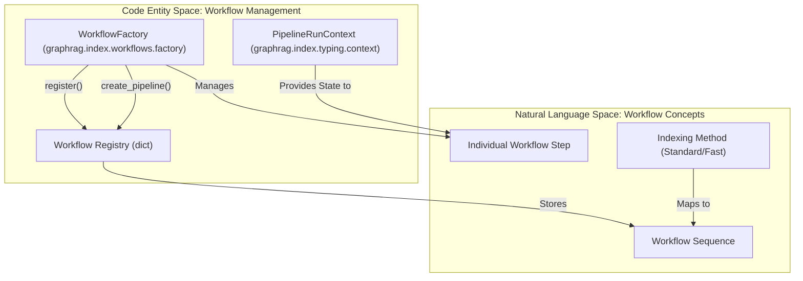
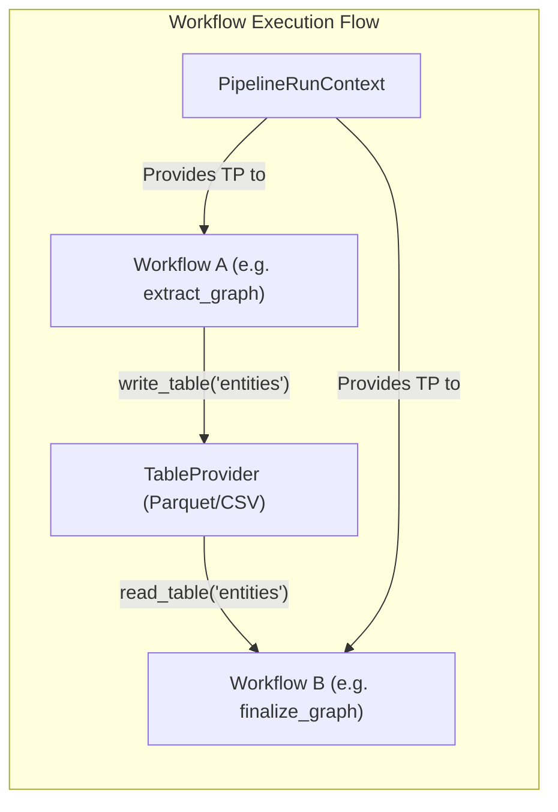

<!-- source: DeepWiki mcp.deepwiki.com · repo microsoft/graphrag · page 3.6 Workflow Configuration · fetched 2026-10-26 -->

# Workflow Configuration

<details>
<summary>Relevant source files</summary>

The following files were used as context for generating this wiki page:

- [docs/config/yaml.md](docs/config/yaml.md)
- [docs/index/architecture.md](docs/index/architecture.md)
- [docs/index/inputs.md](docs/index/inputs.md)
- [packages/graphrag-cache/graphrag_cache/cache_factory.py](packages/graphrag-cache/graphrag_cache/cache_factory.py)
- [packages/graphrag/graphrag/config/models/graph_rag_config.py](packages/graphrag/graphrag/config/models/graph_rag_config.py)
- [packages/graphrag/graphrag/index/typing/context.py](packages/graphrag/graphrag/index/typing/context.py)

</details>


## Purpose and Scope

This document describes the workflow configuration system in GraphRAG, which controls the sequence of operations executed during indexing. A workflow is a discrete processing step in the indexing pipeline (e.g., document loading, entity extraction, community detection). This page covers:

- Built-in indexing methods and their associated workflow lists.
- The workflow registration system via factories.
- Custom workflow configuration and registration.
- The relationship between workflow selection and workflow parameters.
- Context and state management during workflow execution.

**Sources:** [packages/graphrag/graphrag/config/models/graph_rag_config.py:142-156](), [docs/index/architecture.md:10-28]()

---

## Configuration Structure

Workflow configuration in GraphRAG operates at two levels:

### 1. Workflow Selection (settings.yaml)

The `workflows` field in `GraphRagConfig` controls which workflows execute. While often omitted to use default methods, it can be explicitly defined.

| Field | Type | Default | Description |
|-------|------|---------|-------------|
| `workflows` | `list[str] | None` | `None` | Explicit list of workflow names to execute in order. When set, this overrides all built-in indexing methods. |

When `workflows` is `None` (the default), the system selects a workflow list based on the indexing method (e.g., "standard" or "fast") specified in the API or CLI call.

### 2. Workflow-Level Parameters

Individual workflow behavior is controlled by specific configuration sections within the `GraphRagConfig` class. Each section maps to a specific `BaseModel` that defines the parameters for that step.

| Workflow Step | Config Class | Code Pointer |
|---------------|--------------|--------------|
| Entity Extraction | `ExtractGraphConfig` | [packages/graphrag/graphrag/config/models/extract_graph_config.py:11-35]() |
| NLP Extraction | `ExtractGraphNLPConfig` | [packages/graphrag/graphrag/config/models/extract_graph_nlp_config.py:11-19]() |
| Community Detection | `ClusterGraphConfig` | [packages/graphrag/graphrag/config/models/cluster_graph_config.py:11-20]() |
| Community Reports | `CommunityReportsConfig` | [packages/graphrag/graphrag/config/models/community_reports_config.py:11-37]() |
| Text Embedding | `EmbedTextConfig` | [packages/graphrag/graphrag/config/models/embed_text_config.py:11-21]() |

**Sources:** [packages/graphrag/graphrag/config/models/graph_rag_config.py:19-37](), [docs/config/yaml.md:18-121]()

---

## Built-in Indexing Methods

GraphRAG provides built-in indexing methods, each consisting of a predefined workflow sequence. These are managed by the workflow factory.

### Indexing Method Workflow Sequences

The following diagram illustrates the typical sequence of workflows for the "Standard" indexing method:

```mermaid
graph TB
    subgraph "Standard Method Workflow Sequence"
        S1["load_input_documents"]
        S2["create_base_text_units"]
        S3["create_final_documents"]
        S4["extract_graph"]
        S5["finalize_graph"]
        S6["extract_covariates"]
        S7["create_communities"]
        S8["create_final_text_units"]
        S9["create_community_reports"]
        S10["generate_text_embeddings"]
        S1 --> S2 --> S3 --> S4 --> S5 --> S6 --> S7 --> S8 --> S9 --> S10
    end
```



**Sources:** [docs/index/architecture.md:14-28](), [packages/graphrag/graphrag/config/models/graph_rag_config.py:22-37]()

---

## Workflow Registration System

### Workflow Factory and Provider Pattern

GraphRAG uses a factory pattern to register and retrieve workflow implementations. This allows developers to implement custom workflow steps and register them with a unique string name.



**Sources:** [docs/index/architecture.md:37-53](), [packages/graphrag/graphrag/index/typing/context.py:17-35]()

### Workflow Function Signature

Each registered workflow function typically follows a standard signature, accepting the configuration and a run context.

```python
async def run_workflow(
    config: GraphRagConfig, 
    context: PipelineRunContext
) -> None:
    # Workflow logic here
    pass
```

**Sources:** [packages/graphrag/graphrag/index/typing/context.py:17-35]()

---

## Workflow Execution Flow

### PipelineRunContext and State

The `PipelineRunContext` is the primary object passed between workflows. It maintains the state, storage providers, and caches required for execution.

| Component | Code Entity | Purpose |
|-----------|-------------|---------|
| **Input Storage** | `input_storage` | `Storage` instance for reading raw input documents. |
| **Output Storage** | `output_storage` | `Storage` instance for pipeline artifacts. |
| **Table Provider** | `output_table_provider` | `TableProvider` for reading/writing DataFrames. |
| **Cache** | `cache` | `Cache` instance for reading previous LLM responses. |
| **Stats** | `stats` | `PipelineRunStats` tracks execution metrics. |
| **State** | `state` | `PipelineState` for arbitrary runtime property storage. |

**Sources:** [packages/graphrag/graphrag/index/typing/context.py:17-35](), [packages/graphrag-cache/graphrag_cache/cache_factory.py:41-57]()

### Data Flow Between Workflows

Workflows interact primarily through the `TableProvider`. One workflow writes a table (e.g., `entities`), and a subsequent workflow reads it.



**Sources:** [packages/graphrag/graphrag/index/typing/context.py:25-28](), [docs/index/inputs.md:5-25]()

---

## Workflow Parameters and Configuration Mapping

### Input and Chunking Configuration

The `input` and `chunking` sections are critical for the initial workflows. The `input` section defines how files are discovered and read, while `chunking` defines how those documents are split into `text_units`.

The `input` section supports `text`, `csv`, `json`, `jsonl`, `parquet`, and `markitdown` formats [docs/config/yaml.md:89-91](). It also allows configuring `metadata` columns which can be prepended to chunks via the `prepend_metadata` setting in the `chunking` block [docs/config/yaml.md:106]().

**Sources:** [docs/config/yaml.md:73-107](), [packages/graphrag/graphrag/config/models/graph_rag_config.py:71-104]()

### Storage and Table Providers

Workflows use `StorageConfig` and `TableProviderConfig` to determine where and how to persist intermediate data. By default, GraphRAG uses `ParquetTableProvider` for efficient disk storage of DataFrames. Supported storage types include `file`, `memory`, `blob`, and `cosmosdb` [docs/config/yaml.md:116]().

**Sources:** [packages/graphrag/graphrag/config/models/graph_rag_config.py:106-146](), [docs/config/yaml.md:110-121]()

---

