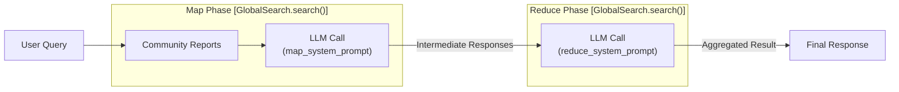

<!-- source: DeepWiki mcp.deepwiki.com · repo microsoft/graphrag · page 3.7 Search Method Configuration · fetched 2026-10-26 -->

# Search Method Configuration

<details>
<summary>Relevant source files</summary>

The following files were used as context for generating this wiki page:

- [docs/blog_posts.md](docs/blog_posts.md)
- [docs/config/yaml.md](docs/config/yaml.md)
- [docs/index/architecture.md](docs/index/architecture.md)
- [docs/index/inputs.md](docs/index/inputs.md)
- [docs/index/overview.md](docs/index/overview.md)
- [docs/prompt_tuning/manual_prompt_tuning.md](docs/prompt_tuning/manual_prompt_tuning.md)
- [docs/query/drift_search.md](docs/query/drift_search.md)
- [docs/query/global_search.md](docs/query/global_search.md)
- [docs/query/local_search.md](docs/query/local_search.md)
- [docs/query/question_generation.md](docs/query/question_generation.md)

</details>


## Purpose and Scope

This page documents the configuration options for GraphRAG's query and search methods: **Local Search**, **Global Search**, **DRIFT Search**, and **Basic Search**. These configurations are defined in the `settings.yaml` file and control how queries are executed against indexed data, including token budgets, retrieval depth, and model selection.

For detailed information about how each search method works algorithmically, see the respective methodology sections for [Local Search](local_search.md), [Global Search](global_search.md), and [DRIFT Search](drift_search.md).

## Configuration Location

Search method configurations are defined as top-level sections in `settings.yaml`, alongside other configuration blocks such as `completion_models` and `embedding_models` [docs/config/yaml.md:14-42]().

```yaml
# settings.yaml structure
completion_models:
  default_completion_model: {...}
  
embedding_models:
  default_embedding_model: {...}

# Search method configurations
local_search: {...}
global_search: {...}
drift_search: {...}
basic_search: {...}
```

**Sources:** [docs/config/yaml.md:14-42](), [docs/config/yaml.md:336-406]()

## Configuration Schema Overview

The following diagram shows how search configurations fit into the overall `GraphRagConfig` structure and reference model definitions.

### Configuration Hierarchy and Code Association

```mermaid
graph TB
    subgraph "GraphRagConfig [graphrag/config/models/graph_rag_config.py]"
        CompletionModels["completion_models<br/>{model_id: ModelConfig}"]
        EmbeddingModels["embedding_models<br/>{model_id: ModelConfig}"]
        
        LocalSearch["local_search<br/>LocalSearchConfig"]
        GlobalSearch["global_search<br/>GlobalSearchConfig"]
        DRIFTSearch["drift_search<br/>DRIFTSearchConfig"]
        BasicSearch["basic_search<br/>BasicSearchConfig"]
    end
    
    subgraph "Model References"
        LocalSearch -->|completion_model_id| CompletionModels
        LocalSearch -->|embedding_model_id| EmbeddingModels
        GlobalSearch -->|completion_model_id| CompletionModels
        DRIFTSearch -->|completion_model_id| CompletionModels
        DRIFTSearch -->|embedding_model_id| EmbeddingModels
        BasicSearch -->|completion_model_id| CompletionModels
        BasicSearch -->|embedding_model_id| EmbeddingModels
    end
    
    subgraph "Implementation Classes [Code Entity Space]"
        LocalSearchImpl["LocalSearch<br/>graphrag.query.structured_search.local_search.search.LocalSearch"]
        GlobalSearchImpl["GlobalSearch<br/>graphrag.query.structured_search.global_search.search.GlobalSearch"]
        DRIFTSearchImpl["DRIFTSearch<br/>graphrag.query.structured_search.drift_search.search.DRIFTSearch"]
        BasicSearchImpl["BasicSearch<br/>graphrag.query.structured_search.basic_search.search.BasicSearch"]
    end
    
    LocalSearch -.->|configures| LocalSearchImpl
    GlobalSearch -.->|configures| GlobalSearchImpl
    DRIFTSearch -.->|configures| DRIFTSearchImpl
    BasicSearch -.->|configures| BasicSearchImpl
```


**Sources:** [docs/query/local_search.md:49-57](), [docs/query/global_search.md:55-69](), [docs/query/drift_search.md:22-28]()

## Local Search Configuration

Local Search combines structured data from the knowledge graph with unstructured text chunks. It identifies entities semantically related to the query and extracts connected relationships, covariates, and community reports [docs/query/local_search.md:5-45]().

### Configuration Fields

| Field | Type | Description | Default |
|-------|------|-------------|---------|
| `prompt` | str | Path to the system prompt file | [docs/prompt_tuning/manual_prompt_tuning.md:59]() |
| `completion_model_id` | str | Key referencing a model in `completion_models` | `default_completion_model` |
| `embedding_model_id` | str | Key referencing a model in `embedding_models` | `default_embedding_model` |
| `text_unit_prop` | float | Proportion of context dedicated to text units | 0.5 |
| `community_prop` | float | Proportion of context dedicated to community info | 0.1 |
| `conversation_history_max_turns` | int | Max turns to include in context | 5 |
| `top_k_entities` | int | Number of entities to retrieve via vector search | 10 |
| `top_k_relationships` | int | Number of relationships to include | 10 |
| `max_context_tokens` | int | Total token budget for context | 4000 |

### Context Building Strategy
The `LocalSearch` implementation uses a `MixedContextBuilder` [docs/query/local_search.md:52]() to prioritize data. This builder filters and ranks candidate entities, text units, community reports, and relationships to fit within the `max_context_tokens` budget based on configured proportions [docs/query/local_search.md:43-46]().

**Sources:** [docs/query/local_search.md:47-57](), [docs/prompt_tuning/manual_prompt_tuning.md:57-65]()

## Global Search Configuration

Global Search uses a map-reduce approach over community reports to answer aggregation queries that require whole-dataset reasoning [docs/query/global_search.md:5-48]().

### Configuration Fields

| Field | Type | Description | Default |
|-------|------|-------------|---------|
| `map_prompt` | str | Path to the map phase prompt | [docs/query/global_search.md:59]() |
| `reduce_prompt` | str | Path to the reduce phase prompt | [docs/query/global_search.md:60]() |
| `knowledge_prompt` | str | Path to the general knowledge prompt | [docs/query/global_search.md:63]() |
| `completion_model_id` | str | Model ID for LLM calls | `default_completion_model` |
| `data_max_tokens` | int | Token budget for the context data | 8000 |
| `map_max_length` | int | Max length for map responses (words) | 300 |
| `reduce_max_length` | int | Max length for reduce responses (words) | 1000 |
| `max_context_tokens` | int | Max tokens for map stage context window | 4000 |
| `allow_general_knowledge` | bool | Include real-world knowledge in reduction | `false` |
| `concurrent_coroutines` | int | Degree of parallelism in map stage | 32 |

### Global Search Dataflow (Code association)


**Sources:** [docs/query/global_search.md:11-69](), [docs/prompt_tuning/manual_prompt_tuning.md:67-80]()

## DRIFT Search Configuration

DRIFT Search (Dynamic Reasoning and Inference with Flexible Traversal) combines global priming with iterative local search refinements to balance computational cost and response quality [docs/query/drift_search.md:7-18]().

### Configuration Fields

| Field | Type | Description | Default |
|-------|------|-------------|---------|
| `prompt` | str | Path to DRIFT system prompt | [docs/prompt_tuning/manual_prompt_tuning.md:83]() |
| `reduce_prompt` | str | Path to reducer prompt | Default path |
| `completion_model_id` | str | Model ID for LLM calls | `default_completion_model` |
| `embedding_model_id` | str | Model ID for vector searches | `default_embedding_model` |
| `n_depth` | int | Number of search steps/iterations | 3 |
| `drift_k_followups` | int | Number of follow-up questions to generate | 5 |
| `primer_folds` | int | Number of folds for search priming | 5 |
| `concurrency` | int | Max concurrent LLM requests | 32 |

### Implementation Components
The `DRIFTSearch` class relies on a `DRIFTContextBuilder` [docs/query/drift_search.md:25]() for preparing context from community reports and a `QueryState` object [docs/query/drift_search.md:28]() to track follow-up actions and execution history.

**Sources:** [docs/query/drift_search.md:20-28](), [docs/prompt_tuning/manual_prompt_tuning.md:81-90]()

## Basic Search Configuration

Basic Search provides a baseline vector RAG implementation that bypasses the knowledge graph, retrieving text units directly via embedding similarity. This is often used for benchmarking GraphRAG against traditional RAG methods.

### Configuration Fields

| Field | Type | Description | Default |
|-------|------|-------------|---------|
| `prompt` | str | Path to the system prompt | Default path |
| `completion_model_id` | str | Model ID for LLM calls | `default_completion_model` |
| `embedding_model_id` | str | Model ID for vector search | `default_embedding_model` |
| `k` | int | Number of text units to retrieve | 10 |
| `max_context_tokens` | int | Total context token budget | 4000 |

**Sources:** [docs/config/yaml.md:397-406]()

## Model Reference and Authentication

Search methods do not define API keys or base URLs directly. Instead, they reference model configurations defined in the `completion_models` and `embedding_models` sections. This separation allows multiple search methods to share the same model instances and authentication settings [docs/config/yaml.md:22-42]().

```yaml
completion_models:
  default_completion_model:
    model_provider: openai
    model: gpt-4o
    api_key: ${GRAPHRAG_API_KEY} # Loaded from .env

local_search:
  completion_model_id: default_completion_model
```

**Sources:** [docs/config/yaml.md:1-16](), [docs/config/yaml.md:22-42]()

---

